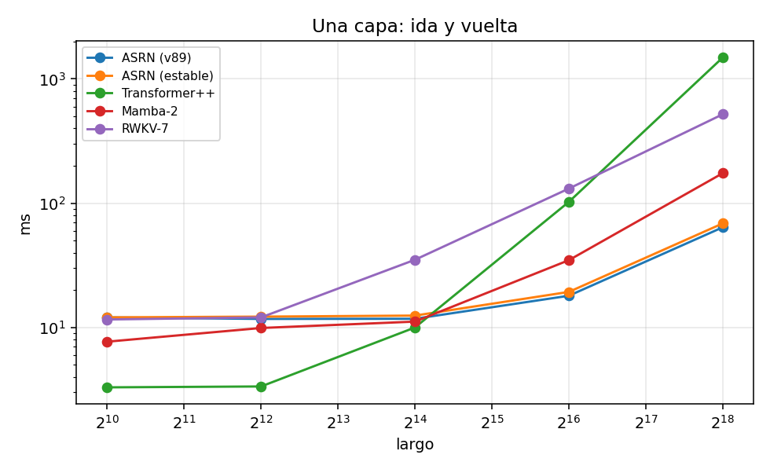
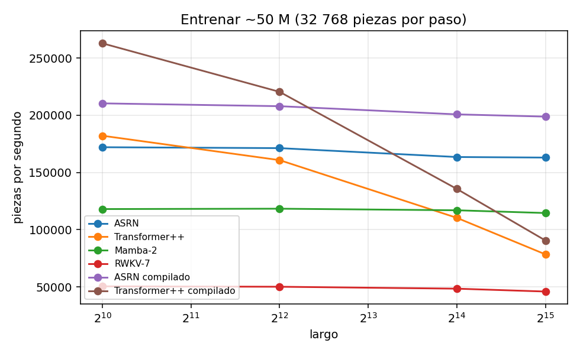
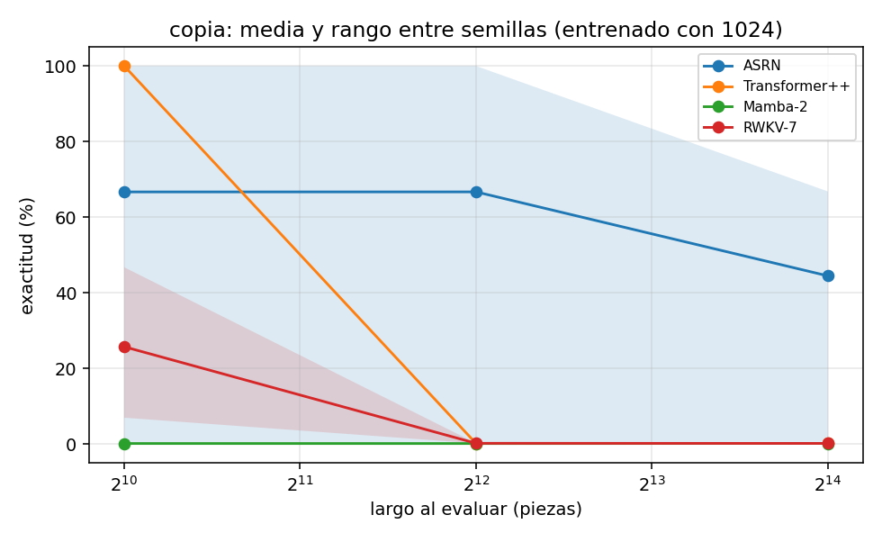
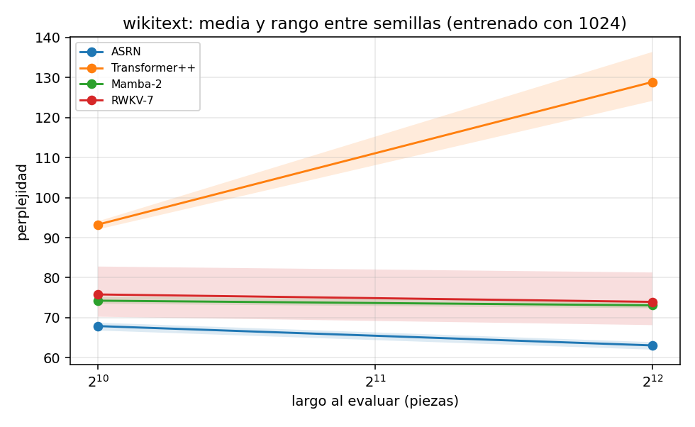

# ASRN — Adaptive Sparse Recurrence Network (Red de Recurrencia Dispersa Adaptativa)

[](https://github.com/KIROKOWA/ASRN/actions/workflows/tests.yml)
[](LICENSE)
[](docs/RELEASE_NOTES_es.md)
[](https://doi.org/10.5281/zenodo.23608503)
[](https://doi.org/10.5281/zenodo.23607506)

**Copia exacta de largo alcance para modelos de lenguaje, con trabajo acotado por pieza: tablas de hash aprendidas
encuentran dónde apareció antes el contexto actual, y una capa con puerta copia lo que vino después.**

[English version](README.md) · [Arquitectura](docs/ARCHITECTURE_es.md) ·
[Reporte técnico](docs/TECHNICAL_REPORT_es.md) · [Notas de la versión](docs/RELEASE_NOTES_es.md) ·
[Resultados](results/README.md) · Versión 1.0 · Licencia Apache 2.0

### Instalar y usar

```bash
pip install git+https://github.com/KIROKOWA/ASRN      # Python >= 3.11, PyTorch >= 2.9; corre en CPU o GPU
```

```python
import torch, asrn

piezas = torch.tensor(list(open(asrn.nucleo.__file__, 'rb').read()))   # los bytes de un texto como piezas (V = 256)
modelo = asrn.crear_modelo(V=256, d=64, n_capas=4, semilla=0)          # bloques locales + capas ASRN (capa estable)
asrn.entrenar(modelo, piezas, largo=256, lote=8, pasos=200)            # AdamW, calentamiento + coseno; imprime pérdidas
secuencias, logits = asrn.escribir(modelo, piezas[:512], n_nuevos=200) # 200 piezas nuevas, trabajo O(1) por pieza
print(bytes(secuencias[0, 512:].tolist()).decode('utf-8', 'replace'))
```

Probado con Python 3.13 y PyTorch 2.11.0 y 2.14.1 (CPU y una NVIDIA A100); la
[integración continua](.github/workflows/tests.yml) corre las dos baterías de pruebas en CPU con Python 3.11 y 3.13.
Para seguir: los [primeros pasos](#primeros-pasos), el [kit para entrenar 100 M](examples/train_100m/README.md) en Colab
o [reproducir el banco en la A100](#reproducir-el-banco) en Colab (unas 4 h 50 min).

---

**ASRN** es una capa de mezcla de secuencia para modelos de lenguaje, distribuida como un paquete de PyTorch que arma,
entrena, guarda y hace escribir modelos completos. Se especializa en un solo trabajo: encontrar dónde apareció antes
en el texto el contexto actual y copiar la pieza (token) que vino después. La atención compara cada pieza con todas las
anteriores, así que su trabajo por pieza crece con el contexto; los modelos de estado fijo como Mamba-2 y RWKV-7 tienen
costo constante por pieza, pero comprimen el pasado en un estado de tamaño fijo, y eso limita el recuerdo exacto y la
copia. ASRN conserva el acceso exacto a las apariciones anteriores sin esa comparación creciente. Hashes de signos
aprendidos (8 tablas de 14 bits) ponen cada posición en un casillero, y cada posición puntúa solo a sus 32 compañeros
de casillero más recientes por tabla. El puntaje combina la similitud de hash, un término de confirmación aprendido,
coincidencias exactas de sufijo de hasta 4 piezas y un *reloj de tiempo propio* aprendido que depende de los datos. La
capa copia el vector de la pieza que siguió a cada coincidencia. Una puerta decide cuánto copiar. Lee intensidades de
Hawkes sobre grupos repetidos de 1 a 4 piezas y una racha de repetición, esta última a través de una respuesta no
monótona aprendida. Todas las recurrencias se calculan con un escaneo asociativo paralelo, con kernels Triton
fusionados en GPU. La memoria de activaciones es O(N), y al entrenar cada pieza puntúa como mucho 8 × 32 candidatos por
capa, sea cual sea el largo (los ordenamientos por casillero y por grupo de piezas son radix en GPU). Escribir paso a
paso cuesta tiempo O(1) por pieza nueva, sea cual sea el largo del texto: cada tabla guarda un anillo con las 32
posiciones más recientes de cada casillero, y la intensidad de Hawkes se lleva por grupo de piezas como un estado que se
actualiza. Su memoria sí crece con el texto, porque lo que se copia hay que guardarlo.

El modelo completo apila bloques locales causales (una convolución corta y una capa densa) y pone una capa ASRN después
de cada dos bloques. No tiene tabla de posiciones. El diagrama muestra el modelo y el interior de una capa ASRN; el
[documento de arquitectura](docs/ARCHITECTURE_es.md) tiene los diagramas detallados, y el
[reporte técnico](docs/TECHNICAL_REPORT_es.md) tiene cada fórmula.

<p align="center"></p>

> Los nombres del código y los comentarios están en español, el idioma del autor. El paquete también exporta alias en
> inglés de sus nombres principales (`asrn.ASRNLayer`, `asrn.create_model`, `asrn.train`, ...; ver
> [Primeros pasos](#primeros-pasos)).

### Por dónde empezar

1. **Instalar** el paquete: [Instalación](#instalación) (`pip install .` desde una copia, o directo desde GitHub).
2. **Probarlo** en CPU en segundos: [Primeros pasos](#primeros-pasos) arma una capa y un modelo completo, y la
   [línea de comandos](#línea-de-comandos) entrena uno.
3. **Comprobarlo**: [Correr las pruebas](#correr-las-pruebas) (76 pruebas en CPU, 7 comprobaciones en GPU).
4. **Reproducir el banco** en CPU o en Colab con una A100: [Reproducir el banco](#reproducir-el-banco). Los resultados
   publicados están en [`results/`](results/README.md).
5. **Entender cómo funciona**: la [arquitectura](docs/ARCHITECTURE_es.md) (diagramas), el
   [reporte técnico](docs/TECHNICAL_REPORT_es.md) (cada fórmula, cada cifra con sus salvedades) y las
   [notas de la versión](docs/RELEASE_NOTES_es.md).
6. **Orientarse**: la [estructura del repositorio](#estructura-del-repositorio) dice qué hay en cada carpeta.

### Qué trae la versión 1.0

- **Un paquete instalable** (`pip install .`). `import asrn` arma modelos cuyas capas ASRN son la *capa estable*
  (`CapaASRNEstable`), con el grupo A de protecciones numéricas encendido. Tiene los mismos parámetros que la capa del
  núcleo de v89 y calcula la misma función salvo el redondeo (1.3·10⁻⁷ en los logits). Los archivos guardados cargan en
  cualquiera de las dos capas, y `asrn.cargar` lee modelos guardados desde v83 hasta v89.
- **Escritura en tiempo O(1) por pieza nueva** (`asrn.escribir`). Coincide con la escritura O(t) anterior y con la
  pasada por el texto entero salvo 2.2·10⁻⁷; ver [Escritura en O(1)](#escritura-en-o1-nuevo-en-10).
- **Una línea de comandos para entrenar**: `python -m asrn` (instalada también como `asrn-train`), con FSDP para
  varios procesos.
- **Un banco de pruebas en una NVIDIA A100** contra Mamba-2 (`mamba_ssm`) y RWKV-7 (`flash-linear-attention`)
  originales y contra nuestro Transformer++. El banco registra lo que favorece a ASRN y lo que no.
- **La historia de desarrollo** de v85–v89 en [`history/`](history/README.md). No forma parte del paquete; se conserva
  porque los documentos la citan como evidencia.

La lista completa de cambios está en las [notas de la versión](docs/RELEASE_NOTES_es.md).

---

## Resultados principales (banco en A100)

Los modelos se entrenaron y midieron en una NVIDIA A100-SXM4-80GB en Colab, el 17 de octubre de 2026, con PyTorch
2.14.1, en bf16. Solo las dos filas de entrenamiento compilado están compiladas; las demás no se compilaron. En las
filas de calidad, cada modelo usó la mejor de dos tasas de aprendizaje (10⁻³, 3·10⁻³) con la semilla 0, y las cifras
son la media ± la desviación estándar de 3 semillas, salvo que la celda diga otra cosa. ASRN es la capa estable de la
versión 1.0 (grupo A). La pasada hacia adelante y los gradientes de 1.0 son idénticos bit a bit a los del código de
esta corrida, así que cada número vale sin cambios para 1.0, salvo el tiempo de escritura, que se midió con la
escritura O(t) anterior (nota ⁴). Cada número de la tabla está en
[`results/banco_a100/`](results/banco_a100/RESUMEN.md), y los valores p de la nota ³ son pruebas t pareadas con sus
valores por semilla. La corrida anterior en la A100 (9 y 11 de octubre, PyTorch 2.11, sin compilar) se conserva
como réplica en [`history/results/banco_a100_pt211/`](history/results/banco_a100_pt211/RESUMEN.md), y la corrida
anterior del desarrollo que cita la nota ³ está en [`history/results/`](history/results/README.md).

| Medición | ASRN 1.0 | Transformer++ | Mamba-2 | RWKV-7 |
|---|---|---|---|---|
| Una capa, ida y vuelta, 1 024 piezas (ms) | 12.1 | **3.3** | 7.7 | 11.6 |
| Una capa, ida y vuelta, 262 144 piezas (ms) | **68.7** | 1 486.0 | 174.3 | 519.4 |
| Una capa, memoria pico con 262 144 piezas (GB) | 10.9 | **5.5** | 8.5 | 21.1 |
| Modelo de ~50 M, entrenamiento con 1 024 piezas por texto (piezas/s) | 172 065 | **182 116** | 118 002 | 50 439 |
| Modelo de ~50 M, entrenamiento con 32 768 piezas por texto (piezas/s) | **163 023** | 78 400 | 114 544 | 45 895 |
| Modelo de ~50 M compilado, entrenamiento con 1 024 piezas por texto (piezas/s) ⁶ | 210 413 | **262 909** | — | — |
| Modelo de ~50 M compilado, entrenamiento con 32 768 piezas por texto (piezas/s) ⁶ | **198 826** | 90 540 | — | — |
| Modelo de ~50 M, escritura con 65 536 piezas de contexto (ms/pieza) ⁴ | 43.1 | **15.2** | 24.5 | 39.5 |
| Copia, exactitud con 4× el largo de entrenamiento (%) | **99.99, 99.98** (2 de 3 semillas) ⁷ | 0.2 ± 0.0 | 0.2 ± 0.0 ¹ | 0.2 ± 0.0 ¹ |
| MQAR, exactitud con 4× los pares de entrenamiento (%) | **99.7 ± 0.4** | 0.3 ± 0.1 ² | 26.1 ± 25.6 | 16.5 ± 9.3 |
| WikiText-103, perplejidad con 1 024 de contexto (~45 M de parámetros) | **67.91 ± 1.00** | 93.27 ± 1.07 ⁵ | 74.25 ± 0.92 | 75.81 ± 6.39 ³ |
| WikiText-103, perplejidad con 4 096 de contexto | **63.08 ± 0.97** | 128.87 ± 6.56 | 73.09 ± 0.88 | 73.96 ± 6.71 |

¹ Mamba-2 no aprendió la copia ni siquiera en el largo de entrenamiento (0.2%), y RWKV-7 no terminó de aprenderla con
este presupuesto (25.8% ± 20.0 en el largo de entrenamiento), así que ninguna de esas dos filas prueba la extrapolación
de largo.
² El Transformer++ no aprendió MQAR con ninguna de las dos tasas en este presupuesto. Es falta de presupuesto o de tasa
en este protocolo, no un límite de la atención.
³ ASRN queda por delante de RWKV-7 en cada semilla, pero la diferencia no es significativa (p pareada = 0.13, n = 3;
0.084 con 4 096 piezas). En una corrida anterior del desarrollo, con otro protocolo y una reimplementación de RWKV-7,
RWKV-7 fue el mejor en texto (47.87 contra 57.02 de ASRN).
⁴ Las cifras de escritura de ASRN (tiempo por pieza, prefijo y memoria) se midieron con la escritura O(t) del código de
esta corrida. 1.0 escribe en O(1) por pieza nueva, y esa escritura todavía no se ha medido en la A100 (en CPU su
tiempo por pieza no crece con el contexto: ver [Escritura en O(1)](#escritura-en-o1-nuevo-en-10)).
Tiempo por pieza nueva con lote 1, medido después del prefijo. El paso del prefijo ahora calcula los logits solo de la
última posición (la corrida anterior los calculaba en las 65 536 posiciones del prefijo del Transformer++). Medido de
nuevo con 65 536 piezas, el prefijo tarda 0.387 s en el Transformer++, 0.140 s en ASRN y 0.139 s en Mamba-2, y la
memoria pico de toda la escritura, con el prefijo, es 2.53, 3.82 y 1.26 GB. El prefijo de RWKV-7 (111–131 s a todo
largo) lo domina la compilación y el ajuste automático de sus kernels de fla.
⁵ En WikiText, el Transformer++ eligió el borde inferior de la grilla de dos tasas (10⁻³; con 3·10⁻³, la semilla 0 dio
159.3), y los otros tres modelos el borde superior (3·10⁻³).
⁶ ASRN compilado por partes (`compilar_partes`) y el Transformer++ con `torch.compile`; el primer paso, que incluye la
compilación, tardó 47.0 s y 26.2 s. Mamba-2 y RWKV-7 no se compilaron.
⁷ El aprendizaje de la copia es bimodal. Las semillas 0 y 2 salieron de la meseta inicial (pérdida < 1 desde el paso
1 000); la semilla 1 se quedó en ella los 2 000 pasos (pérdida final 6.232) y dio 0.15% con 4×, así que la media de las
3 semillas es 66.71 ± 57.64. En la corrida anterior en la A100 aprendieron las 3 semillas (99.87 ± 0.18).

**Salvedades que cambian la lectura.** La compilación aparece solo en las filas de entrenamiento compilado: las
mediciones de una capa, de escritura, de calidad y de la ablación no se compilaron. El Transformer++ es nuestra
implementación de la receta de Llama, con FlashAttention-2 a través de SDPA y con RMSNorm, RoPE y SwiGLU sin fusionar.
Mamba-2 corrió sin `causal-conv1d` y no se compiló, así que su velocidad es pesimista y las ventajas de ASRN sobre
Mamba-2 son cotas superiores; RWKV-7 corrió con los kernels de fla. Las filas de una capa comparan unidades distintas:
el bloque entero de Mamba-2 tiene 2.6 veces los parámetros de la capa ASRN. Con 262 144 piezas la razón entre capas es
2.5, pero entre modelos enteros de ~50 M es 1.4–1.5. La calidad se midió a escala chica: de 2.5 a 46 M de parámetros, y
el entrenamiento en WikiText-103 vio 20 M de posiciones (≈0.44 por parámetro), lejos de converger. El protocolo usó dos
tasas de aprendizaje, tres semillas y un solo corpus de texto, que premia copiar. Con las mismas semillas, el mismo
protocolo y las mismas bibliotecas de los rivales, pero otra versión de PyTorch, las cifras de MQAR de los rivales
cambiaron mucho entre esta corrida y la anterior (Mamba-2 con 4× los pares: 54.4 → 26.1; RWKV-7 en el largo de
entrenamiento: 99.9 → 65.4), muy probablemente por kernels de GPU no deterministas y entrenamiento sin converger,
mientras que ASRN quedó en ≥ 96.45% en cada semilla de las dos corridas. Además, ASRN trae incorporada la coincidencia
exacta de números de pieza, un sesgo inductivo alineado con la copia y MQAR. El
[reporte técnico](docs/TECHNICAL_REPORT_es.md) analiza cada cifra, con sus salvedades.

<p align="center">
  
  
</p>
<p align="center">
  
  
</p>

*La misma carpeta tiene también las gráficas de MQAR, la memoria de una capa, la escritura y la ablación.*

### Dónde ASRN va por delante y dónde no

**Va por delante, en este banco:**

- **La velocidad de entrenamiento casi no cambia con el largo** (−5.3% de 1 024 a 32 768 piezas). Un modelo de ~50 M
  entrena a 163–172 mil piezas/s con textos de 1 024 a 32 768 piezas. ASRN pasa al Transformer++ entre 1 y 4 mil
  piezas (~2.4 mil interpolando) y es 2.08 veces más rápido con 32 mil. Es 1.4–1.5 veces más rápido que Mamba-2 sin
  fusionar a todo largo y 3.4–3.6 veces más rápido que RWKV-7. Compilado, ASRN entrena a 199–210 mil piezas/s
  (1.21–1.23 veces su velocidad sin compilación), pasa al Transformer++ compilado hacia las ~5.4 mil piezas y es 2.20
  veces más rápido con 32 mil.
- **Una capa con textos muy largos.** Desde ~20 mil piezas, la capa ASRN es la más rápida de las medidas. Con 262 144
  piezas es 21.6 veces más rápida que la atención, 2.5 veces más que un bloque de Mamba-2 y 7.6 veces más que RWKV-7. A
  cambio usa 2.0 veces la memoria de la atención y 1.3 veces la de Mamba-2, y cerca de la mitad que RWKV-7.
- **Recuperar algo exacto más allá del largo entrenado.** Cuando ASRN sale de la meseta inicial de la copia, copia con
  4 veces el largo de entrenamiento con ≥ 99.98% (2 de 3 semillas aquí; 3 de 3, ≥ 99.67%, en la corrida anterior),
  donde el Transformer++ cae al azar. Con 2 y 4 veces los pares de MQAR acierta 99.99% y 99.75%, contra 57.17% y 26.09%
  de Mamba-2 y 34.16% y 16.51% de RWKV-7 (p pareada con 2× y 4×: 0.090, no significativa, y 0.039 contra Mamba-2;
  0.025 y 0.0041 contra RWKV-7). Son las tareas que coinciden con la coincidencia exacta que ASRN trae incorporada.
- **Perplejidad en WikiText-103 con este presupuesto chico**, con todas las salvedades de arriba. ASRN es el mejor en
  cada semilla, con diferencia significativa contra el Transformer++ y Mamba-2 (p pareada ≤ 0.008) pero no contra
  RWKV-7 (p = 0.13 y 0.084).

**No va por delante:**

- **Textos cortos con lote 1.** Hasta 16 mil piezas, una capa ASRN tarda unos 12 ms sin importar el largo, contra
  3.3–10.0 ms de la atención y 7.7–11.1 ms de Mamba-2. Ese piso es probablemente el costo de lanzar muchos kernels
  chicos sin compilación (no se perfiló en esta corrida). En el desarrollo, CUDA Graphs bajó una capa con 1 024 piezas
  de 11.4 a 1.6 ms. En el modelo de ~50 M con 1 024 piezas, el Transformer++ es 6% más rápido, y 25% más rápido si se
  compilan los dos.
- **Memoria por capa.** Una capa ASRN necesita unos 40 KiB de memoria pico de entrenamiento por pieza, contra 20 KiB de
  la atención y 31 KiB de un bloque de Mamba-2 (RWKV-7: 79 KiB).
- **Escritura en la A100.** Fue la más lenta de las cuatro con lote 1 (43 ms por pieza), medida con la escritura O(t)
  del código de esta corrida. En la GPU el tiempo fue plano con el contexto (pendiente de 3.0 ns por pieza de contexto,
  IC 95% de −25 a 31 ns), probablemente porque lo dominan los lanzamientos de kernels (no se perfiló), así que el
  término O(t) no se notó. 1.0 escribe en O(1) por pieza nueva, pero esa escritura todavía no se ha medido en la
  A100; en CPU quita el crecimiento con el contexto (ver [Escritura en O(1)](#escritura-en-o1-nuevo-en-10)).
- **Velocidad para aprender dentro del largo entrenado.** El Transformer++ aprende la copia en ≤ 200 pasos. Con la
  misma tasa, ASRN necesita 1 000 pasos cuando sale de la meseta inicial (1 000–1 200 en la corrida anterior), y salir
  de ella en 2 000 pasos no está garantizado (salió en 5 de 6 entrenamientos de la base en las dos corridas en la
  A100). No se comparó nada a igual cómputo.

### Lo que muestra la ablación

La capa ASRN separa dos responsabilidades de diseño. La **recuperación** decide *de dónde copiar*: la atención dispersa
por casilleros (tablas de hash aprendidas, ventanas de candidatos y puntajes con sufijo exacto, confirmación y el
término de tiempo) hace la recuperación exacta. La **regulación** decide *si copiar y cuándo parar*: la puerta, el reloj
de tiempo propio y las señales de Hawkes y de racha regulan la copia al escribir libremente. En la A100 se quitó cada
pieza, una a la vez, en copia y MQAR, con 3 semillas y las tasas de la base (10⁻³ en copia, 3·10⁻³ en MQAR); la base es
la misma corrida de calidad.

1. **El núcleo de recuperación resuelve copia y MQAR.** Sin la capa ASRN (`solo_local`) las dos tareas quedan en el
   azar en 3 de 3 semillas. Esto vale por construcción, porque los bloques locales solo ven las últimas 13 piezas.
2. **Los mecanismos de regulación no interfieren en las tareas de copia pura.** En copia y MQAR, el 100% de las
   posiciones evaluadas pide copiar, así que el núcleo de recuperación basta por sí solo. La presencia de los mecanismos
   de regulación no degrada la recuperación exacta (≥ 99.98% en copia con 4× el largo de entrenamiento en las semillas
   que aprendieron, 99.75% en MQAR con 4× los pares), y quitarlos tampoco la cambia. Cada corrida de copia de la base y
   de las variantes de regulación que salió de la meseta inicial da ≥ 99.89% con 4×, y las medias de MQAR con 4× los
   pares son 99.75 (la base), 99.94 (`sin_puerta`), 99.50 (`puerta_sin_senales`), 99.95 (`sin_reloj`), 99.53
   (`sin_hawkes_racha`), 99.69 (`sin_sufijo`) y 99.88 (`sin_confirmacion`). El aprendizaje de la copia es bimodal, y la
   semilla 1 es la difícil: se quedó en la meseta los 2 000 pasos en la base misma y sin la puerta, sin el reloj y con
   el grupo B (`sin_sufijo` falló en cambio con la semilla 0). Como la base misma falló con la semilla 1, una semilla
   fallida en una variante no se puede atribuir a la pieza quitada. Sumando las dos corridas en la A100 (6
   entrenamientos por variante), la copia se aprendió en 5 de 6 en la base, en 4 de 6 sin la puerta, sin el reloj o sin
   el sufijo, y en 6 de 6 con una puerta que no ve las señales, sin las señales de Hawkes y de racha y sin la
   confirmación.
3. **Su papel activo se valida en escritura libre, en condiciones controladas.** En un experimento sintético controlado
   con citas de largo acotado ([`benchmarks/experimento_citas.py`](benchmarks/experimento_citas.py): piezas al azar con
   citas de 6 a 12 piezas de vez en cuando; 2 bloques locales y 1 capa ASRN, d = 64, 6 000 pasos, 3 semillas;
   [resultados](results/citas/RESUMEN.md)), la capa completa de 1.0 se comparó con la misma capa sin las señales de
   Hawkes y de racha, con una puerta que solo ve el estado oculto, sin puerta y sin el reloj de tiempo propio. Solo con
   la pérdida del modelo de lenguaje y sin supervisión explícita, la puerta de la capa completa aprendió a empujar la
   copia cuando empieza una cita (+0.6 a +0.8 con una racha de una pieza) y a cerrarse con fuerza cuando la racha supera
   las citas de los datos (−7.7 a −9.2 desde 12 piezas). Así frena el *aliasing de estado*: sin la racha, una cita de 5
   piezas y una de 50 son el mismo estado. Con el muestreo por omisión (T = 0.8, top-k 40), la racha de repetición
   escrita más larga es de 10 piezas con la capa completa (texto real: 10), contra 21 sin las señales de Hawkes y de
   racha, 27 con una puerta que no ve las señales y 23 sin puerta; las rachas de más de 9 piezas son el 0.3% de todas
   (texto real: 0.9%), contra 7.2%, 9.3% y 11.8%. Quitar solo las señales de Hawkes y de racha casi no cambia la pérdida
   de validación (3.703–3.706 contra 3.707–3.708): el efecto se ve en lo que el modelo escribe, no en su pérdida. Sin el
   reloj, la capa escribe como la completa (racha más larga 10, 0.2% de rachas de más de 9, la misma pérdida): esta
   tarea no tiene cambios de tema, que es para lo que está el reloj, así que su papel falta probarlo. Un límite
   conocido: cuán seguido empiezan las citas no está calibrado (fracción citada 20.9% con T = 0.8 y 9.3% con T = 1,
   contra 15.6% del texto real). El mismo experimento en la A100 ([resultados](results/citas_a100/RESUMEN.md))
   reproduce el resultado. La puerta aprendió la misma respuesta (+0.6 a +0.7 con una racha de una pieza, −7.6 a −8.4
   desde 12 piezas); con el muestreo por omisión la racha más larga es de 10 piezas con la capa completa, contra 19, 39
   y 21, y las rachas de más de 9 piezas son el 0.3%, contra 7.9%, 9.2% y 12.0%. En los cuatro modos de muestreo, la
   racha más larga de cada semilla va de 9 a 12 con la capa completa y de 9 a 10 sin el reloj, contra 14 a 24 sin las
   señales de Hawkes y de racha, 15 a 39 con una puerta que no ve las señales y 18 a 31 sin puerta. La pérdida de
   validación vuelve a casi no cambiar sin esas señales (3.703–3.705 contra 3.706–3.709).
4. **Refinamientos de la recuperación.** El sufijo exacto, la confirmación y el número de tablas refinan la
   recuperación; su aporte individual no se puede separar en estas tareas saturadas. Con solo dos tablas, la copia se
   aprendió en 1 de 3 semillas en cada corrida en la A100, lo que sugiere un efecto. Mezclar las tablas por log-suma-exp
   (`mezcla_lse`) salió de la meseta de la copia hacia el paso 400 en 3 de 3 semillas en la corrida anterior, pero eso
   no se reprodujo: aquí aprendió la copia en 1 de 3 semillas. En MQAR, ya corregido el error de implementación que la
   hizo divergir en la corrida anterior, ya no diverge, pero no aprende (≤ 3.61% con 4× los pares). Cada corrida tarda
   61–62% más (solo existe en PyTorch) y no se adopta en 1.0. El grupo B de protecciones, apagado por omisión, no
   mostró un costo ni un efecto consistentes.

La ablación a gran escala de los mecanismos de regulación en corpus naturales con distractores y cambios de tema está
prevista para v1.1 (ver la [hoja de ruta](#hoja-de-ruta--trabajo-futuro-v11)). La sección 7 del
[reporte técnico](docs/TECHNICAL_REPORT_es.md) revisa cada pieza.

### Estabilidad numérica (nuevo en 1.0)

Una revisión de la capa del núcleo de v89 reprodujo las fallas siguientes. La capa estable cierra cada una.

| Falla de la capa del núcleo | Medido (en la A100 salvo que se indique) | Capa estable |
|---|---|---|
| La máscara causal es un puntaje de −10⁹, no −∞. Con un núcleo de tiempo extremo, el softmax manda su masa a llaves no válidas, entre ellas piezas futuras | El futuro cambia el pasado en 0.016 con γ = 10⁹ (kernel Triton) | 0 exacto (`mascara_exacta`) |
| El reloj de 32 bits B_t = Σβ, calculado con el `cumsum` de CUDA | El error de B_t − B_{t−1} es 2.2% con 2²⁰ piezas, 8.6% con 2²² y 50% con 2²⁴. El reloj deja de avanzar en el 1.1% de los pasos con ~4 M de piezas y en el 16% con ~16 M | Reloj de 64 bits, partido en dos mitades de 32 bits en el kernel (`reloj_64`) |
| El puntaje cancela valores grandes del reloj | Con el reloj corrido 10⁶, 1.6·10⁷ y 10⁹, la salida se mueve 9.4·10⁻⁵, 2.8·10⁻³ y 8.8·10⁻² | 5.5·10⁻⁸, igual con los tres corrimientos (sin TF32) |
| TF32 en la proyección del reloj | B_t se mueve 2.0 unidades en 65 536 piezas | 1.2·10⁻¹⁰ (`_ProyeccionIEEE`) |
| β no tiene techo | B se desborda y la capa da NaN (reproducido en una prueba en CPU) | β ≤ 10⁴ (`beta_max`) |

El grupo A incluye además dos topes preventivos, `log_alfa_min` y `mejor_max`. Las fallas que evitan se dedujeron del
código y no se midieron. En la A100, el grupo A entero cuesta +7.5% de tiempo y +5.2% de memoria con 262 144 piezas
(+4–5% de memoria a todo largo), medido con `_ProyeccionIEEE` incluida. La protección conviene desde ~1 millón de piezas
por texto y hace falta desde ~16 millones. El grupo B (`tope_puerta`, `kappa_min`) cambia la función, así que está
apagado por omisión y pensado para entrenar desde cero con textos largos. `RecorteDinamico` recorta el gradiente por
grupos de parámetros (reloj, puerta, resto) con un umbral que se adapta.

### Escritura en O(1) (nuevo en 1.0)

Escribir paso a paso (`asrn.escribir`) cuesta tiempo O(1) por pieza nueva, sin importar cuánto texto haya; antes de
1.0 era O(t). Cada tabla guarda, por casillero, un anillo con las 32 posiciones más recientes, que son justo las
llaves que la escritura anterior elegía entre toda la memoria, así que la pieza nueva puntúa solo a sus 8 × 32
candidatos. La intensidad de Hawkes se lleva por llave de grupo de piezas (el reloj y la intensidad en la última
aparición de la llave), con la misma recurrencia que usa el escaneo del texto entero, y la racha de repetición es un
solo número. En CPU, la escritura O(1) es igual a la escritura O(t) anterior y a la pasada por el texto entero salvo
2.2·10⁻⁷, y `escribir()` da las mismas secuencias de piezas que la implementación anterior en 192 de 192 combinaciones
de opciones de muestreo.

Tiempo por pieza nueva en CPU ([`results/escritura_cpu/`](results/escritura_cpu/RESUMEN.md),
[`benchmarks/medir_escritura.py`](benchmarks/medir_escritura.py)): 4 hilos, PyTorch 2.14.1, un modelo ASRN de
700 484 parámetros, lote 1, sin muestrear, mediana de 9 tandas de 32 piezas, las dos escrituras alternadas en cada
contexto.

| Contexto (piezas) | Escritura O(1) (ms/pieza) | Escritura O(t) (ms/pieza) | Escritura O(1), prefijo (s) | Escritura O(t), prefijo (s) |
|---|---|---|---|---|
| 512 | **12.45** | 15.80 | 0.10 | 0.06 |
| 2 048 | **12.47** | 16.73 | 0.26 | 0.20 |
| 8 192 | **10.68** | 19.02 | 0.77 | 0.70 |
| 32 768 | **11.26** | 37.12 | 3.60 | 2.73 |
| 131 072 | **9.49** | 91.67 | 29.04 | 20.44 |

La pendiente del tiempo por pieza contra el contexto es de −19.21 ns por pieza de contexto con la escritura O(1)
(IC 95% de −41.54 a 3.12, indistinguible de cero) y de 583.31 ns con la escritura O(t) (IC 95% de 537.13 a 629.49).
Con 131 072 piezas la escritura O(1) es 9.7 veces más rápida por pieza, y 1.27 veces con 512. Su paso por el prefijo
además llena los anillos y el estado de Hawkes, lo que se perfiló en unos 0.3 s con 32 768 piezas y 1.3 s con 131 072;
las diferencias de la tabla son mayores porque el tiempo del prefijo varía de una corrida a otra en esta máquina
compartida de 4 núcleos (el mismo paso por el prefijo tardó de 14.8 a 23.5 s con 131 072 piezas en cuatro
repeticiones). La memoria sigue creciendo con el texto (lo que se guarda de cada posición), más anillos fijos de 17 MiB
por capa ASRN y por texto con los tamaños por omisión, unos 120 MiB por texto en el modelo de ~50 M del banco. La
escritura O(1) todavía no se ha medido en la A100: las cifras de escritura en la A100 de arriba son de la escritura
O(t), y la sección de escritura del cuaderno ahora corre la escritura O(1), así que la próxima corrida en Colab la mide.

---

## Instalación

```bash
pip install git+https://github.com/KIROKOWA/ASRN   # solo el paquete, directo desde GitHub
# o desde una copia, con las pruebas, el banco y los ejemplos:
git clone https://github.com/KIROKOWA/ASRN.git
cd ASRN
pip install .                  # Python >= 3.11, PyTorch >= 2.9, NumPy
pip install ".[bench]"         # opcional, para el banco: flash-linear-attention, datasets, tiktoken, einops, matplotlib
```

`requirements.txt` trae las mismas dependencias (`torch>=2.9`, `numpy`) para usar el código desde la carpeta sin
instalarlo. `mamba-ssm` no forma parte del extra `bench` y se instala aparte (el cuaderno de la A100 lo instala).

- **GPU y Triton.** En CUDA, la atención por casilleros y el escaneo asociativo corren como kernels Triton cuando
  Triton se puede importar. Triton es opcional: sin él, o en CPU, cada kernel tiene un camino en PyTorch que calcula
  lo mismo salvo el redondeo. `ASRN_TRITON=0` apaga los kernels, y `TRITON_INTERPRET=1` los corre en el intérprete de
  Triton en CPU, que comprueba las cuentas pero no la velocidad.
- **Precisión.** Los pesos van en float32, y la velocidad de bf16 se obtiene con autocast
  (`entrenar(..., precision='bf16')`, o `torch.autocast` al usar el modelo). La capa mezcla cuentas en 32 y 64 bits,
  así que convertir el modelo con `.to(torch.bfloat16)` o `.half()` se rechaza con un error explícito.
- **Compilación.** `torch.compile` de este modelo necesita PyTorch ≥ 2.14. Compilar por partes (`compilar='partes'`,
  `--compilar` o `asrn.compilar_partes(modelo)`) compila los bloques locales y las partes chicas de cada capa ASRN, y
  conserva los kernels Triton. En el desarrollo fue lo más rápido en GPU para el modelo del núcleo (+26% de velocidad de
  entrenamiento en una A100). En el banco de la versión 1.0 (`results/banco_a100/`, PyTorch 2.14.1) sube la velocidad
  de entrenamiento del modelo de ~50 M 1.21–1.23 veces a todo largo; las otras secciones del banco no se compilaron.
- **Colab.** [`benchmarks/asrn_colab.ipynb`](benchmarks/asrn_colab.ipynb)
  ([abrir en Colab](https://colab.research.google.com/github/KIROKOWA/ASRN/blob/main/benchmarks/asrn_colab.ipynb))
  corre todas las pruebas, el banco completo en una A100 y el experimento de citas con PyTorch 2.14, y
  [`examples/train_100m/`](examples/train_100m/README.md)
  ([abrir en Colab](https://colab.research.google.com/github/KIROKOWA/ASRN/blob/main/examples/train_100m/entrenar_asrn_100m.ipynb))
  es un kit de Colab, listo para correr, para entrenar un modelo de 103.5 M de parámetros con FineWeb (su primera
  corrida está en la [hoja de ruta](#hoja-de-ruta--trabajo-futuro-v11)).

## Primeros pasos

**Una capa sola y un modelo completo** (corre en CPU en segundos):

```python
import torch
import asrn

# Una capa ASRN para un modelo de ancho d = 64: asrn.CapaASRNEstable(d, protecciones=None, **opciones de la capa).
capa = asrn.CapaASRNEstable(64)                  # la capa estable, grupo A de protecciones
E = torch.randn(2, 256, 64)                      # vectores de pieza   (lote, largo, d)
h = torch.randn(2, 256, 64)                      # estado              (lote, largo, d)
x = torch.randint(0, 32000, (2, 256))            # números de pieza    (lote, largo), para la coincidencia exacta
salida = capa(E, h, x)                           # (lote, largo, d): h más lo que copió la capa

# Un modelo de lenguaje completo: bloques locales, con una capa ASRN después de cada dos bloques.
modelo = asrn.crear_modelo(V=32000, d=64, n_capas=4, semilla=0)
logits = modelo(x)                               # (lote, largo, V)
```

Dentro del modelo, `E` es el vector de cada pieza y `h` la salida del bloque local anterior.

El paquete también exporta alias en inglés de sus nombres principales, que son los mismos objetos
(`asrn.train is asrn.entrenar`): `ASRNLayer` (= `CapaASRNEstable`), `ASRNCoreLayer` (= `CapaASRN`), `ASRNModel`
(= `ModeloASRN`), `ASRNConfig` (= `ConfigASRN`), `LocalBlock` (= `BloqueLocal`), `Protections` (= `Protecciones`),
`DynamicClip` (= `RecorteDinamico`), `create_model`, `create_from_config`, `convert`, `train`, `evaluate`, `generate`
(= `escribir`), `save` y `load`. Los argumentos y los métodos conservan sus nombres en español (`V`, `d`, `n_capas`,
`semilla`, `largo`, `lote`, `pasos`, ...).

**Elegir un tamaño, entrenar, cargar, evaluar y escribir.** `piezas` es un tensor 1D de números de pieza de cualquier
tokenizador.

```python
import asrn

# ConfigASRN.para_parametros busca una forma para cualquier tamaño (cuenta exacta, sin gastar memoria).
cfg = asrn.ConfigASRN.para_parametros('50m', V=32000)
print(cfg.d, cfg.n_capas, cfg.contar_parametros())      # 600 9 48623832
modelo = asrn.crear_desde_config(cfg, semilla=0).to('cuda')
# o a mano: modelo = asrn.crear_modelo(V=32000, d=512, n_capas=12, semilla=0)

# Entrenar: AdamW, calentamiento + coseno, autocast bf16 en GPU, pasos con NaN saltados, Ctrl+C guarda.
# Escribe modelo.pt (pesos, optimizador y paso, para reanudar) y modelo.mejor.pt (mejor validación, solo pesos).
historial = asrn.entrenar(modelo, piezas, validacion=piezas_val, largo=1024, lote=16, pasos=20000, lr=1e-3,
                          guardar_en='modelo.pt',
                          recorte=asrn.RecorteDinamico(modelo))   # opcional; por omisión, recorte global en 1.0
# Para seguir después: asrn.entrenar(modelo, piezas, ..., reanudar='modelo.pt').

# Cargar, evaluar y escribir.
modelo = asrn.cargar('modelo.mejor.pt', dispositivo='cuda')
print(asrn.evaluar(modelo, piezas_val, largo=1024))      # {'perdida': ..., 'perplejidad': ..., 'piezas': ...}
secuencias, logits = asrn.escribir(modelo, inicio, n_nuevos=200, temperatura=0.8, top_k=40)
# inicio: (largo,) o (lote, largo). escribir devuelve (inicio + piezas nuevas, logits de cada paso) en la CPU;
# con devolver_logits=False, (secuencias, None). asrn.guardar(modelo, 'archivo.pt') guarda configuración + pesos.
```

**Entrenar desde cero con textos largos.** Se agrega el grupo B de protecciones, que acota el logit de la puerta y pone
un piso a las tasas de olvido de Hawkes y de la racha, para que las intensidades queden en el rango visto al entrenar:

```python
proteccion = asrn.Protecciones.textos_largos(largo_entrenamiento=4096)
modelo = asrn.crear_modelo(V=32000, d=512, n_capas=12, semilla=0, protecciones=proteccion)
```

**El núcleo sin protecciones.** `asrn.nucleo` es el código de v89 con la `CapaASRN` original, y
`Protecciones.ninguna()` la reproduce bit a bit. `asrn.convertir` cambia en su lugar las capas ASRN de un modelo por
capas estables, con los mismos pesos:

```python
import asrn.nucleo
nucleo = asrn.nucleo.crear_modelo(V=32000, d=512, n_capas=12, semilla=0)   # CapaASRN, sin protecciones
asrn.convertir(nucleo)                                                      # ahora CapaASRNEstable, grupo A, mismos pesos
```

**Elegir un tamaño.** `ConfigASRN.para_parametros(objetivo, V, **fijos)` acepta un número o un texto ('3k', '50m',
'1.5b', 7e9). Busca el ancho y la profundidad con una cuenta exacta de parámetros en forma cerrada, y respeta lo que
fijes (por ejemplo `d=512` o `n_capas=12`). Entre las formas que quedan a menos de 3% del objetivo, elige la de
proporción ancho / capas más cercana a 64. Es una regla de forma razonable, no un óptimo medido. Si ninguna forma queda
a menos de 50%, da un error que explica por qué. `asrn.TALLAS` tiene configuraciones de ejemplo, de `'nano-3k'` a
`'27b'`. Poder armar y repartir un modelo de cierto tamaño no dice nada de qué tan bien aprende. Con la receta de 1.0,
el modelo más grande entrenado para medir calidad tiene ~45 M de parámetros (WikiText-103; los modelos de ~51 M del
banco de velocidad solo se cronometraron). Versiones anteriores, con otra forma, entrenaron uno de ~300 M. Las
configuraciones de `'1b'` en adelante nunca se han entrenado.

Otras entradas: `checkpoint='asrn'` o `'todo'` recalcula capas en la vuelta para ahorrar memoria.
`crear_desde_config(cfg, dispositivo='meta')`, seguido de `repartir_fsdp` y `materializar`, arma un modelo repartido
que nunca existe entero en un solo proceso. `PasoGrafado` graba un paso de entrenamiento entero como CUDA Graph.

## Línea de comandos

`python -m asrn` (o `asrn-train` después de `pip install .`) entrena un modelo con la capa estable.
`python -m asrn.nucleo` acepta las mismas opciones y entrena el núcleo sin protecciones. (Con esta forma Python muestra
un `RuntimeWarning` de `runpy`, porque el paquete ya importó `asrn.nucleo`; el entrenamiento corre normalmente.)

```bash
# una GPU: elegir un tamaño con --parametros (necesita --V), o tomar un ejemplo con --talla
python -m asrn --datos piezas.bin --V 32000 --parametros 125m --guardar modelo.pt
asrn-train --datos piezas.bin --talla 125m --largo 1024 --lote 16 --pasos 20000 --checkpoint todo --guardar modelo.pt

# varias GPUs con FSDP (lanzar con torchrun; usar --ancho en vez de --d)
torchrun --nproc_per_node=8 -m asrn --fsdp --parametros 1b --V 32000 --datos piezas.bin --guardar modelo.pt

# reanudar desde el archivo de --guardar (trae el estado del optimizador y el paso); pasar el --pasos original
python -m asrn --datos piezas.bin --reanudar modelo.pt --guardar modelo.pt --pasos 20000
```

| Opción | Qué hace |
|---|---|
| `--datos`, `--validacion` | Números de pieza: `.pt` (tensor 1D), `.bin` / `.u16` (uint16 crudo), `.i32` / `.u32` (int32 crudo). Sin `--validacion`, se aparta la última `--fraccion_val` de los datos (por omisión 0.01) |
| `--V`, `--parametros`, `--talla` | Tamaño del vocabulario; número de parámetros buscado (`3k`, `50m`, `1.5b`); o un ejemplo de `TALLAS` |
| `--ancho` / `--d`, `--capas`, `--largo_cada` | Ancho, número de bloques locales, una capa ASRN cada *n* bloques (por omisión 2) |
| `--mezcla`, `--memoria_max`, `--dropout` | Bloque local: `conv` (la receta del lanzamiento) o `memoria` (en prueba); con `memoria`, piezas que recuerda (1024); dropout (0) |
| `--largo`, `--lote`, `--acumular`, `--pasos` | Piezas por texto (512), textos por lote (16), lotes acumulados (1), pasos (20000) |
| `--lr`, `--calentamiento`, `--decaimiento` | Tasa de aprendizaje (1e-3), pasos de calentamiento (por omisión 2% de los pasos, como mucho 2 000), decaimiento de pesos (0.1) |
| `--precision` | `auto` (bf16 en las GPUs que lo soportan), `fp32`, `bf16`, `fp16` |
| `--checkpoint [asrn\|todo]` | Recalcular en la vuelta las capas ASRN, o todo |
| `--compilar [partes\|todo]` | `torch.compile` por partes (sin valor; PyTorch ≥ 2.14) o del modelo entero |
| `--fsdp` | Repartir el modelo entre los procesos de torchrun |
| `--evaluar_cada`, `--guardar`, `--guardar_cada`, `--reanudar`, `--semilla` | Cada cuánto validar (500), archivo de salida (`modelo.pt`), cada cuánto guardar (1000), archivo para reanudar, semilla (0) |

`python -m asrn --help` lista todas las opciones. El archivo `.mejor.pt` trae solo los pesos, así que se carga con
`asrn.cargar()`.

## Correr las pruebas

```bash
python tests/test_nucleo.py          # 57 pruebas del núcleo (minutos en CPU)
python tests/test_nucleo.py fsdp     # solo las pruebas cuyo nombre contiene "fsdp"
python tests/test_estable.py         # 19 pruebas de la capa estable, la API del paquete y los alias en inglés
python tests/verificar_gpu.py        # 7 comprobaciones en GPU: bf16, memoria con checkpoint, FSDP con NCCL,
                                     #   torch.compile, GPU = CPU, causalidad, escribir paso a paso = texto entero
```

Las pruebas del núcleo cubren los kernels Triton contra sus caminos en PyTorch, la escritura O(1) contra la O(t) y
contra la pasada por el texto entero, el checkpoint de gradientes, guardar, cargar y reanudar, la construcción en el
dispositivo `meta`, FSDP2 con dos procesos en CPU, la causalidad y los casos límite. En CPU, los kernels Triton corren
en el intérprete. En 1.0 las dos baterías pasan completas en CPU con Python 3.13.16, PyTorch 2.14.1 y Triton 3.8.0:
57 / 57 y 19 / 19 (76 pruebas). La corrida en la A100 del 17 de octubre de 2026 (PyTorch 2.14.1) pasó las baterías de
ese momento, 55 / 55 y 18 / 18, y las comprobaciones en GPU 7 / 7, incluida la de `torch.compile` (ver
[`results/banco_a100/`](results/banco_a100/RESUMEN.md)). Con PyTorch 2.11.0 pasan 55 pruebas del núcleo y se saltan las
dos de `torch.compile` (necesitan 2.14), y la batería de la capa estable pasa 19 / 19; con esa versión, Triton 3.6 corre
las pruebas de los kernels en su intérprete solo con NumPy < 2.4. La [integración continua](.github/workflows/tests.yml)
corre las dos baterías en CPU con Python 3.11 y 3.13; sin Triton, se saltan las pruebas de kernel contra PyTorch. Ver
las [notas de la versión](docs/RELEASE_NOTES_es.md#verificación).

## Reproducir el banco

**En CPU**, para el costo exacto por capa (FLOPs y bytes guardados para la vuelta), la latencia, la escritura y la
calidad a escala chica:

```bash
python benchmarks/banco_asrn.py costo latencia escritura            # ~5 min
TRITON_INTERPRET=1 python benchmarks/banco_asrn.py costo_kernel     # bytes guardados con el kernel Triton
python benchmarks/banco_asrn.py calidad ablacion --tareas copia,mqar   # horas en CPU
python benchmarks/banco_asrn.py resumir                             # tablas en results/banco_cpu/RESUMEN.md
python benchmarks/medir_escritura.py                                # escrituras O(1) y O(t): results/escritura_cpu/
```

Estos comandos escriben en `results/banco_cpu/` (`medir_escritura.py` en `results/escritura_cpu/`) y reemplazan los
resultados publicados; agrega `--salida /tmp/banco_cpu` (u otra carpeta) a cada comando para conservarlos.

La tarea de texto en CPU lee la documentación de Vim 9.1 de `/usr/share/vim/vim91/doc` (paquete `vim-runtime`).

**En una A100**, abre [`benchmarks/asrn_colab.ipynb`](benchmarks/asrn_colab.ipynb) en Colab con un entorno A100 y
elige *Ejecutar todas*:

[](https://colab.research.google.com/github/KIROKOWA/ASRN/blob/main/benchmarks/asrn_colab.ipynb)
**Reproducir el banco en la A100 en Colab** (entorno A100; la corrida completa tarda unas 4 h 50 min).

Este único cuaderno corre todo en la GPU con PyTorch 2.14: instala PyTorch 2.14.1 (la sesión se reinicia una vez;
después, *Ejecutar todas* otra vez), las baterías de pruebas y las 7 comprobaciones en GPU, la estabilidad en GPU, una
capa, el modelo de ~50 M (también compilado), la escritura (ahora con la escritura O(1)), copia, MQAR, WikiText-103, la
ablación y el experimento de citas acotadas. Instala los rivales originales; si uno no entrena en esa GPU, usa en su
lugar la reimplementación de `rivales_lineales.py` y lo anota en la columna `implementacion`. Guarda cada sección en
Google Drive apenas termina y retoma solo si Colab se desconecta. La corrida completa del 17 de octubre de 2026 tardó
~4.7 h de secciones en una A100 (la primera celda del cuaderno da el tiempo de cada sección), y sus resultados están en
`results/banco_a100/` y `results/citas_a100/`; un modo rápido se estima en ~1 h 45 min.

**El experimento de citas acotadas** (en CPU; el cuaderno de Colab también lo corre en la GPU, en
`results/citas_a100/`) entrena la capa estable completa de 1.0 y cuatro variantes (`sin_hawkes_racha`,
`puerta_sin_senales`, `sin_puerta`, `sin_reloj`) con texto sintético que trae citas de largo acotado, y compara lo que
escribe cada una con la continuación real:

```bash
python benchmarks/experimento_citas.py --semillas 0 1 2   # una corrida por semilla -> results/citas/semilla_<s>.json
python benchmarks/experimento_citas.py --resumir          # junta todo: results/citas/resultados.json, RESUMEN.md
```

Las semillas se pueden correr en procesos separados, y una corrida cortada retoma desde el último modelo terminado. Las
sondas del desarrollo siguen en `history/` (por ejemplo `python history/probes/reloj.py`).

## Estructura del repositorio

```text
asrn/                     el paquete (pip install .)
├── __init__.py           API pública: crear_modelo, crear_desde_config, cargar (capa estable, grupo A), entrenar,
│                         evaluar, escribir, guardar, ConfigASRN, TALLAS, Protecciones, RecorteDinamico, convertir, ...
│                         y sus alias en inglés (ASRNLayer, create_model, train, generate, ...)
├── __main__.py           python -m asrn / asrn-train: la línea de comandos para entrenar, con la capa estable
├── estable.py            CapaASRNEstable, Protecciones, convertir(), RecorteDinamico
└── nucleo.py             el núcleo de v89: CapaASRN y sus kernels Triton (incluido el modo ESTABLE), BloqueLocal,
                          ModeloASRN, ConfigASRN/TALLAS, entrenar, evaluar, escribir (la escritura O(1)),
                          guardar/cargar, FSDP, CLI
tests/                    las baterías de pruebas: test_nucleo.py (57 pruebas del núcleo), test_estable.py (19 pruebas
                          de la capa estable y la API), verificar_gpu.py (7 comprobaciones en GPU)
benchmarks/               el banco de la 1.0 y los experimentos, con los cuadernos de Colab que los corren
├── asrn_colab.ipynb      el cuaderno de Colab: todas las pruebas, el banco en A100 y el experimento de citas
│                         (PyTorch 2.14)
├── banco_asrn.py         la entrada del banco (perfiles cpu y a100); banco_gpu.py (lo que solo se mide en GPU),
│                         banco_modelos.py (ASRN, sus variantes de ablación y las capas de referencia)
├── modelos_oficiales.py  el Transformer++ y Mamba-2 y RWKV-7 originales; rivales_lineales.py (reimplementaciones)
├── experimento_citas.py  el experimento de citas acotadas con la capa estable de 1.0 (CPU o GPU)
├── medir_escritura.py    tiempo por pieza nueva según el contexto, escrituras O(1) y O(t) (CPU o GPU)
└── builders/             programas que arman los cuadernos de Colab (asrn_colab.ipynb y el del kit de 100M)
results/                  los resultados medidos, tal como salieron
├── banco_a100/           la corrida en A100 del 17 de octubre de 2026 (PyTorch 2.14.1): JSON, resumen, gráficas
├── banco_cpu/            corridas en CPU (la escritura, medida con la escritura O(t)): JSON, resumen
├── citas/                el experimento de citas acotadas: JSON y registros por semilla, y después el resumen
├── citas_a100/           el mismo experimento en la A100 (réplica en GPU): JSON por semilla y el resumen
└── escritura_cpu/        las escrituras O(1) y O(t) en CPU, 23 de octubre de 2026: JSON, resumen
examples/train_100m/      kit de Colab, listo para correr, para entrenar un ASRN de 103.5 M de parámetros con FineWeb
docs/                     ARCHITECTURE.md, TECHNICAL_REPORT.md, RELEASE_NOTES.md (cada uno también en español, *_es.md);
                          asrn_arquitectura.svg y asrn_architecture.svg (el diagrama de arriba, en español y en
                          inglés), dibujados por hacer_diagrama.py
paper/                    el preprint: fuentes LaTeX (inglés y español), figuras, bibliografía, metadatos de Zenodo
history/                  historia de desarrollo de v85-v89 (documentos, experimentos, resultados, sondas) y la corrida
                          anterior en A100 (results/banco_a100_pt211/, PyTorch 2.11, conservada como réplica); no
                          forma parte del paquete, se conserva porque los documentos la citan como evidencia
.github/                  la integración continua (workflows/tests.yml: las dos baterías de pruebas en CPU, Python 3.11
                          y 3.13) y las plantillas de issues
pyproject.toml            metadatos del paquete; además requirements.txt, LICENSE, README.md, README.es.md
CHANGELOG.md              los cambios de cada versión; además CITATION.cff (datos para citar) y SECURITY.md (política
                          de seguridad: cargar archivos guardados)
```

Guías de cada carpeta, con qué hay, cómo correrlo y dónde quedan sus salidas: [benchmarks/](benchmarks/README.md) ·
[results/](results/README.md) · [examples/train_100m/](examples/train_100m/README.md) · [paper/](paper/README.md) ·
[history/](history/README.md).

## Documentación

| Documento | Contenido |
|---|---|
| [docs/ARCHITECTURE_es.md](docs/ARCHITECTURE_es.md) · [English](docs/ARCHITECTURE.md) | El diagrama de la arquitectura, el paquete, el flujo de datos del modelo y de la capa (diagramas Mermaid), el reloj, los caminos de entrenar y escribir |
| [docs/TECHNICAL_REPORT_es.md](docs/TECHNICAL_REPORT_es.md) · [English](docs/TECHNICAL_REPORT.md) | El método y las ecuaciones, la estabilidad numérica, cada cifra del banco con sus salvedades, la ablación y una revisión de la evidencia pieza por pieza |
| [docs/RELEASE_NOTES_es.md](docs/RELEASE_NOTES_es.md) · [English](docs/RELEASE_NOTES.md) | Los cambios de la 1.0 y la compatibilidad |
| [CHANGELOG.md](CHANGELOG.md) | La lista corta de cambios de cada versión (en inglés) |
| [results/README.md](results/README.md) | Índice de los resultados tal como salieron |
| [benchmarks/README.md](benchmarks/README.md) · [examples/train_100m/README.md](examples/train_100m/README.md) | Los archivos del banco; el kit para entrenar 100 M |
| [history/README.md](history/README.md) | La historia de desarrollo, con la correspondencia entre las rutas de antes de 1.0 y las de ahora |
| [paper/README.md](paper/README.md) | Los borradores del preprint en LaTeX (inglés y español) y su bibliografía |

## Limitaciones

- **Escala.** La calidad se midió con 2.5–46 M de parámetros y la velocidad con ~50 M, y el entrenamiento en
  WikiText-103 estuvo lejos de converger. El comportamiento a mayor escala todavía no se ha medido; la primera corrida
  de 100 M de parámetros está en la hoja de ruta.
- **Protocolo.** El estudio usó dos tasas de aprendizaje, tres semillas y un solo corpus de texto, y las tasas se
  eligieron con la misma evaluación que se informa. Con la misma tasa de 10⁻³ (una semilla), Mamba-2 quedó por delante
  de ASRN en WikiText (86.1 contra 89.6). No se comparó nada a igual cómputo. Las cifras de MQAR de los rivales
  cambiaron mucho entre las dos corridas en la A100 (muy probablemente por kernels de GPU no deterministas y
  entrenamiento sin converger; ver las salvedades de arriba).
- **Texto contra RWKV-7, sin resolver.** En este banco ASRN dio 67.9 y RWKV-7 75.8 (no significativo, p = 0.13). En una
  corrida anterior, con otro protocolo y una reimplementación de RWKV-7, RWKV-7 fue mejor (47.87 contra 57.02).
- **Sesgo inductivo.** ASRN recibe los números de pieza y trae incorporada la coincidencia exacta. La variante de MQAR
  usada aquí está en el techo para ASRN.
- **Robustez del aprendizaje de la copia.** Salir de la meseta inicial en 2 000 pasos con 10⁻³ no está garantizado: una
  de las 3 semillas de la base se quedó en ella en esta corrida (la base aprendió en 5 de 6 entrenamientos sumando las
  dos corridas en la A100), y lo mismo pasó en 5 de las 24 corridas de copia de la base y de sus siete variantes
  livianas de la ablación (con el grupo B, o sin la puerta, sin las señales de la puerta, sin el reloj, sin las señales
  de Hawkes y de racha, sin el sufijo o sin la confirmación). Con 3·10⁻³, la semilla 0 salió hacia el paso 400 (las dos
  tasas empataron en 100% en el largo de entrenamiento, así que la regla eligió 10⁻³). Es un problema de optimización,
  no de capacidad: cuando ASRN sale de la meseta copia con 4× con ≥ 99.98% (≥ 99.67% en la corrida anterior), y la
  generalización con 16 veces el largo de entrenamiento depende de la semilla (66.8% y 66.5% aquí, de 43% a 97% en la
  corrida anterior). La misma sensibilidad hizo fallar una prueba del núcleo
  (`test_entrenar_aprende_a_copiar_y_reanuda`) en la máquina de la A100 de Colab durante el desarrollo: con una tasa de
  aprendizaje de 3e-3, que un modelo chico salga de la meseta en 600 pasos depende del orden de las sumas en coma
  flotante (número de hilos, instrucciones de MKL, versión de PyTorch). La prueba ahora entrena con 6e-3, que salió de
  la meseta en todas las semillas, hilos y versiones de PyTorch probados, y pasa en la máquina A100 de Colab (corrida
  del 17 de octubre); la meseta en sí sigue siendo una propiedad del aprendizaje de la copia.
- **Velocidad y memoria.** Hay un piso de ~12 ms por capa con textos cortos. La capa usa cerca del doble de memoria por
  pieza que la atención. En la A100, la escritura fue la más lenta de los cuatro modelos (medida con la escritura O(t);
  muy probablemente limitada por los lanzamientos de kernels). Con la escritura O(1) de 1.0 el costo por pieza nueva
  es constante con el contexto (medición en CPU), pero la cifra en la A100 está pendiente. La memoria por texto sigue
  creciendo con el texto, más los anillos fijos (17 MiB por capa ASRN y por texto con los tamaños por omisión).
- **Mecanismos de regulación en texto natural.** La puerta, el reloj y las señales de Hawkes y de racha no interfieren
  en copia ni en MQAR. El papel activo de la puerta y de las señales de Hawkes y de racha se valida en un experimento
  sintético controlado (3 semillas, d = 64, en CPU y repetido en la A100); el reloj no tuvo un efecto medible ahí, y su
  papel previsto (los cambios de tema) no está probado. Su ablación en corpus naturales con distractores y cambios de
  tema está prevista para v1.1. El sufijo y la confirmación son refinamientos de la recuperación cuyo aporte individual
  no se puede separar en estas tareas saturadas.
- **Ingeniería.** FSDP se probó con dos procesos en CPU y con un proceso en GPU (NCCL), pero todavía no entre varias
  GPUs. `RecorteDinamico` no se probó con FSDP y vuelve a calentar después de reanudar. fp16 con FSDP se rechaza (usar
  bf16). Guardar un modelo repartido junta los pesos completos y el estado de AdamW en la RAM del proceso 0, unos 12
  bytes por parámetro. `log_alfa_min` y `mejor_max` no tienen prueba propia.

## Hoja de ruta / Trabajo futuro (v1.1+)

ASRN 1.0 entrena un modelo de ~50 M de parámetros a 163–172 mil piezas/s (199–210 mil compilado por partes), casi
plano de 1 024 a 32 768 piezas por texto, en una sola A100. Para escalar más, el lanzamiento trae el reparto con FSDP2
(`repartir_fsdp`), cubierto por una prueba de FSDP con dos procesos en CPU en `tests/test_nucleo.py` y una comprobación
con un proceso NCCL en la A100, y [`examples/train_100m/`](examples/train_100m/README.md), un kit de Colab listo para
correr para un modelo de 103.5 M de parámetros con FineWeb. Las próximas versiones parten de ahí:

- **Kernels.** Un kernel Triton para mezclar las tablas por su normalizador logarítmico (`mezcla_lse`), solo si más
  semillas muestran que sale antes de la meseta de la copia, y las propuestas de kernel del
  [reporte técnico](docs/TECHNICAL_REPORT_es.md): una ventana deslizante persistente, un ordenamiento de grupos de
  piezas compartido, un radix sort de 14 bits y un escaneo paralelo en toda la grilla.
- **Escritura en la GPU.** Medir la escritura O(1) en la A100 y recortar los lanzamientos de kernels por pieza de la
  escritura (por ejemplo con CUDA Graphs), que dominan en la GPU.
- **Escala.** La primera corrida de 100 M de parámetros con FineWeb usando `examples/train_100m/`.
- **Regulación a gran escala.** Una ablación a gran escala de la puerta, el reloj y las señales de Hawkes y de racha
  en corpus naturales con distractores y cambios de tema.
- **Protocolo.** Grillas de tasas de aprendizaje más anchas (incluido el Transformer++ con 3·10⁻⁴ y 6·10⁻⁴) y más
  semillas, que piden el aprendizaje de la copia y la variación de los rivales entre corridas.
- **Herramientas.** Compilar las secciones que todavía no se compilan (una capa, escritura, calidad), y Mamba-2 con
  `causal-conv1d`.

## Cómo citar

Si usas ASRN, cita el software (DOI [10.5281/zenodo.23608503](https://doi.org/10.5281/zenodo.23608503);
[`CITATION.cff`](CITATION.cff) tiene los mismos datos para GitHub y Zenodo):

```bibtex
@software{calvario2026asrn,
  author  = {Calvario, Alexis},
  title   = {{ASRN}: Adaptive Sparse Recurrence Network},
  version   = {1.0},
  year      = {2026},
  publisher = {Zenodo},
  doi       = {10.5281/zenodo.23608503},
  url       = {https://doi.org/10.5281/zenodo.23608503}
}
```

y el preprint que lo acompaña, *ASRN: Adaptive Sparse Recurrence Networks — Linear-memory long-range copying with a
learned proper-time clock and a Hawkes-gated copy gate* (Alexis Calvario, 2026), publicado en Zenodo con el DOI
[10.5281/zenodo.23607506](https://doi.org/10.5281/zenodo.23607506); sus fuentes LaTeX están en [`paper/`](paper/README.md):

```bibtex
@misc{calvario2026asrnpreprint,
  author    = {Calvario, Alexis},
  title     = {{ASRN}: Adaptive Sparse Recurrence Networks --- Linear-memory long-range copying with a learned
               proper-time clock and a {Hawkes}-gated copy gate},
  year      = {2026},
  publisher = {Zenodo},
  note      = {Preprint},
  doi       = {10.5281/zenodo.23607506},
  url       = {https://doi.org/10.5281/zenodo.23607506}
}
```

## Licencia

El código se publica con la [licencia Apache 2.0](LICENSE). Las fuentes y las figuras del artículo en
[`paper/`](paper/README.md) se publican con CC BY 4.0 ([`paper/LICENSE.md`](paper/LICENSE.md)). Todo lo demás del
repositorio (pruebas, banco, resultados, ejemplos, documentación e historia) sigue la licencia del código.

**Autor:** Alexis Calvario ([ORCID 0009-0004-0854-6398](https://orcid.org/0009-0004-0854-6398)) — concepción,
arquitectura, implementación, experimentos y dirección del proyecto. Cada cifra medida de este repositorio se puede
rastrear hasta código que se puede correr o hasta los resultados publicados; lo que se dedujo sin medirse está marcado
como tal. Si algo no se sostiene, abre un issue.
