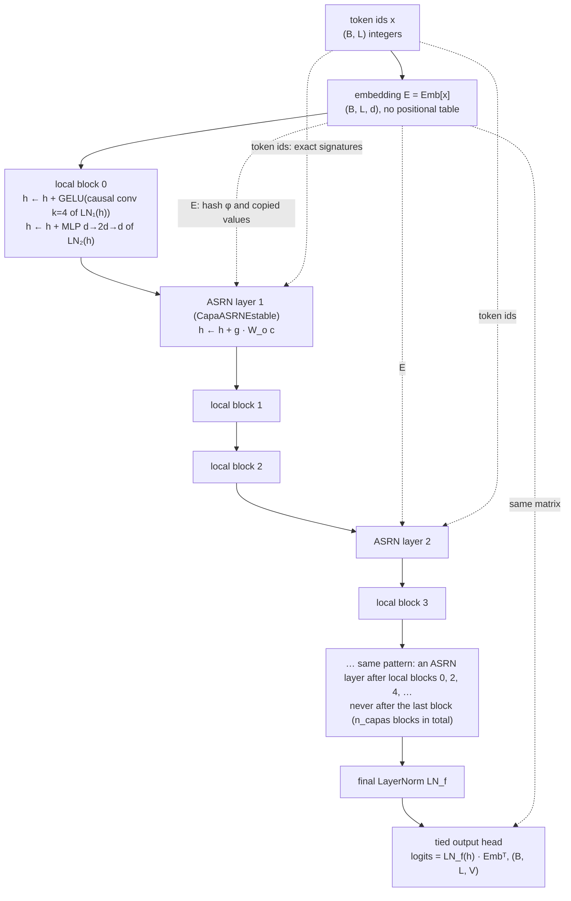
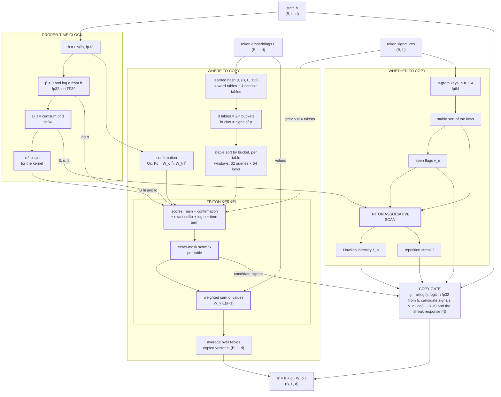
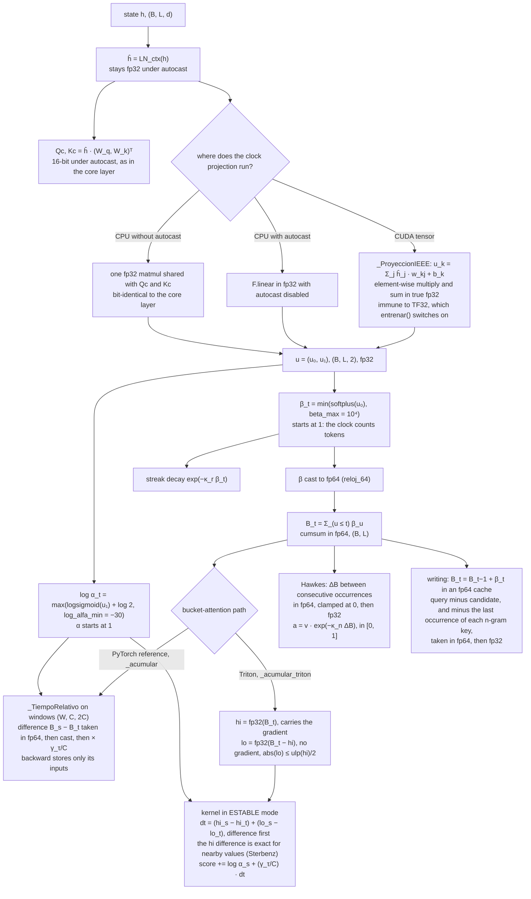
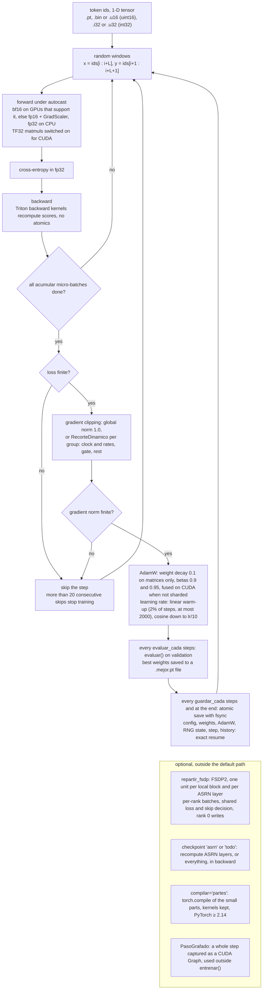
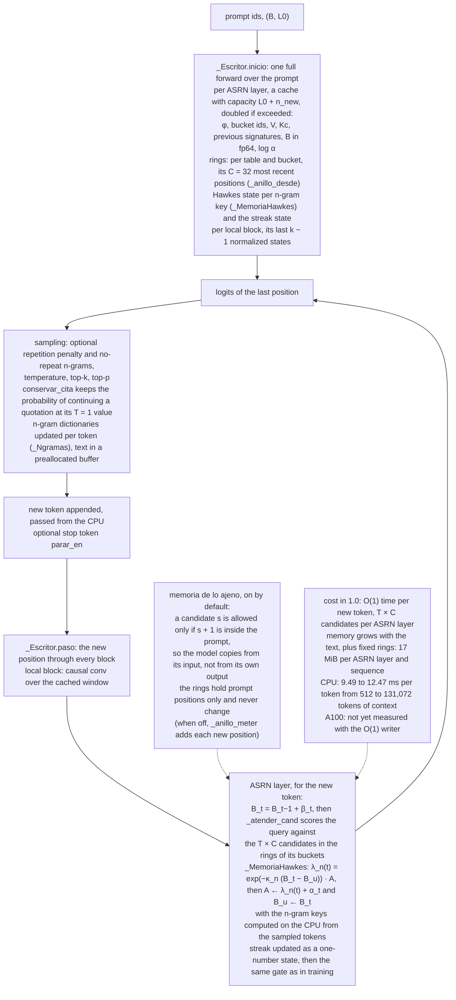
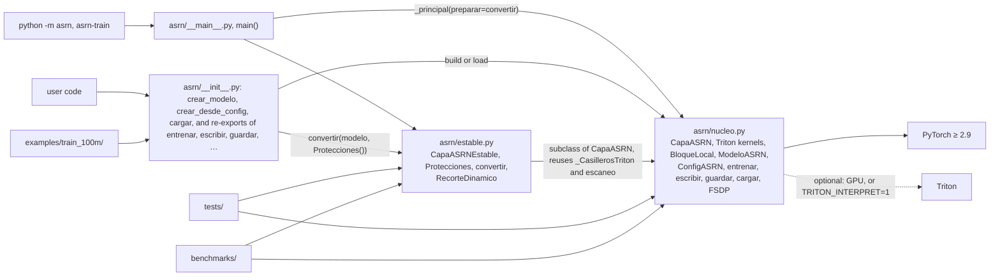
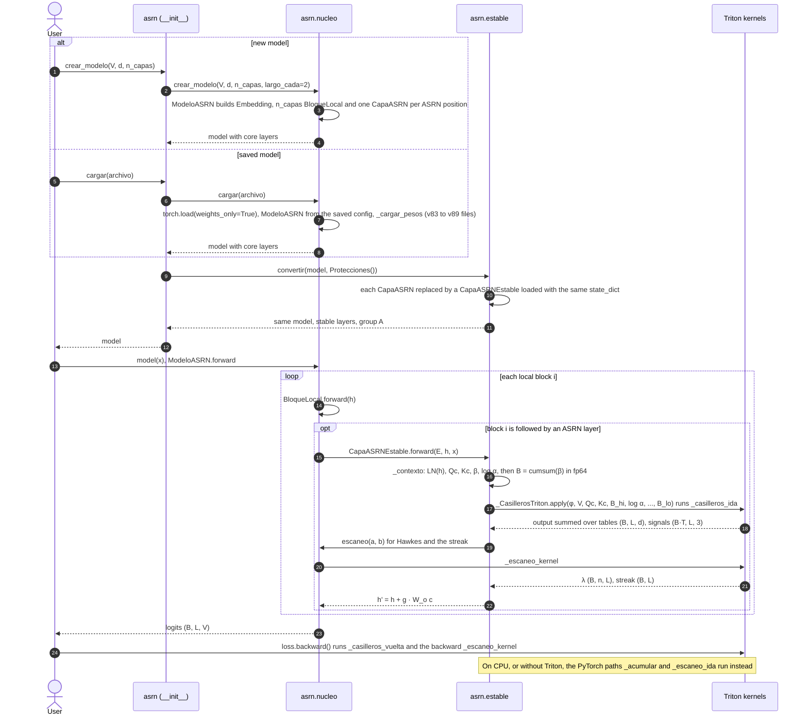

# ASRN 1.0 — Architecture

[Versión en español](ARCHITECTURE_es.md) · [README](../README.md) · [Release notes](RELEASE_NOTES.md) ·
[Technical report](TECHNICAL_REPORT.md) · Author: Alexis Calvario · License: Apache 2.0

This document describes how the **1.0 release** of ASRN (Adaptive Sparse Recurrence Network) is built: the package
layout, the data flow through the model and through one ASRN layer, the proper-time clock, the training and writing
paths, and how the modules call each other at run time. The equations, the stability analysis and the ablation are in
the [technical report](TECHNICAL_REPORT.md); every measured number quoted here comes from
[`history/docs/ESTABILIDAD_Y_BANCO.md`](../history/docs/ESTABILIDAD_Y_BANCO.md) (stability and benchmark report,
cited below as “report §n”),
[`results/banco_a100/RESUMEN.md`](../results/banco_a100/RESUMEN.md) (the A100 run of 17 October 2026, PyTorch 2.14.1),
[`results/citas/RESUMEN.md`](../results/citas/RESUMEN.md),
[`results/citas_a100/RESUMEN.md`](../results/citas_a100/RESUMEN.md),
[`results/banco_cpu/RESUMEN.md`](../results/banco_cpu/RESUMEN.md),
[`results/escritura_cpu/RESUMEN.md`](../results/escritura_cpu/RESUMEN.md) (time per generated token on CPU, O(1) and
O(t) writers), the previous A100 run in
[`history/results/banco_a100_pt211/`](../history/results/banco_a100_pt211/RESUMEN.md) (cited only as a replication) or
the development reports in [`history/docs/`](../history/docs/), and is cited where it appears.

> Code identifiers are in Spanish (the author's language). Each one is glossed the first time it appears:
> *pieza* = token, *casillero* = bucket, *reloj* = clock, *racha* = repetition streak, *vistos* = seen flags,
> *puerta* = gate, *escribir* = generate.

<p align="center"></p>

---

## 1. Overview

ASRN is a language model whose long-range layer does one job: **find where the current context appeared before and
copy the token that came next**, without comparing every token with every earlier token.

- **The model** is a stack of causal *local blocks* (a causal convolution over the current token and the 3 before it,
  plus an MLP) with **one ASRN layer after every second block** (`largo_cada=2`), a final LayerNorm and an output head
  tied to the embedding. There is no positional table.
- **Each ASRN layer** has two branches that share a per-layer **proper-time clock** $B_t=\sum_{u\le t}\beta_u$:
  - *where to copy* — learned sign hashes put every position in a bucket in each of 8 tables; a position scores at
    most its 32 most recent earlier bucket mates per table (a fused **Triton kernel**) and reads a projection of the
    embedding of the token that followed each match;
  - *whether to copy, and when to stop* — a repetition memory over n-grams of 1–4 tokens (seen flags, a Hawkes
    intensity and a repetition streak, computed with a Triton **associative scan**) feeds a **gate** that scales the
    copied vector.
- **The layer computes** $h'_t = h_t + g_t\cdot W_o\,c_t$, where $c_t$ is the copied vector and $g_t\in(0,1)$ the gate.
- **Writing** (generating step by step, `escribir()`) costs **O(1) per new token** in 1.0, whatever the length of the
  text: each table keeps, per bucket, a ring with its C = 32 most recent positions, the Hawkes intensity is carried per
  n-gram key and the streak is one number (§3.4). Its memory still grows with the text.
- **What 1.0 changes.** `import asrn` builds models whose ASRN layers are `CapaASRNEstable` (the *stable* layer) with
  protection group A switched on: exact causal mask, 64-bit clock, and bounds on β, log α and the gate's `mejor`
  signal. It
  has the same parameters and computes the same function as the v89 core layer except for rounding (1.3·10⁻⁷ in the
  logits; report §3), and checkpoints load in either layer. The unprotected core layer is still available in
  `asrn.nucleo`, and `Protecciones.ninguna()` reproduces it bit for bit.

**Defaults of the release recipe** (`ConfigASRN` in `asrn/nucleo.py`):

| Symbol | Meaning | Default | Code name |
|---|---|---|---|
| T | hash tables (4 see the token, 4 see the token and the previous one) | 8 | `n_tablas`, `tablas_contexto=4` |
| b | sign bits per table (2¹⁴ buckets) | 14 | `n_bits` |
| P | hash width T·b | 112 | — |
| C | candidates per table and query (window size) | 32 | `chunk` |
| c_f | confirmation width | 16 | `confirmar` |
| K | longest exact suffix scored | 4 | `sufijo` |
| n | n-gram orders for seen flags and Hawkes | 1–4 | `vistos=4` |
| — | streak-response nodes, up to a streak of | 16, 256 | `nodos_racha`, `racha_max` |
| k | local convolution width | 4 | `k` |
| ff | local MLP width | 2d | `ff` |
| — | ASRN layer after every … local blocks | 2 | `largo_cada` |

---

## 2. Package and repository structure

```text
asrn/                         the production package (pip install .)
├── __init__.py               public API: crear_modelo, crear_desde_config, cargar → models with CapaASRNEstable
│                             (group A); re-exports entrenar, evaluar, escribir, guardar, ConfigASRN, TALLAS,
│                             Protecciones, RecorteDinamico, convertir, inicializar, materializar, repartir_fsdp, …
│                             English aliases of the same objects (ASRNLayer, ASRNModel, create_model, train,
│                             generate, load, …); __version__ = '1.0'
├── __main__.py               python -m asrn  /  asrn-train: the core CLI with convertir() as its model hook
├── estable.py                CapaASRNEstable, Protecciones, _ProyeccionIEEE, _TiempoRelativo, convertir(),
│                             RecorteDinamico (formerly asrn_estable.py)
└── nucleo.py                 the core (formerly asrn_v89.py): CapaASRN and its Triton kernels (incl. ESTABLE mode),
                              escaneo, BloqueLocal, ModeloASRN, ConfigASRN/TALLAS, entrenar, evaluar, escribir,
                              guardar/cargar, FSDP, compilar_partes, PasoGrafado, CLI (_principal)
tests/                        test_nucleo.py (57 tests of the core), test_estable.py (19 tests of the stable layer and
                              the package API), verificar_gpu.py (7 GPU checks)
benchmarks/                   the 1.0 benchmark: asrn_colab.ipynb (the Colab notebook: tests, A100 benchmark and
                              quotation experiment, PyTorch 2.14), banco_asrn.py, banco_gpu.py, banco_modelos.py,
                              modelos_oficiales.py (rivals), rivales_lineales.py, builders/ (generate the notebooks);
                              experimento_citas.py (bounded-quotation experiment with the stable layer, CPU or GPU);
                              medir_escritura.py (time per new token against the context, O(1) and O(t) writers)
results/                      banco_a100/ (A100 run of 17 Oct 2026, PyTorch 2.14.1), banco_cpu/ (exact cost, CPU),
                              citas/ (bounded-quotation experiment, CPU), citas_a100/ (the same on the A100),
                              escritura_cpu/ (O(1) against O(t) writing, CPU)
examples/train_100m/          ready-to-run Colab kit to train a 103.5 M-parameter model on FineWeb (uses import asrn)
docs/                         this document, TECHNICAL_REPORT.md, RELEASE_NOTES.md (each also in Spanish, *_es.md);
                              asrn_architecture.svg and asrn_arquitectura.svg (the diagram above, in English and
                              Spanish), drawn by hacer_diagrama.py
paper/                        LaTeX paper drafts (en, es), figures, bibliography, Zenodo metadata
history/                      development history of v85-v89 and the previous A100 run (results/banco_a100_pt211/):
                              not part of the package; kept because the documents cite it as evidence
                              (see history/README.md)
.github/                      CI workflow (workflows/tests.yml: both test suites on CPU, Python 3.11 and 3.13) and
                              issue templates
CHANGELOG.md                  the changes of each version
CITATION.cff                  how to cite ASRN (citation metadata)
SECURITY.md                   how to report a security problem; safe loading of checkpoints
```

**Layering.** `asrn/__init__.py` → `asrn/estable.py` → `asrn/nucleo.py`. The core never imports the stable module;
the stable layer subclasses `CapaASRN` and reuses the core's kernels (`_CasillerosTriton`, `escaneo`). The CLI in
`__main__.py` is the core's `_principal()` with `preparar=estable.convertir`, so `python -m asrn` trains the stable
layer and `python -m asrn.nucleo` trains the unprotected one. Nothing in the package, its tests or the 1.0 benchmark
reads `history/`: it is reference material. Outside them, the paper-figure script `paper/hacer_figuras.py` reads only
the layer diagram in `history/docs/` (its data come from `results/`).

**Runtime dependencies.** Python ≥ 3.11, PyTorch ≥ 2.9, NumPy (`pyproject.toml`). Triton is optional: without it, or
on CPU, every kernel has a PyTorch reference path that computes the same thing up to rounding. `torch.compile`
(`compilar_partes`) needs PyTorch ≥ 2.14; the 1.0 A100 benchmark ran on PyTorch 2.14.1, uncompiled except for two
rows of the ~50 M training table (ASRN with `compilar_partes`, Transformer++ with `torch.compile`).

---

## 3. Diagrams

The diagrams in this section are Mermaid and render on GitHub (the overview at the top is an SVG drawn by
[`hacer_diagrama.py`](hacer_diagrama.py)). Shapes use B = batch (not to be confused with the clock B_t), L = sequence
length, d = width, V = vocabulary, T = 8 tables.

### 3.1 Model-level data flow



Every ASRN layer receives three inputs: the running state `h`, the **token embeddings `E`** (not `h`: the hash and the
copied values depend only on tokens) and the **token ids**, which become exact signatures (`firmas_de_piezas`: the id
as a float, exact for V ≤ 2²⁴) for suffix matching and n-gram keys. In `ModeloASRN.forward`, the layer `j` runs after
block `i` when `i % largo_cada == 0` and `i < n_capas − 1`; with 8 blocks that gives 4 ASRN layers, with 14 blocks 7.
One ASRN layer every two blocks learned as well as one per block within the seed variation and trained 13–18% faster
in development runs 4 and 5 ([whitepaper](../history/docs/ASRN_v89_Whitepaper.md) §11–12), so it is the default.

### 3.2 Inside one ASRN layer



Thick borders mark the two Triton kernels and the clock. The quantities in the diagram, as the code computes them
(T = 8, b = 14, C = 32; the [technical report](TECHNICAL_REPORT.md) derives and discusses them):

- **Clock** (per layer, from $\hat h_t=\mathrm{LN}(h_t)$):

$$\beta_t=\min\big(\mathrm{softplus}(w_\beta\cdot\hat h_t+b_\beta),\,10^4\big),\qquad \log\alpha_t=\max\big(\log 2\sigma(w_\alpha\cdot\hat h_t+b_\alpha),\,-30\big),\qquad B_t=\sum_{u\le t}\beta_u$$

- **Buckets and candidates.** $\varphi_t=[f_{\text{word}}(E_t);\,f_{\text{ctx}}(E_t,E_{t-1})]\in\mathbb R^{112}$; the bucket of
  position $t$ in table $\tau$ is $\mathrm{id}_\tau(t)=\sum_{j<14}2^j\,\mathbf 1[\varphi_{t,\tau,j}>0]$, and
  $\mathcal N_\tau(t)$ is the set of at most $C$ most recent earlier positions with the same bucket.
- **Score, weights and copied vector** ($\ell(t,s)\le 4$ = number of equal tokens immediately before $t$ and $s$;
  $n_t$ = tables with at least one candidate):

$$\mathrm{score}_\tau(t,s)=\frac{\langle\varphi_t,\varphi_s\rangle}{\sqrt{112}}+\frac{\langle W_q\hat h_t,W_k\hat h_s\rangle}{4}+w^{\text{suf}}_{\ell(t,s)}+\log\alpha_s-\frac{\gamma_\tau}{C}\,(B_t-B_s)$$

$$a_\tau(t,\cdot)=\mathrm{softmax}_{s\in\mathcal N_\tau(t)}\,\mathrm{score}_\tau(t,s),\qquad c_t=\frac{1}{\max(1,n_t)}\sum_\tau\sum_{s\in\mathcal N_\tau(t)}a_\tau(t,s)\,W_vE_{s+1}$$

- **Repetition memory** for the n-gram $G_n(t)=(x_{t-n+1},\dots,x_t)$, $n=1,\dots,4$:

$$v_n(t)=\mathbf 1\big[\exists\,s<t:\,G_n(s)=G_n(t)\big],\qquad \lambda_n(t)=\sum_{s<t,\;G_n(s)=G_n(t)}\alpha_s\,e^{-\kappa_n(B_t-B_s)},\qquad \ell_t=v_4(t)\big(e^{-\kappa_r\beta_t}\ell_{t-1}+1\big)$$

- **Gate and output** ($\text{conf}_t$ = the 4 candidate signals: fraction of tables with candidates, best valid score
  clipped to $\pm10^4$, mean peak weight, fraction of context tables with candidates; $f$ = piecewise-linear response
  on 16 nodes of $\log(1+\ell)$ up to $\ell=256$, learned by increments and constant past the last node):

$$g_t=\sigma\Big(w_g\cdot h_t+b+w_{\text{conf}}\cdot\text{conf}_t+\sum_{n=1}^{4}w_n v_n(t)+\sum_{n=1}^{4}u_n\log\big(1+\lambda_n(t)\big)+f(\ell_t)\Big),\qquad h'_t=h_t+g_t\,W_o c_t$$

Where things sit:

- **The clock** is computed once per layer from the normalized state and is read in three places: the time term of
  every score (inside the kernel), the Hawkes decay, and the streak decay (through β). Each ASRN layer has its own
  clock parameters (`w_reloj`, `b_reloj`, `gamma`, `log_kappa`, `log_kappa_racha`).
- **The bucket-attention kernel** (`_casilleros_ida` forward, `_casilleros_vuelta` backward, both in `asrn/nucleo.py`)
  runs one program per (table row, block of C queries). It loads φ, Qc/Kc, the previous signatures, the clock (hi and
  lo), log α and the values straight from text order through the sort permutation, builds the C × 2C scores in SRAM, and
  writes each query's output to its text position; the outputs of the 8 tables are then summed. The backward recomputes
  the scores (no score tensor is stored) and writes every key gradient into its own slot (each key appears in two
  windows), summed afterwards: no atomics. The `ESTABLE` constexpr switches on the hi/lo time term and the exact mask;
  without it the compiled kernel is the v89 one. On CPU, or without Triton, `CapaASRNEstable._acumular` (batched matmuls
  over the same windows) computes the same thing.
- **The scan kernel** (`_escaneo_kernel`) runs one row per program in blocks of up to 1,024 elements with
  `tl.associative_scan` and a carry between blocks; its backward is the same scan right to left. The PyTorch fallback
  (`_escaneo_ida`) is an even–odd tree: O(N) work, O(log N) depth.

### 3.3 The clock pipeline in detail



For contrast, the core layer (`Protecciones.ninguna()`) computes u inside the shared 16-bit matmul under autocast
(TF32 if enabled), accumulates B in fp32, and builds the time term as $(\log\alpha_s+rB_s)-rB_t$ with $r=\gamma_\tau/C$:
two large numbers that cancel.

Why each step exists — failures measured on the v89 core layer and absent in the stable layer (report §1.2 and §3;
A100 figures from [`results/banco_a100/RESUMEN.md`](../results/banco_a100/RESUMEN.md)):

| Step | Failure it removes | Measured |
|---|---|---|
| fp64 accumulation of B | a 32-bit clock loses resolution with length | probe with β = softplus of a standard normal, CUDA `cumsum`: the neighbour difference B_t − B_{t−1} is off by 2.2% at 2²⁰ tokens, 8.6% at 2²² and 50% at 2²⁴; the clock stops (B + β = B) on 1.1% of steps at 2²² and 16% at 2²⁴ |
| difference before multiplying (`_TiempoRelativo`, hi/lo) | cancellation of two large numbers in the score | shifting the clock (only differences should matter) changes the output of a v89 test layer by 9.4·10⁻⁵, 2.8·10⁻³ and 8.8·10⁻² for shifts of 10⁶, 1.6·10⁷ and 10⁹ (A100, TF32 off); the stable layer, 5.5·10⁻⁸ for all three |
| `_ProyeccionIEEE` | TF32 (or 16-bit autocast) in the β, α projection | turning TF32 on moves v89's fp32 B_t by 2.0 units over 65,536 tokens (d = 512), the stable layer's by 1.2·10⁻¹⁰; under bf16 autocast v89's B drifts 1.3 units after 4,096 tokens with d = 64 and 3.3 with d = 512 (CPU) |
| `beta_max` | unbounded β with broken weights | B overflows within a few tokens and the time term gives ∞ − ∞ = NaN (`test_beta_enorme_no_rompe_la_capa`) |
| `log_alfa_min` | log α → −∞ | preventive (deduced from the code, not measured) |

Cost of group A, measured on the A100 with `_ProyeccionIEEE` (one layer, d = 512, bf16): +7.5% time at 262,144 tokens
and +4–5% peak memory at every length (+5.2% at 262,144; [`results/banco_a100/`](../results/banco_a100/RESUMEN.md)).

### 3.4 Training and writing paths

**Training** (`entrenar()` in `asrn/nucleo.py`):



**Writing** (`escribir()` and `_Escritor` in `asrn/nucleo.py`; the stable layer supplies its own `_contexto`,
`_atender_cand`, `_atender`, `_repeticion_paso` and `_combinar`, so the protections also hold when writing):



Writing step by step gives the same result as processing the whole text (`test_escribir_paso_a_paso_igual_que_entero`,
`test_escritura_paso_a_paso_igual_que_entero`, GPU check 7). The O(1) writer, the previous O(t) writer and the
whole-text forward agree to a maximum difference of 2.2·10⁻⁷ (CPU; v89 and stable layer, rings that overflow, batches
of 1–3, prompts of 1, 2 and 40 tokens, with and without prompt-only copy memory: `test_escritura_o1_igual_que_o_t` in
both suites, and `test_anillo_y_ngramas_como_su_definicion`). `escribir()` gives the same token sequences, and logits
within 10⁻⁴, as the previous O(t) implementation in 192 of 192 combinations of sampling options (temperature, top-k,
top-p, prompt-only copy memory, quotation-preserving temperature, repetition penalty, no-repeat n-grams), v89 and
stable layer.

**Why each new token costs O(1).**

- *Where to copy:* each table keeps, per bucket, a ring with the C = 32 most recent positions — exactly the keys the
  previous `_atender` chose among the whole memory. With prompt-only copy memory (the default) only prompt positions
  can be keys, so the rings are filled from the prompt and never change. The new token scores only its T × C
  candidates (`_atender_cand`; the stable layer keeps the exact mask and the 64-bit clock).
- *Hawkes intensity:* carried per n-gram key (`_MemoriaHawkes`): the clock of the key's last occurrence $B_u$ and
  $A=\lambda+\alpha$ at that moment; then $\lambda_n(t)=e^{-\kappa_n(B_t-B_u)}\,A$ and afterwards
  $A\leftarrow\lambda_n(t)+\alpha_t$, $B_u\leftarrow B_t$. This is the same sum as the definition, carried as the
  recurrence the whole-text associative scan uses. Keys are looked up in Python dictionaries with keys computed on the
  CPU from the sampled tokens (no GPU wait); the states stay on the device. The streak was already one number.
- *Sampling helpers:* the quotation-preserving temperature and `no_repetir_ngramas` use n-gram dictionaries updated per
  token (`_Ngramas`) instead of rescanning the text; the generated text lives in a preallocated buffer.
- The previous O(t) writer (`_atender` and `_repeticion_paso` against the whole cache) stays available as
  `_Escritor(modelo, o1=False)` and is used automatically only if the rings would exceed 2 GiB (very large `n_bits` or
  batch).

**Memory.** It still grows with the text (each position's cached features: what is copied must be stored), plus the
fixed rings: T · 2^n_bits · C positions (int32) and their counters, 17 MiB per ASRN layer per sequence at the default
sizes (8 tables, 14 bits, C = 32); about 120 MiB per sequence for the ~50 M benchmark model (7 ASRN layers).

**Measured time.** On CPU ([`results/escritura_cpu/`](../results/escritura_cpu/RESUMEN.md), written by
[`benchmarks/medir_escritura.py`](../benchmarks/medir_escritura.py): a 700,484-parameter model with d = 128 and 2 ASRN
layers, 4 threads, batch 1, no sampling, median of 9 batches of 32 tokens, the two writers interleaved at each context):

| Context | O(1) ms/token | O(t) ms/token | O(1) prompt (s) | O(t) prompt (s) |
|---|---|---|---|---|
| 512 | 12.45 | 15.80 | 0.10 | 0.06 |
| 2,048 | 12.47 | 16.73 | 0.26 | 0.20 |
| 8,192 | 10.68 | 19.02 | 0.77 | 0.70 |
| 32,768 | 11.26 | 37.12 | 3.60 | 2.73 |
| 131,072 | 9.49 | 91.67 | 29.04 | 20.44 |

The slope of ms per token against the context (least squares, 95% CI) is −19.21 ns per context token (−41.54 to 3.12)
for the O(1) writer, indistinguishable from zero, and 583.31 ns (537.13 to 629.49) for the O(t) writer: at 131,072
tokens the O(1) writer is 9.7× faster per token, and 1.27× at 512. Reading the prompt costs the O(1) writer its
bookkeeping (filling the rings and the Hawkes state), profiled at about 0.3 s at 32,768 tokens and 1.3 s at 131,072
(rings ~0.3 s, Hawkes state 0.8–1.1 s). The prompt differences in the table are larger because the prompt time varies
run to run on this shared 4-core machine: the same prompt pass took 14.8–23.5 s at 131,072 tokens in four repetitions.

On the A100 ([`results/banco_a100/`](../results/banco_a100/RESUMEN.md), ~50 M model, batch 1), the 42.8–43.4 ms per
token for 1k–64k context (slope 3.0 ns per context token, 95% CI −25 to 31 ns: indistinguishable from zero) were
measured **with the O(t) writer**. The time per token was already flat there, most probably kernel-launch overhead (not
profiled), which hid the O(t) term. **The O(1) writer has not been measured on the A100 yet**: the notebook's generation
section (section 6 of [`benchmarks/asrn_colab.ipynb`](../benchmarks/asrn_colab.ipynb)) now runs it, with the new tokens
passed from the CPU as `escribir()` does, so the next Colab run measures it. Measuring it and cutting the per-token
kernel launches of generation (e.g. CUDA graphs), which dominate on the GPU, are on the
[release roadmap](RELEASE_NOTES.md#roadmap--future-work-v11).

### 3.5 How the modules interact at run time

**Module dependencies:**



**One construction (or load) and one forward/backward pass:**



`convertir()` must run before `repartir_fsdp()` and before compiling. The CLI with `--fsdp` follows the same order on
an empty (`meta`) model: `crear_desde_config(cfg, dispositivo='meta')` → `convertir` → `repartir_fsdp` →
`materializar` (weights filled piece by piece, bit-identical to `crear_modelo` with the same seed, so the full model
never exists on one process).

---

## 4. Components

d = 512 is used where a size is quoted. "Report" = [`ESTABILIDAD_Y_BANCO.md`](../history/docs/ESTABILIDAD_Y_BANCO.md).

| Component | File | Function / class | Shapes (in → out) | Notes |
|---|---|---|---|---|
| Package API | `asrn/__init__.py` | `crear_modelo`, `crear_desde_config`, `cargar` | — | core constructors followed by `convertir()`; `protecciones=` selects A (default), A+B (`Protecciones.textos_largos(L)`) or none |
| CLI | `asrn/__main__.py` | `main` → `nucleo._principal(preparar=convertir)` | — | `python -m asrn`, `asrn-train`; multi-process with `torchrun … --fsdp` |
| Language model | `asrn/nucleo.py` | `ModeloASRN`, `crear_modelo` | x (B, L) → logits (B, L, V) | tied head, no positional table; weights must be fp32 (bf16/fp16 only through autocast); V ≤ 2²⁴ |
| Configuration | `asrn/nucleo.py` | `ConfigASRN`, `TALLAS`, `para_parametros` | — | exact parameter count without allocating; `TALLAS` from `1b` up have never been trained |
| Local block | `asrn/nucleo.py` | `BloqueLocal` | (B, L, d) → (B, L, d) | dense causal conv (d × d × 4) + MLP d→2d→d, ≈2.1 M parameters; `mezcla='memoria'` exists but is off (it broke long-range copy in development) |
| ASRN layer (stable) | `asrn/estable.py` | `CapaASRNEstable.forward` | E, h (B, L, d), x (B, L) → h' (B, L, d) | ≈0.65 M parameters; same parameters and names as `CapaASRN` |
| Protections | `asrn/estable.py` | `Protecciones` | — | group A on: `mascara_exacta`, `reloj_64`, `beta_max=1e4`, `log_alfa_min=−30`, `mejor_max=1e4`; group B off: `tope_puerta=10`, `kappa_min=1/(4·L_train)` |
| Clock and confirmation | `asrn/estable.py` | `_contexto`, `_ProyeccionIEEE`, `_kappas` | h → Qc, Kc (B, L, 16); β (B, L) fp64; log α (B, L) | one clock per layer; neutral start β = 1, α = 1, γ = 0 |
| Learned hash and values | `asrn/nucleo.py` | `_phi_y_valores`, `_ids` | E → φ (B, L, 112), V (B, L, d), ids (B, L, 8) int32 | bucket = signs of φ: no gradient through the bucket choice; values are W_v E shifted one position |
| Bucket attention, PyTorch | `asrn/estable.py` | `_acumular`, `_softmax_valido`, `_TiempoRelativo` | windows (W, C, 2C), W = B·T·R − 1, R = ⌈L/C⌉ + 1 | reference and fallback: CPU, or shapes the kernel does not take (C not a power of two ≥ 16, P or c_f below 16) |
| Bucket attention, Triton | `asrn/nucleo.py` | `_CasillerosTriton`, `_casilleros_ida`, `_casilleros_vuelta`, `_cas_puntajes`, `_cas_softmax` | grid (B·T, ⌈L/C⌉); out (B·T, L, d) → summed (B, L, d); signals (B·T, L, 3) | `ESTABLE` constexpr; saves only its inputs: 20.2 KiB per token vs 43.9 KiB for the PyTorch path (fp32, report §5.2) |
| Repetition memory | `asrn/estable.py`, keys in `asrn/nucleo.py` | `_repeticion`, `_claves_vistos`, `_ordenar_claves` | sig (B, L) → seen, Hawkes (B, L, 4), streak (B, L) | fp64 keys, collision ~10⁻¹⁶ per pair; the key sort depends only on tokens but is repeated in every layer |
| Associative scan | `asrn/nucleo.py` | `escaneo`, `_Escaneo`, `_escaneo_kernel`, `_escaneo_ida` | a, b (…, N) → S (…, N) | S_i = a_i S_{i−1} + b_i with a ∈ [0, 1]: products shrink, stable in fp32 and bf16 |
| Gate | `asrn/estable.py`, `asrn/nucleo.py` | `_combinar`, `_respuesta_racha` | h, signals → g (B, L, 1) → h' | logit in fp32; streak response on 16 nodes up to 256, constant past the last node |
| Writing | `asrn/nucleo.py` | `escribir`, `_Escritor`, `_anillo_desde` / `_anillo_meter` (rings), `_MemoriaHawkes`, `_Ngramas` (+ the layer's `_atender_cand`, `_repeticion_o1`) | prompt (B, L0) → ids (B, L0 + n) | O(1) per new token: T × C candidates per ASRN layer; memory grows with the text, plus 17 MiB of rings per ASRN layer and sequence; `_Escritor(modelo, o1=False)` is the previous O(t) writer (the layer's `_atender`, `_repeticion_paso`), used automatically only if the rings would exceed 2 GiB; `memoria_de_lo_ajeno` and `conservar_cita` on by default |
| Training | `asrn/nucleo.py` | `entrenar`, `evaluar`, `crear_optimizador`, `tasa_aprendizaje` | — | NaN/inf steps skipped; Ctrl+C saves; exact resume, also between 1 GPU and FSDP |
| Dynamic clipping | `asrn/estable.py` | `RecorteDinamico` | — | per group: threshold min(cap, μ + zσ) after 50 warm-up steps; tested in one process only, not with FSDP |
| Scale-out | `asrn/nucleo.py` | `repartir_fsdp`, `materializar`, `inicializar`, `pesos_completos` | — | FSDP2 checked with 2 CPU processes (gloo) and NCCL on 1 GPU; several real GPUs not yet tested |
| Speed options | `asrn/nucleo.py` | `compilar_partes`, `PasoGrafado` | — | compile needs PyTorch ≥ 2.14 (compiled by parts, the ~50 M model trained 1.21–1.23× faster on the A100); a CUDA Graph took one layer at 1,024 tokens from 11.4 to 1.6 ms in development ([RENDIMIENTO.md](../history/docs/RENDIMIENTO.md) §5d) |
| Save and load | `asrn/nucleo.py` | `guardar`, `cargar`, `_cargar_pesos`, `_migrar_racha` | — | atomic write; safe load (`weights_only`); v83–v89 files load with the same numbers |
| Tests | `tests/` | `test_nucleo.py`, `test_estable.py`, `verificar_gpu.py` | — | 57 + 19 tests and 7 GPU checks |

**What the ablation shows, component by component.** The two branches of diagram 3.2 are two design
responsibilities. The *where to copy* branch (learned hash tables, candidate windows, and scores with the exact suffix,
the confirmation and the time term, built in the Triton kernel) performs exact retrieval. The *whether to copy* branch
and the gate (seen flags, Hawkes intensities and the repetition streak, the proper-time clock that sets their decay, and
the gate with its candidate signals) are regulation mechanisms for open-ended generation: they decide whether to copy
and when to stop. The A100 ablation ([technical report](TECHNICAL_REPORT.md) §7.1, run of 17 October 2026, 3 seeds,
copy and MQAR) reads accordingly:

- **Retrieval.** Without ASRN layers neither task is solved (`solo_local`, chance level in 3 of 3 seeds, by
  construction). With them ASRN copies at 4× the training length with 99.99% and 99.98% in the 2 of 3 seeds that left
  the initial plateau (seed 1 stayed on it for all 2,000 steps: 0.15%; 3-seed mean 66.71 ± 57.64; 3 of 3 seeds and
  99.87% ± 0.18 in the previous run): leaving the plateau within 2,000 steps is a matter of optimization, not of
  capacity. On MQAR with 4× the pairs it reaches 99.75% ± 0.43. The exact suffix, the confirmation and the number of
  tables are retrieval refinements whose individual contribution is not separable on these saturated tasks (MQAR
  99.69% without the suffix and 99.88% without the confirmation; two tables instead of eight learned copy in 1 of 3
  seeds, 2 of 6 over both A100 runs, which is suggestive but not conclusive). Mixing the tables by logsumexp
  (`mezcla_lse`) learned copy in 1 of 3 seeds (3 of 3 in the previous run) and did not learn MQAR (≤ 3.61% with 4× the
  pairs), at +61–62% run time in its PyTorch-only form: **not** adopted in 1.0.
- **Regulation, non-intrusive on pure-copy tasks.** Copy and MQAR evaluate only positions where copying is correct
  (100% of them require a copy), so the retrieval core is sufficient on its own. The presence of the gate, its
  signals, the clock and Hawkes/streak does not degrade exact retrieval, and removing them does not change it either:
  every run of the base, a regulation variant or group B that left the copy plateau scores ≥ 99.89% at 4×. Seed 1
  stayed on the plateau in the base itself, and also without the gate and without the clock (each 4 of 6 runs learned
  over both A100 runs, against 5 of 6 for the base), so one failed seed in a variant cannot be attributed to the removed
  component. The MQAR means with 4× the pairs are 99.75% for the base, 99.94% without the gate (`sin_puerta`), 99.50%
  without its signals (`puerta_sin_senales`), 99.95% without the clock (`sin_reloj`) and 99.53% without Hawkes and the
  streak (`sin_hawkes_racha`).
- **Regulation, validated in controlled open-ended generation.** In the controlled synthetic bounded-quotation
  experiment ([`benchmarks/experimento_citas.py`](../benchmarks/experimento_citas.py); d = 64, 2 local blocks and 1 ASRN
  layer, 6,000 steps, 3 seeds; [results](../results/citas/RESUMEN.md)), the full 1.0 layer was compared with the same
  layer without the Hawkes and streak signals, with a gate that sees only the hidden state, with no gate, and without
  the clock. The full layer's gate learned from the language-modelling loss alone, without explicit supervision, to push
  copying when a quotation starts (+0.6 to +0.8 at a streak of one token) and to close hard past the data's quotation
  lengths (the streak response f(ℓ) forms a "cliff": −7.7 to −9.2 from ℓ ≈ 12 on). This brakes state aliasing: with
  default sampling, the longest written repetition streak is 10 tokens with the full layer (real text: 10), against 21
  without the Hawkes and streak signals, 27 with a signal-blind gate and 23 with no gate, while removing only the Hawkes
  and streak signals leaves the validation loss practically unchanged (3.703–3.706 against 3.707–3.708). Without the
  clock the layer writes like the full one (longest streak 10, same loss): the task has no topic shifts, so the clock's
  own role is still to be tested. The A100 replication ([results](../results/citas_a100/RESUMEN.md), same variants and
  seeds) agrees: gate +0.6 to +0.7 at a streak of one token and −7.6 to −8.4 from ℓ ≈ 12 on; longest streak 10 with the
  full layer and without the clock, against 19, 39 and 21; validation loss 3.703–3.705 against 3.706–3.709 without
  Hawkes and streak.
- **Protection group B** is off by default and showed no cost or effect beyond seed variation (copy learned in 2 of 3
  seeds, as in the base; MQAR 99.29% with 4× the pairs; run time −3% on copy and +5% on MQAR).

The large-scale ablation of the regulation mechanisms on natural corpora with distractors and topic shifts, and the
other next steps, are listed in the [release roadmap](RELEASE_NOTES.md#roadmap--future-work-v11); the
[technical report](TECHNICAL_REPORT.md) audits each component.

---

## 5. Design invariants

1. **Causality.** A query only reads keys that come strictly before it in its bucket's stably sorted order (so s < t),
   and copies E_{s+1} with s + 1 ≤ t. The local convolution is left-padded by k − 1, the context hash reads E_{t−1},
   n-gram keys read x_{t−3..t}, and every scan runs left to right. With `mascara_exacta`, invalid keys weigh exactly 0
   in PyTorch, in the kernel and when writing; the core layer's finite −10⁹ mask leaked when all valid scores fell below
   it (0.016 with γ = 10⁹ on the A100; 0 with the exact mask). Checked by `test_causal_el_futuro_no_cambia_el_pasado`,
   `test_mascara_exacta_cierra_la_fuga_causal`, `test_mascara_exacta_en_la_escritura` and GPU check 6.
2. **Bounded work per token.** In training, each token scores at most T·C = 256 candidates per layer, whatever L is:
   5.19, 5.14 and 5.13 MFLOP per token at L = 1,024, 4,096 and 16,384 for one layer with d = 512, and constant bytes
   saved for backward (report §5.2). Writing scores the same T·C candidates per layer and carries one Hawkes state per
   n-gram key: **O(1) per new token** (§3.4). What is not constant per token: the sorts in training (8 bucket sorts and
   the n-gram key sort per layer — O(N log N) for a comparison sort, a fixed number of passes for the radix sort used on
   GPUs), a ~12 ms floor per layer up to 16k tokens on the A100 (probably launch overhead, not profiled), and the memory
   of writing, which grows with the text.
3. **Neutral initialization.** The parameters added after v85 (`w_reloj`, `b_reloj`, `gamma`, `log_kappa`,
   `log_kappa_racha`, `u_hawkes`, `d_racha`) start where they have no effect and draw nothing from the random
   generator: `w_reloj = 0` with `b_reloj = (log(e − 1), 0)` gives β = 1 (the clock counts tokens) and α = 1, and
   `gamma`, `u_hawkes` and `d_racha` are 0, so the time term, Hawkes and the streak do not reach the scores or the gate.
   The scoring and gating weights v85 already had (`W_q`, `w_sufijo`, `g_conf`, `w_vistos`) also start at 0. At
   initialization the layer computes the v85 function, and the same seed gives the same weights (checked against v85
   during development; the 1.0 tests no longer include v85). The ablation variants that freeze one of these parts
   therefore compute the same as the base at step 0.
4. **Checkpoint compatibility.** `CapaASRNEstable` keeps the parameter names of `CapaASRN`, so files cross both ways;
   group A changes only rounding, and `Protecciones.ninguna()` is bit-identical to the core
   (`test_sin_protecciones_igual_que_v89_bit_a_bit`, `test_grupo_A_igual_que_v89_salvo_redondeo`). `cargar()` reads
   files from v83 to v89: parameters missing in older files keep their neutral values, and v86's per-node streak
   response is converted exactly to increments (`test_migrar_racha_de_archivos_viejos_es_exacta`). Training files also
   carry the AdamW state (by parameter name when sharded), converted in both directions, so a run can resume from one
   GPU to FSDP and back.
5. **Precision contract.** Weights stay in fp32 (a 16-bit model is rejected with an explanation); bf16/fp16 are used
   only through autocast. Signatures, n-gram keys and the clock are exact or fp64, LayerNorm and the gate logit are
   fp32, and softmax statistics are fp32 in the kernel.
6. **Determinism of the custom backward passes.** The bucket kernel, `_DesordenarSumar` and `_Tomar` avoid atomic
   additions: each contribution has its own slot and is summed in a fixed order, so the same inputs give the same
   gradients.

---

## 6. Known architectural limits (measured)

- **Short sequences, batch 1:** a single ASRN layer has a ~12 ms floor up to 16k tokens on the A100, where
  FlashAttention-2 is 3.7× faster at 1–4k tokens ([`results/banco_a100/`](../results/banco_a100/RESUMEN.md)). The layer
  was measured without `torch.compile` or CUDA Graphs; compiled by parts, the ~50 M model trains 1.21–1.23× faster.
- **Memory per layer:** ~40 KiB per token at peak on the A100 (bf16, 262,144 tokens), 2.0× the attention layer's
  20 KiB and 1.3× the Mamba-2 block's 31 KiB.
- **Writing:** on the A100 it was the slowest of the four models measured with batch 1 (~43 ms per token: 2.9× the
  Transformer++, 1.7× Mamba-2, 1.2× RWKV-7), measured with the O(t) writer and most likely launch-bound. With the O(1)
  writer the cost per token is constant in the context (CPU measurement, §3.4), but the A100 figure is pending. Memory
  per sequence still grows with the text, plus the fixed rings (17 MiB per ASRN layer).
- **Redundant work:** the n-gram key sort depends only on the tokens but is recomputed in every ASRN layer; sharing it
  and a persistent sliding-window kernel are proposed in report §2.2.
- **Table mixing:** tables are averaged uniformly; the logsumexp alternative was measured (see §4) and not adopted.
- **Scale:** the largest models trained for quality in the 1.0 benchmark have ~45 M parameters (WikiText-103, ~0.44
  training positions per parameter, far from convergence); configurations from `1b` up have never been trained.

Measuring the O(1) writer on the A100 and cutting the per-token kernel launches of generation (e.g. CUDA graphs),
which dominate on the GPU, the kernel proposals, more seeds for logsumexp table mixing (and a Triton kernel for it only
if it helps) and the first 100 M-parameter run with `examples/train_100m/` are on the
[release roadmap](RELEASE_NOTES.md#roadmap--future-work-v11).

---

## 7. Sources

- [`history/docs/ESTABILIDAD_Y_BANCO.md`](../history/docs/ESTABILIDAD_Y_BANCO.md) — kernel analysis, protections,
  the CPU benchmark, and the benchmark and ablation of the previous A100 run (paths inside it use the pre-1.0 layout;
  see [`history/README.md`](../history/README.md)).
- [`results/banco_a100/RESUMEN.md`](../results/banco_a100/RESUMEN.md),
  [`results/citas_a100/RESUMEN.md`](../results/citas_a100/RESUMEN.md),
  [`results/banco_cpu/RESUMEN.md`](../results/banco_cpu/RESUMEN.md),
  [`results/escritura_cpu/RESUMEN.md`](../results/escritura_cpu/RESUMEN.md) and their `resultados.json`; the previous
  A100 run (PyTorch 2.11.0) is in [`history/results/banco_a100_pt211/`](../history/results/banco_a100_pt211/RESUMEN.md).
- [`history/docs/ASRN_v89_Whitepaper.md`](../history/docs/ASRN_v89_Whitepaper.md) — v86–v89 history, quotation
  experiment, configuration and FSDP.
- [`history/docs/RENDIMIENTO.md`](../history/docs/RENDIMIENTO.md) — kernel and speed history.
- The code in [`asrn/`](../asrn/): every formula and shape above was taken from it.
