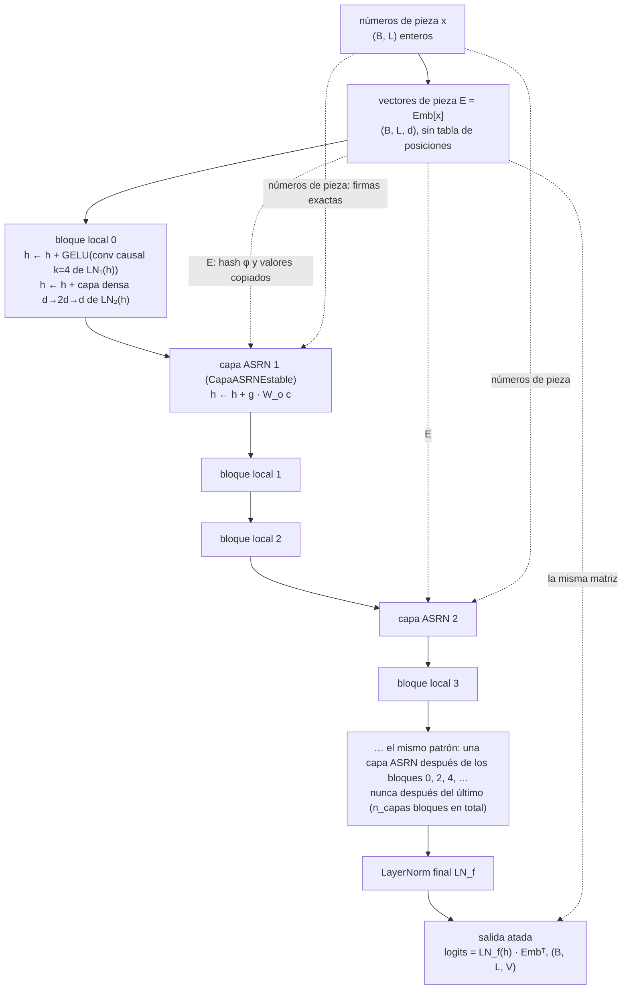
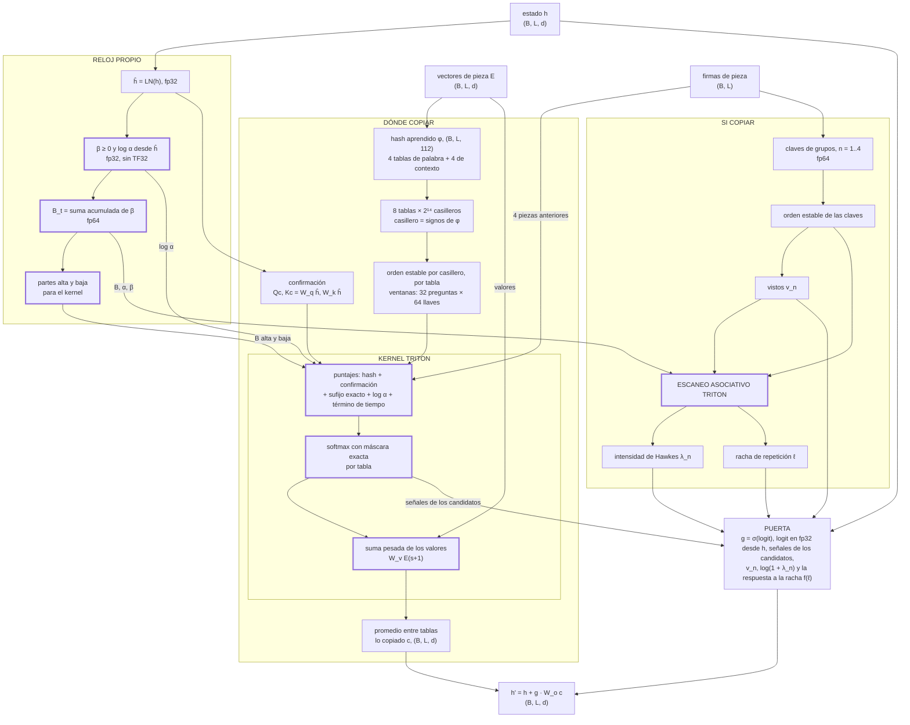
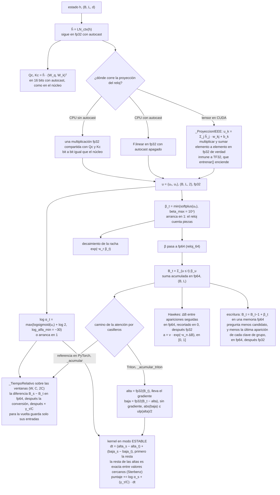
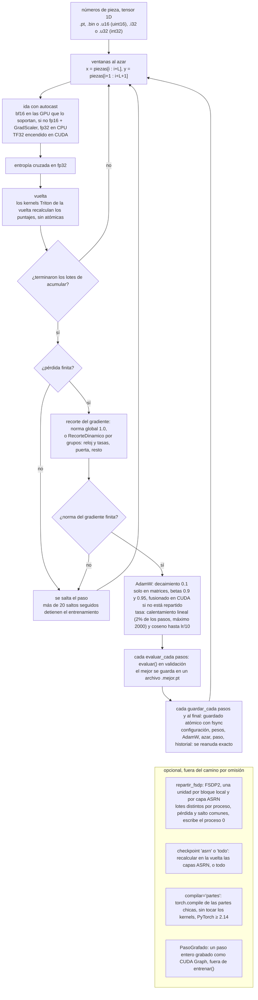
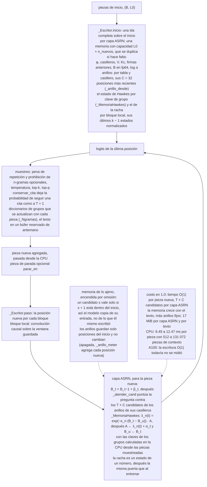
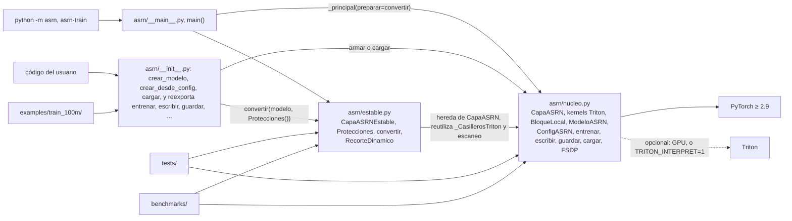
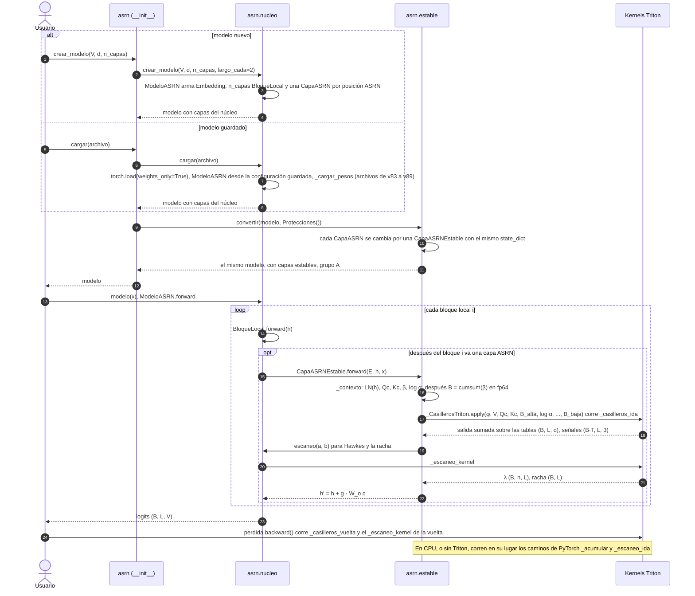

# ASRN 1.0 — Arquitectura

[English version](ARCHITECTURE.md) · [README](../README.es.md) · [Notas de la versión](RELEASE_NOTES_es.md) ·
[Reporte técnico](TECHNICAL_REPORT_es.md) · Autor: Alexis Calvario · Licencia: Apache 2.0

Este documento describe cómo está construida la **versión 1.0** de ASRN (Adaptive Sparse Recurrence Network): la
organización del paquete, el flujo de datos por el modelo y por una capa ASRN, el reloj de tiempo propio, los caminos de
entrenamiento y de escritura, y cómo se llaman los módulos entre sí al correr. Las ecuaciones, el análisis de
estabilidad y la ablación están en el [reporte técnico](TECHNICAL_REPORT_es.md); cada cifra medida que
aparece aquí sale de [`history/docs/ESTABILIDAD_Y_BANCO.md`](../history/docs/ESTABILIDAD_Y_BANCO.md) (informe de
estabilidad y banco de pruebas, que abajo se cita como «informe §n»),
[`results/banco_a100/RESUMEN.md`](../results/banco_a100/RESUMEN.md) (la corrida en A100 del 17 de octubre de 2026,
PyTorch 2.14.1), [`results/citas/RESUMEN.md`](../results/citas/RESUMEN.md),
[`results/citas_a100/RESUMEN.md`](../results/citas_a100/RESUMEN.md),
[`results/banco_cpu/RESUMEN.md`](../results/banco_cpu/RESUMEN.md),
[`results/escritura_cpu/RESUMEN.md`](../results/escritura_cpu/RESUMEN.md) (tiempo por pieza escrita en CPU, escritura
O(1) y O(t)), la corrida anterior en A100 de
[`history/results/banco_a100_pt211/`](../history/results/banco_a100_pt211/RESUMEN.md) (citada solo como réplica) o de
los informes de desarrollo de [`history/docs/`](../history/docs/), y se cita donde aparece.

> Los nombres del código están en español. Glosario para quien lea también la versión en inglés: *pieza* = token,
> *casillero* = bucket, *reloj* = clock, *racha* = repetition streak, *vistos* = seen flags, *puerta* = gate,
> *escribir* = generar.

<p align="center"></p>

---

## 1. Visión general

ASRN es un modelo de lenguaje cuya capa de largo alcance hace un solo trabajo: **encontrar dónde apareció antes el
contexto actual y copiar la pieza que vino después**, sin comparar cada pieza con todas las anteriores.

- **El modelo** es una pila de *bloques locales* causales (una convolución causal sobre la pieza actual y las 3
  anteriores, más una capa densa) con **una capa ASRN después de cada dos bloques** (`largo_cada=2`), una LayerNorm
  final y una salida atada a la matriz de vocabulario. No hay tabla de posiciones.
- **Cada capa ASRN** tiene dos ramas que comparten un **reloj de tiempo propio** por capa, $B_t=\sum_{u\le t}\beta_u$:
  - *dónde copiar*: hashes de signos aprendidos ponen cada posición en un casillero de cada una de 8 tablas; una
    posición puntúa como mucho a sus 32 compañeros de casillero anteriores más recientes por tabla (un **kernel Triton**
    fusionado) y lee una proyección del vector de la pieza que siguió a cada coincidencia;
  - *si copiar, y cuándo parar*: una memoria de lo repetido sobre grupos de 1 a 4 piezas (vistos, una intensidad de
    Hawkes y una racha de repetición, calculadas con un **escaneo asociativo** en Triton) alimenta una **puerta** que
    escala el vector copiado.
- **La capa calcula** $h'_t = h_t + g_t\cdot W_o\,c_t$, donde $c_t$ es lo copiado y $g_t\in(0,1)$ la puerta.
- **Escribir** (generar paso a paso, `escribir()`) cuesta **O(1) por pieza nueva** en 1.0, sea cual sea el largo del
  texto: cada tabla lleva, por casillero, un anillo con sus C = 32 posiciones más recientes, la intensidad de Hawkes se
  lleva por clave de grupo y la racha es un número (sección 3.4). Su memoria sigue creciendo con el texto.
- **Qué cambia en 1.0.** `import asrn` arma modelos cuyas capas ASRN son `CapaASRNEstable` (la capa *estable*) con el
  grupo A de protecciones encendido: máscara causal exacta, reloj de 64 bits y topes para β, log α y la señal `mejor`
  de la puerta. Tiene los mismos parámetros y calcula la misma función que la capa del núcleo de v89 salvo el redondeo
  (1.3·10⁻⁷ en los logits; informe §3), y los archivos guardados cargan en cualquiera de las dos. La capa sin
  protecciones sigue en `asrn.nucleo`, y `Protecciones.ninguna()` la reproduce bit a bit.

**Valores por omisión de la receta** (`ConfigASRN` en `asrn/nucleo.py`):

| Símbolo | Qué es | Por omisión | Nombre en el código |
|---|---|---|---|
| T | tablas de hash (4 ven la pieza, 4 la pieza y la anterior) | 8 | `n_tablas`, `tablas_contexto=4` |
| b | bits de signo por tabla (2¹⁴ casilleros) | 14 | `n_bits` |
| P | ancho del hash T·b | 112 | — |
| C | candidatos por tabla y pregunta (tamaño de ventana) | 32 | `chunk` |
| c_f | ancho de la confirmación | 16 | `confirmar` |
| K | sufijo exacto más largo que se puntúa | 4 | `sufijo` |
| n | largos de grupo para vistos y Hawkes | 1–4 | `vistos=4` |
| — | nodos de la respuesta a la racha, hasta una racha de | 16, 256 | `nodos_racha`, `racha_max` |
| k | ancho de la convolución local | 4 | `k` |
| ff | ancho de la capa densa local | 2d | `ff` |
| — | una capa ASRN cada … bloques locales | 2 | `largo_cada` |

---

## 2. Estructura del paquete y del repositorio

```text
asrn/                         el paquete de producción (pip install .)
├── __init__.py               API pública: crear_modelo, crear_desde_config, cargar → modelos con CapaASRNEstable
│                             (grupo A); reexporta entrenar, evaluar, escribir, guardar, ConfigASRN, TALLAS,
│                             Protecciones, RecorteDinamico, convertir, inicializar, materializar, repartir_fsdp, …
│                             alias en inglés de los mismos objetos (ASRNLayer, ASRNModel, create_model, train,
│                             generate, load, …); __version__ = '1.0.0'
├── __main__.py               python -m asrn  /  asrn-train: la línea de comandos del núcleo con convertir() como gancho
├── estable.py                CapaASRNEstable, Protecciones, _ProyeccionIEEE, _TiempoRelativo, convertir(),
│                             RecorteDinamico (antes asrn_estable.py)
└── nucleo.py                 el núcleo (antes asrn_v89.py): CapaASRN y sus kernels Triton (con el modo ESTABLE),
                              escaneo, BloqueLocal, ModeloASRN, ConfigASRN/TALLAS, entrenar, evaluar, escribir,
                              guardar/cargar, FSDP, compilar_partes, PasoGrafado, línea de comandos (_principal)
tests/                        test_nucleo.py (57 pruebas del núcleo), test_estable.py (19 pruebas de la capa estable
                              y de la API del paquete), verificar_gpu.py (7 comprobaciones en GPU)
benchmarks/                   el banco de 1.0: asrn_colab.ipynb (el cuaderno de Colab: pruebas, banco en A100 y
                              experimento de citas, PyTorch 2.14), banco_asrn.py, banco_gpu.py, banco_modelos.py,
                              modelos_oficiales.py (rivales), rivales_lineales.py, builders/ (arman los cuadernos);
                              experimento_citas.py (experimento de citas acotadas con la capa estable, en CPU o GPU);
                              medir_escritura.py (tiempo por pieza nueva según el contexto, escritura O(1) y O(t))
results/                      banco_a100/ (corrida en A100 del 17 de octubre de 2026, PyTorch 2.14.1), banco_cpu/
                              (costo exacto, CPU), citas/ (experimento de citas acotadas, CPU), citas_a100/ (lo mismo
                              en la A100), escritura_cpu/ (escritura O(1) contra O(t), CPU)
examples/train_100m/          kit de Colab listo para correr que entrena un modelo de 103.5 M de parámetros con
                              FineWeb (usa import asrn)
docs/                         este documento, TECHNICAL_REPORT.md, RELEASE_NOTES.md (cada uno también en español,
                              *_es.md); asrn_arquitectura.svg y asrn_architecture.svg (el diagrama de arriba, en
                              español y en inglés), dibujados por hacer_diagrama.py
paper/                        borradores del artículo en LaTeX (en, es), figuras, bibliografía, metadatos de Zenodo
history/                      historial de desarrollo de v85-v89 y la corrida anterior en A100
                              (results/banco_a100_pt211/): no es parte del paquete; se conserva porque los documentos
                              lo citan como evidencia (ver history/README.md)
.github/                      flujo de integración continua (workflows/tests.yml: las dos baterías de pruebas en CPU,
                              Python 3.11 y 3.13) y plantillas de issues
CHANGELOG.md                  los cambios de cada versión
CITATION.cff                  cómo citar ASRN (metadatos de cita)
SECURITY.md                   cómo avisar de un problema de seguridad; carga segura de archivos guardados
```

**Capas del código.** `asrn/__init__.py` → `asrn/estable.py` → `asrn/nucleo.py`. El núcleo nunca importa el módulo
estable; la capa estable hereda de `CapaASRN` y reutiliza los kernels del núcleo (`_CasillerosTriton`, `escaneo`). La
línea de comandos de `__main__.py` es `_principal()` del núcleo con `preparar=estable.convertir`, así que
`python -m asrn` entrena la capa estable y `python -m asrn.nucleo` la capa sin protecciones. Nada del paquete, de sus
pruebas ni del banco de 1.0 lee `history/`: es material de referencia. Fuera de eso, el programa de las figuras del
artículo, `paper/hacer_figuras.py`, solo lee de ahí el diagrama de la capa de `history/docs/` (sus datos salen de
`results/`).

**Dependencias.** Python ≥ 3.11, PyTorch ≥ 2.9, NumPy (`pyproject.toml`). Triton es opcional: sin él, o en CPU, cada
kernel tiene un camino de referencia en PyTorch que calcula lo mismo salvo el redondeo. `torch.compile`
(`compilar_partes`) necesita PyTorch ≥ 2.14; el banco de 1.0 en la A100 corrió con PyTorch 2.14.1 y solo compiló dos
filas de la tabla de entrenamiento del modelo de ~50 M (ASRN con `compilar_partes`, Transformer++ con `torch.compile`).

---

## 3. Diagramas

Los diagramas de esta sección son Mermaid y GitHub los dibuja (el de arriba es un SVG que dibuja
[`hacer_diagrama.py`](hacer_diagrama.py)). Las formas usan B = lote (no confundir con el reloj B_t), L = largo,
d = ancho, V = vocabulario, T = 8 tablas.

### 3.1 Flujo de datos del modelo



Cada capa ASRN recibe tres entradas: el estado `h`, los **vectores de pieza `E`** (no `h`: el hash y los valores
copiados dependen solo de las piezas) y los **números de pieza**, que se vuelven firmas exactas (`firmas_de_piezas`: el
número como float, exacto con V ≤ 2²⁴) para el sufijo exacto y las claves de los grupos. En `ModeloASRN.forward`, la
capa `j` corre después del bloque `i` cuando `i % largo_cada == 0` e `i < n_capas − 1`; con 8 bloques salen 4 capas
ASRN y con 14 bloques, 7. Una capa ASRN cada dos bloques aprendió igual que una por bloque dentro de la variación entre
semillas y entrenó 13–18% más rápido en las corridas de desarrollo 4 y 5
([whitepaper](../history/docs/ASRN_v89_Whitepaper.md) §11–12); por eso es la de omisión.

### 3.2 Dentro de una capa ASRN



Los bordes gruesos marcan los dos kernels Triton y el reloj. Las cantidades del diagrama, tal como las calcula el
código (T = 8, b = 14, C = 32; el [reporte técnico](TECHNICAL_REPORT_es.md) las deriva y las discute):

- **Reloj** (por capa, desde $\hat h_t=\mathrm{LN}(h_t)$):

$$\beta_t=\min\big(\mathrm{softplus}(w_\beta\cdot\hat h_t+b_\beta),\,10^4\big),\qquad \log\alpha_t=\max\big(\log 2\sigma(w_\alpha\cdot\hat h_t+b_\alpha),\,-30\big),\qquad B_t=\sum_{u\le t}\beta_u$$

- **Casilleros y candidatos.** $\varphi_t=[f_{\text{palabra}}(E_t);\,f_{\text{contexto}}(E_t,E_{t-1})]\in\mathbb R^{112}$; el
  casillero de la posición $t$ en la tabla $\tau$ es $\mathrm{id}_\tau(t)=\sum_{j<14}2^j\,\mathbf 1[\varphi_{t,\tau,j}>0]$,
  y $\mathcal N_\tau(t)$ son a lo sumo las $C$ posiciones anteriores más recientes con el mismo casillero.
- **Puntaje, pesos y lo copiado** ($\ell(t,s)\le 4$ = cuántas piezas seguidas coinciden justo antes de $t$ y de $s$;
  $n_t$ = tablas con al menos un candidato):

$$\mathrm{puntaje}_\tau(t,s)=\frac{\langle\varphi_t,\varphi_s\rangle}{\sqrt{112}}+\frac{\langle W_q\hat h_t,W_k\hat h_s\rangle}{4}+w^{\text{suf}}_{\ell(t,s)}+\log\alpha_s-\frac{\gamma_\tau}{C}\,(B_t-B_s)$$

$$a_\tau(t,\cdot)=\mathrm{softmax}_{s\in\mathcal N_\tau(t)}\,\mathrm{puntaje}_\tau(t,s),\qquad c_t=\frac{1}{\max(1,n_t)}\sum_\tau\sum_{s\in\mathcal N_\tau(t)}a_\tau(t,s)\,W_vE_{s+1}$$

- **Memoria de lo repetido** para el grupo $G_n(t)=(x_{t-n+1},\dots,x_t)$, $n=1,\dots,4$:

$$v_n(t)=\mathbf 1\big[\exists\,s<t:\,G_n(s)=G_n(t)\big],\qquad \lambda_n(t)=\sum_{s<t,\;G_n(s)=G_n(t)}\alpha_s\,e^{-\kappa_n(B_t-B_s)},\qquad \ell_t=v_4(t)\big(e^{-\kappa_r\beta_t}\ell_{t-1}+1\big)$$

- **Puerta y salida** ($\text{conf}_t$ = las 4 señales de los candidatos: fracción de tablas con candidatos, mejor
  puntaje válido acotado a $\pm10^4$, peso más alto promedio, fracción de tablas de contexto con candidatos; $f$ =
  respuesta lineal por tramos sobre 16 nodos de $\log(1+\ell)$ hasta $\ell=256$, aprendida por incrementos y constante
  pasado el último nodo):

$$g_t=\sigma\Big(w_g\cdot h_t+b+w_{\text{conf}}\cdot\text{conf}_t+\sum_{n=1}^{4}w_n v_n(t)+\sum_{n=1}^{4}u_n\log\big(1+\lambda_n(t)\big)+f(\ell_t)\Big),\qquad h'_t=h_t+g_t\,W_o c_t$$

Dónde está cada cosa:

- **El reloj** se calcula una vez por capa desde el estado normalizado y se lee en tres lugares: el término de tiempo de
  cada puntaje (dentro del kernel), el decaimiento de Hawkes y el de la racha (a través de β). Cada capa ASRN tiene sus
  propios parámetros de reloj (`w_reloj`, `b_reloj`, `gamma`, `log_kappa`, `log_kappa_racha`).
- **El kernel de la atención por casilleros** (`_casilleros_ida` en la ida, `_casilleros_vuelta` en la vuelta, los dos
  en `asrn/nucleo.py`) corre un programa por (fila de tabla, bloque de C preguntas). Lee φ, Qc/Kc, las firmas
  anteriores, el reloj (parte alta y baja), log α y los valores directamente del orden del texto a través de la
  permutación del ordenamiento, arma los puntajes C × 2C en la SRAM y escribe la salida de cada pregunta en su posición
  del texto; después se suman las salidas de las 8 tablas. La vuelta recalcula los puntajes (no se guarda ningún tensor
  de puntajes) y escribe el gradiente de cada llave en su propio lugar (cada llave aparece en dos ventanas), que se suma
  después: sin operaciones atómicas. El parámetro `ESTABLE` (`tl.constexpr`) enciende el término de tiempo en dos
  partes y la máscara exacta; sin él, el kernel compilado es el de v89. En CPU, o sin Triton,
  `CapaASRNEstable._acumular` (multiplicaciones por lotes sobre las mismas ventanas) calcula lo mismo.
- **El kernel del escaneo** (`_escaneo_kernel`) corre una fila por programa, en bloques de hasta 1 024 elementos con
  `tl.associative_scan` y un acarreo entre bloques; su vuelta es el mismo escaneo de derecha a izquierda. El respaldo en
  PyTorch (`_escaneo_ida`) es un árbol par-impar: trabajo O(N), profundidad O(log N).

### 3.3 El reloj, paso a paso



En contraste, la capa del núcleo (`Protecciones.ninguna()`) calcula u dentro de la multiplicación compartida, en 16
bits con autocast (y en TF32 si está permitido), acumula B en fp32 y arma el término de tiempo como
$(\log\alpha_s+rB_s)-rB_t$ con $r=\gamma_\tau/C$: dos números grandes que se cancelan.

Por qué existe cada paso: fallas medidas en la capa del núcleo de v89 que no aparecen en la capa estable (informe §1.2
y §3; las cifras de la A100 están en [`results/banco_a100/RESUMEN.md`](../results/banco_a100/RESUMEN.md)):

| Paso | Falla que elimina | Medido |
|---|---|---|
| B acumulado en fp64 | un reloj de 32 bits pierde resolución con el largo | sonda con β = softplus de una normal estándar, `cumsum` de CUDA: la diferencia entre vecinas B_t − B_{t−1} se equivoca 2.2% con 2²⁰ piezas, 8.6% con 2²² y 50% con 2²⁴; el reloj se detiene (B + β = B) en el 1.1% de los pasos con 2²² y en el 16% con 2²⁴ |
| primero la resta (`_TiempoRelativo`, alta/baja) | cancelación de dos números grandes en el puntaje | desplazar el reloj (solo deberían importar las diferencias) cambia la salida de una capa de prueba de v89 en 9.4·10⁻⁵, 2.8·10⁻³ y 8.8·10⁻² con corrimientos de 10⁶, 1.6·10⁷ y 10⁹ (A100, sin TF32); la capa estable, 5.5·10⁻⁸ con los tres |
| `_ProyeccionIEEE` | TF32 (o autocast en 16 bits) en la proyección de β y α | encender TF32 mueve el B_t en fp32 de v89 2.0 unidades en 65 536 piezas (d = 512), el de la estable 1.2·10⁻¹⁰; con autocast bf16, el B de v89 se corre 1.3 unidades tras 4 096 piezas con d = 64 y 3.3 con d = 512 (CPU) |
| `beta_max` | β sin techo con pesos rotos | B desborda en pocas piezas y el término de tiempo da ∞ − ∞ = NaN (`test_beta_enorme_no_rompe_la_capa`) |
| `log_alfa_min` | log α → −∞ | preventiva (la falla se deduce del código, no se midió) |

Costo del grupo A, medido en la A100 con `_ProyeccionIEEE` (una capa, d = 512, bf16): +7.5% de tiempo con 262 144
piezas y +4–5% de memoria pico a todo largo (+5.2% con 262 144;
[`results/banco_a100/`](../results/banco_a100/RESUMEN.md)).

### 3.4 Entrenamiento y escritura

**Entrenamiento** (`entrenar()` en `asrn/nucleo.py`):



**Escritura** (`escribir()` y `_Escritor` en `asrn/nucleo.py`; la capa estable pone sus propios `_contexto`,
`_atender_cand`, `_atender`, `_repeticion_paso` y `_combinar`, así que las protecciones valen también al escribir):



Escribir paso a paso da lo mismo que procesar el texto entero (`test_escribir_paso_a_paso_igual_que_entero`,
`test_escritura_paso_a_paso_igual_que_entero` y la comprobación 7 en GPU). La escritura O(1), la escritura O(t) de
antes y la ida sobre el texto entero coinciden con una diferencia máxima de 2.2·10⁻⁷ (CPU; capa de v89 y capa estable,
anillos que se desbordan, lotes de 1 a 3, inicios de 1, 2 y 40 piezas, con y sin memoria de lo ajeno:
`test_escritura_o1_igual_que_o_t` en las dos baterías, y `test_anillo_y_ngramas_como_su_definicion`). `escribir()` da
las mismas secuencias de piezas, y logits a menos de 10⁻⁴, que la implementación O(t) anterior en 192 de 192
combinaciones de opciones de muestreo (temperatura, top-k, top-p, memoria de lo ajeno, temperatura que conserva las
citas, pena de repetición, prohibición de n-gramas repetidos), con la capa de v89 y con la estable.

**Por qué cada pieza nueva cuesta O(1).**

- *Dónde copiar:* cada tabla lleva, por casillero, un anillo con las C = 32 posiciones más recientes: justo las llaves
  que el `_atender` anterior elegía entre toda la memoria. Con la memoria de lo ajeno (por omisión) solo las posiciones
  del inicio pueden ser llaves, así que los anillos se llenan desde el inicio y no cambian. La pieza nueva puntúa solo
  a sus T × C candidatos (`_atender_cand`; la capa estable conserva la máscara exacta y el reloj de 64 bits).
- *Intensidad de Hawkes:* se lleva por clave de grupo (`_MemoriaHawkes`): el reloj de la última aparición de la clave,
  $B_u$, y $A=\lambda+\alpha$ en ese momento; entonces $\lambda_n(t)=e^{-\kappa_n(B_t-B_u)}\,A$ y después
  $A\leftarrow\lambda_n(t)+\alpha_t$, $B_u\leftarrow B_t$. Es la misma suma de la definición, llevada como la
  recurrencia que usa el escaneo asociativo sobre el texto entero. Las claves se buscan en diccionarios de Python, con
  claves calculadas en la CPU desde las piezas muestreadas (sin esperar a la GPU); los estados quedan en el
  dispositivo. La racha ya era un número.
- *Ayudas del muestreo:* la temperatura que conserva las citas y `no_repetir_ngramas` usan diccionarios de grupos que se
  actualizan con cada pieza (`_Ngramas`) en vez de recorrer el texto otra vez; el texto escrito vive en un búfer
  reservado de antemano.
- La escritura O(t) anterior (`_atender` y `_repeticion_paso` contra toda la memoria) sigue disponible como
  `_Escritor(modelo, o1=False)` y se usa automáticamente solo si los anillos pasaran de 2 GiB (`n_bits` o lote muy
  grandes).

**Memoria.** Sigue creciendo con el texto (lo guardado de cada posición: lo que se copia hay que guardarlo), más los
anillos fijos: T · 2^n_bits · C posiciones (int32) y sus contadores, 17 MiB por capa ASRN y por texto con los tamaños
por omisión (8 tablas, 14 bits, C = 32); unos 120 MiB por texto para el modelo de ~50 M del banco (7 capas ASRN).

**Tiempo medido.** En CPU ([`results/escritura_cpu/`](../results/escritura_cpu/RESUMEN.md), escrito por
[`benchmarks/medir_escritura.py`](../benchmarks/medir_escritura.py): un modelo de 700 484 parámetros con d = 128 y 2
capas ASRN, 4 hilos, lote 1, sin muestrear, mediana de 9 tandas de 32 piezas, las dos escrituras alternadas en cada
contexto):

| Contexto | O(1) ms/pieza | O(t) ms/pieza | O(1) inicio (s) | O(t) inicio (s) |
|---|---|---|---|---|
| 512 | 12.45 | 15.80 | 0.10 | 0.06 |
| 2 048 | 12.47 | 16.73 | 0.26 | 0.20 |
| 8 192 | 10.68 | 19.02 | 0.77 | 0.70 |
| 32 768 | 11.26 | 37.12 | 3.60 | 2.73 |
| 131 072 | 9.49 | 91.67 | 29.04 | 20.44 |

La pendiente de los ms por pieza según el contexto (mínimos cuadrados, IC 95%) es de −19.21 ns por pieza de contexto
(−41.54 a 3.12) con la escritura O(1), que no se distingue de cero, y de 583.31 ns (537.13 a 629.49) con la O(t): con
131 072 piezas la escritura O(1) es 9.7 veces más rápida por pieza, y 1.27 veces con 512. Leer el inicio le cuesta a la
escritura O(1) sus cuentas propias (llenar los anillos y el estado de Hawkes), que perfiladas dan unos 0.3 s con
32 768 piezas y 1.3 s con 131 072 (anillos ~0.3 s, estado de Hawkes 0.8–1.1 s). Las diferencias de la tabla en el
inicio son mayores porque el tiempo de leer el inicio varía de una corrida a otra en esta máquina compartida de 4
núcleos: la misma lectura del inicio tardó 14.8–23.5 s con 131 072 piezas en cuatro repeticiones.

En la A100 ([`results/banco_a100/`](../results/banco_a100/RESUMEN.md), modelo de ~50 M, lote 1), los 42.8–43.4 ms por
pieza con 1–64 mil de contexto (pendiente de 3.0 ns por pieza de contexto, IC 95% de −25 a 31 ns: no se distingue de
cero) se midieron **con la escritura O(t)**. Ahí el tiempo por pieza ya era plano, muy probablemente por el costo de
lanzar kernels (no se perfiló), que escondía el término O(t). **La escritura O(1) todavía no se midió en la A100**: la
sección de escritura del cuaderno (la sección 6 de [`benchmarks/asrn_colab.ipynb`](../benchmarks/asrn_colab.ipynb))
ahora la corre, con las piezas nuevas pasadas desde la CPU como hace `escribir()`, así que la próxima corrida en Colab
la mide. Medirla y recortar los lanzamientos de kernels por pieza al escribir (por ejemplo, con CUDA Graphs), que son
lo que domina en la GPU, están en la
[hoja de ruta del lanzamiento](RELEASE_NOTES_es.md#hoja-de-ruta--trabajo-futuro-v11).

### 3.5 Cómo interactúan los módulos al correr

**Dependencias entre módulos:**



**Armar (o cargar) un modelo y una pasada de ida y vuelta:**



`convertir()` va antes de `repartir_fsdp()` y antes de compilar. La línea de comandos con `--fsdp` sigue el mismo orden
sobre un modelo vacío (`meta`): `crear_desde_config(cfg, dispositivo='meta')` → `convertir` → `repartir_fsdp` →
`materializar` (los pesos se llenan pieza por pieza, bit a bit iguales a `crear_modelo` con la misma semilla, así el
modelo entero nunca existe en un solo proceso).

---

## 4. Componentes

Donde se da un tamaño, es con d = 512. "Informe" = [`ESTABILIDAD_Y_BANCO.md`](../history/docs/ESTABILIDAD_Y_BANCO.md).

| Componente | Archivo | Función / clase | Formas (entrada → salida) | Notas |
|---|---|---|---|---|
| API del paquete | `asrn/__init__.py` | `crear_modelo`, `crear_desde_config`, `cargar` | — | los constructores del núcleo seguidos de `convertir()`; `protecciones=` elige A (por omisión), A+B (`Protecciones.textos_largos(L)`) o ninguna |
| Línea de comandos | `asrn/__main__.py` | `main` → `nucleo._principal(preparar=convertir)` | — | `python -m asrn`, `asrn-train`; varios procesos con `torchrun … --fsdp` |
| Modelo de lenguaje | `asrn/nucleo.py` | `ModeloASRN`, `crear_modelo` | x (B, L) → logits (B, L, V) | salida atada, sin tabla de posiciones; los pesos van en fp32 (bf16/fp16 solo con autocast); V ≤ 2²⁴ |
| Configuración | `asrn/nucleo.py` | `ConfigASRN`, `TALLAS`, `para_parametros` | — | cuenta exacta de parámetros sin reservar memoria; las `TALLAS` desde `1b` nunca se entrenaron |
| Bloque local | `asrn/nucleo.py` | `BloqueLocal` | (B, L, d) → (B, L, d) | convolución causal densa (d × d × 4) + capa densa d→2d→d, ≈2.1 M de parámetros; `mezcla='memoria'` existe pero está apagada (rompió la copia a distancia en el desarrollo) |
| Capa ASRN (estable) | `asrn/estable.py` | `CapaASRNEstable.forward` | E, h (B, L, d), x (B, L) → h' (B, L, d) | ≈0.65 M de parámetros; los mismos parámetros y nombres que `CapaASRN` |
| Protecciones | `asrn/estable.py` | `Protecciones` | — | grupo A encendido: `mascara_exacta`, `reloj_64`, `beta_max=1e4`, `log_alfa_min=−30`, `mejor_max=1e4`; grupo B apagado: `tope_puerta=10`, `kappa_min=1/(4·L_entrenamiento)` |
| Reloj y confirmación | `asrn/estable.py` | `_contexto`, `_ProyeccionIEEE`, `_kappas` | h → Qc, Kc (B, L, 16); β (B, L) fp64; log α (B, L) | un reloj por capa; arranque neutro β = 1, α = 1, γ = 0 |
| Hash aprendido y valores | `asrn/nucleo.py` | `_phi_y_valores`, `_ids` | E → φ (B, L, 112), V (B, L, d), casilleros (B, L, 8) int32 | casillero = signos de φ: la elección del casillero no tiene gradiente; los valores son W_v E corrido una posición |
| Atención por casilleros, PyTorch | `asrn/estable.py` | `_acumular`, `_softmax_valido`, `_TiempoRelativo` | ventanas (W, C, 2C), W = B·T·R − 1, R = ⌈L/C⌉ + 1 | referencia y respaldo: CPU, o formas que el kernel no acepta (C que no es potencia de dos ≥ 16, P o c_f menores que 16) |
| Atención por casilleros, Triton | `asrn/nucleo.py` | `_CasillerosTriton`, `_casilleros_ida`, `_casilleros_vuelta`, `_cas_puntajes`, `_cas_softmax` | rejilla (B·T, ⌈L/C⌉); salida (B·T, L, d) → sumada (B, L, d); señales (B·T, L, 3) | `ESTABLE` constexpr; guarda solo sus entradas: 20.2 KiB por pieza contra 43.9 KiB del camino de PyTorch (fp32, informe §5.2) |
| Memoria de lo repetido | `asrn/estable.py`, claves en `asrn/nucleo.py` | `_repeticion`, `_claves_vistos`, `_ordenar_claves` | firmas (B, L) → vistos, Hawkes (B, L, 4), racha (B, L) | claves en fp64, colisión ~10⁻¹⁶ por par; el orden de las claves depende solo de las piezas pero se repite en cada capa |
| Escaneo asociativo | `asrn/nucleo.py` | `escaneo`, `_Escaneo`, `_escaneo_kernel`, `_escaneo_ida` | a, b (…, N) → S (…, N) | S_i = a_i S_{i−1} + b_i con a ∈ [0, 1]: los productos se achican, estable en fp32 y bf16 |
| Puerta | `asrn/estable.py`, `asrn/nucleo.py` | `_combinar`, `_respuesta_racha` | h, señales → g (B, L, 1) → h' | logit en fp32; respuesta a la racha sobre 16 nodos hasta 256, constante pasado el último |
| Escritura | `asrn/nucleo.py` | `escribir`, `_Escritor`, `_anillo_desde` / `_anillo_meter` (anillos), `_MemoriaHawkes`, `_Ngramas` (+ `_atender_cand`, `_repeticion_o1` de la capa) | inicio (B, L0) → piezas (B, L0 + n) | O(1) por pieza nueva: T × C candidatos por capa ASRN; la memoria crece con el texto, más 17 MiB de anillos por capa ASRN y por texto; `_Escritor(modelo, o1=False)` es la escritura O(t) anterior (`_atender`, `_repeticion_paso` de la capa), que se usa automáticamente solo si los anillos pasaran de 2 GiB; `memoria_de_lo_ajeno` y `conservar_cita` encendidas por omisión |
| Entrenamiento | `asrn/nucleo.py` | `entrenar`, `evaluar`, `crear_optimizador`, `tasa_aprendizaje` | — | se saltan los pasos con NaN/inf; Ctrl+C guarda; reanudar exacto, también entre 1 GPU y FSDP |
| Recorte dinámico | `asrn/estable.py` | `RecorteDinamico` | — | por grupo: umbral min(tope, μ + zσ) después de 50 pasos de calentamiento; probado en un solo proceso, todavía no con FSDP |
| Escalar | `asrn/nucleo.py` | `repartir_fsdp`, `materializar`, `inicializar`, `pesos_completos` | — | FSDP2 comprobado con 2 procesos en CPU (gloo) y NCCL con 1 GPU; varias GPU de verdad, sin probar |
| Velocidad | `asrn/nucleo.py` | `compilar_partes`, `PasoGrafado` | — | compilar necesita PyTorch ≥ 2.14 (compilado por partes, el modelo de ~50 M entrenó 1.21–1.23 veces más rápido en la A100); un CUDA Graph bajó una capa con 1 024 piezas de 11.4 a 1.6 ms en el desarrollo ([RENDIMIENTO.md](../history/docs/RENDIMIENTO.md) §5d) |
| Guardar y cargar | `asrn/nucleo.py` | `guardar`, `cargar`, `_cargar_pesos`, `_migrar_racha` | — | escritura atómica; carga segura (`weights_only`); los archivos de v83 a v89 cargan con los mismos números |
| Pruebas | `tests/` | `test_nucleo.py`, `test_estable.py`, `verificar_gpu.py` | — | 57 + 19 pruebas y 7 comprobaciones en GPU |

**Lo que muestra la ablación, componente por componente.** Las dos ramas del diagrama 3.2 son dos responsabilidades
de diseño. La rama *dónde copiar* (tablas de hash aprendidas, ventanas de candidatos y puntajes con el sufijo exacto, la
confirmación y el término de tiempo, armados en el kernel Triton) hace la recuperación exacta. La rama *si copiar* y la
puerta (vistos, intensidades de Hawkes y racha de repetición, el reloj de tiempo propio que fija su decaimiento, y la
puerta con sus señales de los candidatos) son mecanismos de regulación para escribir libremente: deciden si copiar y
cuándo parar. La ablación en la A100 ([reporte técnico](TECHNICAL_REPORT_es.md) §7.1, corrida del 17 de octubre de
2026, 3 semillas, copia y MQAR) se lee así:

- **Recuperación.** Sin capas ASRN no se resuelve ninguna de las dos tareas (`solo_local`, en el azar en 3 de 3
  semillas, por construcción). Con ellas ASRN copia con 4× el largo entrenado con 99.99% y 99.98% en las 2 de 3
  semillas que salieron de la meseta inicial (la semilla 1 se quedó en ella los 2 000 pasos: 0.15%; media de 3
  semillas 66.71 ± 57.64; 3 de 3 semillas y 99.87% ± 0.18 en la corrida anterior): salir de la meseta en 2 000 pasos es
  cuestión de optimización, no de capacidad. En MQAR con 4× los pares llega a 99.75% ± 0.43. El sufijo exacto, la
  confirmación y el número de tablas son refinamientos de la recuperación cuyo aporte individual no se puede separar en
  estas tareas saturadas (MQAR 99.69% sin el sufijo y 99.88% sin la confirmación; dos tablas en vez de ocho
  aprendieron la copia en 1 de 3 semillas, 2 de 6 en las dos corridas en A100, lo que lo sugiere, sin ser
  concluyente). Mezclar las tablas por logsumexp (`mezcla_lse`) aprendió la copia en 1 de 3 semillas (3 de 3 en la
  corrida anterior) y no aprendió MQAR (≤ 3.61% con 4× los pares), con +61–62% de tiempo por corrida en su forma solo
  de PyTorch: **no** se adoptó en 1.0.
- **Regulación: no interfiere en las tareas de copia pura.** Copia y MQAR solo evalúan posiciones donde copiar es
  correcto (el 100% pide una copia), así que el núcleo de recuperación basta por sí solo. La presencia de la puerta,
  sus señales, el reloj y Hawkes y la racha no degrada la recuperación exacta, y quitarlos tampoco la cambia: cada
  entrenamiento de la base, de una variante de regulación o del grupo B que salió de la meseta de la copia da ≥ 99.89%
  con 4×. La semilla 1 se quedó en la meseta en la misma base, y también sin la puerta y sin el reloj (cada una aprendió
  en 4 de 6 entrenamientos de las dos corridas en A100, contra 5 de 6 la base), así que una semilla fallida en una
  variante no se puede atribuir al componente quitado. Las medias de MQAR con 4× los pares son 99.75% la base, 99.94%
  sin la puerta (`sin_puerta`), 99.50% sin sus señales (`puerta_sin_senales`), 99.95% sin el reloj (`sin_reloj`) y
  99.53% sin Hawkes ni la racha (`sin_hawkes_racha`).
- **Regulación: validada al escribir libremente, en condiciones controladas.** En el experimento sintético controlado de
  citas de largo acotado ([`benchmarks/experimento_citas.py`](../benchmarks/experimento_citas.py); d = 64, 2 bloques
  locales y 1 capa ASRN, 6 000 pasos, 3 semillas; [resultados](../results/citas/RESUMEN.md)), la capa completa de 1.0 se
  comparó con la misma capa sin las señales de Hawkes y de racha, con una puerta que solo ve el estado oculto, sin
  puerta y sin el reloj. La puerta de la capa completa aprendió solo con la pérdida del modelo de lenguaje, sin
  supervisión explícita, a empujar la copia cuando empieza una cita (+0.6 a +0.8 con una racha de una pieza) y a
  cortarla pasado el largo de las citas de los datos (la respuesta a la racha f(ℓ) forma un "acantilado": −7.7 a −9.2
  desde ℓ ≈ 12). Así frena el aliasing de estado: con el muestreo por omisión, la racha de repetición escrita más larga
  es de 10 piezas con la capa completa (texto real: 10), contra 21 sin las señales de Hawkes y de racha, 27 con una
  puerta que no ve las señales y 23 sin puerta, mientras que quitar solo las señales de Hawkes y de racha casi no cambia
  la pérdida de validación (3.703–3.706 contra 3.707–3.708). Sin el reloj, la capa escribe como la completa (racha más
  larga 10, la misma pérdida): la tarea no tiene cambios de tema, así que el papel propio del reloj falta probarlo. La
  réplica en la A100 ([resultados](../results/citas_a100/RESUMEN.md), mismas variantes y semillas) coincide: la puerta
  da +0.6 a +0.7 con una racha de una pieza y −7.6 a −8.4 desde ℓ ≈ 12; la racha más larga es 10 con la capa completa y
  sin el reloj, contra 19, 39 y 21; la pérdida de validación, 3.703–3.705 contra 3.706–3.709 sin Hawkes ni racha.
- **El grupo B de protecciones** está apagado por omisión y no tuvo costo ni efecto más allá de la variación entre
  semillas (aprendió la copia en 2 de 3 semillas, como la base; MQAR 99.29% con 4× los pares; tiempo por corrida −3% en
  copia y +5% en MQAR).

La ablación a gran escala de los mecanismos de regulación en corpus naturales con distractores y cambios de tema, y los
demás pasos siguientes, están en la
[hoja de ruta del lanzamiento](RELEASE_NOTES_es.md#hoja-de-ruta--trabajo-futuro-v11); el
[reporte técnico](TECHNICAL_REPORT_es.md) revisa cada componente.

---

## 5. Invariantes de diseño

1. **Causalidad.** Una pregunta solo lee llaves que están estrictamente antes que ella en el orden estable de su
   casillero (así s < t), y copia E_{s+1} con s + 1 ≤ t. La convolución local se rellena con k − 1 ceros a la izquierda,
   el hash de contexto lee E_{t−1}, las claves de los grupos leen x_{t−3..t} y todos los escaneos van de izquierda a
   derecha. Con `mascara_exacta`, las llaves no válidas pesan 0 exacto en PyTorch, en el kernel y al escribir; la
   máscara finita de −10⁹ de la capa del núcleo dejaba pasar el futuro cuando todos los puntajes válidos quedaban por
   debajo (0.016 con γ = 10⁹ en la A100; 0 con la máscara exacta). Lo comprueban
   `test_causal_el_futuro_no_cambia_el_pasado`, `test_mascara_exacta_cierra_la_fuga_causal`,
   `test_mascara_exacta_en_la_escritura` y la comprobación 6 en GPU.
2. **Trabajo acotado por pieza.** Al entrenar, cada pieza puntúa como mucho T·C = 256 candidatos por capa, sea cual
   sea L: 5.19, 5.14 y 5.13 MFLOP por pieza con L = 1 024, 4 096 y 16 384 para una capa con d = 512, y bytes guardados
   para la vuelta constantes (informe §5.2). Al escribir, puntúa los mismos T·C candidatos por capa y lleva un estado de
   Hawkes por clave de grupo: **O(1) por pieza nueva** (sección 3.4). Lo que no es constante por pieza: los
   ordenamientos al entrenar (8 por casillero y el de las claves de los grupos, por capa: O(N log N) con un ordenamiento
   por comparación, un número fijo de pasadas con el radix que se usa en GPU), un piso de ~12 ms por capa hasta 16 mil
   piezas en la A100 (probablemente el costo de lanzar kernels, no se perfiló) y la memoria de la escritura, que crece
   con el texto.
3. **Arranque neutro.** Los parámetros agregados después de v85 (`w_reloj`, `b_reloj`, `gamma`, `log_kappa`,
   `log_kappa_racha`, `u_hawkes`, `d_racha`) arrancan donde no tienen efecto y no consumen el generador de azar:
   `w_reloj = 0` con `b_reloj = (log(e − 1), 0)` da β = 1 (el reloj cuenta piezas) y α = 1, y `gamma`, `u_hawkes` y
   `d_racha` valen 0, así que el término de tiempo, Hawkes y la racha no llegan a los puntajes ni a la puerta. Los pesos
   de puntaje y de puerta que v85 ya tenía (`W_q`, `w_sufijo`, `g_conf`, `w_vistos`) también arrancan en 0. Al empezar,
   la capa calcula la función de v85 y la misma semilla da los mismos pesos (se comprobó contra v85 durante el
   desarrollo; las pruebas de 1.0 ya no incluyen v85). Por eso las variantes de la ablación que congelan una de estas
   partes calculan lo mismo que la base en el paso 0.
4. **Compatibilidad de los archivos.** `CapaASRNEstable` conserva los nombres de los parámetros de `CapaASRN`, así que
   los archivos cruzan en los dos sentidos; el grupo A solo cambia el redondeo, y `Protecciones.ninguna()` es bit a bit
   el núcleo (`test_sin_protecciones_igual_que_v89_bit_a_bit`, `test_grupo_A_igual_que_v89_salvo_redondeo`). `cargar()`
   lee archivos de v83 a v89: los parámetros que les faltan a los archivos viejos quedan en su valor neutro, y la
   respuesta a la racha por nodos de v86 se convierte exacta a incrementos
   (`test_migrar_racha_de_archivos_viejos_es_exacta`). Los archivos
   de entrenamiento traen además el estado de AdamW (por nombre de parámetro cuando está repartido), que se convierte en
   los dos sentidos: un entrenamiento puede seguir de una GPU a FSDP y al revés.
5. **Contrato de precisión.** Los pesos quedan en fp32 (un modelo en 16 bits se rechaza explicando qué hacer); bf16 y
   fp16 se usan solo con autocast. Las firmas, las claves de los grupos y el reloj son exactos o van en fp64; LayerNorm
   y el logit de la puerta van en fp32, y las cuentas del softmax en el kernel, también en fp32.
6. **Determinismo de las vueltas propias.** El kernel de casilleros, `_DesordenarSumar` y `_Tomar` no usan sumas
   atómicas: cada contribución tiene su propio lugar y se suma en un orden fijo, así que las mismas entradas dan los
   mismos gradientes.

---

## 6. Límites conocidos de la arquitectura (medidos)

- **Textos cortos, lote 1:** una capa ASRN sola tiene un piso de ~12 ms hasta 16 mil piezas en la A100, donde
  FlashAttention-2 es 3.7 veces más rápida con 1–4 mil piezas
  ([`results/banco_a100/`](../results/banco_a100/RESUMEN.md)). La capa se midió sin `torch.compile` ni CUDA Graphs;
  compilado por partes, el modelo de ~50 M entrena 1.21–1.23 veces más rápido.
- **Memoria por capa:** ~40 KiB por pieza de pico en la A100 (bf16, 262 144 piezas), 2.0 veces los 20 KiB de la capa
  de atención y 1.3 veces los 31 KiB del bloque de Mamba-2.
- **Escritura:** en la A100 fue la más lenta de los cuatro modelos medidos con lote 1 (~43 ms por pieza: 2.9 veces el
  Transformer++, 1.7 veces Mamba-2 y 1.2 veces RWKV-7), medida con la escritura O(t) y muy probablemente limitada por
  el lanzamiento de kernels. Con la escritura O(1) el costo por pieza es constante según el contexto (medido en CPU,
  sección 3.4), pero la cifra de la A100 está pendiente. La memoria por texto sigue creciendo con el texto, más los
  anillos fijos (17 MiB por capa ASRN).
- **Trabajo repetido:** el orden de las claves de los grupos depende solo de las piezas pero se recalcula en cada capa
  ASRN; compartirlo y un kernel de ventana deslizante persistente están propuestos en el informe §2.2.
- **Mezcla de tablas:** las tablas se promedian de forma uniforme; la alternativa por logsumexp se midió (sección 4) y
  no se adoptó.
- **Escala:** los modelos más grandes entrenados para medir calidad en el banco de 1.0 tienen ~45 M de parámetros
  (WikiText-103, ~0.44 posiciones de entrenamiento por parámetro, lejos de converger); las configuraciones desde `1b`
  nunca se entrenaron.

Medir la escritura O(1) en la A100 y recortar los lanzamientos de kernels por pieza al escribir (por ejemplo, con CUDA
Graphs), que son lo que domina en la GPU, las propuestas de kernel, más semillas para la mezcla de tablas por logsumexp
(y un kernel Triton para ella solo si ayuda) y la primera corrida de 100 M de parámetros con `examples/train_100m/`
están en la [hoja de ruta del lanzamiento](RELEASE_NOTES_es.md#hoja-de-ruta--trabajo-futuro-v11).

---

## 7. Fuentes

- [`history/docs/ESTABILIDAD_Y_BANCO.md`](../history/docs/ESTABILIDAD_Y_BANCO.md): análisis del kernel,
  protecciones, el banco en CPU, y el banco y la ablación de la corrida anterior en A100 (sus rutas son las de antes
  de 1.0; ver [`history/README.md`](../history/README.md)).
- [`results/banco_a100/RESUMEN.md`](../results/banco_a100/RESUMEN.md),
  [`results/citas_a100/RESUMEN.md`](../results/citas_a100/RESUMEN.md),
  [`results/banco_cpu/RESUMEN.md`](../results/banco_cpu/RESUMEN.md),
  [`results/escritura_cpu/RESUMEN.md`](../results/escritura_cpu/RESUMEN.md) y sus `resultados.json`; la corrida
  anterior en A100 (PyTorch 2.11.0) está en
  [`history/results/banco_a100_pt211/`](../history/results/banco_a100_pt211/RESUMEN.md).
- [`history/docs/ASRN_v89_Whitepaper.md`](../history/docs/ASRN_v89_Whitepaper.md): historia de v86 a v89,
  experimento de citas, configuración y FSDP.
- [`history/docs/RENDIMIENTO.md`](../history/docs/RENDIMIENTO.md): historia del kernel y de la velocidad.
- El código de [`asrn/`](../asrn/): cada fórmula y cada forma de arriba salen de él.
