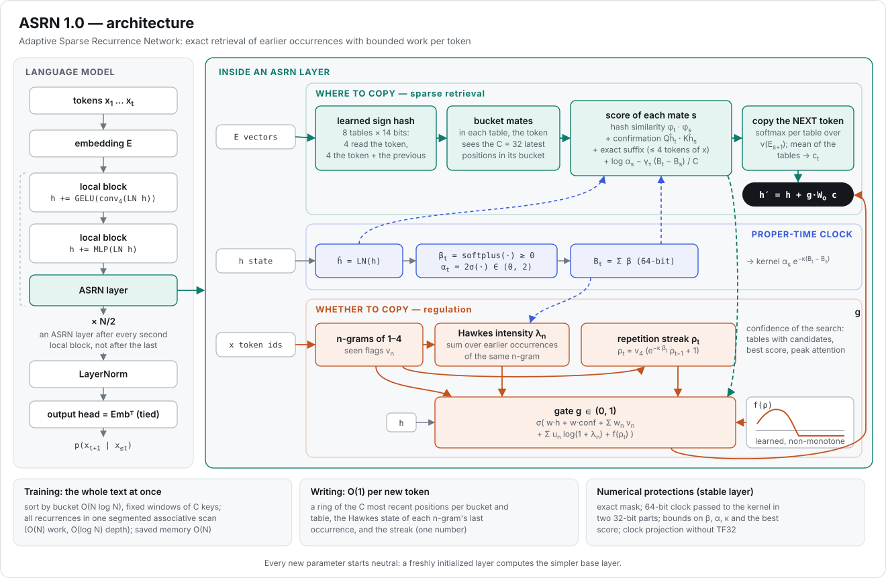
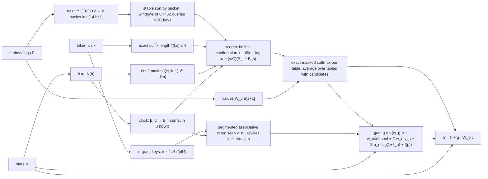

# ASRN: Adaptive Sparse Recurrence Networks

### Technical report for release 1.0: learned-hash sparse retrieval, a proper-time clock, Hawkes repetition signals and numerically protected kernels

**Alexis Calvario** (independent researcher)
Version 1.0.0 — October 2026
Code: the `asrn` package in this repository [Calvario, 2026] (Apache License 2.0). Raw results: [`results/`](../results/README.md). Development history: [`history/`](../history/README.md). [Versión en español](TECHNICAL_REPORT_es.md).

---

> **How to read the numbers.** Every figure in this report is taken from a result file or development report in this
> repository (listed under *Reproducibility*). Each measurement carries a tag that says where it was taken:
>
> - **[CPU]**: a 4-core CPU without GPU, PyTorch 2.14.1. Exact operation and memory counts, latency, and small-scale
>   quality. Triton kernels run in the Triton interpreter there, which checks arithmetic, not speed
>   (`results/banco_cpu/`; the timing of the two generation writers is in `results/escritura_cpu/`).
> - **[A100-Oct17]**: the single execution of `benchmarks/asrn_colab.ipynb` on 17 October 2026 on one NVIDIA
>   A100-SXM4-80GB in Google Colab (PyTorch 2.14.1, CUDA 13.0, Python 3.13.15, code fingerprint `5164e1f32513`). Every
>   section, including RWKV-7, comes from it: `results/banco_a100/` for the benchmark and `results/citas_a100/` for the
>   bounded-quotation experiment. Two rows of the training table are compiled; every other measurement is uncompiled.
>   That code computes the same forward pass and gradients as release 1.0.0, bit for bit; only its generation writer
>   was the earlier $O(t)$ one (Section 6.6 and *Reproducibility*).
> - **[A100-Oct9]** and **[A100-Oct11]**: the two executions of the previous A100 run (notebook `banco_a100.ipynb`,
>   PyTorch 2.11.0, nothing compiled; `history/results/banco_a100_pt211/`), cited only as a replication. The Oct 11
>   execution (code fingerprint `176cfe250773`) added RWKV-7 and repeated the stability probes with TF32 disabled; the
>   other rows, including the ablation, come from Oct 9.
> - **[A100-run5]**: the fifth development run (Oct 5, 2026), an earlier protocol against *reimplementations* of
>   Mamba-2 and RWKV-7 (`history/results/corrida_5/`).
> - **[A100-dev]**: earlier development measurements (runs 1–4, local-block variants, the compiled-speed notebook;
>   A100 40 GB or 80 GB, PyTorch 2.11 or 2.14) recorded in `history/`.
>
> Numbers carrying different tags are not directly comparable.

## Abstract

Attention's work per token grows with the context; fixed-state recurrent models (Mamba-2, RWKV-7) have constant cost but
limited exact recall. ASRN (Adaptive Sparse Recurrence Network) is a language-model layer that retrieves exact earlier
occurrences with bounded work per token: learned sign hashes (8 tables, 14 bits) restrict each position to its 32 most
recent bucket mates, scored by hash similarity, confirmation, exact suffix matches and a learned proper-time clock; the
token that followed each match is copied through a gate reading Hawkes intensities and a repetition streak. Release 1.0
adds a numerically protected layer (exact masking, 64-bit clock, bounds) that closes a causal leak measured when every
valid score falls below −10⁹ (γ=10⁹) and removes clock drift that appears from about a million tokens, for +7.5% time
and +5.2% memory at 262k tokens. On one A100 with PyTorch 2.14, at 262,144 tokens an uncompiled ASRN layer is 21.6×
faster than FlashAttention-2 attention and 2.5× faster than a Mamba-2 block run without causal-conv1d (a unit with 2.6×
its parameters); a ~50M model trains at 163–172k tokens/s from 1k to 32k tokens uncompiled and 199–210k compiled by
parts, 2.08× our Transformer++ at 32k (2.20× with both compiled). With 2.5–46M parameters and 3 seeds, ASRN copies at 4×
the training length when it leaves the initial plateau (99.99% and 99.98%; the third seed stayed on it for all 2,000
steps), keeps MQAR recall with 4× the pairs (99.75% vs 26.1% for Mamba-2 and 16.5% for RWKV-7, neither fully converged
and both highly variable across runs) and reaches WikiText-103 perplexity 67.9 (RWKV-7 75.8, not significant; an earlier
development run (run 5) with another protocol and a reimplemented RWKV-7 found RWKV-7 best, 47.87 vs 57.02; Mamba-2
74.3, but ahead of ASRN when both use a learning rate of 10⁻³, one seed). The models are far from convergence, the
corpus rewards copying, and ASRN has exact token matching built in, a bias aligned with copy and MQAR. ASRN is slower on
short inputs, uses about twice attention's memory and generated slowest on the A100 (43 ms/token, measured with the
earlier O(t) writer and most likely launch-bound). Release 1.0.0 generates in O(1) time per new token (a ring of recent
positions per bucket, a Hawkes state per n-gram): with a ~0.7M-parameter model on CPU, 9.49–12.47 ms per token from 512
to 131,072 tokens of context, 9.7× faster than the O(t) writer at 131,072; it has not yet been measured on the A100. The
design separates two responsibilities: bucketed sparse attention decides *where* to copy, and the gate, the proper-time
clock and the Hawkes/streak signals regulate *whether* to copy and *when to stop*. On copy and MQAR, where every
evaluated position requires copying, the retrieval core is sufficient on its own and the regulation mechanisms are
non-intrusive: with them ASRN reaches 99.99% / 99.98% at 4× in the seeds that learned copy and 99.75% on MQAR, removing
them one at a time leaves the accuracy of the runs that learned within seed variation (lowest learned copy run at 4×:
99.89% among the base and the regulation variants; the base itself stayed on the initial copy plateau with one seed, as
did the variants without the gate and without the clock, so one failed seed cannot be attributed to a removed mechanism;
MQAR means 99.29–99.95% with 4× the pairs, against 99.75% for the base), and removing the ASRN layer drops both tasks to
chance. The active role of the gate and of the Hawkes and streak signals is validated in a controlled synthetic
bounded-quotation experiment with the 1.0 layer (3 seeds, on CPU and replicated on the A100): without explicit
supervision the gate learns to brake state aliasing, and the longest repetition streak in free generation stays at 10
tokens, as in the real text, against 21–27 (CPU) and 19–39 (A100) without those signals, without the gate's signals or
without a gate; the proper-time clock has no measurable effect in that task, which has no topic shifts. Their
large-scale ablation on natural corpora is planned for v1.1.

## 1. Introduction

### 1.1 The problem

A causal Transformer layer [Vaswani et al., 2017] computes, for every position $t$, a softmax over all earlier
positions. Its work per token therefore grows linearly with the context, and the total work quadratically. IO-aware
kernels such as FlashAttention [Dao et al., 2022] make the memory of that computation linear, but not the work. In our
measurements one attention layer ($d=512$, FlashAttention-2 through PyTorch SDPA, forward and backward) takes 3.3 ms at
1,024 tokens and 1,486.0 ms at 262,144 tokens [A100-Oct17]. During generation the whole key–value cache is read for
each new token.

Linear-time models replace the growing context by a state of fixed size: linear attention [Katharopoulos et al., 2020],
selective state spaces such as Mamba and Mamba-2 [Gu & Dao, 2023; Dao & Gu, 2024], and modern recurrent networks such
as RWKV-7 [Peng et al., 2025]. Their cost per token is constant, but a fixed state cannot hold an arbitrarily long span
verbatim: such models are provably and empirically weaker at copying and associative recall [Jelassi et al., 2024;
Arora et al., 2023]. Copying is how a language model reuses names, numbers, identifiers and quotations from its
context, the behaviour that induction heads implement inside Transformers [Olsson et al., 2022].

The problem ASRN addresses is therefore specific: **a sequence-mixing layer whose training work per token does not
grow with the context length, which can still retrieve and copy individual tokens from far back, and which carries an
explicit mechanism for deciding when copying is appropriate.**

### 1.2 What ASRN proposes

ASRN keeps *exact* access to individual past positions, as attention does, but only to a bounded set of candidates per
position chosen by learned hashing: in each of $T=8$ tables, a position sees at most its $C=32$ most recent earlier
positions in the same hash bucket. What is copied is the embedding of the token that *followed* each match, an explicit
induction ("copy-next") operation. Retrieval is complemented by an explicit model of repetition — whether, how often
and how recently the current 1- to 4-gram occurred (a Hawkes intensity), and how long the current quotation has lasted
(a streak) — which a gate reads to decide how much of the retrieved content enters the residual stream. Retrieval and
repetition share one notion of time, a learned and data-dependent *proper-time clock*.

The design therefore separates two responsibilities. **Retrieval** — learned hash tables, candidate windows, and scores
with the exact suffix, the confirmation and the time term — decides *where* to copy and performs exact retrieval.
**Regulation** — the gate, the proper-time clock and the Hawkes and streak signals — decides *whether* to copy and *when
to stop*, which matters in open-ended generation, where copying is only sometimes correct.

### 1.3 Contributions

This report documents release 1.0 of ASRN: the v89 core (`asrn/nucleo.py`) plus a numerically protected layer
(`asrn/estable.py`), which the public API uses by default. Its contributions are:

1. **A code-aligned specification** of the layer and the model (Sections 2 and 4). Every equation was checked against
   the implementation.
2. **A numerical analysis of the clock and of the masking** (Sections 3 and 5). Two failure modes of v89 were found by
   measurement — a causal leak caused by a finite mask, and loss of clock precision from about one million tokens —
   and closed by protections whose cost was measured.
3. **An evaluation against the original Mamba-2 (`mamba_ssm`), the original RWKV-7 (`flash-linear-attention`) and a
   Llama-style Transformer** at matched width and approximately matched parameter count (Section 6), reporting where ASRN is ahead, where it
   is behind, and which conclusions this scale does not support.
4. **An ablation, a per-component evidence audit and a controlled generation experiment** (Section 7). On copy and MQAR
   the retrieval core is necessary and sufficient, and the regulation mechanisms are non-intrusive: their presence does
   not degrade exact retrieval, and removing them leaves the accuracy of the runs that learned within seed variation
   (the base itself, and the variants without the gate or without the clock, each stayed on the copy plateau with one
   of three seeds, so the failure cannot be attributed to the removed mechanism). The active role of the gate and of the
   Hawkes and streak signals is validated in a controlled synthetic experiment of bounded quotations with the 1.0 layer,
   where the gate learns without explicit supervision to brake state aliasing in free generation; the clock has no
   measurable effect in that task. The roadmap of release 1.1 (Section 10) names the experiment that extends each result
   to larger scale.
5. **Constant-time generation** (Sections 2.11 and 6.6). Writing step by step costs $O(1)$ time per new token: a ring
   of the $C$ most recent positions per bucket and a Hawkes state per $n$-gram key replace the pass over the whole
   memory. It gives the same outputs as the earlier $O(t)$ writer (maximum difference $2.2\cdot10^{-7}$), and on CPU its
   time per token does not grow from 512 to 131,072 tokens of context; its A100 measurement is pending.

To our knowledge, the combination of one learned proper-time clock shared by a sparse exact-retrieval layer and by an
$n$-gram Hawkes intensity, read by a copy gate through a learned non-monotone response to the repetition streak, has not
been described before. We do **not** claim that each component is individually necessary for every task: on pure-copy
tasks the retrieval core suffices on its own, and the regulation mechanisms act in open-ended generation, where the
controlled experiment of Section 7.2 measures their effect; their ablation at scale on natural text is v1.1 work.

### 1.4 Related work

**Hashed and routed attention.** Reformer [Kitaev et al., 2020] sorts positions by locality-sensitive hash bucket and
attends within a block and its predecessor; the Routing Transformer [Roy et al., 2021] clusters queries and keys. ASRN
uses the same sort-and-window structure but differs in four ways: the hash is learned (the signs of a learned
projection), the window is causal and ordered by recency (the $C$ most recent bucket mates), the score adds discrete
evidence (exact suffix matches) and a proper-time decay, and the value is the next token's embedding, followed by a
repetition-aware gate. Reformer combines its hash rounds weighted by their normalizers, which ASRN does not (Section 7).

**Linear-time sequence models.** Linear attention [Katharopoulos et al., 2020], selective state-space models [Gu & Dao,
2023; Dao & Gu, 2024] and RWKV-7 [Peng et al., 2025] carry a fixed-size state (without decay in linear attention;
data-dependent decay through Mamba's input-dependent step size and RWKV-7's dynamic decay). ASRN's clock is related in spirit — a data-dependent step $\beta_t$
accumulated into a proper time $B_t$ — but it is used differently: the decay acts on sparse *exact* matches, as a
normalized recency bias in the retrieval scores and as the kernel of a point-process intensity, rather than on the
transition of a dense state. The recall limits of fixed-state models are documented by Jelassi et al. [2024] and by the
multi-query associative recall (MQAR) task of Zoology [Arora et al., 2023], which we use.

**Copy mechanisms.** Pointer networks [Vinyals et al., 2015], CopyNet [Gu et al., 2016], pointer-generator networks
[See et al., 2017] and pointer-sentinel mixtures [Merity et al., 2016] mix generation with copying from a source or a
cache at the output. ASRN's copy happens inside every ASRN layer and acts on embeddings, not on the output distribution.

**Point processes.** Hawkes processes [Hawkes, 1971] are self-exciting point processes; neural variants model event
sequences [Mei & Eisner, 2017; Zuo et al., 2020]. In ASRN the Hawkes intensity is not an output but an internal feature:
the excitation of the current $n$-gram by its own past occurrences, measured in proper time.

**Parallel scans and kernels.** Linear recurrences can be parallelized with associative scans [Blelloch, 1990; Martin &
Cundy, 2018; Smith et al., 2023]. ASRN computes all its repetition recurrences with one segmented scan, and its bucket
attention with Triton [Tillet et al., 2019] kernels that recompute scores in the backward pass, as FlashAttention does.
The baselines use the Triton kernels of flash-linear-attention [Yang & Zhang, 2024] (RWKV-7) and of `mamba_ssm`
(Mamba-2).

**Length extrapolation.** Position encodings such as rotary embeddings [Su et al., 2024] do not extrapolate well beyond
the training length, which motivated ALiBi [Press et al., 2022]. ASRN has no positional table: order enters through the
local convolutions and the clock. We did not test Transformers with ALiBi or other extrapolation schemes.

## 2. Architecture and internal mechanics

### 2.1 Model recipe

Tokens $x_t\in\{0,\dots,V-1\}$ are embedded as $E_t=\mathrm{Emb}[x_t]\in\mathbb{R}^d$, and $h^{(0)}=E$. The model stacks
$N_b$ causal *local blocks* and inserts an ASRN layer after block $i$ whenever $i \bmod 2 = 0$ and $i<N_b-1$
(`largo_cada=2`, the default since October 2026): $\lceil (N_b-1)/2\rceil$ ASRN layers in total. A local block mixes the
current position and the $k-1=3$ previous ones with a dense causal convolution, then applies an MLP of width $2d$:

$$
h \leftarrow h + \mathrm{GELU}\big(\mathrm{Conv}^{\mathrm{causal}}_{k}(\mathrm{LN}_1 h)\big), \qquad
h \leftarrow h + W_2\,\mathrm{GELU}\big(W_1\,\mathrm{LN}_2 h\big).
$$

The output matrix is tied to the embedding, $p(x_{t+1}\mid x_{\le t})=\mathrm{softmax}(\mathrm{Emb}\,\mathrm{LN}_f h_t)$,
and there is no positional table. For $N_b\ge 8$, the outputs that are added to the residual stream are scaled by
$1/\sqrt{2N_b}$ at initialization. Weights are kept in fp32 and 16-bit arithmetic is used through autocast: the layer
mixes 32- and 64-bit arithmetic (clock, token signatures, $n$-gram keys), and the code rejects models converted to 16-bit
weights. The models of Section 6 are, for example, $d=512$ with 8 local blocks and 4 ASRN layers (~45M parameters,
WikiText-103) and $d=512$ with 14 local blocks and 7 ASRN layers (~50M, speed).

Each ASRN layer receives three inputs: the token embeddings $E$, the current state $h$ and the token ids $x$. **Hashes
and copied values depend only on the embeddings**; the state enters through the confirmation term, the clock and the
gate; the token ids enter through the exact-match features (suffix, seen flags, Hawkes, streak).

### 2.2 The layer at a glance



*Overview of the model (left: local blocks with an ASRN layer after every second one) and of one ASRN layer (right:
where to copy, the proper-time clock, whether to copy; training cost, $O(1)$ writing and the numerical protections).
Source: `docs/asrn_architecture.svg`, drawn by `docs/hacer_diagrama.py` (Spanish version: `docs/asrn_arquitectura.svg`).
Figure 1 below details the data flow inside the layer.*



*Figure 1. Data flow inside one ASRN layer. Left branch: where to copy (hash, windows, scores). Lower branch: whether to
copy (repetition memory read by the gate). The proper-time clock feeds both.*

| Symbol | Meaning | Default |
|---|---|---|
| $T$ | hash tables (the last $T_c$ also see the previous token) | 8, $T_c=4$ |
| $b$ | bits per table (buckets per table: $2^b$) | 14 (16,384) |
| $P=Tb$ | hash coordinates per position | 112 |
| $C$ | candidates per table (block size of the windows) | 32 |
| $c_f$ | confirmation width | 16 |
| $K$ | maximum exact suffix | 4 |
| $n$ | $n$-gram orders of the repetition memory | 1–4 |
| — | streak-response nodes, maximum streak | 16, 256 |

### 2.3 Learned hashing

Two small MLPs produce the hash coordinates: $f_{\mathrm{word}}:\mathbb{R}^d\to\mathbb{R}^{64}\to\mathbb{R}^{56}$ for the
four token-only tables and $f_{\mathrm{ctx}}:\mathbb{R}^{2d}\to\mathbb{R}^{64}\to\mathbb{R}^{56}$, applied to
$[E_t;E_{t-1}]$, for the four context tables, so $\varphi_t\in\mathbb{R}^{112}$. The bucket of position $t$ in table
$\tau$ is the sign pattern of that table's 14 coordinates, read as a binary number. Two consequences follow from the
construction. First, because the hash is a deterministic function of the embeddings, **equal tokens always share a
bucket in the token-only tables, and equal bigrams in the context tables**; other tokens may collide with them.
Second, bucket ids are computed from $\varphi$ without gradient: the assignment itself is not learned by
backpropagation. The hash learns only indirectly, through the similarity term $\langle\varphi_t,\varphi_s\rangle$ of the
score, which pulls together useful pairs that already share a bucket; a useful pair that never collides receives no
signal. The similarity term uses all 112 coordinates, so tables differ only in *which* candidates they see and in their
time scale $\gamma_\tau$. In bf16, a coordinate close to zero can change sign by rounding.

### 2.4 Candidate windows

For every (sequence, table) row, positions are sorted stably by bucket id (ties keep text order), a leading block of
$C$ empty slots is prepended, and the sorted row is cut into blocks of $C=32$. Each block of 32 queries is scored
against the $2C=64$ keys formed by the previous and the current block. Key $j$ is valid for query $i$ iff (a) both have
the same bucket, (b) the key is one of the $C$ sorted positions immediately preceding the query, and (c) the key is a
real position. Because the order is (bucket, position), (a)–(b) select exactly the at most $C$ most recent earlier
positions in the same bucket, $\mathcal{N}_\tau(t)$, and causality ($s<t$) holds by construction. Half of every
$32\times64$ tile lies outside this band and is discarded; this is likely immaterial because, by an estimate from the
kernel code, the kernels are limited by memory traffic, not arithmetic (Section 2.10).

The work per position is therefore bounded by $T\cdot C=256$ candidates, whatever the sequence length. The price is
**truncated recency**: in a frequent bucket (a common token) only its 32 most recent occurrences are visible, so
long-range access to frequent material relies on the context tables, whose buckets (token pairs) are rarer.

### 2.5 Scores, per-table softmax and copy-next

Each candidate is scored by four terms (Section 4.3): hash similarity, a learned confirmation from the normalized
state, a learned weight for the exact-suffix length, and the logarithm of a proper-time memory kernel. A softmax is
taken **per table**; the value of candidate $s$ is $W_vE_{s+1}$, the embedding of the token that followed it (since
$s<t$, at most the current token). Table outputs are **averaged uniformly** over the $n_t$ tables that have candidates,
so a table with poor candidates weighs as much as one with an exact match; the gate corrects this only globally.
Mixing tables by their log-normalizers, as Reformer does, was tested and not adopted (Section 7).

### 2.6 Exact suffix and confirmation

The suffix length $\ell(t,s)\in\{0,\dots,4\}$ counts consecutive exact matches backwards, $x_{t-1}=x_{s-1}$,
$x_{t-2}=x_{s-2}$, and so on. It is computed from token ids (the "signature" of a token is its id stored in fp32, exact
for vocabularies up to $2^{24}$, which the code enforces), and contributes a learned weight $w^{\mathrm{suf}}_\ell$
(five numbers). It is discrete evidence that a vector similarity cannot provide, and it was designed to make copying
exact. The ablation neither shows that copying needs it nor rules it out: without it (`sin_sufijo`), 2 of 3 seeds left
the initial copy plateau (seed 0 did not, in both A100 runs), one of them copied at 4× with 99.77% and the other with
only 39.77% (the lowest learned run of the ablation), and the MQAR mean (99.69%) stayed within seed variation
(Section 7). The confirmation term is a 16-dimensional bilinear form on the normalized state, with $W_q$ initialized at
zero so that it starts inactive.

### 2.7 Repetition memory: seen flags, Hawkes intensity and streak

For each order $n=1,\dots,4$, the $n$-gram ending at $t$ is identified by a key
$k_n(t)=\sum_{j=0}^{n-1}c_j\,x_{t-j}$, computed in fp64 with fixed random coefficients $c_j\in[0.5,1.5)$. A stable sort
of the keys places the previous occurrence of the same $n$-gram immediately before each position, which gives the
*seen* flag $v_n(t)$ and the order in which the Hawkes intensity is scanned (no extra sort). The stability review
estimates the probability that two different $n$-grams share a key at about $10^{-16}$ per pair.

- The **Hawkes intensity** $\lambda_n(t)$ sums $\alpha_s e^{-\kappa_n(B_t-B_s)}$ over the earlier occurrences $s$ of the
  same $n$-gram: how often, how recently in proper time, and how memorable. Its support, $\mathbf{1}[\lambda_n>0]$, equals
  $v_n$ except when the decay underflows in fp32 ($\kappa_n(B_t-B_s)\gtrsim104$): then $\lambda_n=0$ while $v_n=1$, and
  the seen flag keeps that information.
- The **streak** $\rho_t=v_4(t)\,(e^{-\kappa_r\beta_t}\rho_{t-1}+1)$ measures how long the current quotation has been
  running (with $\kappa_r=0$ it is the exact run length of seen 4-grams).

The rates are learned in log space (hence positive) and start from a geometric spectrum,
$\kappa_n=1/(C\cdot4^{\,n-1})$ and $\kappa_r=1/(8C)$: short $n$-grams forget quickly, long ones (rare) remember longer.
All of these are linear recurrences $S_i=a_iS_{i-1}+b_i$ with $a_i\in[0,1]$, solved by a segmented associative scan
(Section 4.6): $O(N)$ work and $O(\log N)$ depth in the PyTorch even–odd implementation, and, on GPU, one Triton kernel
per direction that scans blocks of 1,024 elements with `tl.associative_scan` and carries the state between blocks. The
backward pass is the same scan run right to left; it stores two numbers per element. With $a_i\in[0,1]$ the scan only
multiplies numbers in $[0,1]$ and adds; an $a_i$ that underflows simply restarts the recurrence, which is the correct
behaviour. The intensity is bounded by twice the number of occurrences and enters the gate as $\log(1+\lambda)$.

### 2.8 The gate

The gate logit sums: a linear function of the state $h_t$ (computed in fp32); four retrieval-confidence signals —
fraction of tables with candidates, best valid score, mean peak attention over tables with candidates, fraction of
context tables with candidates; the seen flags; $\log(1+\lambda_n)$; and a learned response $f(\rho_t)$ to the streak.
$f$ is piecewise linear on 16 nodes equally spaced in $\log(1+\rho)$ up to $\rho=256$, parametrized by *increments*
(Section 4.7). It can rise while a quotation has a typical length and fall sharply when it becomes too long, which a
monotone response such as $u\log(1+\rho)$ cannot express. Because nodes that never see data receive zero gradient, their
increments stay at zero and the curve extrapolates flatly from the last node with data, so a learned brake does not
vanish for streaks longer than any seen in training.

The motivation is *state aliasing*. Under teacher forcing the gate learns $P(\text{copy}\mid\text{signals})$. If the
signals saturate (seen flags in $\{0,1\}^4$, suffixes up to 4 tokens), a 5-token quotation and a 50-token one are the
same state, the gate applies one average continuation rate, and in free generation quotation lengths become geometric,
with a longer tail than in real text. Hawkes and streak make the quotation state observable. Their effect is measured
in a controlled synthetic experiment of bounded quotations (Section 7.2).

### 2.9 Neutral initialization and compatibility

$w_\alpha$, $\gamma$, the seen weights $w_n$, the Hawkes weights $u_n$, the streak increments $\delta_j$, $w^{\mathrm{suf}}$,
the confidence weights and $W_q$ start at zero, and the clock bias is set so that $\beta_t=1$ and $\alpha_t=1$: the
clock initially counts tokens. A freshly built layer therefore computes what the earlier v85 layer computed, and
`asrn.cargar` still reads v85 and v87 checkpoints (the 62-test suite of the development runs checked that they
reproduce their outputs; the 1.0 suite no longer includes those comparisons). The stable layer
`CapaASRNEstable` has the same parameters and names as the core `CapaASRN`, so checkpoints cross in both directions.

### 2.10 Triton kernels and memory flow

The bucket attention runs on GPU as two fused Triton kernels (`_casilleros_ida`, `_casilleros_vuelta`), with the
PyTorch implementation kept as reference and CPU fallback. One program handles one (batch row × table, block of 32
queries in that table's order). It reads its 32 queries and 64 keys directly from text order through the sort
permutation — $\varphi$, $Q_c/K_c$, the clock, $\log\alpha$, the bucket and the four previous token ids — builds the
scores in on-chip memory (two `tl.dot`), applies the suffix weight, the time term and the mask, takes the softmax in
fp32, multiplies by $V$ in blocks of 64 columns and writes each query's output at its text position, together with the
gate signals. The backward kernel **recomputes** the scores, as FlashAttention does, and stores nothing from the forward
pass except its inputs. It uses **no atomic additions**: each position is a query once per table and each key appears
in exactly two windows (as current and as previous block), so every contribution is written to its own slot and the
slots are summed afterwards in a fixed order, which also makes the backward deterministic. Gradients of $\gamma$ and
$w^{\mathrm{suf}}$ are written one row per program and summed afterwards.

The measured effects of these choices (saved memory 43.8 → 20.1 KiB per token, backward 6.4 → 0.99 ms, scan ~290 → ~6
launched operations, all with identical arithmetic up to rounding) are collected in Section 7.4.

**By a count from the kernel code, the layer's kernels are memory-bound** (estimated, not profiled). With $d=512$, bf16,
per token and layer, the forward pass moves about 41 KB and the backward about 81 KB, about 122 KB in total, at roughly 10 arithmetic operations per byte
(an A100 needs about 100 to become compute-bound). At about 2.0 TB/s this is a floor of about 60 ns per token. The
measured marginal cost of the whole stable layer between 65,536 and 262,144 tokens is 251 ns per token [A100-Oct17],
about four times that floor: the operations around the kernels (hashing, sorting, gathering previous tokens, dtype
conversions) weigh more than the kernels, consistent with an earlier profile in which the Triton kernels took about
2–3 ms of a layer [A100-dev]. Up to 16k tokens the layer has a fixed floor of about 12 ms (12.1–12.5 ms) that does not
depend on the length [A100-Oct17]. It was not profiled in the benchmark, but it is most likely kernel-launch overhead:
recording the step as a CUDA Graph earlier reduced one layer at 1,024 tokens from 11.4 to 1.6 ms (FlashAttention:
1.5 ms) [A100-dev].

### 2.11 Generation path

`escribir()` (`asrn.generate`) processes a prompt once and then one token at a time, and in release 1.0.0 each new
token costs **$O(1)$ time**, however much text there is (`_Escritor` in `asrn/nucleo.py`). Each ASRN layer caches, per
position, $\varphi$, bucket ids, values, $K_c$, the four previous token ids, the clock $B$ and $\log\alpha$, in buffers
reserved in advance; each local block keeps its last $k-1$ normalized inputs. Three structures make the step
independent of $t$:

- **Where to copy: a ring per bucket.** Each table keeps, for each of its $2^b$ buckets, a ring with the $C=32$ most
  recent positions in that bucket — exactly the keys the earlier writer chose by scoring the whole memory. The new token
  reads the ring of its bucket in each table and scores only those $T\times C$ candidates (`_atender_cand`; the stable
  layer keeps the exact mask and the 64-bit clock). With prompt-only copy memory (the default) only prompt positions
  can be keys, so the rings are filled from the prompt and never change; without it, each new position enters its
  rings.
- **Whether to copy: a Hawkes state per $n$-gram key** (`_MemoriaHawkes`). For each key it keeps the clock of its last
  occurrence, $B_u$, and $A=\lambda_n+\alpha$ at that moment; then $\lambda_n(t)=e^{-\kappa_n(B_t-B_u)}A$, and
  afterwards $A\leftarrow\lambda_n(t)+\alpha_t$ and $B_u\leftarrow B_t$. This is the sum of Section 4.5 carried as the
  recurrence that the whole-text associative scan uses. The keys are computed on the CPU from the sampled tokens and
  looked up in Python dictionaries (no wait for the GPU); the states stay on the device. The streak was already one
  number per layer.
- **Sampling helpers.** The quotation-preserving temperature (Section 4.7) and `no_repetir_ngramas` read $n$-gram
  dictionaries updated with each token (`_Ngramas`) instead of rescanning the text, and the generated text lives in a
  preallocated buffer.

Memory still grows with the text (each position's cached features: what is copied must be stored), plus the fixed
rings: $T\cdot2^{b}\cdot C$ positions (int32) and their counters, 17 MiB per ASRN layer per sequence at the default
sizes ($T=8$, $b=14$, $C=32$), about 120 MiB per sequence for the ~50M benchmark model (7 ASRN layers). The earlier
$O(t)$ writer scores the new token against the **whole** cached memory, restricts it per table to the $C$ most recent
valid bucket mates and compares its $n$-gram keys with all previous keys; it stays available as
`_Escritor(modelo, o1=False)` and is used automatically only if the rings would exceed 2 GiB (very large `n_bits` or
batch).

**Equivalence** [CPU]. The $O(1)$ writer gives the same logits as the $O(t)$ writer, with and without prompt-only copy
memory, and both match the whole-text forward pass when prompt-only copy memory is off: maximum difference
$2.2\cdot10^{-7}$ (v89 and stable layer, rings that overflow, batches of 1–3, prompts of 1, 2 and 40 tokens;
`test_escritura_o1_igual_que_o_t` in both suites, and `test_anillo_y_ngramas_como_su_definicion` for the rings and the
$n$-gram dictionaries). `escribir()` gives the same token sequences, and logits within $10^{-4}$, as the previous $O(t)$
implementation in 192 of 192 combinations of sampling options (temperature, top-$k$, top-$p$, prompt-only copy memory,
quotation-preserving temperature, repetition penalty, no-repeat $n$-grams), with the v89 and the stable layer.

Two defaults shape generation: *prompt-only copy memory* (`memoria_de_lo_ajeno=True`: candidates are restricted to
positions whose continuation lies inside the prompt, so the model cannot get trapped copying its own output), and a
*quotation-preserving temperature* (Section 4.7). With prompt-only copy memory disabled
(`memoria_de_lo_ajeno=False`), step-by-step generation matches full-sequence processing, also on the GPU (on the A100,
with the $O(t)$ writer of that run, TF32 off, a small test model: 100% of 80 steps equal, maximum difference
$2.3\cdot10^{-7}$ [A100-Oct17, GPU check 7]). With the default, the candidate set is deliberately smaller than the
parallel path's.

## 3. The system clock

### 3.1 Definition

From the normalized state $\hat h_t=\mathrm{LN}(h_t)$, each ASRN layer computes two scalars per token:

$$
\beta_t=\mathrm{softplus}(w_\beta^\top\hat h_t+b_\beta)\ \ge 0,\qquad
\alpha_t=2\,\sigma(w_\alpha^\top\hat h_t+b_\alpha)\in(0,2),\qquad
B_t=\sum_{u\le t}\beta_u .
$$

The biases $b_\beta$ and $b_\alpha$ are learned; $b_\alpha$ is initialized at 0.

$B_t$ is a monotone, data-dependent reparametrization of time: a token may advance the clock a lot (for example at a
change of topic) or almost nothing (inside a quotation, where nothing should be forgotten). $\alpha_s$ states how
memorable occurrence $s$ is. Memory decays with the continuous kernel

$$
K_\kappa(t,s)=\alpha_s\,e^{-\kappa\,(B_t-B_s)},
$$

an exponential kernel whose distance is proper time rather than token count. At initialization $\beta_t=\alpha_t=1$.

### 3.2 Why clock precision matters

The clock is the only notion of time and distance in an ASRN layer: there is no positional table, and the local
convolutions see four positions. It is used in three places:

1. **Retrieval (normalized kernel).** Table $\tau$ adds $\log\alpha_s-(\gamma_\tau/C)(B_t-B_s)$ to the score, i.e. the
   logarithm of $K$ with a per-table rate. After the softmax this is a normalized recency preference measured in proper
   time. $\gamma_\tau$ starts at zero and its sign is not constrained by the code, so a table can also learn to prefer
   older candidates.
2. **Repetition (unnormalized kernel).** $K$ with rates $\kappa_n$ is the excitation kernel of the Hawkes intensities,
   so "how recently" an $n$-gram was seen is also measured in proper time.
3. **Streak decay.** The streak decays by $e^{-\kappa_r\beta_t}$ per token, i.e. per unit of proper time.

Because every layer shares one clock across all its tables and all its repetition memories, an error in $B$ propagates
to both *where* and *whether* the layer copies. The relative form $B_t-B_s$ also keeps the gate signal "best score"
stationary along the sequence.

### 3.3 Separability of the time term

Because the kernel is exponential, time enters the score **linearly** in $B$:

$$
-\frac{\gamma_\tau}{C}(B_t-B_s)=\underbrace{\frac{\gamma_\tau}{C}B_s}_{\text{key}}-\underbrace{\frac{\gamma_\tau}{C}B_t}_{\text{query}} .
$$

The term separates into a per-key and a per-query vector that are broadcast inside the $C\times2C$ tile, so the backward
pass never stores a $C\times 2C$ tensor of time terms. This is a good decision for memory, and it is also the origin of
the cancellation problem below.

### 3.4 Precision of a 32-bit clock

An fp32 number has a 24-bit significand. For $B$ in $[2^k,2^{k+1})$ the spacing of representable numbers is
$\mathrm{ulp}(B)=2^{k-23}$, and each accumulation $B\leftarrow B+\beta$ is rounded with an error up to
$\mathrm{ulp}(B)/2$: 0.06 at $B=2^{20}$ and 1 at $B=2^{24}$. Two consequences follow: the increment $B_t-B_{t-1}$ that
the model actually uses is known only to about $\mathrm{ulp}(B)$, so its relative error grows like
$\mathrm{ulp}(B)/\beta$; and when $\beta_t<\mathrm{ulp}(B)/2$, $B+\beta$ rounds back to $B$ and **the clock stops**. A
parallel prefix sum does not help: the limit is the significand of $B$, not the order of the additions. The probes
measured this with $\beta=\mathrm{softplus}(\mathcal{N}(0,1))$ (mean 0.81), reporting the median relative error of
$B_t-B_{t-1}$ over the last quarter of the sequence and the fraction of steps where the clock did not advance:

| Length | 32-bit accumulator [CPU] | 64-bit sum rounded to 32 bits [CPU] | CUDA `cumsum` [A100-Oct17] | Clock stopped [CPU] | Clock stopped [A100-Oct17] |
|---|---|---|---|---|---|
| $2^{16}$ | 0.13% | 0.16% | — | 0% | — |
| $2^{20}$ (1 M) | 2.0% | 2.5% | 2.2% | 0.01% | 0.03% |
| $2^{22}$ (4 M) | 8.1% | 10% | 8.6% | 0.9% | 1.1% |
| $2^{24}$ (16 M) | 44% | 64% | 50% | 16% | 16% |
| $2^{25}$ (32 M) | — | — | 100% | — | 37% |
| $2^{26}$ (64 M) | 100% | 100% | — | 61% | — |

The 32-bit accumulator is also the v89 generation path (`B[t] = B[t-1] + β`). The GPU `cumsum` falls between the two
CPU variants, as predicted by the CPU emulation. The relative error is smaller for differences between distant
positions (on the A100 at $2^{20}$ tokens: 0.19% at distance 32 and 0.007% at distance 1,024), but the absolute error
stays near one ulp of $B$ and grows with the length; multiplied by $\gamma/C$, that absolute error is what enters the
score.

### 3.5 Cancellation in the score

v89 evaluates the time term as $(\log\alpha_s+r B_s)-rB_t$, $r=\gamma_\tau/C$: two large numbers are formed and then
subtracted after other score terms have been added. Shifting the whole clock by a constant should not change anything
(only differences matter), so the output change under a shift isolates the arithmetic error. On a test layer with
$\gamma$ between 0.5 and 4 [CPU]: $4\cdot10^{-5}$ for a shift of $10^5$, $2.8\cdot10^{-4}$ for $10^6$, $4.7\cdot10^{-3}$ for
$1.6\cdot10^7$, $2\cdot10^{-2}$ for $6.4\cdot10^7$ and 0.11 for $10^9$. On the A100 with another test layer
(`banco_gpu.py`, Triton kernel on the GPU, TF32 off): $9.4\cdot10^{-5}$, $2.8\cdot10^{-3}$ and $8.8\cdot10^{-2}$ for shifts of
$10^6$, $1.6\cdot10^7$ and $10^9$ [A100-Oct17]; the same test on CPU gives $1.2\cdot10^{-4}$, $2.8\cdot10^{-3}$ and
$7.8\cdot10^{-2}$.

### 3.6 The 64-bit clock and the split kernel

The stable layer (`reloj_64`) makes three changes:

1. $\beta$ is cast to fp64 before the prefix sum, so $B_t$ is accumulated in fp64 in both the parallel path and the
   step-by-step generation cache.
2. In the PyTorch path, the difference $B_s-B_t$ is taken in fp64 **before** multiplying by the rate
   (`_TiempoRelativo`, which saves only its inputs for the backward pass, as v89 did).
3. In the Triton kernel (`ESTABLE` compile-time mode), the 64-bit clock is passed as two fp32 arrays,
   $B^{\mathrm{hi}}=\mathrm{fl}_{32}(B)$ and $B^{\mathrm{lo}}=\mathrm{fl}_{32}(B-B^{\mathrm{hi}})$, with
   $|B^{\mathrm{lo}}|\le\mathrm{ulp}(B^{\mathrm{hi}})/2$, and the time difference is formed before the multiplication:

$$
\Delta_{ts}=\big(B^{\mathrm{hi}}_s-B^{\mathrm{hi}}_t\big)+\big(B^{\mathrm{lo}}_s-B^{\mathrm{lo}}_t\big),\qquad
\text{score}\mathrel{+}=\log\alpha_s+\frac{\gamma_\tau}{C}\,\Delta_{ts}.
$$

By Sterbenz's lemma, the difference of two floating-point numbers within a factor of two of each other is exact, so for
positions whose clocks are close (the common case for recent bucket mates once $B$ is large) the high parts subtract
without error and the low parts restore the rounding of the original 64-bit values. Gradients flow through the high
part only: the derivative of $r(B_s-B_t)$ does not depend on how $B$ is split. The kernel reads 4 extra bytes per query
and per key.

### 3.7 Reduced-precision projections: bf16 and TF32

To save one read of $\hat h$, v89 computes the clock projection $w^\top\hat h$ in the same matrix product as $Q_c$ and
$K_c$, which under autocast runs in 16 bits. In fp16 the $d$-term sum can overflow 65,504 and make $\beta$ infinite; in
bf16, $\beta$ carries about three significant digits and the bias accumulates in $B$. Measured on the layer of
`test_reloj_en_32_bits_con_autocast` [CPU]: 0.39, 0.65, 0.93 and 1.27 units of $B$ after 512, 1,024, 2,048 and 4,096 tokens
with $d=64$, and 3.3 units after 4,096 tokens with $d=512$. On NVIDIA GPUs there is a third case: with
`torch.backends.cuda.matmul.allow_tf32` enabled (as `entrenar()` and the notebooks do), an "fp32" matrix product uses a
10-bit mantissa. The stable layer therefore computes the clock projection in true fp32 by elementwise multiply-and-sum
(`_ProyeccionIEEE`; two output columns, about $2d$ operations per token), outside autocast and outside TF32, while $Q_c$
and $K_c$ keep the fast path. Measured over 65,536 tokens with $d=512$ [A100-Oct17], switching TF32 on changes $B_t$ of
v89 in fp32 by up to **1.98 units**, and that of the stable layer by $1.16\cdot10^{-10}$ (the fp64 rounding).

### 3.8 Measured results and cost

| Probe | v89 core layer | Stable layer (group A) | Tag |
|---|---|---|---|
| Output change, clock shifted by $10^6$ / $1.6\cdot10^7$ / $10^9$ (TF32 off) | $9.4\cdot10^{-5}$ / $2.8\cdot10^{-3}$ / $8.8\cdot10^{-2}$ | $5.5\cdot10^{-8}$ for all three | [A100-Oct17] |
| Same probe | $1.2\cdot10^{-4}$ / $2.8\cdot10^{-3}$ / $7.8\cdot10^{-2}$ | $5.5\cdot10^{-8}$ for all three | [CPU] |
| Two shifted clocks against each other ($10^6$ vs $10^9$) | $8.8\cdot10^{-2}$ | $5.5\cdot10^{-8}$ | [A100-Oct17] |
| $\max\lvert\Delta B_t\rvert$, TF32 on vs off, 65,536 tokens, fp32 | 1.98 | $1.16\cdot10^{-10}$ | [A100-Oct17] |
| Kernel `ESTABLE` vs PyTorch, fp32 (output / worst gradient) | — | $4.9\cdot10^{-8}$ / $4.5\cdot10^{-6}$ | [A100-Oct17] |
| Kernel `ESTABLE` in bf16, distance to the fp32 answer | — | 0.096 (PyTorch in bf16: 0.094) | [A100-Oct17] |
| One layer, $2^{20}$ tokens, forward only, $d=64$, bf16: time / memory | 41.7 ms / 2.185 GB | 33.3 ms / 2.198 GB | [A100-Oct17] |

The stable layer's error does not change with the shift; a constant error is not drift but a fixed rounding difference
between the base computation and any shifted clock. In the first execution of the previous run [A100-Oct9], with TF32
enabled, the stable layer gave a constant $3.55\cdot10^{-6}$ instead, caused by TF32 in the matrix products that follow
the time term, again without drift. At $2^{20}$ tokens the outputs of the two layers differ by $8.2\cdot10^{-4}$ (less
than 0.1%), a figure that mixes clock, bf16 projection, masking and rounding, and does not isolate drift; the memory
difference is 12 bytes per token and a single timing per execution does not resolve a time difference. In the normal
regime the stable layer reproduces v89 up to rounding ($1.3\cdot10^{-7}$ in the logits [CPU]). The cost of all group-A
protections together, now measured with `_ProyeccionIEEE`, is +7.5% time at 262,144 tokens (68.7 vs 64.0 ms; +0–7% at
shorter lengths) and +4–5% memory at every length (10.85 vs 10.31 GB at 262,144, +5.2%) [A100-Oct17]; the memory
increase comes from saving $\hat h$ in fp32 for the clock. These are single timings; the previous run, before
`_ProyeccionIEEE`, measured +3% time [A100-Oct9].

**Practical reading.** The 64-bit clock becomes advisable from about one million tokens, where the increment error
reaches 2%, and necessary from about 16 million, where the clock stops on 16% of the steps — on the GPU as on the CPU.
How much the 32-bit error matters at shorter lengths depends on the learned $\gamma$; at $2^{20}$ tokens the test layer's
output changed by less than 0.1%.

### 3.9 A hypothesis ruled out

The adjoint of a prefix sum is a suffix sum, $\partial L/\partial\beta_u=\sum_{t\ge u}\partial L/\partial B_t$, so one might
expect the clock gradient to grow with the sequence length. Measured with a fixed number of tokens per step on a small
untrained model ($d=64$) from 256 to 65,536 tokens with Zipf-like text and to 32,768 with a uniform vocabulary [CPU], the
clock-gradient norm stays flat ($1.7\cdot10^{-5}$ and $0.7\cdot10^{-5}$ respectively), the norm for $\gamma$ stays between
2 and $6\cdot10^{-7}$ (rising 1.7× from 256 to 32,768 with the uniform vocabulary), about 0.0% of the total. No protection
was added for this; it should be measured again in a large trained model.

## 4. Mathematical formulation

### 4.1 Notation

$L$ (or $N$) sequence length, $d$ width, $T$ tables, $b$ bits, $P=Tb$, $C$ candidates, $c_f$ confirmation width, $K$
maximum suffix; $B_t$ always denotes the clock. $\hat h_t=\mathrm{LN}(h_t)$. $\mathcal{N}_\tau(t)$ is the candidate set
of position $t$ in table $\tau$, $n_\tau(t)=\lvert\mathcal{N}_\tau(t)\rvert$, $n_t$ the number of tables with
$n_\tau(t)>0$, $n^{\mathrm{ctx}}_t$ the same count over the $T_c$ context tables.

### 4.2 Layer output and hashing

$$
h'_t=h_t+g_t\,W_o\,c_t,\qquad c_t=\frac{1}{\max(1,n_t)}\sum_{\tau=1}^{T}\ \sum_{s\in\mathcal{N}_\tau(t)}a_\tau(t,s)\,W_vE_{s+1}
$$

$$
\varphi_t=\big[f_{\mathrm{word}}(E_t)\,;\,f_{\mathrm{ctx}}([E_t;E_{t-1}])\big]\in\mathbb{R}^{P},\qquad
\mathrm{id}_\tau(t)=\sum_{j=0}^{b-1}2^{j}\,\mathbf{1}\big[\varphi_{t,\tau,j}>0\big]
$$

$$
\mathcal{N}_\tau(t)=\big\{\text{the at most }C\text{ largest }s<t\text{ with }\mathrm{id}_\tau(s)=\mathrm{id}_\tau(t)\big\}
$$

### 4.3 Score

$$
s_\tau(t,s)=\frac{\langle\varphi_t,\varphi_s\rangle}{\sqrt{P}}+\frac{\langle W_q\hat h_t,\,W_k\hat h_s\rangle}{\sqrt{c_f}}
+w^{\mathrm{suf}}_{\ell(t,s)}+\log\alpha_s-\frac{\gamma_\tau}{C}\,(B_t-B_s)
$$

$$
\ell(t,s)=\max\big\{m\le K:\ x_{t-j}=x_{s-j}\ \ \forall j=1,\dots,m\big\}
$$

With the defaults, $\sqrt{P}=\sqrt{112}$ and $\sqrt{c_f}=4$.

### 4.4 Masked softmax

Let $\mathcal{W}(t)$ be the 64 keys of $t$'s window and $\mathcal{N}_\tau(t)\subseteq\mathcal{W}(t)$ the valid ones. v89
replaces invalid scores by a finite constant $-M$, $M=10^9$:

$$
a^{\mathrm{v89}}_\tau(t,\cdot)=\mathbf{1}\big[n_\tau(t)>0\big]\cdot\mathrm{softmax}_{s\in\mathcal{W}(t)}\Big(s_\tau(t,s)\ \text{if}\ s\in\mathcal{N}_\tau(t)\ \text{else}\ -M\Big).
$$

If every valid score falls far below $-M$ (for example with a very large time term), the softmax mass moves to *invalid* keys,
which include the query itself — whose value $W_vE_{t+1}$ is the next token — and later positions: information flows
from the future. The stable layer subtracts the maximum over **valid** keys only, and gives invalid keys exactly zero
weight:

$$
m_\tau(t)=\max_{s\in\mathcal{N}_\tau(t)}s_\tau(t,s),\qquad
a_\tau(t,s)=\frac{\mathbf{1}[s\in\mathcal{N}_\tau(t)]\;e^{\,s_\tau(t,s)-m_\tau(t)}}{\sum_{s'\in\mathcal{N}_\tau(t)}e^{\,s_\tau(t,s')-m_\tau(t)}} .
$$

In the normal regime both give the same bits (the softmax already subtracts the row maximum internally).

### 4.5 Clock and repetition recurrences

$$
\beta_t=\min\big(\mathrm{softplus}(w_\beta^\top\hat h_t+b_\beta),\ \beta_{\max}\big),\qquad
\log\alpha_t=\max\big(\log 2+\log\sigma(w_\alpha^\top\hat h_t+b_\alpha),\ \log\alpha_{\min}\big),\qquad
B_t=\sum_{u\le t}\beta_u
$$

(the bounds $\beta_{\max}=10^4$ and $\log\alpha_{\min}=-30$ belong to the stable layer; v89 has none.)

$$
v_n(t)=\mathbf{1}\big[\exists\,s<t:\ k_n(s)=k_n(t)\big],\qquad k_n(t)=\sum_{j=0}^{n-1}c_j\,x_{t-j}
$$

$$
\lambda_n(t)=\sum_{s<t,\ k_n(s)=k_n(t)}\alpha_s\,e^{-\kappa_n(B_t-B_s)},\qquad n=1,\dots,4
$$

$$
\rho_t=v_4(t)\big(e^{-\kappa_r\beta_t}\rho_{t-1}+1\big),\qquad \rho_0=0
$$

In the order sorted by key, where $i-1$ is the previous element and $r_i=\mathbf{1}[k(i)=k(i-1)]$, the Hawkes intensity
is the linear recurrence

$$
S_i=a_i\,\big(S_{i-1}+\alpha_{i-1}\big),\qquad a_i=r_i\,\exp\!\big(-\kappa_n\max(0,\,B_i-B_{i-1})\big),
$$

and $\lambda_n(t)$ is $S$ read at $t$'s sorted position. The intensity of a self-exciting process with exponential
kernel admits exactly this recursion, which is what makes it computable by a scan.

### 4.6 Associative composition

Every recurrence above has the form $S_i=a_iS_{i-1}+b_i$ with $a_i\in[0,1]$. Affine maps $x\mapsto ax+b$ compose as

$$
(a_1,b_1)\circ(a_2,b_2)=\big(a_1a_2,\ a_2b_1+b_2\big),
$$

which is associative, so the prefix $S_i$ is a scan in this monoid with identity $(1,0)$. Setting $a_i=0$ restarts the
recurrence, so many independent segments (all $n$-grams, all sequences) are scanned in one pass. With upstream gradient
$g_i=\partial L/\partial S_i$, the backward pass is the same recurrence run backwards:

$$
\eta_i=g_i+a_{i+1}\,\eta_{i+1},\qquad \frac{\partial L}{\partial b_i}=\eta_i,\qquad \frac{\partial L}{\partial a_i}=\eta_i\,S_{i-1}.
$$

### 4.7 Gate and streak response

$$
\mathrm{conf}_t=\Big[\frac{n_t}{T},\ \ m_t,\ \ \frac{1}{\max(1,n_t)}\sum_{\tau:\,n_\tau(t)>0}\max_s a_\tau(t,s),\ \ \frac{n^{\mathrm{ctx}}_t}{T_c}\Big],\qquad
m_t=\max_{\tau:\,n_\tau(t)>0}m_\tau(t)\ \ (0\text{ if }n_t=0)
$$

$$
z_t=w_g^\top h_t+b_g+w_{\mathrm{conf}}^\top\mathrm{conf}_t+b_{\mathrm{conf}}+\sum_{n=1}^{4}w_n\,v_n(t)+\sum_{n=1}^{4}u_n\log\big(1+\lambda_n(t)\big)+f(\rho_t),\qquad g_t=\sigma(z_t)
$$

$$
x=\min\!\Big(\frac{\log(1+\rho)}{\Delta},\,15\Big),\quad \Delta=\frac{\log 257}{15},\quad i=\min(\lfloor x\rfloor,14),\qquad
f(\rho)=U_i+(x-i)\,\delta_{i+1},\qquad U_i=\sum_{j\le i}\delta_j
$$

$f$ is linear between nodes and constant beyond the last node ($\rho\ge256$). In the stable layer, $m_t$ is clipped to
$\pm10^4$ (`mejor_max`). The protections of group B, off by default, replace the gate logit by a soft cap and floor the
repetition rates:

$$
z_t\ \leftarrow\ c\,\tanh(z_t/c),\quad c=10;\qquad \kappa_n,\kappa_r\ \leftarrow\ \max\big(\kappa,\ \kappa_{\min}\big),\quad \kappa_{\min}=\frac{1}{4L_{\mathrm{train}}} .
$$

**Quotation-preserving temperature.** In generation, let $\mathcal{C}_t$ be the set of tokens that would close an
already-seen 4-gram, $p$ the model distribution at temperature 1 and $q$ the distribution after temperature, top-$k$ and
top-$p$. Sampling uses

$$
q'_w=q_w\,\frac{p(\mathcal{C}_t)}{q(\mathcal{C}_t)}\ \ (w\in\mathcal{C}_t),\qquad
q'_w=q_w\,\frac{1-p(\mathcal{C}_t)}{1-q(\mathcal{C}_t)}\ \ (w\notin\mathcal{C}_t),
$$

so that the probability of continuing a quotation is the model's own and temperature only sharpens the choice within
each part (unchanged if $q$ zeroes one of the parts). It does not cover the start of a quotation: in the synthetic
experiment (Section 7.2), the full layer quotes 20.9–22.2% of tokens at $T=0.8$ and 9.3–11.2% at $T=1$, against 15.6% in
the real text.

### 4.8 Dynamic gradient clipping

`RecorteDinamico` (optional; not used in the benchmarks, which clip the global norm at 1) partitions parameters into
groups $G$ (clock and rates; gate and suffix weight; rest). For group norm $\nu_G$ it keeps exponential moving averages $\mu_G,\mu^{(2)}_G$
with decay 0.98 and bias correction, and uses, after a warm-up of 50 steps,

$$
\theta_G=\min\big(\theta_{\max},\ \mu_G+z\,\sigma_G\big),\qquad \sigma_G=\sqrt{\max\big(0,\ \mu^{(2)}_G-\mu_G^2\big)},\qquad
\nabla_G\leftarrow\nabla_G\cdot\min\!\Big(1,\ \frac{\theta_G}{\nu_G}\Big),
$$

with $\theta_{\max}=1$ and $z=3$ by default. The averages are updated with the *clipped* norm (a spike does not raise the
next threshold) and not updated when the norm is not finite.

### 4.9 Complexity and comparison

Per token and table, an ASRN layer scores at most $2C$ keys of dimension $P+c_f$ and mixes $2C$ values of dimension $d$.
Counting training FLOPs as $2\times$ multiply-adds and $3\times$ for forward plus backward:

$$
\mathrm{FLOPs}_{\mathrm{ASRN}}\approx 6\,(2d^2+\text{hash and clock projections})+6\,T\cdot2C\,(P+c_f+d),
$$

independent of $N$ except for the sort. With a comparison sort the total time would be $O(N\log N)$; the GPU sort of
32-bit bucket ids is a radix sort with a fixed number of passes, so the work per token is constant in practice. The
counted FLOPs per token are flat (Section 6.2), but `FlopCounterMode` does not count the sort, whose cost shows up only in
timings: the model's training throughput on the A100 is nearly flat (−5.3% from 1k to 32k tokens, Section 6.5), while
the CPU latency grows slightly faster than linearly (exponent 1.14–1.22), attributed to sorting and cache effects. Saved
memory for the backward pass is $O(N)$. In generation (Section 2.11) the time per new token is $O(1)$ in the context:
the token scores $T\cdot C$ candidates read from the rings and updates one Hawkes state per $n$-gram order; memory is
$O(t)$ for the cache plus the fixed rings. The comparison below is per sequence-mixing layer, without the dense layer
that accompanies it ($N_s$: Mamba-2 state size, 64 on CPU and 128 on the A100; $D_h$: RWKV-7 head width, 64):

| | Transformer (FlashAttention) | Mamba-2 (SSD) | RWKV-7 | ASRN |
|---|---|---|---|---|
| Training FLOPs per token | $6\cdot4d^2+\mathbf{6Nd}$ | $\approx6\cdot6d^2+O(dN_s)$ | $\approx6\cdot4d^2+O(dD_h)$ | $6(2d^2+\text{hash})+6T\cdot2C(P+c_f+d)$ |
| Grows with $N$ | **yes (linearly)** | no | no | no (radix sort: fixed passes) |
| Limit on GPU | arithmetic (tensor cores) | arithmetic and memory | arithmetic and memory | **memory** (~10 FLOP/byte, estimated) |
| Activation memory | $O(Nd)$ | $O(Nd)$ + per-chunk states | $O(Nd)$ + per-chunk states | $O(N(d+P+T))$ |
| Generation time per token | $O(Nd)$ | $O(dN_s)$, constant | $O(dD_h)$, constant | $O(TC(P+d))$, constant |
| Generation memory | cache $2Nd$ | fixed $2dN_s$ | fixed $dD_h$ | $O(N(d+P))$ + rings, $T\cdot2^{b}\cdot C$ positions |
| Exact recall from far back | yes, if positions generalize | limited by the state | limited by the state | yes, if the match is among the $C$ most recent in its bucket |

## 5. Numerical stability and protections

The stable layer is `CapaASRNEstable` (`asrn/estable.py`), selected by default by `asrn.crear_modelo`,
`asrn.crear_desde_config` and `asrn.cargar`. Group A changes nothing in the normal regime and is on by default; group B
changes the function and is off by default (`Protecciones.textos_largos(L)` enables it, intended for training from
scratch on long texts; `Protecciones.ninguna()` reproduces v89 bit for bit).

| Protection | Group | Failure it prevents | Status of the failure | Cost |
|---|---|---|---|---|
| `mascara_exacta` | A | Causal leak when every valid score falls below $-10^9$ (PyTorch path, kernel and generation) | **Measured**: future changes past by 0.016 with $\gamma=10^9$ and 0.075 with $\gamma=10^{11}$ [CPU]; 0.016 with the Triton kernel on the GPU [A100-Oct17]; protected: 0 exactly | None: same bits in the normal regime |
| `reloj_64` | A | Clock precision from ~1M tokens; score cancellation; stopped clock from ~16M; clock projection in 16 bits or TF32 | **Measured** (Section 3) | 8 bytes per token for $B$ instead of 4; +4 bytes read per query and key in the kernel; two fp32 projection columns without TF32 |
| `beta_max` $=10^4$ | A | $B$ becomes infinite with broken weights ($\infty-\infty=$ NaN in the whole layer) | **Reproduced** in `test_beta_enorme_no_rompe_la_capa` | None (far above normal values) |
| `log_alfa_min` $=-30$ | A | $\log\alpha\to-\infty$, another way to fall below $-10^9$ | Preventive (deduced from code; no dedicated test) | None |
| `mejor_max` $=10^4$ | A | A $-10^9$ entering the gate through the best-score signal | Preventive (deduced from code; no dedicated test) | None |
| `tope_puerta` ($c=10$) | B | Saturated gate (near-zero gradient) for signals outside the training range | Preventive | Changes the gate: $z\to c\tanh(z/c)$ |
| `kappa_min` ($1/(4L_{\mathrm{train}})$) | B | With $\kappa\to0$, $\lambda$ grows with the text length, showing the gate values never seen in training | Preventive ($\log(1+\lambda)$ stayed flat from 256 to 65,536 tokens in the gradient probe) | Changes Hawkes: bounded memory |
| `RecorteDinamico` | training | One global clip lets a spike in a few numbers (clock, $\gamma$) shrink the whole model's gradient | Unit-tested: a $10^4$ spike in the clock is clipped to the threshold and the "rest" group is untouched bit for bit | One norm per group and step; no GPU synchronization |

The measured cost of group A as a whole is +7.5% time at 262,144 tokens and +4–5% memory at every length, measured with
`_ProyeccionIEEE` [A100-Oct17]. Group B showed no measurable cost or effect in the ablation (Section 7).

**What was not needed.** Stabilizing the per-table softmax (it already subtracts the maximum in fp32), protecting
LayerNorm (fp32 under autocast, $\varepsilon=10^{-5}$; $h$ would have to exceed about $10^{19}$ to overflow the square), and
clipping the clock gradient by length (it does not grow; Section 3.9). No `nan_to_num` was added inside the layer:
hiding a NaN would prevent `entrenar()` from skipping the step, which is the correct response when something breaks.

## 6. Experimental evaluation

### 6.1 Protocol

**Software and hardware.** CPU: 4 cores, PyTorch 2.14.1. A100: NVIDIA A100-SXM4-80GB (Colab), PyTorch 2.14.1, CUDA
13.0, bf16 autocast, no CUDA graphs. **Only two rows are compiled**: the ~50M ASRN model compiled by parts
(`compilar_partes`: each local block and the small parts of each ASRN layer; bucket attention and scan keep their
Triton kernels) and the Transformer++ with `torch.compile`, both measured as separate rows of the training table
(Section 6.5). Every other measurement (single layer, generation, quality, ablation, quotation experiment) ran
uncompiled, and Mamba-2 and RWKV-7 were never compiled. TF32 was on except in the fp32 kernel comparison and the
numerical stability probes. Timings are single runs per point (median of 2–5 repetitions for layers and models; the mean
of 32 tokens of one pass for generation).

**Models compared on the A100** (all with tied output embeddings, same width, and the number of blocks that brings the
parameter count closest to ASRN's):

- **ASRN**: the stable layer with group A, in the default recipe.
- **Transformer++**: *our* implementation of the Llama recipe (RMSNorm, SwiGLU, RoPE) in
  `benchmarks/modelos_oficiales.py`, with attention through `scaled_dot_product_attention` (FlashAttention-2 on the
  A100) and a key–value cache for generation. RMSNorm, RoPE and SwiGLU are separate PyTorch operations, **not fused**,
  so its speed with short inputs may be pessimistic.
- **Mamba-2**: the `Mamba2` block of `mamba_ssm` 2.3.2 (SSD Triton kernels, state 128, head width 64) **without
  `causal-conv1d`** (no wheel for this version), i.e. its unfused path: its speed and memory are pessimistic, so every
  ASRN-vs-Mamba-2 speed ratio below is an **upper bound**.
- **RWKV-7**: `RWKV7Model` of `flash-linear-attention` 0.5.2 with its own initialization and head width 64 (the official
  model does not tie the output; here it is tied, as in all models). fla compiles or autotunes its kernels for each new
  shape, which most likely explains its slow first step (230 s at 1,024 tokens) and prefix pass (Section 6.6).

**Parameters.** Copy: ASRN 2,631,236 (4 local blocks + 2 ASRN layers, $d=256$), Transformer++ 2,541,312 (3 blocks),
Mamba-2 2,458,488 (5 blocks), RWKV-7 2,915,328. MQAR: 4,597,316, 4,507,392, 4,424,568 and 4,881,408 (larger vocabulary).
WikiText-103: 45,138,568 (8 local blocks + 4 ASRN layers, $d=512$), 44,416,000 (6 blocks), 44,656,912 (11 blocks) and
46,320,640. On WikiText-103, without the vocabulary matrix, ASRN has 3.9% more parameters than the Transformer++ and 2.6% more
than Mamba-2 (whose vocabulary matrix is padded to 50,264 rows); on copy and MQAR, 3.7% and 7.4% more. RWKV-7 (3, 3 and
6 blocks) has 10.8%, 6.2% and 2.6% more parameters in total than ASRN in the three tasks (11.4%, 11.4% and 6.1% more
without the vocabulary matrix).

**Training.** Identical loop for all models: AdamW (betas 0.9/0.95, weight decay 0.1 on matrices only), 2% warm-up and
cosine decay to lr/10, global gradient clipping at 1, bf16, the same batches for every model within a seed. For each
model and task, the better of two learning rates $\{10^{-3},3\cdot10^{-3}\}$ on seed 0 is repeated with seeds 1 and 2;
mean ± standard deviation over 3 seeds is reported. Ties (100% with both rates) go to $10^{-3}$. **There is no separate
test set: the learning rate is selected with the same evaluation that is reported.**

**Tasks.**
- *Copy*: vocabulary 512, sequences of 1,024 tokens whose second half repeats the first (copying from 512 back), 2,000
  steps of batch 32. Accuracy on the copyable half at 1,024, 4,096 and 16,384 tokens (at 4,096, 2,047 tokens are copied
  from 2,048 back). Chance: $1/511=0.196\%$.
- *MQAR* [Arora et al., 2023]: vocabulary 8,192, sequences of 512 tokens with 64 key–value pairs ($L/8$), 2,000 steps of
  batch 64. Accuracy on the queried values at 512, 1,024 and 2,048 tokens, i.e. with 64, 128 and 256 pairs: length and
  number of pairs change together.
- *WikiText-103* [Merity et al., 2016]: GPT-2 tokens (50,257); 1,220 steps of 16 windows of 1,024 tokens with random
  starts (with replacement) among the first 19,988,480 training tokens (each run sees ~63% of them, ~12.6M distinct).
  Per-token perplexity on the first 245,760 validation tokens with 1,024 and 4,096 tokens of context (same tokens at both
  lengths). This is about **0.44 training positions per parameter**; the numbers are not comparable to published
  per-word test-set results.

**Speed.** Random tokens. *Single layer*: $d=512$, batch 1, bf16, forward + backward, with peak memory. **Each "layer" is
a different unit**: ASRN's is its mixing layer only (0.65M parameters; in the recipe it comes with two local blocks of
2.1M), the Transformer++'s is attention with RMSNorm (1.05M, without SwiGLU), and Mamba-2's is its whole block (1.72M,
whose expansion plays the role of a dense layer) — **2.6× the ASRN layer's parameters**. *Model*: ~50M parameters
(vocabulary 32,768, $d=512$; ASRN with 14 local blocks and 7 ASRN layers, Transformer++ with 11 blocks, Mamba-2 with
20), 32,768 tokens per step at every length. *Generation*: the same models, batch 1, mean of 32 new tokens after a
prefix of 1k–64k tokens.

**CPU protocol** (exact cost and small-scale quality): models with $d=128$ and 0.61–0.73M parameters; the same training
recipe with batches of 16 × 256; copy with sequences of 256 tokens (vocabulary 128), 400 steps. FLOPs are counted with
PyTorch's `FlopCounterMode` (forward + backward with respect to the state and the parameters, the embeddings passed as
inputs without gradient); saved bytes with `saved_tensors_hooks`, excluding weights; one layer with $d=512$ and batch 1.

### 6.2 Exact cost per layer [CPU]

| Layer ($d=512$) | MFLOP/token, $L$=1,024 | $L$=4,096 | $L$=16,384 | KiB saved/token |
|---|---|---|---|---|
| ASRN (v89), PyTorch path | 5.19 | 5.14 | 5.13 | 43.8 |
| ASRN (stable), PyTorch path | 5.19 | 5.14 | 5.13 | 43.9 |
| ASRN (v89), Triton kernel | (same) | (same) | (same) | 20.1 |
| ASRN (stable), Triton kernel | (same) | (same) | (same) | 20.2 |
| Transformer (attention) | 9.44 | 18.87 | 56.62 | 12.0 |
| Mamba-2 (reference PyTorch) | 11.48 | 11.48 | 11.48 | 93.8 |
| RWKV-7 (reference PyTorch, step by step) | 8.26 | — | — | 183.3 |

- ASRN costs the same per token at any length; attention grows linearly and costs 11× more at 16k tokens. With $d=512$
  the counted ASRN layer costs fewer FLOPs than an attention layer even at zero length (its projections are $2d^2$
  against $4d^2$). The count excludes the backward into the embeddings $E$ (value projection and hash MLPs), which the
  model does compute, so the margin inside the model is smaller.
- `FlopCounterMode` does not count CPU SDPA, so $6Ld$ FLOPs per token (causal attention, forward and backward) were added
  to the Transformer row. It also miscounts the backward of a grouped convolution: for Mamba-2's depthwise convolution
  (1,152 groups) it reported about 1,000× the real value, and a first version of this table gave 22.1 MFLOP; the
  benchmark now uses a group-aware formula, giving **11.48 MFLOP/token**.
- The Mamba-2 and RWKV-7 memory figures come from their reference PyTorch implementations (RWKV-7 step by step stores the
  state of every step) and do **not** represent their GPU kernels, which store their inputs plus one state per chunk.

### 6.3 Latency on CPU [CPU]

| Layer ($d=256$), ms forward+backward | $L$=512 | 2,048 | 8,192 | 32,768 | fitted exponent (2k–32k) |
|---|---|---|---|---|---|
| ASRN (v89) | 22.7 | 63.7 | 317.6 | 1,853.8 | 1.22 |
| ASRN (stable) | 26.9 | 67.5 | 297.7 | 1,608.8 | 1.14 |
| Transformer | 5.3 | 29.6 | 331.5 | 4,796.0 | 1.83 |

ASRN and attention cross between 2k and 8k tokens; at 32,768 ASRN is 2.6–3.0× faster. Differences between v89 and the
stable layer (−13% to +19%, no fixed direction) are CPU measurement noise. CPU latencies of Mamba-2 and RWKV-7 are not
meaningful comparisons (RWKV-7 runs step by step in Python; the chunked SSD backward of Mamba-2 scales poorly on CPU).

### 6.4 One layer on the A100


*Figure 2. One layer, forward + backward, $d=512$, batch 1, bf16, uncompiled [A100-Oct17]. Axis labels in Spanish
("largo" = length).*

| ms (forward + backward) | $L$=1,024 | 4,096 | 16,384 | 65,536 | 262,144 |
|---|---|---|---|---|---|
| ASRN (v89) | 12.0 | 11.7 | 11.7 | 18.0 | 64.0 |
| ASRN (stable) | 12.1 | 12.2 | 12.5 | 19.3 | 68.7 |
| Transformer++ attention (FlashAttention-2) | 3.3 | 3.4 | 10.0 | 102.4 | 1,486.0 |
| Mamba-2 block (`mamba_ssm`, no `causal-conv1d`) | 7.7 | 9.9 | 11.1 | 34.8 | 174.3 |
| RWKV-7 (fla) | 11.6 | 12.0 | 35.0 | 131.1 | 519.4 |
| *Transformer++ / stable* | *0.27* | *0.27* | *0.80* | *5.3* | *21.6* |
| *Mamba-2 / stable* | *0.64* | *0.81* | *0.89* | *1.8* | *2.5* |
| *RWKV-7 / stable* | *0.96* | *0.99* | *2.8* | *6.8* | *7.6* |

| Peak memory (GB) | $L$=1,024 | 4,096 | 16,384 | 65,536 | 262,144 | KiB/token |
|---|---|---|---|---|---|---|
| ASRN (v89) | 0.04 | 0.16 | 0.65 | 2.6 | 10.3 | 38 |
| ASRN (stable) | 0.04 | 0.17 | 0.68 | 2.7 | 10.9 | 40 |
| Transformer++ | 0.02 | 0.09 | 0.34 | 1.4 | 5.5 | 20 |
| Mamba-2 | 0.05 | 0.16 | 0.55 | 2.1 | 8.5 | 31 |
| RWKV-7 | 0.08 | 0.33 | 1.32 | 5.3 | 21.1 | 79 |

- **Up to 16k tokens ASRN is among the slowest layers**: its time is a ~12 ms floor (Section 2.10); FlashAttention-2 is
  3.7× faster at 1k–4k tokens, Mamba-2 is also faster, and RWKV-7 ties at 1k–4k (ASRN overtakes it from ~4.2k tokens).
- **From about 18–20k tokens** (linear interpolation between 16k and 65k: ~17.8k against attention, ~20.2k against the
  Mamba-2 block) ASRN overtakes both. At
  65,536 tokens it is 5.3× faster than attention and 1.8× faster than the Mamba-2 block; at 262,144, 21.6× and 2.5×.
  Against Mamba-2, these are ratios between different units (2.6× the parameters) and an unfused Mamba-2; with whole
  models the ratio is 1.4–1.5 (Section 6.5).
- **RWKV-7 is the slowest layer at 16k and 65k tokens** (at 262,144 attention is slower: 1,486.0 vs 519.4 ms) and uses
  the most memory at every length: at 262,144 tokens it takes 7.6× ASRN's time with 1.9× its memory (measured as the
  first layer of a two-layer fla model).
- **ASRN uses more memory than attention**: ~40 KiB per token, 2.0× attention (20 KiB) and 1.3× Mamba-2 (31 KiB).

### 6.5 Training a ~50M model on the A100


*Figure 3. Training throughput with 32,768 tokens per step [A100-Oct17]. Labels in Spanish.*

| Tokens/s (peak GB) | Params | $L$=1,024 | 4,096 | 16,384 | 32,768 |
|---|---|---|---|---|---|
| ASRN | 50.7M | 172,065 (23.5) | 171,275 (23.5) | 163,503 (23.5) | 163,023 (23.5) |
| Transformer++ | 51.0M | 182,116 (25.5) | 160,772 (25.5) | 110,342 (25.5) | 78,400 (25.6) |
| Mamba-2 | 51.2M | 118,002 (26.4) | 118,314 (26.4) | 116,935 (26.4) | 114,544 (26.4) |
| RWKV-7 | 51.1M | 50,439 (30.5) | 50,082 (30.5) | 48,397 (30.5) | 45,895 (30.5) |
| ASRN, compiled by parts | 50.7M | 210,413 (22.3) | 207,945 (22.3) | 200,800 (22.3) | 198,826 (22.3) |
| Transformer++, `torch.compile` | 51.0M | 262,909 (22.9) | 220,468 (22.9) | 135,614 (22.9) | 90,540 (22.9) |
| *ASRN / Transformer++* | | *0.94* | *1.07* | *1.48* | *2.08* |
| *ASRN / Mamba-2* | | *1.46* | *1.45* | *1.40* | *1.42* |
| *ASRN / RWKV-7* | | *3.41* | *3.42* | *3.38* | *3.55* |
| *Compiled ASRN / compiled Transformer++* | | *0.80* | *0.94* | *1.48* | *2.20* |

- ASRN's throughput is nearly **independent of the sequence length** (−5.3% from 1,024 to 32,768 tokens; −5.5%
  compiled), against −57% for the Transformer++ (−66% compiled), −3% for Mamba-2 and −9% for RWKV-7.
- ASRN overtakes the Transformer++ between 1k and 4k tokens (~2.4k interpolating), much earlier than for a single layer,
  because with a large batch the fixed cost is shared by all tokens of the step; at 1,024 tokens the Transformer++ is 6%
  faster.
- **Compiled.** Compilation by parts speeds ASRN up by 1.21–1.23× at every length and lowers its peak memory to 22.3 GB;
  `torch.compile` speeds the Transformer++ up by 1.44× at 1,024 tokens and 1.15× at 32,768. With both compiled the
  crossover moves to ~5.4k tokens: the Transformer++ is 1.25× faster at 1,024 and ASRN 2.20× faster at 32,768. The first
  step at 1,024 tokens, compilation included, takes 47.0 s for ASRN and 26.2 s for the Transformer++. Mamba-2 and RWKV-7
  were not compiled, so the compiled rows are compared only with each other.
- Against the unfused, uncompiled Mamba-2 ASRN is 1.40–1.46× faster (an upper bound), and against RWKV-7 3.38–3.55×,
  the same order as with the reimplemented RWKV-7 of run 5 (50–53k tokens/s [A100-run5]).
- Peak memory is dominated by the vocabulary logits (common to all): ASRN uses 8% less than the Transformer++, 11% less
  than Mamba-2 and 23% less than RWKV-7, and compiled 3% less than the compiled Transformer++ (one measurement each).

### 6.6 Generation

**On the A100, with the $O(t)$ writer.** The run of 17 October measured the code of that time, whose writer was $O(t)$
per token (Section 2.11). **The $O(1)$ writer of release 1.0.0 has not been measured on the A100 yet.** The notebook's
generation section (`benchmarks/asrn_colab.ipynb`, section 6) now runs the $O(1)$ writer, with the new tokens passed
from the CPU as `escribir()` does, so the next Colab run measures it.

| ms per new token [A100-Oct17] | context 1,024 | 4,096 | 16,384 | 65,536 | prefix 65,536 (s) | memory at 65,536 (GB) |
|---|---|---|---|---|---|---|
| ASRN ($O(t)$ writer) | 42.8 | 42.8 | 43.4 | 43.1 | 0.140 | 3.82 |
| Transformer++ | 14.6 | 14.4 | 14.7 | 15.2 | 0.387 | 2.53 |
| Mamba-2 | 25.3 | 24.9 | 24.7 | 24.5 | 0.139 | 1.26 |
| RWKV-7 | 34.3 | 38.2 | 34.0 | 39.5 | (130.9)\* | 3.69 |

*Methodological notes.* The Transformer++ prefix pass is now measured with the corrected wrapper, which computes the
logits of the last position only, as for the other models (in the previous run it computed the logits of all 65,536
prefix positions, 4.3 GB, so its prefix time and memory were not comparable). \* 110.9–130.9 s at every prefix length:
mostly compilation or autotuning of fla kernels for each new shape.

- **ASRN generated slowest** with the $O(t)$ writer: 2.9× the Transformer++, 1.7× Mamba-2 and 1.2× RWKV-7 (means over
  the four contexts: 43.05, 14.75, 24.84 and 36.51 ms), consistent with the number of small operations per token (8
  tables, 4 Hawkes orders, streak, gate).
- With the corrected wrapper, the Transformer++ prefix pass at 65,536 tokens takes 0.387 s and 2.53 GB, against 0.140 s
  and 3.82 GB for ASRN and 0.139 s and 1.26 GB for Mamba-2.
- The curves are nearly flat with batch 1, including the Transformer++, which reads its whole cache (14.4–15.2 ms;
  fitted slope 11 ns per context token, 95% CI 3–19 ns); RWKV-7 fluctuates between 34.0 and 39.5 ms without a trend.
  What is measured is most likely kernel launches, not context (not profiled). The $O(t)$ term of that writer is hidden
  underneath: the fitted slope is indistinguishable from zero (3.0 ns per context token; 95% CI −25 to 31 ns). The
  $O(1)$ writer removes that term but not the launches, so no A100 speed-up is claimed for it until it is measured.
- ASRN's peak memory at 64k tokens of context is 3× Mamba-2's, but it includes the prefix pass (Mamba-2's also grows,
  from 0.11 to 1.26 GB, although its state is fixed); the persistent cache was not measured separately. The $O(1)$
  writer adds its fixed rings, about 120 MiB per sequence for this model (Section 2.11).

**On CPU, both writers** [CPU] (`benchmarks/medir_escritura.py`, `results/escritura_cpu/`). ASRN model of 700,484
parameters ($V=256$, $d=128$, 4 local blocks, 2 ASRN layers), batch 1, no sampling; median of 9 batches of 32 tokens;
the two writers interleaved at each context, after warming up both and after one unmeasured prompt of each length.

| Context | $O(1)$ writer, ms/token | $O(t)$ writer, ms/token | $O(1)$ prompt pass (s) | $O(t)$ prompt pass (s) |
|---|---|---|---|---|
| 512 | 12.45 | 15.80 | 0.10 | 0.06 |
| 2,048 | 12.47 | 16.73 | 0.26 | 0.20 |
| 8,192 | 10.68 | 19.02 | 0.77 | 0.70 |
| 32,768 | 11.26 | 37.12 | 3.60 | 2.73 |
| 131,072 | 9.49 | 91.67 | 29.04 | 20.44 |

- **The $O(1)$ writer's time per token does not grow with the context.** Least-squares slope of ms per token against
  the context, with 95% CI: −19.21 ns per context token (−41.54 to 3.12), indistinguishable from zero, against
  583.31 ns (537.13 to 629.49) for the $O(t)$ writer. At 131,072 tokens the $O(1)$ writer is 9.7× faster per token
  (91.67 / 9.49 ms); at 512, 1.27×.
- **Prompt pass.** The $O(1)$ writer also fills the rings and the Hawkes state while reading the prompt; profiled, that
  bookkeeping took about 0.3 s at 32,768 tokens and 1.3 s at 131,072 (rings ~0.3 s, Hawkes state 0.8–1.1 s). The
  differences in the table are larger because the prompt time varies from run to run on this shared 4-core machine:
  the same prompt pass took 14.8–23.5 s at 131,072 tokens in four repetitions.
- The CPU generation figures of `results/banco_cpu/` (3.83 → 14.55 ms per token from 512 to 32,768 tokens of context)
  were measured with the $O(t)$ writer in an earlier session, by `benchmarks/banco_asrn.py` (one pass per context, not
  interleaved); they are not comparable with the measurement above.

### 6.7 Quality

**CPU, copy, ~0.7M parameters, 400 steps, 3 seeds** [CPU]:

| Model | lr | params | $L$=256 | $L$=1,024 | $L$=4,096 |
|---|---|---|---|---|---|
| ASRN | 3e-3 | 684,100 | 100.0% ± 0.0 | 99.8% ± 0.1 | 74.3% ± 9.4 |
| Transformer | 1e-3 | 609,920 | 100.0% ± 0.0 | 0.7% ± 0.0 | 0.8% ± 0.1 |
| Mamba-2 (reimplementation) | 1e-3 | 721,608 | 0.9% ± 0.2 | 0.8% ± 0.0 | 0.8% ± 0.1 |

RWKV-7 reached 5.3% in its single CPU run (step by step it takes 10 minutes per run, and the CPU benchmark run stopped
there).

**A100, 3 seeds, selected learning rate** [A100-Oct17]:

| Copy (trained at 1,024) | lr | 1,024 | 4,096 (4×) | 16,384 (16×) | loss < 1 from step | s/run |
|---|---|---|---|---|---|---|
| ASRN | 1e-3 | 100.00, 100.00 (2 of 3 seeds)† | 99.99, 99.98 (2 of 3)† | 66.83, 66.49 (2 of 3)† | 1,000 / never / 1,000 | 78 |
| Transformer++ | 1e-3 | 100.0% ± 0.0 | 0.2% ± 0.0 | 0.2% ± 0.0 | 200 / 200 / 200 | 40 |
| Mamba-2 | 3e-3 | 0.2% ± 0.1 | 0.2% ± 0.0 | 0.2% ± 0.0 | never | 88 |
| RWKV-7 | 1e-3 | 25.8% ± 20.0 (23.5 / 7.0 / 46.8) | 0.2% ± 0.0 | 0.2% ± 0.0 | never (final loss 3.6 / 5.0 / 2.3) | 245 |

† Seeds 0 and 2. Seed 1 stayed on the initial plateau for all 2,000 steps (final loss 6.232 ≈ ln 511; 0.10 / 0.15 /
0.18% at 1,024 / 4,096 / 16,384). Mean ± sd over the 3 seeds: 66.70 ± 57.68 / 66.71 ± 57.64 / 44.50 ± 38.38%. Previous
run [A100-Oct9]: 3 of 3 seeds learned, 100.00 ± 0.00 / 99.87 ± 0.18 / 67.57 ± 27.00%.

| MQAR (trained with 64 pairs at 512) | lr | 512 (64 pairs) | 1,024 (128) | 2,048 (256) | s/run |
|---|---|---|---|---|---|
| ASRN | 3e-3 | 100.0% ± 0.0 | 100.0% ± 0.0 | 99.7% ± 0.4 | 87 |
| Transformer++ | 3e-3 | 1.5% ± 0.2 | 0.6% ± 0.2 | 0.3% ± 0.1 | 54 |
| Mamba-2 | 3e-3 | 93.2% ± 3.3 | 57.2% ± 23.8 | 26.1% ± 25.6 (9.1 / 55.5 / 13.7) | 94 |
| RWKV-7 | 1e-3 | 65.4% ± 31.8 (37.5 / 58.8 / 100.0) | 34.2% ± 18.5 | 16.5% ± 9.3 | 208 |

| WikiText-103 perplexity | lr | context 1,024 | context 4,096 | 4,096 vs 1,024 | s/run |
|---|---|---|---|---|---|
| ASRN | 3e-3 | **67.91 ± 1.00** | **63.08 ± 0.97** | −7.1% | 147 |
| Transformer++ | 1e-3 | 93.27 ± 1.07 | 128.87 ± 6.56 | +38% | 121 |
| Mamba-2 | 3e-3 | 74.25 ± 0.92 | 73.09 ± 0.88 | −1.6% | 141 |
| RWKV-7 | 3e-3 | 75.81 ± 6.39 | 73.96 ± 6.71 | −2.4% | 300 |

*Methodological note: each model's rate is the better of the two-rate grid $\{10^{-3},3\cdot10^{-3}\}$ on seed 0. On
WikiText-103 the Transformer++ selected the lower edge of the grid and the other three models the upper edge (see the
caveats below; wider grids are part of Section 10).*

**Copy.** When ASRN leaves the initial plateau it copies without error at the training length and nearly without error
at 4×: seeds 0 and 2 reached 100% / 99.99% / 66.83% and 100% / 99.98% / 66.49% at 1× / 4× / 16× (loss < 1 from step
1,000). Seed 1 stayed on the plateau for all 2,000 steps. Leaving it within 2,000 steps at $10^{-3}$ is therefore not
guaranteed: it happened in 5 of the 6 base runs of the two A100 runs (3 of 3 in the previous run [A100-Oct9], whose
learned runs copied at 4× with ≥ 99.67%). This is optimization (plateau escape), not capacity: with $3\cdot10^{-3}$
seed 0 left the plateau between steps 200 and 400 and reached 100% / 99.99% / 97.62% (not selected because both rates
tied at 100% at the training length). At 16× the result depends on the seed (66.8% and 66.5% here, 43.5–96.8% in the
previous run): what is solid is that ASRN *sometimes* generalizes to 16×, not how much on average. The Transformer++
falls **exactly to chance** outside its training length (0.17–0.23% against 0.196%); these data do not separate two
causes, RoPE at unseen distances or a head that learned a fixed offset of 511. Mamba-2 did not learn the task even at
the training length (its loss stayed at $\ln 511=6.236$ for 2,000 steps with both rates); ASRN sat on the same plateau
for about 800 steps in its learned seeds (and for all 2,000 in seed 1), so this shows that Mamba-2 did not learn within
this budget, not that it cannot copy (its state of 327,680 numbers is large enough). RWKV-7 was still learning (24%, 7%
and 47% at the training length). **Against ASRN:** at the training length the Transformer++ learns the task in ≤ 200
steps in every seed (loss 0.0025–0.0026 at step 200), at least 4× earlier than ASRN's learned seeds with the same rate,
and each of its runs takes 52% of the time (40 s vs 78 s).

**MQAR.** ASRN keeps its recall as the number of pairs grows (99.99%, 99.99%, 99.75%; ≥ 99.25% in every seed). It
selected $3\cdot10^{-3}$ this time, by a near tie at the training length (100.00% against 99.97% with $10^{-3}$ on
seed 0); the previous run tied at 100%, took $10^{-3}$ and gave 98.51 ± 1.78% at 2,048. Mamba-2 falls from 93.2% to
57.2% and 26.1%, the decline expected from a fixed-size state [Arora et al., 2023], here confounded with length
extrapolation and with Mamba-2 not having converged at the training length (its loss was still falling at step 2,000:
final loss 0.33 / 0.16 / 0.49), and it varies strongly across seeds (9.1%, 55.5% and 13.7% at 2,048). Against ASRN the
paired t-test gives $p=0.070$, $0.090$ and $0.039$ with 64, 128 and 256 pairs: only the last is below 0.05. RWKV-7 (with
$10^{-3}$; it did not learn with $3\cdot10^{-3}$) reaches 65.4%, 34.2% and 16.5%: seeds 0 and 1 did not converge (final
loss 3.40 and 2.05), and seed 2 (final loss 0.001) scores 100%, 54.6% and 27.0%, close to 1/2 and 1/4 with 2× and 4× the
pairs, which suggests that it stores about the 64 pairs of the training length; this was not verified. Against ASRN,
paired $p=0.20$, $0.025$ and $0.0041$. **The rivals' MQAR results are not stable across runs**: with the same seeds,
protocol and rival libraries but a different PyTorch version, Mamba-2 at 2,048 went from 54.39 ± 5.89% in the previous
run to 26.09 ± 25.55%, and RWKV-7 at 512 from 99.90 ± 0.17% to 65.43 ± 31.76% — most likely non-deterministic GPU
kernels acting on unconverged training — while ASRN stayed ≥ 96.4% in every seed of both runs. **The Transformer++ did
not learn MQAR** with either rate (final loss 7.4–8.2, near $\ln 4096=8.32$). This is a budget or learning-rate failure
of this protocol, not a limit of attention (Zoology shows attention solving MQAR with more training): that row is not
evidence against attention.

**WikiText-103.** ASRN is best in every seed (66.81–68.76) and the Transformer++ worst (92.05–94.07). Against Mamba-2
(73.48–75.28) the paired t-test gives $p=0.0078$ at 1,024 and $p=0.0030$ at 4,096. RWKV-7 varies strongly across seeds
(74.41, 70.24, 82.78; mean 75.81, behind Mamba-2): behind ASRN in all three seeds (by 6.26, 3.43 and 14.02), but **not
significant** with $n=3$ ($p=0.13$ at 1,024, $p=0.084$ at 4,096). With 4,096 tokens of context ASRN improves by 7.1%,
RWKV-7 by 2.4% and Mamba-2 by 1.6% (they use the extra context); the Transformer++ degrades by 38% (plausibly RoPE
beyond its training length; not tested). The caveats weigh heavily here:

- **Far from convergence**: 0.44 training positions per parameter (0.28 counting distinct tokens per run); the loss curves
  were still falling (0.2–0.5 nats between steps 488–732 and 976–1,220), and the Mamba-2 − ASRN loss gap on the same
  batches shrank during training (from ~0.10–0.16 to ~0.03–0.07 nats).
- **Learning rates at the edge of the grid**: ASRN and Mamba-2 chose the higher rate, the Transformer++ the lower one
  (159.3 with $3\cdot10^{-3}$), with a short warm-up (24 steps). With the same $10^{-3}$ (seed 0) the order was
  different: Mamba-2 86.1, ASRN 89.6, Transformer++ 94.1.
- **Inductive bias and corpus**: ASRN receives token ids and has exact matching built in (suffix, seen flags, word
  tables). WikiText-103 rewards copying (entities recur within an article). With one corpus, the advantage may be
  specific to WikiText.
- **Contradiction with run 5 (RWKV-7)**: in run 5 [A100-run5] (30M training tokens, the reimplemented RWKV-7 of
  `rivales_lineales.py`, the v89 layer) RWKV-7 was clearly best on text, 47.87 ± 0.15 against 57.02 ± 0.32 for the same
  ASRN recipe at 1,024 tokens (Mamba-2 59.46, Transformer 64.26). Here, with fla's `RWKV7Model`, RWKV-7 is 12% above
  ASRN (7% in the previous run). Differences in data, evaluation and implementation of both models prevent deciding
  which reflects RWKV-7 better. **No general claim that ASRN beats RWKV-7 on text is supported.**

**Training time** (equal data, not equal compute): relative to the Transformer++, a run takes 1.93×, 1.60× and 1.21×
longer for ASRN on copy, MQAR and WikiText, 2.18×, 1.72× and 1.16× for Mamba-2, and 6.1×, 3.8× and 2.5× for RWKV-7
(first run's compilation included). With 2.5–4.9M-parameter models these times mostly measure overheads; at ~45M the
gap narrows to 1.16–1.21× for ASRN and Mamba-2 (RWKV-7 stays at 2.5×). Three seeds measure variation from
initialization and batches, not from the learning-rate grid or the protocol, which is larger; with $n=3$ no
non-parametric test can go below two-sided $p=0.10$ (the t-tests above assume normality).

### 6.8 Tests

In release 1.0.0, `tests/test_nucleo.py` holds 57 tests of the core and `tests/test_estable.py` 19 tests of the stable
layer and the package API (15 at the time of the stability review, plus the package API, command-line and English-alias
tests and the writer test), 76 in total, and `tests/verificar_gpu.py` 7 GPU checks. The tests added with the $O(1)$
writer are `test_escritura_o1_igual_que_o_t` (in both suites: $O(1)$ writer = $O(t)$ writer = whole-text forward,
Section 2.11) and `test_anillo_y_ngramas_como_su_definicion` (core). The GitHub Actions workflow
(`.github/workflows/tests.yml`) runs both suites on CPU with Python 3.11 and 3.13; without Triton the kernel-vs-PyTorch
tests are skipped. Both suites pass in full on CPU (57 / 57 and 19 / 19; Python 3.13.16, PyTorch 2.14.1, Triton 3.8.0,
23 October 2026); with PyTorch 2.11.0 (Triton 3.6.0, NumPy 2.3.5) the core suite gives 55 passed and 2 skipped (the
`torch.compile` tests, which need 2.14) and the stable suite 19 / 19. Tested environments: Python 3.13 with PyTorch
2.11.0 and 2.14.1 (CPU, A100). Before the $O(1)$ writer, the suites (55 and 18 tests, as in the A100 run) passed in full
on CPU with PyTorch 2.14.1 (55 / 55 and 18 / 18); with PyTorch 2.11.0 the core suite gave 53 passed and 2 skipped (the
`torch.compile` tests, which need 2.14) and the stable suite 18 / 18.

On the A100 [A100-Oct17] the suites of that time passed in full: the core suite 55 / 55 (5.3 min), the stable suite
18 / 18 (1.0 min) and all 7 GPU checks, **including `torch.compile`** (compiled vs eager: logits within
$4.8\cdot10^{-4}$, gradients within $1.2\cdot10^{-7}$). The other six: bf16 training of a 30M model (loss 9.806 → 0.203
at 46,435 tokens/s), tiered checkpointing (2,009 / 1,708 / 1,099 MB without, with ASRN-only and with full
checkpointing), FSDP with NCCL in one process (difference 0), GPU = CPU to $6.1\cdot10^{-7}$ (gradient relative
difference $4.5\cdot10^{-7}$), causality ($1.8\cdot10^{-7}$) and generation = full sequence ($2.3\cdot10^{-7}$ over 80
steps, with the $O(t)$ writer of that code).

In the previous run [A100-Oct9] the core suite of that time (62 tests, which also compared v89 with v85 and v87; those
comparisons are no longer part of the suite) gave 59 passed, 2 skipped and 1 failed:
`test_entrenar_aprende_a_copiar_y_reanuda` (copy loss 4.19 after 600 steps against a threshold of 1.5). It had failed on
Colab with PyTorch 2.11 since run 5 (code `d9927a1bba79`) and passed with PyTorch 2.11 in runs 2–4. The test trains on
the CPU, also on that machine, and the failure was reproduced off Colab with PyTorch 2.11 on 6 and 12 CPU threads (copy
loss 4.19–4.20; the previous version of the test itself gives 4.199 on 12 threads, and the current one passes there).
The cause is the initial copy plateau (loss ≈ ln 63 = 4.14): at the test's former learning rate of 3e-3, whether the
model leaves it in 600 steps depends on the order of floating-point sums. With PyTorch 2.14.1 on 1 and 4 threads, model
seed 6 also stayed on the plateau (4.22–4.23) and seed 4 ended at 0.83–0.91, while the other six seeds reached
0.23–0.52; with PyTorch 2.11, 2 threads passed (0.24) and 6 threads with AVX2 kernels barely passed (1.19). More steps
do not help (1,000 steps: seed 6 still at 4.28). The test now trains at 6e-3 with the same steps, batch, threshold and
resume check; it leaves the plateau by step 250 in every case tried (22 runs, model seeds 0–7 on 4 threads and 0–3 on 12
threads with PyTorch 2.14.1; seeds 0–3 on 12 threads, 0–3 on 6 threads with MKL set to AVX-512 and 0–1 on 12 threads
with ATen and MKL set to AVX2 with PyTorch 2.11.0; final copy loss 0.118–0.159), and it passes on the Colab A100
machine [A100-Oct17]. In that previous run the stable suite (14 tests at that time) had one failure of the test itself
(it compared a GPU model on the CPU), since fixed, and the `torch.compile` GPU check was skipped (PyTorch 2.11).

### 6.9 Replication across the two A100 runs

The previous A100 run ([A100-Oct9], [A100-Oct11]; PyTorch 2.11.0, nothing compiled; `history/results/banco_a100_pt211/`)
used the same protocol (except the corrected Transformer++ prefix wrapper), seeds and rival libraries. The conclusions
on speed, memory, WikiText-103 and ASRN's MQAR recall are the same; the main differences:

| Measurement | Previous run (PyTorch 2.11) | This run (PyTorch 2.14) |
|---|---|---|
| One stable layer / attention at 262,144 tokens (ms) | 66.2 / 1,488.9 | 68.7 / 1,486.0 |
| ~50M ASRN training, uncompiled, 1k–32k (tokens/s); ASRN / Transformer++ at 32k | 170–173k; 2.17 | 163–172k; 2.08 |
| ASRN generation ($O(t)$ writer), mean over the four contexts (ms/token) | 40.66 | 43.05 |
| ASRN copy: seeds that left the plateau (4× of the learned seeds) | 3 of 3 (99.67–99.99%) | 2 of 3 (99.98–99.99%) |
| ASRN MQAR at 2,048 (256 pairs) | 98.51 ± 1.78 ($10^{-3}$) | 99.75 ± 0.43 ($3\cdot10^{-3}$) |
| Mamba-2 MQAR at 2,048 / RWKV-7 MQAR at 512 | 54.39 ± 5.89 / 99.90 ± 0.17 | 26.09 ± 25.55 / 65.43 ± 31.76 |
| WikiText-103 at 1,024: ASRN / Mamba-2 / RWKV-7 | 67.78 / 74.17 / 72.35 | 67.91 / 74.25 / 75.81 |
| `mezcla_lse` (ablation): copy seeds learned; MQAR | 3 of 3; diverged (implementation error) | 1 of 3; not learned |

The single-layer time (+4% at 262k), ASRN's generation (+6%) and its uncompiled training at 16k–32k (−4%) moved by a
few percent between the runs; each is a single measurement, and whether the PyTorch version or the Colab machine caused
it was not investigated. The copy plateau and the rivals' MQAR variation are discussed in Section 6.7, `mezcla_lse` in
Section 7.1.

## 7. Ablation study and justification of components

### 7.1 Component ablation on the A100 [A100-Oct17]

ASRN (stable layer, group A) with one component removed at a time, on copy and MQAR, 3 seeds, at the rate selected for
ASRN in each task: $10^{-3}$ for copy and $3\cdot10^{-3}$ for MQAR (the previous run used $10^{-3}$ for both). The base
row (`estable_A`) is the quality run of Section 6.7 itself. Removed components that start at a neutral value (clock,
Hawkes and streak, suffix, confirmation) are frozen there, so these variants compute exactly the base function at step
0, and all variants see the same batches in each seed: the design is paired (copy losses at step 200 differ by less than
$10^{-4}$ across variants of a seed, except `mezcla_lse`). Variants: `sin_puerta` fixes the gate at 1;
`puerta_sin_senales` keeps $\sigma(w_g^\top h+b)$ only; `sin_reloj` freezes $\beta=1,\alpha=1,\gamma=0$;
`sin_hawkes_racha` freezes $u_n$, the streak increments and the rates; `sin_sufijo` freezes $w^{\mathrm{suf}}$;
`sin_confirmacion` freezes $W_q$; `dos_tablas` uses 1 + 1 tables instead of 4 + 4; `solo_local` removes all ASRN layers;
`mezcla_lse` weights tables by their log-normalizers (one softmax over the union of candidates, PyTorch only).

Copy is **bimodal** — a run either leaves the initial plateau (loss ≈ ln 511) and reaches 100% at the training length,
or stays at chance for 2,000 steps — so learned runs and their generalization are reported separately.

| Variant (copy) | learned | 4×, worst learned run | 16× of learned runs (s0 / s1 / s2) | s/run |
|---|---|---|---|---|
| estable_A (base) | 2 of 3 | 99.98% | 66.8 / — / 66.5% | 77.9 |
| estable_AB (+ group B) | 2 of 3 | 99.89% | 53.0 / — / 85.0% | 75.5 |
| sin_puerta | 2 of 3 | 99.98% | 74.6 / — / 74.0% | 64.7 |
| puerta_sin_senales | 3 of 3 | 99.98% | 74.3 / 93.1 / 95.4% | 66.6 |
| sin_reloj | 2 of 3 | 99.98% | 97.4 / — / 79.4% | 73.6 |
| sin_hawkes_racha | 3 of 3 | 99.98% | 70.7 / 77.8 / 88.0% | 72.0 |
| sin_sufijo | 2 of 3 | 39.77% | — / 58.4 / 4.9% | 74.2 |
| sin_confirmacion | 3 of 3 | 99.93% | 39.5 / 78.4 / 78.3% | 78.5 |
| dos_tablas | 1 of 3 | 99.67% | 36.4 / — / — | 77.3 |
| solo_local | 0 of 3 | — | — | 31.8 |
| mezcla_lse | 1 of 3 | 92.67% | 51.5 / — / — | 126.5 |

| Variant (MQAR) | 512, worst seed | 1,024, worst | 2,048 (s0 / s1 / s2) | s/run |
|---|---|---|---|---|
| estable_A (base) | 99.97% | 99.98% | 100.00 / 99.25 / 99.99% | 86.6 |
| estable_AB | 99.97% | 99.67% | 99.98 / 97.92 / 99.98% | 90.8 |
| sin_puerta | 100.00% | 99.98% | 99.94 / 99.95 / 99.93% | 77.4 |
| puerta_sin_senales | 100.00% | 99.95% | 99.98 / 99.01 / 99.50% | 79.1 |
| sin_reloj | 100.00% | 100.00% | 100.00 / 99.86 / 99.98% | 89.0 |
| sin_hawkes_racha | 99.90% | 99.80% | 99.97 / 98.73 / 99.89% | 84.1 |
| sin_sufijo | 99.97% | 99.95% | 100.00 / 99.13 / 99.95% | 87.2 |
| sin_confirmacion | 100.00% | 99.97% | 99.95 / 99.98 / 99.71% | 89.2 |
| dos_tablas | 99.84% | 99.71% | 99.65 / 98.71 / 98.62% | 89.0 |
| solo_local | 1.11% | 0.59% | 0.30 / 0.34 / 0.29% | 43.9 |
| mezcla_lse | 3.91% | 2.57% | 3.61 / 1.08 / 3.15% | 139.7 |

*Methodological note on `mezcla_lse`: in the previous run this variant diverged on MQAR (NaN from step 400) because of
an implementation error in the variant itself. With the corrected implementation it no longer diverges, but it does not
learn MQAR (final loss 8.06–8.28, near $\ln 4096=8.32$). It is not part of release 1.0 (Section 7.4).*

**What is conclusive.**

1. **The ASRN layer is what solves both tasks.** Without it (`solo_local`, a receptive field of 13 tokens while the copy
   distance is 512) the loss stays at chance for 2,000 steps in all seeds of both tasks, in both A100 runs. This is
   conclusive by construction rather than by statistics.

**What did not replicate: log-normalizer mixing.** In the previous run all three `mezcla_lse` seeds left the copy
plateau by step 400, 600–800 steps before the base, taking the first three places of 30 runs, which suggested that
mixing tables by log-normalizer accelerates learning the copy. With the same seeds and protocol (but the corrected
variant and PyTorch 2.14), only seed 0 learned here (loss < 1 from step 600; 99.52% at 1×, 92.67% at 4×), and seeds 1
and 2 stayed on the plateau (4 of 6 runs learned across both runs, against 5 of 6 for the base). It does not learn
MQAR, and it costs +62% per copy run and +61% per MQAR run (PyTorch only). The faster copy learning is therefore not a
robust effect; log-normalizer mixing stays outside 1.0.

**What three seeds cannot establish.**

- That removing the gate, the clock or the suffix harms learning. The base itself stayed on the copy plateau with seed
  1, as did `estable_AB`, `sin_puerta`, `sin_reloj`, `dos_tablas` and `mezcla_lse` (the last two also with seed 2);
  `sin_sufijo` failed with seed 0 instead (also in the previous run, where the base learned it). **Because the base
  itself failed on seed 1, one failed seed in a variant cannot be attributed to the removed component.** Across both
  runs (6 runs per variant) the base learned in 5, `sin_puerta`, `sin_reloj` and `sin_sufijo` in 4 each (Fisher, 4/6 vs
  5/6: $p=0.50$ one-sided, treating the runs as independent), and `puerta_sin_senales`, `sin_hawkes_racha` and
  `sin_confirmacion` in 6. In this run 5 of the 24 runs of the 8 light variants (the base, `estable_AB` and the six
  that remove one component, `sin_puerta` to `sin_confirmacion`) stayed on the plateau, 4 of them with seed 1; at that
  rate the probability of at least one failure in 3 seeds is 0.50, and ~3.5 of the 7 non-base variants were expected to
  show one (4 did). Without clock or suffix the variant also computes the base
  function at step 0: what changes is optimization within the budget, not capacity.
- That fewer tables make learning harder: `dos_tablas` learned in 1 of 3 in both runs (2 of 6, against 5 of 6 for the
  base; Fisher $p=0.12$ one-sided on the pooled counts); suggestive, not conclusive.
- That the suffix matters for length generalization: `sin_sufijo` seed 2 learned at 1× (87.02%) but gave only 39.77% at
  4× and 4.88% at 16×, the lowest learned run of the ablation; one run is suggestive, not evidence.
- That any variant generalizes better or worse at 16×: the 19 learned runs of the light variants range from 4.9% (that
  `sin_sufijo` run) to 97.4%, or from 39.5% without it, and the variation between variants does not exceed that within
  variants (one-way ANOVA $F=2.17$, $p=0.12$; without `sin_sufijo`, $F=1.07$, $p=0.44$).
- Anything in MQAR beyond the need for the ASRN layer: the 27 runs of the base and the 8 variants other than
  `solo_local` and `mezcla_lse` all learned (≥ 99.84% with 64 pairs, ≥ 97.92% with 256; means 98.99–99.95% at 2,048),
  and the variation at 2,048 follows how far each run converged (Spearman −0.77 between final loss and accuracy,
  $p<0.0001$), not the removed component. This MQAR is at ceiling for ASRN: unique keys, the value right after its key,
  and every evaluated position asks for a copy; finding the exact token and reading the next one suffices.

**Retrieval and regulation on pure-copy tasks.** Copy and MQAR evaluate only positions where copying is correct: 100% of
the evaluated positions require a copy. On them the ASRN retrieval core (hash tables, candidate windows and scores) is
sufficient on its own, and the regulation mechanisms are non-intrusive. Their presence does not degrade exact retrieval:
the full layer reaches 99.99% and 99.98% on copy at 4× in the two seeds that left the plateau (the third stayed on it)
and 99.75% ± 0.43 on MQAR with 4× the pairs. Removing them does not lower it beyond seed variation in the runs that
learned: among the copy runs that left the plateau, the lowest at 4× is 99.89% for the base and the regulation variants
(`estable_AB`, seed 0), against 39.77% across all ablation variants (`sin_sufijo`, seed 2, a retrieval variant); one
seed each of the base, `estable_AB`, `sin_puerta` and `sin_reloj` (as well as one of `sin_sufijo` and two each of
`dos_tablas` and `mezcla_lse`) stayed on the plateau, which cannot be attributed to the removed component (see above).
The MQAR means at 2,048 tokens are 99.75% for the base, 99.94% without the gate (`sin_puerta`), 99.50% with the gate
but without its signals (`puerta_sin_senales`), 99.95% without the clock (`sin_reloj`), 99.53% without Hawkes and
streak (`sin_hawkes_racha`) and 99.29% with group B added (`estable_AB`); without the retrieval refinements they are
99.69% (`sin_sufijo`) and 99.88% (`sin_confirmacion`). Only `solo_local`, without any ASRN layer, fails both tasks
(chance level in 3/3 seeds), and `mezcla_lse` fails MQAR. This is the outcome the design predicts: the gate (with
Hawkes, streak and seen flags) decides when *not* to copy and when to stop a quotation that has run too long, and the
clock lets stale matches fade at a change of topic — situations these tasks do not contain. The active role of these
mechanisms is measured in controlled open-ended generation (Section 7.2), and their large-scale ablation on natural
corpora with distractors and topic shifts is planned for v1.1 (Section 10). Their cost was measured: without the gate a
copy run takes 17% less time, without its signals 15% less, without Hawkes and streak 8% less and without the clock 6%
less (against the base's 77.9 s; on MQAR −11%, −9%, −3% and +3% against 86.6 s). Group B has no measurable cost or
effect.

### 7.2 Validation in controlled open-ended generation: the bounded-quotation experiment

Copy and MQAR cannot exercise the regulation mechanisms, so their active role was tested where it matters: free
generation of text that contains quotations of bounded length. The experiment runs on the stable layer of ASRN 1.0
(`benchmarks/experimento_citas.py`; the raw per-seed data and the summary are in `results/citas/` for the CPU and in
`results/citas_a100/` for the replication on the A100).

**Setup.** Text is random, unpredictable tokens ($V=64$) in which, with probability 0.04 per position, a span of the
last 200 tokens of uniform length 6–12 is quoted. In the real continuation, runs of already-seen 4-grams therefore
rarely exceed 9 tokens (0.9% do; the longest is 10), and 15.6% of tokens are quoted. Five models are trained with the
same seed, data and recipe ($d=64$, 2 local blocks and 1 ASRN layer, $L=256$, batch 16, learning rate $3\cdot10^{-3}$,
6,000 steps on fresh text): the full 1.0 layer; the same layer without the Hawkes and streak signals
(`sin_hawkes_racha`: $u^{\mathrm{hk}}$, $d_r$ and both decay rates frozen at their neutral initial values, so the gate
does not see repetition); a gate that sees only the hidden state (`puerta_sin_senales`); no gate (`sin_puerta`, the gate
fixed at 1); and no proper-time clock (`sin_reloj`: $\beta=1$, $\alpha=1$, $\gamma=0$, so time counts tokens). Each
model writes 128 tokens after 128-token prompts of 64 validation texts, at $T=0.8$ with top-$k$=40 (the default) and at
$T=1$, with and without prompt-only copy memory; the full layer also writes with the quotation-preserving temperature
off. Seeds 0, 1 and 2; streaks are pooled over the three seeds.

| Default sampling: $T=0.8$, top-$k$=40, seeds 0–2 [CPU] | quoted | mean run | max run (per seed) | runs > 9 | validation loss |
|---|---|---|---|---|---|
| real continuation | 15.6% | 5.60 | 10 | 0.9% | — |
| **ASRN 1.0 (full layer)** | **20.9%** | **5.24** | **10 (9 / 10 / 10)** | **0.3%** | **3.7027–3.7056** |
| without Hawkes and streak (`sin_hawkes_racha`) | 19.0% | 5.22 | 21 (21 / 20 / 20) | 7.2% | 3.7070–3.7079 |
| gate without signals (`puerta_sin_senales`) | 13.9% | 4.69 | 27 (17 / 23 / 27) | 9.3% | 3.7290–3.7586 |
| no gate (`sin_puerta`) | 14.7% | 4.91 | 23 (19 / 21 / 23) | 11.8% | 3.7320–3.7396 |
| no clock (`sin_reloj`) | 20.2% | 5.25 | 10 (10 / 10 / 9) | 0.2% | 3.7042–3.7053 |

**What the gate learns.** Without any explicit supervision — from the language-modelling loss alone — the full layer's
gate learns almost the same response to the streak in the three seeds: a push to copy when a quotation starts (+0.62 to
+0.76 at $\rho\approx1$), turning negative by $\rho\approx5$ (−0.50 to −0.66), −2.0 to −2.4 at $\rho\approx8$, and a hard
brake from $\rho\approx12$ on (−7.7 to −9.2), flat up to $\rho=256$ [CPU]: a "cliff" just past the longest streak the
data contains, which does not vanish for streaks longer than any seen in training.

**Effect on writing.** With the default sampling, the full layer writes repetition streaks like the real text's: the
longest is 10 (real: 10), and 0.3% of streaks exceed 9 tokens (real: 0.9%). Without the Hawkes and streak signals the
longest written streak doubles to 20–21 per seed and 7.2% of streaks exceed 9 tokens, although the model quotes about as
often (19.0% against 20.9%) and its validation loss is practically the same (0.002–0.005 higher): the brake is invisible
in the loss and visible only in what the model writes. With a gate that does not see the signals, or with no gate, the
model quotes less (13.9–14.7%), still cannot stop (longest 17–27 per seed, 9.3–11.8% of streaks above 9), and the
validation loss worsens by 0.03–0.05. Without the clock the layer writes like the full one (longest 10, 0.2% above 9)
with the same validation loss. The same ordering holds in every condition: at $T=0.8$ and $T=1$, with and without
prompt-only copy memory, the full layer's longest streak per seed is 9–10 (up to 11 with the quotation-preserving
temperature off at $T=0.8$), against 15–36 without the Hawkes and streak signals, without the gate's signals or without
a gate. The quotation-preserving temperature (Section 4.7) matters at $T=0.8$: turning it off raises the quoted fraction
from 20.9% to 27.6% and the streaks above 9 tokens from 0.3% to 2.8% (prompt-only copy memory on).

**Replication on the A100** [A100-Oct17]. The same 5 variants × 3 seeds × 6,000 steps, run on the GPU by the benchmark
notebook, reproduce the CPU result:

| Default sampling, seeds 0–2 [A100-Oct17] | quoted | mean run | max run (per seed) | runs > 9 | validation loss |
|---|---|---|---|---|---|
| **ASRN 1.0 (full layer)** | **21.8%** | **5.39** | **10 (9 / 10 / 10)** | **0.3%** | **3.7032–3.7054** |
| without Hawkes and streak (`sin_hawkes_racha`) | 19.6% | 5.30 | 19 (17 / 15 / 19) | 7.9% | 3.7058–3.7094 |
| gate without signals (`puerta_sin_senales`) | 14.9% | 4.83 | 39 (24 / 21 / 39) | 9.2% | 3.7348–3.7477 |
| no gate (`sin_puerta`) | 14.6% | 4.97 | 21 (21 / 20 / 20) | 12.0% | 3.7282–3.7312 |
| no clock (`sin_reloj`) | 19.4% | 5.26 | 10 (9 / 10 / 9) | 0.4% | 3.7038–3.7049 |

Across all sampling conditions the full layer's longest streak per seed is 9–12 (12 only with prompt-only copy memory
off at $T=0.8$) and without the clock 9–10, against 14–24 without the Hawkes and streak signals, 15–39 with a gate
without signals and 18–31 without a gate. Without Hawkes and streak the validation loss is 0.001–0.004 higher; with a
gate without signals or no gate, 0.025–0.045 higher. The learned gate response has the same shape:
+0.64 to +0.75 at $\rho\approx1.1$ and −7.65 to −8.41 from $\rho\approx12.3$ on.

**Why a non-monotone response.** These mechanisms fix *state aliasing* (Section 2.8): without the streak, a 5-token and
a 50-token quotation are the same state, and the gate can only apply one average continuation rate. The learned response
rises and then falls, which a monotone function of the streak cannot express.

**Scope.** This is a controlled synthetic experiment: one task, three seeds, $d=64$, one ASRN layer, on CPU and
replicated on one A100. It removes the Hawkes and streak signals together and the gate's inputs as a whole, so it
validates the gate and its repetition signals, not each signal separately. The proper-time clock has no measurable
effect here, as expected for a task without topic shifts; whether the clock helps when the text changes topic is
hypothesis 7 of the roadmap (Section 10). One known limit remains: how often a quotation *starts* is not calibrated —
the full layer quotes 20.9–22.2% of tokens at $T=0.8$ and 9.3–11.2% at $T=1$ (21.8–24.2% and 10.1–11.8% on the A100),
against 15.6% in the real text (the quotation-preserving temperature covers only the continuation of a quotation). The
ablation of each mechanism at scale on natural corpora is the main experiment planned for v1.1. An earlier version of
this experiment, run during development against the pre-v89 layer, is described in the v89 whitepaper in
`history/docs/`; its implementations are no longer part of the repository and its figures are not used here.

### 7.3 Per-component evidence audit

Retrieval components are judged on copy and MQAR, which test exact retrieval directly. Regulation components are judged
on two counts: whether they are non-intrusive on those tasks, and whether they act where they are meant to act, in
controlled open-ended generation (Section 7.2). MQAR figures are means at 2,048 tokens (4× the pairs); the base gives
99.75% [A100-Oct17].

| Component | Role | Evidence for | Evidence against, or limits | Verdict |
|---|---|---|---|---|
| ASRN layer (whole) | Retrieval and regulation | `solo_local` fails copy and MQAR in 3/3 seeds [A100-Oct17], as in the previous run [A100-Oct9] and in runs 1–3 [A100-dev] | — | **Justified** (necessary for copy and MQAR) |
| Learned hash with 8 tables (4 token + 4 context) | Retrieval | Exact retrieval on copy and MQAR (99.99% and 99.98% at 4× in the 2 of 3 seeds that learned copy; 99.75% with 4× the pairs); `dos_tablas` learned copy in 1/3 seeds in both runs (suggestive) | Fisher $p=0.12$ (2/6 vs 5/6); no sweep of $T$ or $b$ | **Validated** as part of the retrieval core; the number of tables is a refinement whose individual contribution is not separable on these saturated tasks |
| Window of $C=32$ most recent bucket mates | Retrieval | Bounded work; FLOPs/token flat in $L$ [CPU]; exact retrieval on copy and MQAR | No ablation of $C$; truncated recency for frequent tokens | **Validated** for efficiency and retrieval; $C$ not swept |
| Exact suffix ($w^{\mathrm{suf}}$) | Retrieval refinement | Designed for exact copying | `sin_sufijo` 2/3 learned (n.s.), one of them only 39.77% at 4× (suggestive); MQAR 99.69% | Refinement; individual contribution not separable on these saturated tasks |
| Confirmation $Q_c/K_c$ | Retrieval refinement | — | `sin_confirmacion` 3/3 learned; MQAR 99.88% | Refinement; individual contribution not separable on these saturated tasks |
| Proper-time clock ($\beta,\alpha,\gamma$) | Regulation (also the time term of the score) | Neutral at init; non-intrusive on copy and MQAR | `sin_reloj` 2/3 learned copy, as did the base; MQAR 99.95%; in the quotation experiment `sin_reloj` writes like the full layer on CPU and on the A100 (longest streak 10, same loss); no test with topic shifts | Non-intrusive; no measurable effect in the quotation task, which has no topic shifts; its intended role is hypothesis 7 of the roadmap (v1.1) |
| Hawkes + streak + non-monotone response | Regulation | Quotation experiment (1.0 layer, 3 seeds, CPU and A100): longest written streak 10 with them (real text: 10) against 20–21 per seed without them on CPU and 15–19 on the A100, with practically the same validation loss; the learned response is a non-monotone "cliff" | `sin_hawkes_racha` 3/3 learned copy; MQAR 99.53%, within seed variation; synthetic task, $d=64$ | Non-intrusive on copy and MQAR; **validated** in the controlled quotation experiment; large-scale ablation planned for v1.1 |
| Gate and its signals | Regulation | Learns the quotation "cliff" without explicit supervision; a gate without signals or no gate writes streaks up to 17–27 per seed on CPU (20–39 on the A100) and loses 0.03–0.05 in validation loss (Section 7.2) | `sin_puerta` 2/3 (as the base), `puerta_sin_senales` 3/3, no measurable difference on copy and MQAR (99.94% and 99.50%); cost 17% / 15% of a copy run | Non-intrusive on copy and MQAR (cost measured); **validated** in the controlled quotation experiment; large-scale ablation planned for v1.1 |
| Per-table softmax + uniform average | Retrieval | Adopted baseline | `mezcla_lse` left the copy plateau earlier in the previous run (3/3), but learned copy in 1/3 seeds in this run, does not learn MQAR and costs +62% per run (PyTorch only) | Adopted; log-normalizer mixing (`mezcla_lse`) not adopted |
| One ASRN layer every two blocks (`largo_cada=2`) | Model recipe | Same quality within seed variation and 13–18% faster [A100-dev, A100-run5] | Measured at ≤ 50M only | **Justified** at this scale |
| Dense local convolution (vs fading memory) | Model recipe | Keeps copy generalization (100% / 100% / 99.2%) [A100-dev] | Fading memory gives −5.7% perplexity (one seed) | **Justified** for length generalization; a trade-off |
| Triton kernels (bucket attention, scan) | Efficiency | 20.1 vs 43.8 KiB/token; backward 6.4 → 0.99 ms; ~290 → ~6 scan ops | — | **Justified** |
| Group A protections | Numerics | Measured failures closed (leak, drift, TF32, NaN) | Some members preventive; +7.5% time at 262k tokens, +4–5% memory | **Justified** (`mascara_exacta`, `reloj_64`, `beta_max`); preventive (`log_alfa_min`, `mejor_max`) |
| Group B protections | Numerics | — | No measurable cost or effect | Off by default |
| `RecorteDinamico` | Training | Unit test of grouping, thresholds and NaN handling | Not used in any benchmark; untested with FSDP | Optional; not exercised in the benchmarks |

### 7.4 Why the adopted v89 solutions are the efficient choice — the measured part

Only decisions backed by a measurement are listed; each was made against a measured alternative.

- **Fused bucket-attention kernels with recomputation.** Saved activations fall from 43.8 to 20.1 KiB per token per
  layer [CPU]. In the development measurement that introduced them, the single-layer memory at 262,144 tokens fell from
  15.0 GB (PyTorch bucket attention with the Triton scan) to 7.0 GB (kernels with atomic additions), and the 50M model
  went from 61–92k to ~106k tokens/s depending on the sequence length [A100-dev].
- **No atomic additions in the backward.** The backward kernel went from 6.4 to 0.99 ms at 16,384 tokens and the model
  from ~106k to ~146k tokens/s; it is also deterministic. The cost is memory: 12.0 GB instead of 7.0 GB per layer at
  262,144 tokens in that measurement, because each key's gradient is written to two slots [A100-dev].
- **Reduction-based backward of small embedding lookups (`_Tomar`).** Half of the layer's GPU time (18.4 of 36.6 ms at
  16,384 tokens) was the atomic backward of $w^{\mathrm{suf}}[\ell]$ over 5 addresses. Replacing it, together with four
  byte-reduction fixes with identical arithmetic, made the layer 1.20× (1,024 tokens) to 2.80× (262,144) faster and the
  model 1.61–2.01× faster than before these changes [A100-dev].
- **Triton scan.** ~290 launched operations per layer became ~6; with it and the previous fixes, the model trained
  1.8–2.3× faster than the first version [A100-dev].
- **Copy-free tensor flow (v86).** Saved floats per token fell from 55.3 to 30.9 units of $d$ (−44%) with the same
  arithmetic (overlapping views instead of concatenation; reorderings whose backward stores only indices) [CPU].
- **One ASRN layer every two blocks.** Run 4: WikiText-103 perplexity 57.06 ± 0.47 against 56.97 ± 0.18, copy at 4× and
  16× 99.3% / 89.6% against 99.9% / 90.9%, and 16–18% faster (172,394 vs 148,007 tokens/s at 1,024 × 32) [A100-dev];
  run 5: within seed variation and 13% faster [A100-run5]; compiled, 214,536 vs 184,982 tokens/s [A100-dev].
- **Dense local convolution kept over fading memory.** Fading memory per channel (same parameters, same scan) lowered
  perplexity from 56.24 to 53.06 (−5.7%) but broke copy generalization (35.4% at 4×, 2.7% at 16×, against 100% and
  99.2%) and cost 17% speed (one seed) [A100-dev]. A per-channel convolution matched the recipe and a gated MLP was
  worse; both were removed from the code.
- **Per-table value splitting removed (`partir_valores`).** +1–3% training speed (218,788 vs 214,536 tokens/s at 1,024,
  compiled), −21% time and −32% memory for one layer at 262,144 tokens, at the price of changing the model; not worth
  keeping [A100-dev].
- **Fewer dtype conversions.** Converted numbers per token fell from 15,954 to 9,032 (−43%) with identical results up
  to rounding [CPU]; the GPU speed effect was not measured.
- **Stability protections.** Close a causal leak measured when every valid score falls below $-10^9$ ($\gamma=10^9$)
  and the clock drift that appears from about a million tokens, for +7.5% time at 262,144 tokens and +4–5% memory,
  measured with `_ProyeccionIEEE` (one timing per length [A100-Oct17]; Section 5).
- **All of the above together.** Measured in one session, the 50M model went from 44,879 tokens/s (first version) to
  214,536 tokens/s (kernels, `largo_cada=2`, compiled), at 1,024 × 32 tokens per step [A100-dev].
- **Not adopted: `mezcla_lse`** (+62% time per run in its PyTorch-only form; its faster copy learning did not replicate
  and it does not learn MQAR); **off by default: group B** (no measured effect).

### 7.5 Measured efficiency limits

- **Short sequences.** The ~12 ms single-layer floor below 16k tokens and the 6% deficit of the uncompiled 50M model at
  1,024 tokens [A100-Oct17]. CUDA Graphs removed most of the floor for a single layer [A100-dev]; in training they could
  gain at most a few percent, because the GPU was already busy 95–98% of the step (an estimate: the graphed training
  step failed in that run and was not measured). With both models compiled the Transformer++ is still 1.25× faster at
  1,024 tokens [A100-Oct17] (1.27× in a development measurement [A100-dev]). The development analysis attributed the
  remaining short-input gap to work per token, not to scheduling.
- **Generation.** Slowest of the four models on the A100 (43 ms/token, measured with the $O(t)$ writer; most likely
  launch-bound, not profiled). Release 1.0.0 writes in $O(1)$ time per token (Section 2.11), and on CPU its time per
  token is constant in the context (Section 6.6); its A100 figure is pending, and the per-token kernel launches remain.
- **Memory.** About 2× attention per layer.

The kernel proposals that address these limits, estimated from the code, are collected in Section 10.

## 8. Limitations

- **Scale.** 2.5–46M parameters for quality and ~50M for speed. WikiText-103 training saw about 20M positions (0.44 per
  parameter), far from convergence. A 103.5M-parameter model on ~2B FineWeb tokens [Penedo et al., 2024] is prepared in
  `examples/train_100m/`; its first run is on the roadmap (Section 10), so behaviour beyond ~50M parameters has not been
  measured.
- **Protocol.** Three seeds, two learning rates selected on the same evaluation that is reported, and one text corpus
  that rewards copying.
- **Inductive bias.** ASRN receives token ids and has exact token matching built in, a bias aligned with copy and MQAR.
  The MQAR used is at ceiling for ASRN.
- **Baselines.** Transformer++ is our unfused implementation; Mamba-2 ran without `causal-conv1d` (ASRN-vs-Mamba-2
  speedups are upper bounds); the single-layer comparison mixes units with different parameter counts (Mamba-2's block
  has 2.6× the ASRN layer's parameters; with whole models the speed ratio is 1.4–1.5×). Compilation is measured only in
  training, for ASRN (by parts) and the Transformer++; the single layer, generation and quality ran uncompiled, and
  Mamba-2 and RWKV-7 were never compiled. No comparison at equal compute was made.
- **Text quality against RWKV-7 is unresolved**: here ASRN 67.9 vs RWKV-7 75.8, not significant ($p=0.13$; RWKV-7 70.2
  to 82.8 across seeds); in run 5, with another protocol and a reimplemented RWKV-7, RWKV-7 was best (47.87 vs 57.02).
- **Copy plateau escape.** Leaving the initial copy plateau within 2,000 steps at $10^{-3}$ is not guaranteed: the base
  ASRN left it in 2 of 3 seeds in this run (5 of 6 across both A100 runs), and 5 of the 24 runs of the 8 light ablation
  variants (Section 7.1) stayed on it. This is optimization, not capacity: the base's learned runs copy at 4× with
  ≥ 99.98% (≥ 99.67% in the previous run), and seed 0 with $3\cdot10^{-3}$ left the plateau by step 400. 16×
  generalization of the learned light-variant runs ranges from 39.5% to 97.4% (4.9% for one `sin_sufijo` run); and at a
  learning rate of 3e-3 the core copy test left the plateau or not depending on the order of floating-point sums, which
  made it fail on the Colab machine (now trained at 6e-3; Section 6.8).
- **Speed.** Slower than attention and Mamba-2 for single layers below ~18–20k tokens; memory per layer is about twice
  attention's. On the A100, generation was the slowest of the four models (43 ms/token, measured with the $O(t)$
  writer; most likely launch-bound, not profiled). With the $O(1)$ writer of release 1.0.0 the per-token cost is
  constant in the context on CPU (Section 6.6), but the A100 figure is pending; memory per sequence still grows with the
  text, plus the fixed rings (Section 2.11).
- **Regulation mechanisms.** On copy and MQAR, where every evaluated position requires copying, the gate, its signals,
  the clock and the Hawkes/streak signals are non-intrusive but have no occasion to act. The active role of the gate and
  of the Hawkes and streak signals is validated in one controlled synthetic experiment (three seeds, $d=64$, on CPU and
  replicated on the A100); the clock had no measurable effect there, and its intended role (topic shifts) is untested.
  Their large-scale ablation on natural corpora with distractors and topic shifts is planned for v1.1. The suffix, the
  confirmation and the number of tables are retrieval refinements whose individual contribution is not separable on
  these saturated tasks.
- **Engineering gaps.** `log_alfa_min` and `mejor_max` have no dedicated tests; `RecorteDinamico` is untested with FSDP;
  `torch.compile` requires PyTorch ≥ 2.14 for this model.

## 9. Conclusion and expected results

ASRN removes the dependence of training work per token on context length for one specific job — finding where the
current context occurred before and reusing what followed — while keeping that access exact. At the scale tested, the
measurements support four statements: (i) a ~50M ASRN model trains at a speed nearly independent of sequence length
(−5.3% from 1k to 32k tokens), ahead of our Transformer++ from about 2.4k tokens uncompiled and 5.4k with both
compiled, and of an unfused Mamba-2 by 1.4–1.5×; (ii) a single ASRN layer is the fastest of the measured units beyond
about 18–20k tokens (uncompiled; the Mamba-2 unit is a whole block with 2.6× the parameters and ran without
causal-conv1d), with about twice attention's memory; (iii) ASRN retrieves exact content beyond its training length:
copy at 4× in the seeds that leave the initial plateau (2 of 3 here, 3 of 3 in the previous run), where the
Transformer++ (the only rival that learned copy at the training length) fell to chance; and MQAR with 4× the pairs and
4× the length, where Mamba-2 and RWKV-7, neither fully converged and both variable across runs, fell to 26.1% and
16.5% (54.4% and 30.0% in the previous run); both are tasks aligned with its built-in exact matching; and (iv) the
stable layer of release 1.0 has no causal leak, no clock drift and a TF32-immune clock, at a small cost and with the
same function as v89 in the normal regime. On text, ASRN led at this small budget, but against RWKV-7 the result is not
significant and contradicts an earlier run.

The ablation and the controlled generation experiment support a clear division of labour. The retrieval core is
necessary and sufficient for exact retrieval on copy and MQAR, where the regulation mechanisms are non-intrusive: their
presence does not degrade accuracy and removing them leaves it, in the runs that learned, within seed variation. In
controlled open-ended generation, the gate and the Hawkes and streak signals learn without explicit supervision to brake
state aliasing: the longest written repetition streak stays at 10 tokens, as in the real text, against 21–27 without
them (19–39 in the A100 replication); removing only the Hawkes and streak signals leaves the validation loss practically
unchanged, so the brake shows in what the model writes, not in the loss. With release 1.0, a ~50M-parameter model trains
at 163–172k tokens/s uncompiled and 199–210k compiled by parts on a single A100; the release includes a ready-to-run kit
to scale beyond 100M parameters (`examples/train_100m/`) and supports FSDP2 sharding. Generation costs $O(1)$ time per
new token: with a ~0.7M-parameter model on CPU, 9.49–12.47 ms per token from 512 to 131,072 tokens of context, 9.7×
faster than the earlier $O(t)$ writer at 131,072; on the A100 the $O(1)$ writer has not been measured yet. The
large-scale ablation of the regulation mechanisms and the other next steps are listed in Section 10.

The expected results below are **predictions**, each with the experiment that would confirm or refute it.

| # | Prediction | Experiment | Confirmed if | Refuted if |
|---|---|---|---|---|
| 1 | Compilation (PyTorch ≥ 2.14) or CUDA Graphs remove most of the ~12 ms single-layer floor and move the single-layer crossover with FlashAttention-2 well below ~18k tokens | Re-run the single-layer section compiled and with graphs | Floor approaches the 1.6 ms measured earlier with CUDA Graphs at 1,024 tokens | Floor persists |
| 2 | ASRN's 1.4–1.5× training advantage over Mamba-2 shrinks when Mamba-2 uses `causal-conv1d` | Re-run the 50M speed section with the fused path | Ratio below 1.4 | Ratio unchanged |
| 3 | Length-independent training throughput persists at ~100M parameters | Run `examples/train_100m/` and time 1k–32k tokens per sequence at fixed tokens per step | Throughput flat within a few percent | Throughput falls with length |
| 4 | Part of the WikiText-103 advantage comes from corpus repetition and the built-in exact matching | Same protocol on a corpus with less repetition (e.g. FineWeb), learning rates widened to $3\cdot10^{-4}$, $6\cdot10^{-4}$ and $6\cdot10^{-3}$ | The gap to Mamba-2 and RWKV-7 shrinks | The gap persists or grows |
| 5 | The ASRN-vs-RWKV-7 ordering on text depends on protocol and budget | Identical protocol for both, more learning rates, ≥ 5 seeds, more data | A stable ordering across seeds with $p<0.05$ | Ordering flips across settings |
| 6 | The gate, Hawkes and streak matter at scale on natural text, where copying must sometimes be suppressed or stopped | Large-scale ablation on corpora with distractors and topic shifts, and a short WikiText ablation of the gate variants, ≥ 5 seeds | Removing them changes quotation-length statistics or perplexity measurably | No difference: simplify the gate |
| 7 | The clock matters when the text changes topic | A task with topic shifts where stale matches must be forgotten; `sin_reloj` vs base | `sin_reloj` measurably worse | No difference |
| 8 | The 64-bit clock is needed for contexts of millions of tokens | Evaluate trained models with $\gamma\neq0$ at 1M–16M tokens, v89 vs stable layer | v89 output degrades with length; stable does not | No measurable degradation |
| 9 | Log-normalizer table mixing speeds up leaving the copy plateau (seen in one A100 run, not in the other) | ≥ 10 seeds on copy, then a fused Triton kernel; copy, MQAR and WikiText | Earlier plateau exit in most seeds, at < 10% extra time with the kernel, no quality loss | No consistent gain, or MQAR still not learned |
| 10 | With the $O(1)$ writer, per-token generation time is flat on the GPU too (on CPU it is, Section 6.6), and fewer kernel launches lower it | Run the notebook's generation section on the A100, then with CUDA graphs | Flat A100 curve; fewer ms/token after launch reduction | Cost grows with context on the GPU, or no gain from fewer launches |
| 11 | The copy-plateau failure rate is a budget effect | Ablation with $3\cdot10^{-3}$, more steps and more seeds | Failure rate falls (with 0 failures in $n$ seeds the bound is ~$3/n$) | Failures persist |

## 10. Roadmap / Future work (v1.1+)

Release 1.0 delivers a ~50M-parameter ASRN model that trains at 163–172k tokens/s from 1,024 to 32,768 tokens per
sequence on a single A100 (−5.3%; 199–210k compiled by parts), while our Transformer++ goes from 182,116 to 78,400
tokens/s (ASRN 2.08× faster at 32k; 2.20× with both compiled). To scale beyond 100M parameters, the release includes
`examples/train_100m/`, a ready-to-run kit (script and Colab notebook) for a 103.5M-parameter model on FineWeb, and
FSDP2 sharding (`repartir_fsdp`), covered by a two-process FSDP test on CPU in `tests/test_nucleo.py` and a one-process
NCCL check on the A100. Generation costs $O(1)$ time per new token (Section 2.11). The items below extend release 1.0;
the predictions of Section 9 state what each one is expected to show.

- **Log-normalizer table mixing (`mezcla_lse`).** Its faster copy learning in the previous run did not replicate (1 of
  3 seeds learned copy in this run), it does not learn MQAR with the corrected implementation, and it costs +62% per run
  in PyTorch (Section 7.1). A fused Triton kernel is worth writing only if more seeds show a consistent gain
  (prediction 9).
- **Generation on the GPU.** Measure the $O(1)$ writer on the A100 (the notebook's generation section already runs
  it) and cut the per-token kernel launches of generation (e.g. CUDA graphs), which most likely dominate on the GPU
  (prediction 10).
- **First 100M-parameter run on FineWeb** with `examples/train_100m/` (103.5M parameters, ~2B tokens [Penedo et al.,
  2024]), including the length sweep of prediction 3.
- **Large-scale ablation of the regulation mechanisms** (gate and its signals, clock, Hawkes and streak) on corpora with
  distractors and topic shifts, with ≥ 5 seeds (predictions 6 and 7).
- **Wider learning-rate grids and more steps.** $3\cdot10^{-4}$ and $6\cdot10^{-4}$ for the Transformer++ and
  $6\cdot10^{-3}$ for ASRN and Mamba-2 (prediction 4); more steps and seeds for the copy plateau (prediction 11). The
  `mezcla_lse` MQAR re-run and the Transformer++ prefix re-measurement with the corrected wrapper are done (Sections 7.1
  and 6.6).
- **Compiled runs and fused baselines.** Training is now measured compiled for ASRN (by parts) and the Transformer++
  (Section 6.5); still to do: the single layer and generation compiled or with CUDA Graphs (prediction 1), compiled
  Mamba-2 and RWKV-7, and Mamba-2 with `causal-conv1d` (prediction 2).
- **Kernel proposals** (estimated from the code, not measured): a persistent sliding window that reads each key once
  (−34% of kernel bytes); sharing the $n$-gram sort across layers; a 14-bit radix sort with int32 indices (~3× fewer
  bytes in the 8 sorts per layer); a grid-parallel fused scan (with batch 1 the current scan uses 5 programs, i.e. 5 of
  108 SMs); packed per-position records; autotuning of warps and stages. None of these changes the model.

## Reproducibility

**Environment.** Python ≥ 3.11, PyTorch ≥ 2.9 and NumPy (`pip install .`, or `pip install -r requirements.txt`);
`torch.compile` of this model requires PyTorch ≥ 2.14. Benchmarks against the original rivals use the extra `[bench]`
(`flash-linear-attention`, `datasets`, `tiktoken`, `einops`, `matplotlib`) and `mamba_ssm`, installed separately. Measured
environments: CPU with 4 threads and PyTorch 2.14.1; A100-SXM4-80GB with PyTorch 2.14.1+cu130, CUDA 13.0, Python
3.13.15, `mamba_ssm` 2.3.2.post1 (PyTorch's conv1d, no `causal-conv1d`), fla 0.5.2, code fingerprint `5164e1f32513`.
Continuous integration (`.github/workflows/tests.yml`) runs both test suites on CPU with Python 3.11 and 3.13. The
previous A100 run (PyTorch 2.11.0+cu130; the Oct 11 execution with fingerprint `176cfe250773`, the Oct 9 execution from
a ZIP without fingerprint) is kept in `history/results/banco_a100_pt211/`.

**Provenance of the A100 results.** `results/banco_a100/` and `results/citas_a100/` come from code fingerprint
`5164e1f32513`: the first 12 hex digits of the sha256 of `asrn/*.py`, the root `*.py` and `benchmarks/*.py`
concatenated in sorted order (the notebook prints it). The 1.0.0 code differs from that code only in the $O(1)$ writer
(`asrn/nucleo.py`, `asrn/estable.py`), the generation benchmark passing the new tokens from the CPU
(`benchmarks/banco_gpu.py`), docstrings, and the new `benchmarks/medir_escritura.py`. The forward pass and the
gradients are bit-identical (verified), so every A100 number except the generation timing, which measured the earlier
$O(t)$ writer (Section 6.6), applies unchanged to 1.0.0.

```bash
pip install .
python tests/test_nucleo.py                  # 57 tests of the core (CPU; kernels in the Triton interpreter)
python tests/test_estable.py                 # 19 tests of the stable layer and the package API
python tests/verificar_gpu.py                # 7 GPU checks (on a GPU)
python benchmarks/banco_asrn.py costo latencia escritura          # exact cost, CPU latency, CPU generation (O(1))
python benchmarks/medir_escritura.py         # O(1) vs O(t) writer, ms per token vs context: results/escritura_cpu/
TRITON_INTERPRET=1 python benchmarks/banco_asrn.py costo_kernel   # saved bytes with the Triton kernel
python benchmarks/banco_asrn.py calidad ablacion --tareas copia,mqar
python benchmarks/banco_asrn.py resumir      # tables in results/banco_cpu/RESUMEN.md
python history/probes/reloj.py               # clock probes (also fuga.py, corrimiento.py, gradientes.py)
python benchmarks/experimento_citas.py --semillas 0 1 2           # bounded-quotation experiment on ASRN 1.0 (CPU)
python benchmarks/experimento_citas.py --resumir                  # results/citas/resultados.json and RESUMEN.md
```

The A100 benchmark is `benchmarks/asrn_colab.ipynb` (Colab, PyTorch 2.14; it also runs every test and the bounded-quotation
experiment, saves each section to Drive and resumes after a disconnection). The run of 17 October 2026 (started 02:12
UTC) produced `results/banco_a100/` and `results/citas_a100/` in one execution, with 284 minutes of sections. Its
generation section (section 6) now runs the $O(1)$ writer. The previous run came from the notebook of that time,
`banco_a100.ipynb`, with PyTorch 2.11.

| Source | Content |
|---|---|
| `asrn/nucleo.py`, `asrn/estable.py`, `asrn/__init__.py` | Core layer, kernels, model, training, generation; stable layer and protections; public API |
| `results/banco_a100/resultados.json`, `RESUMEN.md`, `*.png` | All A100 numbers of the Oct 17 run, per run and per seed, with its environment |
| `results/citas/`, `results/citas_a100/` | Bounded-quotation experiment on CPU and on the A100 (per seed and summary) |
| `results/banco_cpu/` | Exact cost, CPU latency, CPU generation ($O(t)$ writer, earlier session), CPU copy |
| `results/escritura_cpu/` | CPU ms per new token and prompt pass, $O(1)$ vs $O(t)$ writer, 512–131,072 tokens |
| `benchmarks/medir_escritura.py` | The writer measurement (both writers interleaved at each context; slope, 95% CI) |
| `docs/asrn_architecture.svg` | Architecture diagram of Section 2.2 (drawn by `docs/hacer_diagrama.py`) |
| `history/docs/ESTABILIDAD_Y_BANCO.md` | Stability review and benchmark analysis (Spanish; paths refer to the pre-1.0 layout) |
| `history/docs/ASRN_v89_Whitepaper.md`, `RENDIMIENTO.md` | v86–v89 history, synthetic quotation experiment, speed engineering |
| `history/results/` | Development runs 1–5, local-block variants, compiled speed; the previous A100 run (`banco_a100_pt211/`) |
| `examples/train_100m/` | Ready-to-run kit (script and Colab notebook) for a 103.5M-parameter model on FineWeb |
| `paper/` | LaTeX preprint (English and Spanish) and bibliography |

**Author.** Alexis Calvario: conception, architecture, implementation, experiments and direction. Every measured
figure in this report comes from code in this repository and from the published result files; estimates and deductions
are labelled as such.

## References

- Arora, S., Eyuboglu, S., Timalsina, A., Johnson, I., Poli, M., Zou, J., Rudra, A., Ré, C. (2023). *Zoology: Measuring
  and Improving Recall in Efficient Language Models.* arXiv:2312.04927.
- Blelloch, G. E. (1990). *Prefix Sums and Their Applications.* Technical Report CMU-CS-90-190, Carnegie Mellon
  University.
- Calvario, A. (2026). *ASRN: Adaptive Sparse Recurrence Network (source code, tests and measurements).*
  https://github.com/KIROKOWA/ASRN
- Dao, T., Fu, D. Y., Ermon, S., Rudra, A., Ré, C. (2022). *FlashAttention: Fast and Memory-Efficient Exact Attention
  with IO-Awareness.* Advances in Neural Information Processing Systems.
- Dao, T., Gu, A. (2024). *Transformers are SSMs: Generalized Models and Efficient Algorithms Through Structured State
  Space Duality.* International Conference on Machine Learning.
- Gu, A., Dao, T. (2023). *Mamba: Linear-Time Sequence Modeling with Selective State Spaces.* arXiv:2312.00752.
- Gu, J., Lu, Z., Li, H., Li, V. O. K. (2016). *Incorporating Copying Mechanism in Sequence-to-Sequence Learning.*
  Proceedings of the 54th Annual Meeting of the ACL.
- Hawkes, A. G. (1971). *Spectra of Some Self-Exciting and Mutually Exciting Point Processes.* Biometrika 58(1), 83–90.
- Jelassi, S., Brandfonbrener, D., Kakade, S. M., Malach, E. (2024). *Repeat After Me: Transformers are Better than State
  Space Models at Copying.* International Conference on Machine Learning.
- Katharopoulos, A., Vyas, A., Pappas, N., Fleuret, F. (2020). *Transformers are RNNs: Fast Autoregressive Transformers
  with Linear Attention.* International Conference on Machine Learning.
- Kitaev, N., Kaiser, Ł., Levskaya, A. (2020). *Reformer: The Efficient Transformer.* International Conference on
  Learning Representations.
- Martin, E., Cundy, C. (2018). *Parallelizing Linear Recurrent Neural Nets Over Sequence Length.* International
  Conference on Learning Representations.
- Mei, H., Eisner, J. (2017). *The Neural Hawkes Process: A Neurally Self-Modulating Multivariate Point Process.*
  Advances in Neural Information Processing Systems.
- Merity, S., Xiong, C., Bradbury, J., Socher, R. (2016). *Pointer Sentinel Mixture Models.* arXiv:1609.07843.
- Olsson, C., et al. (2022). *In-context Learning and Induction Heads.* Transformer Circuits Thread.
- Peng, B., et al. (2025). *RWKV-7 "Goose" with Expressive Dynamic State Evolution.* arXiv preprint.
- Penedo, G., Kydlíček, H., Ben Allal, L., Lozhkov, A., Mitchell, M., Raffel, C., Von Werra, L., Wolf, T. (2024). *The
  FineWeb Datasets: Decanting the Web for the Finest Text Data at Scale.* arXiv:2406.17557.
- Press, O., Smith, N. A., Lewis, M. (2022). *Train Short, Test Long: Attention with Linear Biases Enables Input Length
  Extrapolation.* International Conference on Learning Representations.
- Roy, A., Saffar, M., Vaswani, A., Grangier, D. (2021). *Efficient Content-Based Sparse Attention with Routing
  Transformers.* Transactions of the Association for Computational Linguistics 9.
- See, A., Liu, P. J., Manning, C. D. (2017). *Get To The Point: Summarization with Pointer-Generator Networks.*
  Proceedings of the 55th Annual Meeting of the ACL.
- Smith, J. T. H., Warrington, A., Linderman, S. W. (2023). *Simplified State Space Layers for Sequence Modeling.*
  International Conference on Learning Representations.
- Su, J., Ahmed, M., Lu, Y., Pan, S., Bo, W., Liu, Y. (2024). *RoFormer: Enhanced Transformer with Rotary Position
  Embedding.* Neurocomputing 568.
- Tillet, P., Kung, H. T., Cox, D. (2019). *Triton: An Intermediate Language and Compiler for Tiled Neural Network
  Computations.* Proceedings of the 3rd ACM SIGPLAN International Workshop on Machine Learning and Programming
  Languages.
- Vaswani, A., Shazeer, N., Parmar, N., Uszkoreit, J., Jones, L., Gomez, A. N., Kaiser, Ł., Polosukhin, I. (2017).
  *Attention Is All You Need.* Advances in Neural Information Processing Systems.
- Vinyals, O., Fortunato, M., Jaitly, N. (2015). *Pointer Networks.* Advances in Neural Information Processing Systems.
- Yang, S., Zhang, Y. (2024). *FLA: A Triton-Based Library for Hardware-Efficient Implementations of Linear Attention
  Mechanism.* https://github.com/fla-org/flash-linear-attention
- Zuo, S., Jiang, H., Li, Z., Zhao, T., Zha, H. (2020). *Transformer Hawkes Process.* International Conference on
  Machine Learning.
