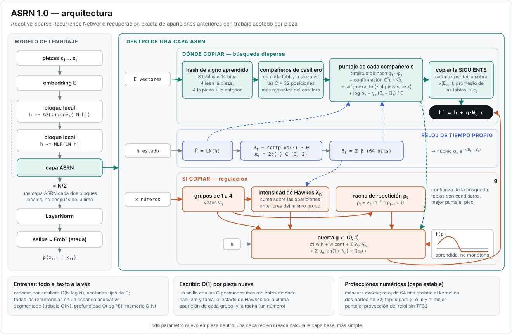
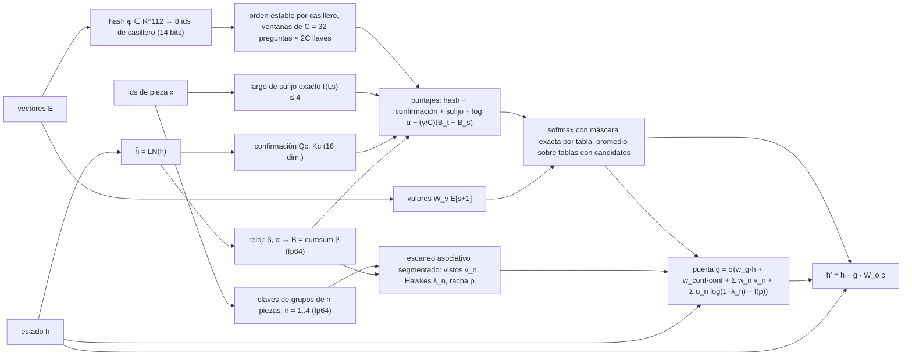

# ASRN: Adaptive Sparse Recurrence Networks

### Reporte técnico de la versión 1.0: recuperación dispersa con hash aprendido, un reloj de tiempo propio, señales de repetición de Hawkes y kernels protegidos numéricamente

**Alexis Calvario** (investigador independiente)
Versión 1.0 — octubre de 2026
Código: el paquete `asrn` de este repositorio [Calvario, 2026] (Licencia Apache 2.0). Resultados en bruto: [`results/`](../results/README.md). Historial de desarrollo: [`history/`](../history/README.md). [English version](TECHNICAL_REPORT.md).

*Terminología: pieza = token; casillero = bucket; racha = streak; puerta = gate; vistos = seen flags;
escribir = generar.*

---

> **Cómo leer los números.** Cada cifra de este reporte sale de un archivo de resultados o de un informe de desarrollo
> de este repositorio (listados en *Reproducibilidad*). Cada medición lleva una etiqueta que dice dónde se tomó:
>
> - **[CPU]**: una CPU de 4 núcleos sin GPU, PyTorch 2.14.1. Conteos exactos de operaciones y de memoria, latencia y
>   calidad a escala chica. Ahí los kernels Triton corren en el intérprete de Triton, que comprueba la aritmética, no la
>   velocidad (`results/banco_cpu/`; el tiempo de las dos versiones de la escritura está en `results/escritura_cpu/`).
> - **[A100-Oct17]**: la única ejecución de `benchmarks/asrn_colab.ipynb`, el 17 de octubre de 2026, en una NVIDIA
>   A100-SXM4-80GB en Google Colab (PyTorch 2.14.1, CUDA 13.0, Python 3.13.15, huella del código `5164e1f32513`).
>   Todas las secciones, incluido RWKV-7, salen de ella: `results/banco_a100/` para el banco y `results/citas_a100/`
>   para el experimento de citas acotadas. Dos filas de la tabla de entrenamiento están compiladas; todas las demás
>   mediciones se tomaron sin compilar. Ese código calcula la misma ida y los mismos gradientes que la versión 1.0,
>   bit a bit; solo su escritura era la $O(t)$ anterior (sección 6.6 y *Reproducibilidad*).
> - **[A100-Oct9]** y **[A100-Oct11]**: las dos ejecuciones de la corrida anterior en la A100 (cuaderno
>   `banco_a100.ipynb`, PyTorch 2.11.0, nada compilado; `history/results/banco_a100_pt211/`), citadas solo como
>   replicación. La ejecución del 11 de octubre (huella del código `176cfe250773`) agregó RWKV-7 y repitió las sondas
>   de estabilidad con TF32 desactivado; las demás filas, incluida la ablación, son del 9 de octubre.
> - **[A100-run5]**: la quinta corrida de desarrollo (5 de octubre de 2026), un protocolo anterior contra
>   *reimplementaciones* de Mamba-2 y RWKV-7 (`history/results/corrida_5/`).
> - **[A100-dev]**: mediciones de desarrollo anteriores (corridas 1–4, variantes del bloque local, el cuaderno de
>   velocidad compilada; A100 de 40 GB u 80 GB, PyTorch 2.11 o 2.14) registradas en `history/`.
>
> Los números con etiquetas distintas no son directamente comparables.

## Resumen

El trabajo por pieza de la atención crece con el contexto; los modelos recurrentes de estado fijo (Mamba-2, RWKV-7)
tienen costo constante pero una recuperación exacta limitada. ASRN (Adaptive Sparse Recurrence Network) es una capa de
modelo de lenguaje que recupera apariciones anteriores exactas con trabajo acotado por pieza: hashes de signos
aprendidos (8 tablas, 14 bits) restringen cada posición a sus 32 compañeros de casillero más recientes, puntuados por
similitud de hash, confirmación, coincidencias exactas de sufijo y un reloj de tiempo propio aprendido; la pieza que
siguió a cada coincidencia se copia a través de una puerta que lee intensidades de Hawkes y una racha de repetición. La
versión 1.0 agrega una capa protegida numéricamente (máscara exacta, reloj de 64 bits, topes) que cierra una fuga causal
medida cuando todos los puntajes válidos caen por debajo de −10⁹ (γ=10⁹) y elimina la deriva del reloj que aparece desde
alrededor de un millón de piezas, a cambio de +7.5% de tiempo y +5.2% de memoria con 262k piezas. En una A100 con
PyTorch 2.14, con 262 144 piezas una capa ASRN sin compilar es 21.6× más rápida que la atención con FlashAttention-2 y
2.5× más rápida que un bloque de Mamba-2 corrido sin causal-conv1d (una unidad con 2.6× sus parámetros); un modelo de
~50M entrena a 163–172k piezas/s de 1k a 32k piezas sin compilar y a 199–210k compilado por partes, 2.08× nuestro
Transformer++ con 32k (2.20× con ambos compilados). Con 2.5–46M parámetros y 3 semillas, ASRN copia con 4× el largo de
entrenamiento cuando sale de la meseta inicial (99.99% y 99.98%; la tercera semilla se quedó en ella los 2 000 pasos),
mantiene la recuperación en MQAR con 4× los pares (99.75% contra 26.1% de Mamba-2 y 16.5% de RWKV-7, ninguno del todo
convergido y ambos muy variables entre corridas) y alcanza una perplejidad de 67.9 en WikiText-103 (RWKV-7 75.8, no
significativo; una corrida de desarrollo anterior (la corrida 5) con otro protocolo y un RWKV-7 reimplementado encontró
a RWKV-7 como el mejor, 47.87 contra 57.02; Mamba-2 74.3, pero por delante de ASRN cuando ambos usan una tasa de
aprendizaje de 10⁻³, una semilla). Los modelos están lejos de converger, el corpus premia copiar y ASRN trae incorporada
la coincidencia exacta de piezas, un sesgo alineado con la copia y con MQAR. ASRN es más lento con entradas cortas, usa
cerca del doble de memoria que la atención y fue el que escribió más lento en la A100 (43 ms/pieza, medido con la
escritura O(t) anterior y, muy probablemente, limitado por los lanzamientos de kernels). La versión 1.0 escribe en un
tiempo O(1) por pieza nueva (un anillo de posiciones recientes por casillero, un estado de Hawkes por grupo de n
piezas): con un modelo de ~0.7M parámetros en CPU, 9.49–12.47 ms por pieza de 512 a 131 072 piezas de contexto, 9.7× más
rápida que la escritura O(t) con 131 072; todavía no se midió en la A100. El diseño separa dos responsabilidades: la
atención dispersa por casilleros decide *dónde* copiar, y la puerta, el reloj de tiempo propio y las señales de Hawkes y
de racha regulan *si* copiar y *cuándo parar*. En copia y MQAR, donde todas las posiciones evaluadas piden copiar, el
núcleo de recuperación basta por sí solo y los mecanismos de regulación no son intrusivos: con ellos ASRN llega a
99.99% / 99.98% con 4× en las semillas que aprendieron la copia y a 99.75% en MQAR, quitarlos uno por uno deja la
exactitud de las corridas que aprendieron dentro de la variación entre semillas (la corrida de copia más baja entre las
que aprendieron, con 4×: 99.89% entre la base y las variantes de regulación; la base misma se quedó en la meseta inicial
de la copia con una semilla, igual que las variantes sin la puerta y sin el reloj, así que una semilla fallida no se
puede atribuir a un mecanismo quitado; medias de MQAR de 99.29–99.95% con 4× los pares, contra 99.75% de la base), y
quitar la capa ASRN lleva ambas tareas al azar. El papel activo de la puerta y de las señales de Hawkes y de racha se
valida en un experimento sintético controlado de citas acotadas con la capa de 1.0 (3 semillas, en CPU y replicado en la
A100): sin supervisión explícita, la puerta aprende a frenar el aliasing de estado, y la racha de repetición más larga
al escribir libremente se queda en 10 piezas, como en el texto real, contra 21–27 (CPU) y 19–39 (A100) sin esas señales,
sin las señales de la puerta o sin puerta; el reloj de tiempo propio no tiene un efecto medible en esa tarea, que no
tiene cambios de tema. Su ablación a gran escala en corpus naturales está planeada para v1.1.

## 1. Introducción

### 1.1 El problema

Una capa Transformer causal [Vaswani et al., 2017] calcula, para cada posición $t$, un softmax sobre todas las
posiciones anteriores. Por eso su trabajo por pieza crece linealmente con el contexto, y el trabajo total, de forma
cuadrática. Los kernels conscientes de la entrada/salida, como FlashAttention [Dao et al., 2022], hacen lineal la
memoria de ese cálculo, pero no el trabajo. En nuestras mediciones, una capa de atención ($d=512$, FlashAttention-2 a
través de SDPA de PyTorch, ida y vuelta) tarda 3.3 ms con 1 024 piezas y 1 486.0 ms con 262 144 piezas
[A100-Oct17]. Durante la generación se lee toda la caché de llaves y valores por cada pieza nueva.

Los modelos de tiempo lineal reemplazan el contexto creciente por un estado de tamaño fijo: la atención lineal
[Katharopoulos et al., 2020], los espacios de estados selectivos como Mamba y Mamba-2 [Gu & Dao, 2023; Dao & Gu, 2024]
y las redes recurrentes modernas como RWKV-7 [Peng et al., 2025]. Su costo por pieza es constante, pero un estado fijo
no puede guardar textualmente un tramo arbitrariamente largo: esos modelos son, de forma demostrable y empírica, más
débiles para copiar y para la recuperación asociativa [Jelassi et al., 2024; Arora et al., 2023]. Copiar es la forma en
que un modelo de lenguaje reutiliza nombres, números, identificadores y citas de su contexto, el comportamiento que las
cabezas de inducción implementan dentro de los Transformers [Olsson et al., 2022].

Por lo tanto, el problema que aborda ASRN es específico: **una capa de mezcla de secuencia cuyo trabajo de
entrenamiento por pieza no crece con el largo del contexto, que aun así puede recuperar y copiar piezas individuales
de muy atrás, y que lleva un mecanismo explícito para decidir cuándo conviene copiar.**

### 1.2 Qué propone ASRN

ASRN conserva el acceso *exacto* a posiciones pasadas individuales, como la atención, pero solo a un conjunto acotado
de candidatos por posición, elegido mediante hashing aprendido: en cada una de las $T=8$ tablas, una posición ve como
mucho sus $C=32$ posiciones anteriores más recientes en el mismo casillero del hash. Lo que se copia es el vector de la
pieza que *siguió* a cada coincidencia, una operación explícita de inducción («copiar la siguiente»). La recuperación se
complementa con un modelo explícito de la repetición —si el grupo actual de 1 a 4 piezas ya apareció, cuántas veces y
qué tan recientemente (una intensidad de Hawkes), y cuánto lleva la cita actual (una racha)—, que una puerta lee para
decidir cuánto del contenido recuperado entra en el flujo residual. La recuperación y la repetición comparten una sola
noción de tiempo, un *reloj de tiempo propio* aprendido y dependiente de los datos.

Así, el diseño separa dos responsabilidades. La **recuperación** —tablas de hash aprendidas, ventanas de candidatos y
puntajes con el sufijo exacto, la confirmación y el término de tiempo— decide *dónde* copiar y hace la recuperación
exacta. La **regulación** —la puerta, el reloj de tiempo propio y las señales de Hawkes y de racha— decide *si* copiar y
*cuándo parar*, lo que importa en la generación abierta, donde copiar solo a veces es lo correcto.

### 1.3 Contribuciones

Este reporte documenta la versión 1.0 de ASRN: el núcleo de v89 (`asrn/nucleo.py`) más una capa protegida
numéricamente (`asrn/estable.py`), que la API pública usa por omisión. Sus contribuciones son:

1. **Una especificación alineada con el código** de la capa y del modelo (secciones 2 y 4). Cada ecuación se comprobó
   contra la implementación.
2. **Un análisis numérico del reloj y de la máscara** (secciones 3 y 5). Se encontraron por medición dos modos de falla
   de v89 —una fuga causal causada por una máscara finita y una pérdida de precisión del reloj desde alrededor de un
   millón de piezas— y se cerraron con protecciones cuyo costo se midió.
3. **Una evaluación contra el Mamba-2 original (`mamba_ssm`), el RWKV-7 original (`flash-linear-attention`) y un
   Transformer al estilo de Llama** con el mismo ancho y un número de parámetros aproximadamente igual (sección 6), que
   informa dónde ASRN va por delante, dónde va por detrás y qué conclusiones no admite esta escala.
4. **Una ablación, una auditoría de la evidencia por componente y un experimento controlado de generación** (sección 7).
   En copia y MQAR el núcleo de recuperación es necesario y suficiente, y los mecanismos de regulación no son
   intrusivos: su presencia no degrada la recuperación exacta, y quitarlos deja la exactitud de las corridas que
   aprendieron dentro de la variación entre semillas (la base misma, y las variantes sin la puerta o sin el reloj, se
   quedaron cada una en la meseta de la copia con una de tres semillas, así que la falla no se puede atribuir al
   mecanismo quitado). El papel activo de la puerta y de las señales de Hawkes y de racha se valida en un experimento
   sintético controlado de citas acotadas con la capa de 1.0, donde la puerta aprende sin supervisión explícita a
   frenar el aliasing de estado al escribir libremente; el reloj no tiene un efecto medible en esa tarea. La hoja de
   ruta de la versión 1.1 (sección 10) nombra el experimento que lleva cada resultado a mayor escala.
5. **Generación en tiempo constante** (secciones 2.11 y 6.6). Escribir paso a paso cuesta un tiempo $O(1)$ por pieza
   nueva: un anillo con las $C$ posiciones más recientes de cada casillero y un estado de Hawkes por clave de grupo de
   $n$ piezas reemplazan la pasada por toda la memoria. Da las mismas salidas que la escritura $O(t)$ anterior
   (diferencia máxima $2.2\cdot10^{-7}$), y en CPU su tiempo por pieza no crece de 512 a 131 072 piezas de contexto; su
   medición en la A100 está pendiente.

Hasta donde sabemos, la combinación de un único reloj de tiempo propio aprendido, compartido por una capa de
recuperación exacta dispersa y por una intensidad de Hawkes sobre grupos de $n$ piezas, leída por una puerta de copia
mediante una respuesta aprendida no monótona a la racha de repetición, no se había descrito antes. **No** afirmamos que
cada componente sea necesario por separado para cualquier tarea: en las tareas de copia pura el núcleo de recuperación
basta por sí solo, y los mecanismos de regulación actúan en la generación abierta, donde el experimento controlado de la
sección 7.2 mide su efecto; su ablación a escala en texto natural es trabajo de v1.1.

### 1.4 Trabajo relacionado

**Atención con hash y con enrutamiento.** Reformer [Kitaev et al., 2020] ordena las posiciones por casillero de un
hash sensible a la localidad y atiende dentro de un bloque y su predecesor; el Routing Transformer [Roy et al., 2021]
agrupa preguntas y llaves. ASRN usa la misma estructura de ordenar y ventana, pero difiere en cuatro aspectos: el hash
es aprendido (los signos de una proyección aprendida), la ventana es causal y está ordenada por recencia (los $C$
compañeros de casillero más recientes), el puntaje agrega evidencia discreta (coincidencias exactas de sufijo) y un
decaimiento en tiempo propio, y el valor es el vector de la pieza siguiente, seguido por una puerta consciente de la
repetición. Reformer combina sus rondas de hash ponderadas por sus normalizadores, cosa que ASRN no hace (sección 7).

**Modelos de secuencia de tiempo lineal.** La atención lineal [Katharopoulos et al., 2020], los modelos selectivos de
espacio de estados [Gu & Dao, 2023; Dao & Gu, 2024] y RWKV-7 [Peng et al., 2025] llevan un estado de tamaño fijo (sin
decaimiento en la atención lineal; con decaimiento dependiente de los datos a través del paso dependiente de la entrada
de Mamba y del decaimiento dinámico de RWKV-7). El reloj de ASRN está emparentado en espíritu —un paso $\beta_t$
dependiente de los datos que se acumula en un tiempo propio $B_t$—, pero se usa de otra forma: el decaimiento actúa
sobre coincidencias *exactas* dispersas, como un sesgo de recencia normalizado en los puntajes de recuperación y como
el núcleo de la intensidad de un proceso puntual, y no sobre la transición de un estado denso. Los límites de
recuperación de los modelos de estado fijo están documentados por Jelassi et al. [2024] y por la tarea de recuperación
asociativa con múltiples preguntas (MQAR) de Zoology [Arora et al., 2023], que usamos.

**Mecanismos de copia.** Las redes de punteros [Vinyals et al., 2015], CopyNet [Gu et al., 2016], las redes
puntero-generador [See et al., 2017] y las mezclas con centinela de punteros [Merity et al., 2016] mezclan la
generación con la copia desde una fuente o una caché en la salida. La copia de ASRN ocurre dentro de cada capa ASRN y
actúa sobre vectores, no sobre la distribución de salida.

**Procesos puntuales.** Los procesos de Hawkes [Hawkes, 1971] son procesos puntuales autoexcitados; sus variantes
neuronales modelan secuencias de eventos [Mei & Eisner, 2017; Zuo et al., 2020]. En ASRN la intensidad de Hawkes no es
una salida sino un rasgo interno: la excitación del grupo de $n$ piezas actual por sus propias apariciones pasadas,
medida en tiempo propio.

**Escaneos paralelos y kernels.** Las recurrencias lineales se pueden paralelizar con escaneos asociativos
[Blelloch, 1990; Martin & Cundy, 2018; Smith et al., 2023]. ASRN calcula todas sus recurrencias de repetición con un
solo escaneo segmentado, y su atención por casilleros con kernels de Triton [Tillet et al., 2019] que recalculan los
puntajes en la vuelta, como hace FlashAttention. Los modelos de referencia usan los kernels Triton de
flash-linear-attention [Yang & Zhang, 2024] (RWKV-7) y de `mamba_ssm` (Mamba-2).

**Extrapolación de largo.** Las codificaciones de posición como los embeddings rotatorios [Su et al., 2024] no
extrapolan bien más allá del largo de entrenamiento, lo que motivó ALiBi [Press et al., 2022]. ASRN no tiene tabla de
posiciones: el orden entra por las convoluciones locales y por el reloj. No probamos Transformers con ALiBi ni con
otros esquemas de extrapolación.

## 2. Arquitectura y mecánica interna

### 2.1 Receta del modelo

Las piezas $x_t\in\{0,\dots,V-1\}$ se convierten en vectores $E_t=\mathrm{Emb}[x_t]\in\mathbb{R}^d$, y $h^{(0)}=E$. El
modelo apila $N_b$ *bloques locales* causales e inserta una capa ASRN después del bloque $i$ siempre que
$i \bmod 2 = 0$ e $i<N_b-1$ (`largo_cada=2`, el valor por omisión desde octubre de 2026): $\lceil (N_b-1)/2\rceil$ capas
ASRN en total. Un bloque local mezcla la posición actual y las $k-1=3$ anteriores con una convolución causal densa y
luego aplica un MLP de ancho $2d$:

$$
h \leftarrow h + \mathrm{GELU}\big(\mathrm{Conv}^{\mathrm{causal}}_{k}(\mathrm{LN}_1 h)\big), \qquad
h \leftarrow h + W_2\,\mathrm{GELU}\big(W_1\,\mathrm{LN}_2 h\big).
$$

La matriz de salida está atada al embedding,
$p(x_{t+1}\mid x_{\le t})=\mathrm{softmax}(\mathrm{Emb}\,\mathrm{LN}_f h_t)$, y no hay tabla de posiciones. Para
$N_b\ge 8$, las salidas que se suman al flujo residual se escalan por $1/\sqrt{2N_b}$ al inicializar. Los pesos se
guardan en fp32 y la aritmética de 16 bits se usa a través de autocast: la capa mezcla aritmética de 32 y 64 bits
(reloj, firmas de las piezas, claves de los grupos de $n$ piezas), y el código rechaza modelos convertidos a pesos de 16
bits. Los modelos de la sección 6 son, por ejemplo, $d=512$ con 8 bloques locales y 4 capas ASRN (~45M parámetros,
WikiText-103) y $d=512$ con 14 bloques locales y 7 capas ASRN (~50M, velocidad).

Cada capa ASRN recibe tres entradas: los vectores de las piezas $E$, el estado actual $h$ y los ids de las piezas $x$.
**Los hashes y los valores copiados dependen solo de los vectores de las piezas**; el estado entra por el término de
confirmación, el reloj y la puerta; los ids de las piezas entran por los rasgos de coincidencia exacta (sufijo, vistos,
Hawkes, racha).

### 2.2 La capa de un vistazo



*Vista general del modelo (izquierda: bloques locales con una capa ASRN cada dos bloques) y de una capa ASRN (derecha:
dónde copiar, el reloj de tiempo propio, si copiar; el costo de entrenar, la escritura en $O(1)$ y las protecciones
numéricas). Fuente: `docs/asrn_arquitectura.svg`, dibujado por `docs/hacer_diagrama.py` (versión en inglés:
`docs/asrn_architecture.svg`). La figura 1, más abajo, detalla el flujo de datos dentro de la capa.*



*Figura 1. Flujo de datos dentro de una capa ASRN. Rama izquierda: dónde copiar (hash, ventanas, puntajes). Rama
inferior: si copiar (memoria de la repetición que lee la puerta). El reloj de tiempo propio alimenta a ambas.*

| Símbolo | Significado | Por omisión |
|---|---|---|
| $T$ | tablas de hash (las últimas $T_c$ ven también la pieza anterior) | 8, $T_c=4$ |
| $b$ | bits por tabla (casilleros por tabla: $2^b$) | 14 (16 384) |
| $P=Tb$ | coordenadas de hash por posición | 112 |
| $C$ | candidatos por tabla (tamaño de bloque de las ventanas) | 32 |
| $c_f$ | ancho de la confirmación | 16 |
| $K$ | sufijo exacto máximo | 4 |
| $n$ | órdenes de los grupos de $n$ piezas de la memoria de repetición | 1–4 |
| — | nodos de la respuesta a la racha, racha máxima | 16, 256 |

### 2.3 Hashing aprendido

Dos MLP pequeños producen las coordenadas del hash: $f_{\mathrm{word}}:\mathbb{R}^d\to\mathbb{R}^{64}\to\mathbb{R}^{56}$
para las cuatro tablas que solo ven la pieza y $f_{\mathrm{ctx}}:\mathbb{R}^{2d}\to\mathbb{R}^{64}\to\mathbb{R}^{56}$,
aplicado a $[E_t;E_{t-1}]$, para las cuatro tablas de contexto, de modo que $\varphi_t\in\mathbb{R}^{112}$. El
casillero de la posición $t$ en la tabla $\tau$ es el patrón de signos de las 14 coordenadas de esa tabla, leído como
número binario. De la construcción se siguen dos consecuencias. Primero, como el hash es una función determinista de
los vectores de las piezas, **las piezas iguales siempre comparten casillero en las tablas que solo ven la pieza, y los
pares iguales en las tablas de contexto**; otras piezas pueden chocar con ellas. Segundo, los ids de casillero se
calculan a partir de $\varphi$ sin gradiente: la asignación misma no se aprende por retropropagación. El hash aprende
solo de forma indirecta, a través del término de similitud $\langle\varphi_t,\varphi_s\rangle$ del puntaje, que acerca
pares útiles que ya comparten casillero; un par útil que nunca choca no recibe señal. El término de similitud usa las
112 coordenadas, así que las tablas difieren solo en *qué* candidatos ven y en su escala de tiempo $\gamma_\tau$. En
bf16, una coordenada cercana a cero puede cambiar de signo por redondeo.

### 2.4 Ventanas de candidatos

Para cada fila (secuencia, tabla), las posiciones se ordenan de forma estable por id de casillero (los empates
conservan el orden del texto), se antepone un bloque inicial de $C$ casillas vacías y la fila ordenada se corta en
bloques de $C=32$. Cada bloque de 32 preguntas se puntúa contra las $2C=64$ llaves formadas por el bloque anterior y el
actual. La llave $j$ es válida para la pregunta $i$ si y solo si (a) ambas tienen el mismo casillero, (b) la llave es
una de las $C$ posiciones ordenadas que preceden inmediatamente a la pregunta y (c) la llave es una posición real. Como
el orden es (casillero, posición), (a)–(b) seleccionan exactamente las a lo sumo $C$ posiciones anteriores más
recientes del mismo casillero, $\mathcal{N}_\tau(t)$, y la causalidad ($s<t$) se cumple por construcción. La mitad de
cada mosaico de $32\times64$ queda fuera de esta banda y se descarta; probablemente esto no importa porque, según una
estimación a partir del código del kernel, los kernels están limitados por el tráfico de memoria, no por la aritmética
(sección 2.10).

Por lo tanto, el trabajo por posición está acotado por $T\cdot C=256$ candidatos, sea cual sea el largo de la
secuencia. El precio es una **recencia truncada**: en un casillero frecuente (una pieza común) solo son visibles sus
32 apariciones más recientes, de modo que el acceso de largo alcance a material frecuente depende de las tablas de
contexto, cuyos casilleros (pares de piezas) son más raros.

### 2.5 Puntajes, softmax por tabla y copiar la siguiente

Cada candidato se puntúa con cuatro términos (sección 4.3): la similitud de hash, una confirmación aprendida a partir
del estado normalizado, un peso aprendido para el largo del sufijo exacto y el logaritmo de un núcleo de memoria en
tiempo propio. Se toma un softmax **por tabla**; el valor del candidato $s$ es $W_vE_{s+1}$, el vector de la pieza que
lo siguió (como $s<t$, a lo sumo la pieza actual). Las salidas de las tablas se **promedian uniformemente** sobre las
$n_t$ tablas que tienen candidatos, así que una tabla con candidatos pobres pesa tanto como una con una coincidencia
exacta; la puerta corrige esto solo de forma global. Mezclar las tablas por sus log-normalizadores, como hace Reformer,
se probó y no se adoptó (sección 7).

### 2.6 Sufijo exacto y confirmación

El largo del sufijo $\ell(t,s)\in\{0,\dots,4\}$ cuenta coincidencias exactas consecutivas hacia atrás,
$x_{t-1}=x_{s-1}$, $x_{t-2}=x_{s-2}$, etc. Se calcula a partir de los ids de las piezas (la «firma» de una pieza es su
id guardado en fp32, exacto para vocabularios de hasta $2^{24}$, lo que el código hace cumplir) y aporta un peso
aprendido $w^{\mathrm{suf}}_\ell$ (cinco números). Es evidencia discreta que una similitud vectorial no puede dar, y se
diseñó para que la copia fuera exacta. La ablación no muestra que la copia lo necesite ni lo descarta: sin él
(`sin_sufijo`), 2 de 3 semillas salieron de la meseta inicial de la copia (la semilla 0 no, en las dos corridas en la
A100), una de ellas copió con 4× al 99.77% y la otra solo al 39.77% (la corrida aprendida más baja de la ablación), y
la media de MQAR (99.69%) quedó dentro de la variación entre semillas (sección 7). El término de confirmación es una
forma bilineal de 16 dimensiones sobre el estado normalizado, con $W_q$ inicializada en cero para que empiece
inactiva.

### 2.7 Memoria de la repetición: vistos, intensidad de Hawkes y racha

Para cada orden $n=1,\dots,4$, el grupo de $n$ piezas que termina en $t$ se identifica con una clave
$k_n(t)=\sum_{j=0}^{n-1}c_j\,x_{t-j}$, calculada en fp64 con coeficientes aleatorios fijos $c_j\in[0.5,1.5)$. Un orden
estable de las claves pone la aparición anterior del mismo grupo inmediatamente antes de cada posición, lo que da la
marca de *visto* $v_n(t)$ y el orden en que se escanea la intensidad de Hawkes (sin un orden adicional). La revisión de
estabilidad estima la probabilidad de que dos grupos distintos compartan clave en alrededor de $10^{-16}$ por par.

- La **intensidad de Hawkes** $\lambda_n(t)$ suma $\alpha_s e^{-\kappa_n(B_t-B_s)}$ sobre las apariciones anteriores $s$
  del mismo grupo: cuántas veces, qué tan recientemente en tiempo propio y qué tan memorables. Su soporte,
  $\mathbf{1}[\lambda_n>0]$, es igual a $v_n$ salvo cuando el decaimiento se desborda por abajo en fp32
  ($\kappa_n(B_t-B_s)\gtrsim104$): entonces $\lambda_n=0$ mientras $v_n=1$, y la marca de visto conserva esa
  información.
- La **racha** $\rho_t=v_4(t)\,(e^{-\kappa_r\beta_t}\rho_{t-1}+1)$ mide cuánto lleva la cita actual (con $\kappa_r=0$ es
  el largo exacto de la serie de grupos de 4 piezas ya vistos).

Las tasas se aprenden en escala logarítmica (por lo tanto son positivas) y parten de un espectro geométrico,
$\kappa_n=1/(C\cdot4^{\,n-1})$ y $\kappa_r=1/(8C)$: los grupos cortos olvidan rápido y los largos (raros) recuerdan más.
Todas son recurrencias lineales $S_i=a_iS_{i-1}+b_i$ con $a_i\in[0,1]$, resueltas con un escaneo asociativo segmentado
(sección 4.6): trabajo $O(N)$ y profundidad $O(\log N)$ en la implementación par–impar de PyTorch y, en GPU, un kernel
Triton por dirección que escanea bloques de 1 024 elementos con `tl.associative_scan` y lleva el estado entre bloques.
La vuelta es el mismo escaneo corrido de derecha a izquierda; guarda dos números por elemento. Con $a_i\in[0,1]$, el
escaneo solo multiplica números en $[0,1]$ y suma; un $a_i$ que se desborda por abajo simplemente reinicia la
recurrencia, que es el comportamiento correcto. La intensidad está acotada por el doble del número de apariciones y
entra en la puerta como $\log(1+\lambda)$.

### 2.8 La puerta

El logit de la puerta suma: una función lineal del estado $h_t$ (calculada en fp32); cuatro señales de confianza en la
recuperación —fracción de tablas con candidatos, mejor puntaje válido, atención pico media sobre las tablas con
candidatos, fracción de tablas de contexto con candidatos—; los vistos; $\log(1+\lambda_n)$; y una respuesta aprendida
$f(\rho_t)$ a la racha. $f$ es lineal por tramos sobre 16 nodos equiespaciados en $\log(1+\rho)$ hasta $\rho=256$,
parametrizada por *incrementos* (sección 4.7). Puede subir mientras una cita tiene un largo típico y caer bruscamente
cuando se vuelve demasiado larga, algo que una respuesta monótona como $u\log(1+\rho)$ no puede expresar. Como los
nodos que nunca ven datos reciben gradiente cero, sus incrementos se quedan en cero y la curva extrapola de forma plana
desde el último nodo con datos, así que un freno aprendido no desaparece para rachas más largas que cualquiera vista en
el entrenamiento.

La motivación es el *aliasing de estado*. Con teacher forcing, la puerta aprende $P(\text{copia}\mid\text{señales})$. Si
las señales se saturan (vistos en $\{0,1\}^4$, sufijos de hasta 4 piezas), una cita de 5 piezas y una de 50 son el
mismo estado, la puerta aplica una sola tasa media de continuación y, al generar libremente, los largos de las citas
se vuelven geométricos, con una cola más larga que en el texto real. Hawkes y la racha hacen observable el estado de la
cita. Su efecto se mide en un experimento sintético controlado de citas acotadas (sección 7.2).

### 2.9 Inicialización neutra y compatibilidad

$w_\alpha$, $\gamma$, los pesos de los vistos $w_n$, los pesos de Hawkes $u_n$, los incrementos de la racha $\delta_j$,
$w^{\mathrm{suf}}$, los pesos de confianza y $W_q$ empiezan en cero, y el sesgo del reloj se fija para que $\beta_t=1$ y
$\alpha_t=1$: al principio el reloj cuenta piezas. Por eso, una capa recién construida calcula lo mismo que calculaba
la capa anterior de v85, y `asrn.cargar` todavía lee los archivos guardados de v85 y v87 (la batería de 62 pruebas de
las corridas de desarrollo comprobaba que reproducen sus salidas; la batería de 1.0 ya no incluye esas comparaciones).
La capa estable `CapaASRNEstable` tiene los mismos parámetros y nombres que la capa del
núcleo `CapaASRN`, así que los archivos guardados cruzan en ambas direcciones.

### 2.10 Kernels Triton y flujo de memoria

La atención por casilleros corre en GPU como dos kernels Triton fusionados (`_casilleros_ida`, `_casilleros_vuelta`),
y la implementación en PyTorch se conserva como referencia y como respaldo en CPU. Un programa se encarga de una
(fila del lote × tabla, bloque de 32 preguntas en el orden de esa tabla). Lee sus 32 preguntas y 64 llaves
directamente en el orden del texto a través de la permutación del orden —$\varphi$, $Q_c/K_c$, el reloj, $\log\alpha$,
el casillero y los ids de las cuatro piezas anteriores—, arma los puntajes en la memoria del chip (dos `tl.dot`),
aplica el peso del sufijo, el término de tiempo y la máscara, toma el softmax en fp32, multiplica por $V$ en bloques de
64 columnas y escribe la salida de cada pregunta en su posición del texto, junto con las señales de la puerta. El kernel
de la vuelta **recalcula** los puntajes, como hace FlashAttention, y no guarda nada de la ida salvo sus entradas. **No
usa sumas atómicas**: cada posición es pregunta una vez por tabla y cada llave aparece exactamente en dos ventanas (como
bloque actual y como bloque anterior), así que cada contribución se escribe en su propia casilla y las casillas se suman
después en un orden fijo, lo que además hace determinista la vuelta. Los gradientes de $\gamma$ y $w^{\mathrm{suf}}$ se
escriben como una fila por programa y se suman después.

Los efectos medidos de estas decisiones (memoria guardada de 43.8 → 20.1 KiB por pieza, vuelta de 6.4 → 0.99 ms,
escaneo de ~290 → ~6 operaciones lanzadas, todo con aritmética idéntica salvo el redondeo) se reúnen en la sección 7.4.

**Según un conteo a partir del código del kernel, los kernels de la capa están limitados por la memoria** (estimado,
no perfilado). Con $d=512$, bf16, por pieza y capa, la ida mueve unos 41 KB y la vuelta unos 81 KB, unos 122 KB en
total, a razón de unas 10 operaciones aritméticas por byte (una A100 necesita unas 100 para quedar limitada por el
cómputo). A unos 2.0 TB/s, esto da un piso de unos 60 ns por pieza. El costo marginal medido de toda la capa estable
entre 65 536 y 262 144 piezas es de 251 ns por pieza [A100-Oct17], unas cuatro veces ese piso: las operaciones
alrededor de los kernels (hashing, ordenamiento, recolección de las piezas anteriores, conversiones de tipo) pesan más
que los kernels, lo que concuerda con un perfil anterior en el que los kernels Triton tomaban unos 2–3 ms de una capa
[A100-dev]. Hasta 16k piezas, la capa tiene un piso fijo de unos 12 ms (12.1–12.5 ms) que no depende del largo
[A100-Oct17]. No se perfiló en el banco, pero lo más probable es que sea el costo de lanzar kernels: grabar el paso
como CUDA Graph redujo antes una capa con 1 024 piezas de 11.4 a 1.6 ms (FlashAttention: 1.5 ms) [A100-dev].

### 2.11 Camino de generación

`escribir()` (`asrn.generate`) procesa una vez el inicio y luego una pieza a la vez, y en la versión 1.0 cada pieza
nueva cuesta un **tiempo $O(1)$**, sin importar cuánto texto haya (`_Escritor` en `asrn/nucleo.py`). Cada capa ASRN
guarda en caché, por posición, $\varphi$, los ids de casillero, los valores, $K_c$, los ids de las cuatro piezas
anteriores, el reloj $B$ y $\log\alpha$, en búferes reservados de antemano; cada bloque local conserva sus últimas $k-1$
entradas normalizadas. Tres estructuras hacen que el paso no dependa de $t$:

- **Dónde copiar: un anillo por casillero.** Cada tabla lleva, para cada uno de sus $2^b$ casilleros, un anillo con las
  $C=32$ posiciones más recientes de ese casillero: justo las llaves que la escritura anterior elegía puntuando toda la
  memoria. La pieza nueva lee el anillo de su casillero en cada tabla y puntúa solo esos $T\times C$ candidatos
  (`_atender_cand`; la capa estable conserva la máscara exacta y el reloj de 64 bits). Con la memoria de lo ajeno (por
  omisión) solo las posiciones del inicio pueden ser llaves, así que los anillos se llenan con el inicio y no cambian
  más; sin ella, cada posición nueva entra en sus anillos.
- **Si copiar: un estado de Hawkes por clave de grupo de $n$ piezas** (`_MemoriaHawkes`). Para cada clave guarda el
  reloj de su última aparición, $B_u$, y $A=\lambda_n+\alpha$ en ese momento; luego
  $\lambda_n(t)=e^{-\kappa_n(B_t-B_u)}A$, y después $A\leftarrow\lambda_n(t)+\alpha_t$ y $B_u\leftarrow B_t$. Es la suma
  de la sección 4.5 llevada como la recurrencia que usa el escaneo asociativo sobre el texto entero. Las claves se
  calculan en la CPU a partir de las piezas muestreadas y se buscan en diccionarios de Python (sin esperar a la GPU);
  los estados quedan en el dispositivo. La racha ya era un solo número por capa.
- **Ayudas del muestreo.** La temperatura que conserva la cita (sección 4.7) y `no_repetir_ngramas` leen diccionarios de
  grupos de $n$ piezas que se actualizan con cada pieza (`_Ngramas`) en vez de recorrer el texto otra vez, y el texto
  escrito vive en un búfer reservado de antemano.

La memoria sigue creciendo con el texto (lo que se guarda en caché de cada posición: lo que se copia hay que guardarlo),
más los anillos fijos: $T\cdot2^{b}\cdot C$ posiciones (int32) y sus contadores, 17 MiB por capa ASRN y por secuencia
con los tamaños por omisión ($T=8$, $b=14$, $C=32$), unos 120 MiB por secuencia para el modelo de ~50M del banco (7
capas ASRN). La escritura $O(t)$ anterior puntúa la pieza nueva contra **toda** la memoria en caché, la restringe por
tabla a los $C$ compañeros de casillero válidos más recientes y compara sus claves de grupos de $n$ piezas con todas las
claves anteriores; sigue disponible como `_Escritor(modelo, o1=False)` y se usa automáticamente solo si los anillos
pasaran de 2 GiB (un `n_bits` o un lote muy grandes).

**Equivalencia** [CPU]. La escritura $O(1)$ da los mismos logits que la escritura $O(t)$, con y sin la memoria de lo
ajeno, y ambas coinciden con la ida sobre el texto entero cuando la memoria de lo ajeno está desactivada: diferencia
máxima $2.2\cdot10^{-7}$ (capa de v89 y estable, anillos que se desbordan, lotes de 1–3, inicios de 1, 2 y 40 piezas;
`test_escritura_o1_igual_que_o_t` en las dos baterías, y `test_anillo_y_ngramas_como_su_definicion` para los anillos y
los diccionarios de grupos de $n$ piezas). `escribir()` da las mismas secuencias de piezas, y logits a menos de
$10^{-4}$, que la implementación $O(t)$ anterior en 192 de 192 combinaciones de opciones de muestreo (temperatura,
top-$k$, top-$p$, memoria de lo ajeno, temperatura que conserva la cita, pena de repetición, prohibición de repetir
grupos de $n$ piezas), con la capa de v89 y la estable.

Dos valores por omisión moldean la generación: la *memoria de lo ajeno* (`memoria_de_lo_ajeno=True`: los candidatos se
restringen a posiciones cuya continuación está dentro del inicio, así que el modelo no puede quedar atrapado copiando su
propia salida) y una *temperatura que conserva la cita* (sección 4.7). Con la memoria de lo ajeno desactivada
(`memoria_de_lo_ajeno=False`), generar paso a paso coincide con procesar la secuencia entera, también en la GPU (en la
A100, con la escritura $O(t)$ de esa corrida, TF32 desactivado, un modelo de prueba chico: 100% de 80 pasos iguales,
diferencia máxima $2.3\cdot10^{-7}$ [A100-Oct17, verificación de GPU 7]). Con el valor por omisión, el conjunto de
candidatos es, a propósito, más chico que el del camino paralelo.

## 3. El reloj del sistema

### 3.1 Definición

A partir del estado normalizado $\hat h_t=\mathrm{LN}(h_t)$, cada capa ASRN calcula dos escalares por pieza:

$$
\beta_t=\mathrm{softplus}(w_\beta^\top\hat h_t+b_\beta)\ \ge 0,\qquad
\alpha_t=2\,\sigma(w_\alpha^\top\hat h_t+b_\alpha)\in(0,2),\qquad
B_t=\sum_{u\le t}\beta_u .
$$

Los sesgos $b_\beta$ y $b_\alpha$ se aprenden; $b_\alpha$ se inicializa en 0.

$B_t$ es una reparametrización monótona del tiempo que depende de los datos: una pieza puede hacer avanzar mucho el
reloj (por ejemplo, en un cambio de tema) o casi nada (dentro de una cita, donde no debería olvidarse nada). $\alpha_s$
indica qué tan memorable es la aparición $s$. La memoria decae con el núcleo continuo

$$
K_\kappa(t,s)=\alpha_s\,e^{-\kappa\,(B_t-B_s)},
$$

un núcleo exponencial cuya distancia es el tiempo propio en lugar del número de piezas. Al inicializar,
$\beta_t=\alpha_t=1$.

### 3.2 Por qué importa la precisión del reloj

El reloj es la única noción de tiempo y de distancia en una capa ASRN: no hay tabla de posiciones, y las convoluciones
locales ven cuatro posiciones. Se usa en tres lugares:

1. **Recuperación (núcleo normalizado).** La tabla $\tau$ suma $\log\alpha_s-(\gamma_\tau/C)(B_t-B_s)$ al puntaje, es
   decir, el logaritmo de $K$ con una tasa por tabla. Después del softmax, esto es una preferencia de recencia
   normalizada medida en tiempo propio. $\gamma_\tau$ empieza en cero y el código no restringe su signo, así que una
   tabla también puede aprender a preferir candidatos más viejos.
2. **Repetición (núcleo sin normalizar).** $K$ con tasas $\kappa_n$ es el núcleo de excitación de las intensidades de
   Hawkes, así que «qué tan recientemente» se vio un grupo de $n$ piezas también se mide en tiempo propio.
3. **Decaimiento de la racha.** La racha decae por $e^{-\kappa_r\beta_t}$ por pieza, es decir, por unidad de tiempo
   propio.

Como cada capa comparte un reloj entre todas sus tablas y todas sus memorias de repetición, un error en $B$ se propaga
tanto a *dónde* como a *si* la capa copia. La forma relativa $B_t-B_s$ también mantiene estacionaria a lo largo de la
secuencia la señal de la puerta «mejor puntaje».

### 3.3 Separabilidad del término de tiempo

Como el núcleo es exponencial, el tiempo entra en el puntaje **linealmente** en $B$:

$$
-\frac{\gamma_\tau}{C}(B_t-B_s)=\underbrace{\frac{\gamma_\tau}{C}B_s}_{\text{llave}}-\underbrace{\frac{\gamma_\tau}{C}B_t}_{\text{pregunta}} .
$$

El término se separa en un vector por llave y otro por pregunta que se difunden dentro del mosaico de $C\times2C$, así
que la vuelta nunca guarda un tensor de $C\times 2C$ de términos de tiempo. Es una buena decisión para la memoria, y es
también el origen del problema de cancelación que se describe abajo.

### 3.4 Precisión de un reloj de 32 bits

Un número fp32 tiene una mantisa de 24 bits. Para $B$ en $[2^k,2^{k+1})$, la separación entre números representables
es $\mathrm{ulp}(B)=2^{k-23}$, y cada acumulación $B\leftarrow B+\beta$ se redondea con un error de hasta
$\mathrm{ulp}(B)/2$: 0.06 en $B=2^{20}$ y 1 en $B=2^{24}$. Se siguen dos consecuencias: el incremento $B_t-B_{t-1}$ que
el modelo usa realmente se conoce solo hasta alrededor de $\mathrm{ulp}(B)$, así que su error relativo crece como
$\mathrm{ulp}(B)/\beta$; y cuando $\beta_t<\mathrm{ulp}(B)/2$, $B+\beta$ se redondea de vuelta a $B$ y **el reloj se
detiene**. Una suma prefija paralela no ayuda: el límite es la mantisa de $B$, no el orden de las sumas. Las sondas lo
midieron con $\beta=\mathrm{softplus}(\mathcal{N}(0,1))$ (media 0.81), informando la mediana del error relativo de
$B_t-B_{t-1}$ en el último cuarto de la secuencia y la fracción de pasos en que el reloj no avanzó:

| Largo | Acumulador de 32 bits [CPU] | Suma de 64 bits redondeada a 32 bits [CPU] | `cumsum` de CUDA [A100-Oct17] | Reloj detenido [CPU] | Reloj detenido [A100-Oct17] |
|---|---|---|---|---|---|
| $2^{16}$ | 0.13% | 0.16% | — | 0% | — |
| $2^{20}$ (1 M) | 2.0% | 2.5% | 2.2% | 0.01% | 0.03% |
| $2^{22}$ (4 M) | 8.1% | 10% | 8.6% | 0.9% | 1.1% |
| $2^{24}$ (16 M) | 44% | 64% | 50% | 16% | 16% |
| $2^{25}$ (32 M) | — | — | 100% | — | 37% |
| $2^{26}$ (64 M) | 100% | 100% | — | 61% | — |

El acumulador de 32 bits es también el camino de generación de v89 (`B[t] = B[t-1] + β`). El `cumsum` de la GPU queda
entre las dos variantes de CPU, como predijo la emulación en CPU. El error relativo es menor para diferencias entre
posiciones lejanas (en la A100 con $2^{20}$ piezas: 0.19% a distancia 32 y 0.007% a distancia 1 024), pero el error
absoluto se mantiene cerca de un ulp de $B$ y crece con el largo; multiplicado por $\gamma/C$, ese error absoluto es lo
que entra en el puntaje.

### 3.5 Cancelación en el puntaje

v89 evalúa el término de tiempo como $(\log\alpha_s+r B_s)-rB_t$, $r=\gamma_\tau/C$: se forman dos números grandes y
luego se restan después de haber sumado otros términos del puntaje. Correr todo el reloj una constante no debería
cambiar nada (solo importan las diferencias), así que el cambio de la salida ante un corrimiento aísla el error
aritmético. En una capa de prueba con $\gamma$ entre 0.5 y 4 [CPU]: $4\cdot10^{-5}$ para un corrimiento de $10^5$,
$2.8\cdot10^{-4}$ para $10^6$, $4.7\cdot10^{-3}$ para $1.6\cdot10^7$, $2\cdot10^{-2}$ para $6.4\cdot10^7$ y 0.11 para
$10^9$. En la A100, con otra capa de prueba (`banco_gpu.py`, kernel Triton en la GPU, TF32 desactivado):
$9.4\cdot10^{-5}$, $2.8\cdot10^{-3}$ y $8.8\cdot10^{-2}$ para corrimientos de $10^6$, $1.6\cdot10^7$ y $10^9$
[A100-Oct17]; la misma prueba en CPU da $1.2\cdot10^{-4}$, $2.8\cdot10^{-3}$ y $7.8\cdot10^{-2}$.

### 3.6 El reloj de 64 bits y el kernel con el reloj partido

La capa estable (`reloj_64`) hace tres cambios:

1. $\beta$ se pasa a fp64 antes de la suma prefija, así que $B_t$ se acumula en fp64 tanto en el camino paralelo como
   en la caché de la generación paso a paso.
2. En el camino de PyTorch, la diferencia $B_s-B_t$ se toma en fp64 **antes** de multiplicar por la tasa
   (`_TiempoRelativo`, que guarda solo sus entradas para la vuelta, como hacía v89).
3. En el kernel Triton (modo `ESTABLE`, fijado al compilar), el reloj de 64 bits se pasa como dos arreglos fp32,
   $B^{\mathrm{hi}}=\mathrm{fl}_{32}(B)$ y $B^{\mathrm{lo}}=\mathrm{fl}_{32}(B-B^{\mathrm{hi}})$, con
   $|B^{\mathrm{lo}}|\le\mathrm{ulp}(B^{\mathrm{hi}})/2$, y la diferencia de tiempo se forma antes de la multiplicación:

$$
\Delta_{ts}=\big(B^{\mathrm{hi}}_s-B^{\mathrm{hi}}_t\big)+\big(B^{\mathrm{lo}}_s-B^{\mathrm{lo}}_t\big),\qquad
\text{puntaje}\mathrel{+}=\log\alpha_s+\frac{\gamma_\tau}{C}\,\Delta_{ts}.
$$

Por el lema de Sterbenz, la diferencia de dos números de punto flotante que están a menos de un factor dos uno del otro
es exacta, así que para posiciones cuyos relojes son cercanos (el caso común de los compañeros de casillero recientes
una vez que $B$ es grande) las partes altas se restan sin error y las partes bajas restituyen el redondeo de los
valores originales de 64 bits. Los gradientes fluyen solo por la parte alta: la derivada de $r(B_s-B_t)$ no depende de
cómo se parta $B$. El kernel lee 4 bytes extra por pregunta y por llave.

### 3.7 Proyecciones de precisión reducida: bf16 y TF32

Para ahorrarse una lectura de $\hat h$, v89 calcula la proyección del reloj $w^\top\hat h$ en el mismo producto de
matrices que $Q_c$ y $K_c$, que con autocast corre en 16 bits. En fp16, la suma de $d$ términos puede pasar de 65 504 y
volver infinito a $\beta$; en bf16, $\beta$ lleva unas tres cifras significativas y el sesgo se acumula en $B$. Medido
en la capa de `test_reloj_en_32_bits_con_autocast` [CPU]: 0.39, 0.65, 0.93 y 1.27 unidades de $B$ después de 512, 1 024,
2 048 y 4 096 piezas con $d=64$, y 3.3 unidades después de 4 096 piezas con $d=512$. En las GPU de NVIDIA hay un tercer
caso: con `torch.backends.cuda.matmul.allow_tf32` activado (como lo hacen `entrenar()` y los cuadernos), un producto de
matrices «fp32» usa una mantisa de 10 bits. Por eso, la capa estable calcula la proyección del reloj en fp32 de verdad
con una multiplicación y suma elemento a elemento (`_ProyeccionIEEE`; dos columnas de salida, unas $2d$ operaciones por
pieza), fuera de autocast y fuera de TF32, mientras que $Q_c$ y $K_c$ conservan el camino rápido. Medido sobre 65 536
piezas con $d=512$ [A100-Oct17], activar TF32 cambia el $B_t$ de v89 en fp32 hasta en **1.98 unidades**, y el de la capa
estable en $1.16\cdot10^{-10}$ (el redondeo de fp64).

### 3.8 Resultados medidos y costo

| Sonda | Capa del núcleo v89 | Capa estable (grupo A) | Etiqueta |
|---|---|---|---|
| Cambio de la salida, reloj corrido $10^6$ / $1.6\cdot10^7$ / $10^9$ (TF32 desactivado) | $9.4\cdot10^{-5}$ / $2.8\cdot10^{-3}$ / $8.8\cdot10^{-2}$ | $5.5\cdot10^{-8}$ en los tres | [A100-Oct17] |
| La misma sonda | $1.2\cdot10^{-4}$ / $2.8\cdot10^{-3}$ / $7.8\cdot10^{-2}$ | $5.5\cdot10^{-8}$ en los tres | [CPU] |
| Dos relojes corridos uno contra otro ($10^6$ contra $10^9$) | $8.8\cdot10^{-2}$ | $5.5\cdot10^{-8}$ | [A100-Oct17] |
| $\max\lvert\Delta B_t\rvert$, TF32 activado contra desactivado, 65 536 piezas, fp32 | 1.98 | $1.16\cdot10^{-10}$ | [A100-Oct17] |
| Kernel `ESTABLE` contra PyTorch, fp32 (salida / peor gradiente) | — | $4.9\cdot10^{-8}$ / $4.5\cdot10^{-6}$ | [A100-Oct17] |
| Kernel `ESTABLE` en bf16, distancia a la respuesta en fp32 | — | 0.096 (PyTorch en bf16: 0.094) | [A100-Oct17] |
| Una capa, $2^{20}$ piezas, solo ida, $d=64$, bf16: tiempo / memoria | 41.7 ms / 2.185 GB | 33.3 ms / 2.198 GB | [A100-Oct17] |

El error de la capa estable no cambia con el corrimiento; un error constante no es deriva sino una diferencia fija de
redondeo entre el cálculo base y cualquier reloj corrido. En la primera ejecución de la corrida anterior [A100-Oct9],
con TF32 activado, la capa estable dio en cambio un $3.55\cdot10^{-6}$ constante, causado por TF32 en los productos de
matrices que siguen al término de tiempo, también sin deriva. Con $2^{20}$ piezas, las salidas de las dos capas
difieren en $8.2\cdot10^{-4}$ (menos de 0.1%), una cifra que mezcla reloj, proyección en bf16, máscara y redondeo, y
que no aísla la deriva; la diferencia de memoria es de 12 bytes por pieza y una sola medición de tiempo por ejecución
no resuelve una diferencia de tiempo. En el régimen normal, la capa estable reproduce v89 salvo el redondeo
($1.3\cdot10^{-7}$ en los logits [CPU]). El costo de todas las protecciones del grupo A juntas, medido ahora con
`_ProyeccionIEEE`, es +7.5% de tiempo con 262 144 piezas (68.7 contra 64.0 ms; +0–7% en los largos menores) y +4–5% de
memoria en todos los largos (10.85 contra 10.31 GB con 262 144, +5.2%) [A100-Oct17]; el aumento de memoria viene de
guardar $\hat h$ en fp32 para el reloj. Son mediciones de tiempo únicas; la corrida anterior, antes de
`_ProyeccionIEEE`, midió +3% de tiempo [A100-Oct9].

**Lectura práctica.** El reloj de 64 bits se vuelve recomendable desde alrededor de un millón de piezas, donde el error
del incremento llega al 2%, y necesario desde alrededor de 16 millones, donde el reloj se detiene en el 16% de los
pasos, en la GPU igual que en la CPU. Cuánto importa el error de 32 bits en largos menores depende del $\gamma$
aprendido; con $2^{20}$ piezas, la salida de la capa de prueba cambió menos de 0.1%.

### 3.9 Una hipótesis descartada

La adjunta de una suma prefija es una suma sufija, $\partial L/\partial\beta_u=\sum_{t\ge u}\partial L/\partial B_t$,
así que podría esperarse que el gradiente del reloj creciera con el largo de la secuencia. Medido con un número fijo de
piezas por paso en un modelo chico sin entrenar ($d=64$) de 256 a 65 536 piezas con texto tipo Zipf y hasta 32 768 con
un vocabulario uniforme [CPU], la norma del gradiente del reloj se mantiene plana ($1.7\cdot10^{-5}$ y
$0.7\cdot10^{-5}$, respectivamente), la norma para $\gamma$ se mantiene entre 2 y $6\cdot10^{-7}$ (sube 1.7× de 256 a
32 768 con el vocabulario uniforme), alrededor del 0.0% del total. No se agregó ninguna protección por esto; debería
volver a medirse en un modelo grande entrenado.

## 4. Formulación matemática

### 4.1 Notación

$L$ (o $N$) largo de la secuencia, $d$ ancho, $T$ tablas, $b$ bits, $P=Tb$, $C$ candidatos, $c_f$ ancho de la
confirmación, $K$ sufijo máximo; $B_t$ siempre denota el reloj. $\hat h_t=\mathrm{LN}(h_t)$. $\mathcal{N}_\tau(t)$ es el
conjunto de candidatos de la posición $t$ en la tabla $\tau$, $n_\tau(t)=\lvert\mathcal{N}_\tau(t)\rvert$, $n_t$ el
número de tablas con $n_\tau(t)>0$, $n^{\mathrm{ctx}}_t$ el mismo conteo sobre las $T_c$ tablas de contexto.

### 4.2 Salida de la capa y hashing

$$
h'_t=h_t+g_t\,W_o\,c_t,\qquad c_t=\frac{1}{\max(1,n_t)}\sum_{\tau=1}^{T}\ \sum_{s\in\mathcal{N}_\tau(t)}a_\tau(t,s)\,W_vE_{s+1}
$$

$$
\varphi_t=\big[f_{\mathrm{word}}(E_t)\,;\,f_{\mathrm{ctx}}([E_t;E_{t-1}])\big]\in\mathbb{R}^{P},\qquad
\mathrm{id}_\tau(t)=\sum_{j=0}^{b-1}2^{j}\,\mathbf{1}\big[\varphi_{t,\tau,j}>0\big]
$$

$$
\mathcal{N}_\tau(t)=\big\{\text{los a lo sumo }C\text{ mayores }s<t\text{ con }\mathrm{id}_\tau(s)=\mathrm{id}_\tau(t)\big\}
$$

### 4.3 Puntaje

$$
s_\tau(t,s)=\frac{\langle\varphi_t,\varphi_s\rangle}{\sqrt{P}}+\frac{\langle W_q\hat h_t,\,W_k\hat h_s\rangle}{\sqrt{c_f}}
+w^{\mathrm{suf}}_{\ell(t,s)}+\log\alpha_s-\frac{\gamma_\tau}{C}\,(B_t-B_s)
$$

$$
\ell(t,s)=\max\big\{m\le K:\ x_{t-j}=x_{s-j}\ \ \forall j=1,\dots,m\big\}
$$

Con los valores por omisión, $\sqrt{P}=\sqrt{112}$ y $\sqrt{c_f}=4$.

### 4.4 Softmax con máscara

Sea $\mathcal{W}(t)$ el conjunto de las 64 llaves de la ventana de $t$ y $\mathcal{N}_\tau(t)\subseteq\mathcal{W}(t)$
las válidas. v89 reemplaza los puntajes no válidos por una constante finita $-M$, $M=10^9$:

$$
a^{\mathrm{v89}}_\tau(t,\cdot)=\mathbf{1}\big[n_\tau(t)>0\big]\cdot\mathrm{softmax}_{s\in\mathcal{W}(t)}\Big(s_\tau(t,s)\ \text{si}\ s\in\mathcal{N}_\tau(t)\ \text{y si no}\ -M\Big).
$$

Si todos los puntajes válidos caen muy por debajo de $-M$ (por ejemplo, con un término de tiempo muy grande), la masa
del softmax se va a las llaves *no válidas*, que incluyen a la propia pregunta —cuyo valor $W_vE_{t+1}$ es la pieza
siguiente— y a posiciones posteriores: la información fluye desde el futuro. La capa estable resta el máximo solo sobre
las llaves **válidas** y da a las llaves no válidas un peso exactamente cero:

$$
m_\tau(t)=\max_{s\in\mathcal{N}_\tau(t)}s_\tau(t,s),\qquad
a_\tau(t,s)=\frac{\mathbf{1}[s\in\mathcal{N}_\tau(t)]\;e^{\,s_\tau(t,s)-m_\tau(t)}}{\sum_{s'\in\mathcal{N}_\tau(t)}e^{\,s_\tau(t,s')-m_\tau(t)}} .
$$

En el régimen normal, ambas dan los mismos bits (el softmax ya resta internamente el máximo de la fila).

### 4.5 Recurrencias del reloj y de la repetición

$$
\beta_t=\min\big(\mathrm{softplus}(w_\beta^\top\hat h_t+b_\beta),\ \beta_{\max}\big),\qquad
\log\alpha_t=\max\big(\log 2+\log\sigma(w_\alpha^\top\hat h_t+b_\alpha),\ \log\alpha_{\min}\big),\qquad
B_t=\sum_{u\le t}\beta_u
$$

(los topes $\beta_{\max}=10^4$ y $\log\alpha_{\min}=-30$ pertenecen a la capa estable; v89 no tiene ninguno.)

$$
v_n(t)=\mathbf{1}\big[\exists\,s<t:\ k_n(s)=k_n(t)\big],\qquad k_n(t)=\sum_{j=0}^{n-1}c_j\,x_{t-j}
$$

$$
\lambda_n(t)=\sum_{s<t,\ k_n(s)=k_n(t)}\alpha_s\,e^{-\kappa_n(B_t-B_s)},\qquad n=1,\dots,4
$$

$$
\rho_t=v_4(t)\big(e^{-\kappa_r\beta_t}\rho_{t-1}+1\big),\qquad \rho_0=0
$$

En el orden por clave, donde $i-1$ es el elemento anterior y $r_i=\mathbf{1}[k(i)=k(i-1)]$, la intensidad de Hawkes es
la recurrencia lineal

$$
S_i=a_i\,\big(S_{i-1}+\alpha_{i-1}\big),\qquad a_i=r_i\,\exp\!\big(-\kappa_n\max(0,\,B_i-B_{i-1})\big),
$$

y $\lambda_n(t)$ es $S$ leído en la posición de $t$ en ese orden. La intensidad de un proceso autoexcitado con núcleo
exponencial admite exactamente esta recursión, que es lo que permite calcularla con un escaneo.

### 4.6 Composición asociativa

Cada recurrencia de arriba tiene la forma $S_i=a_iS_{i-1}+b_i$ con $a_i\in[0,1]$. Las funciones afines
$x\mapsto ax+b$ se componen como

$$
(a_1,b_1)\circ(a_2,b_2)=\big(a_1a_2,\ a_2b_1+b_2\big),
$$

que es asociativa, así que el prefijo $S_i$ es un escaneo en este monoide con identidad $(1,0)$. Poner $a_i=0$
reinicia la recurrencia, así que muchos segmentos independientes (todos los grupos de $n$ piezas, todas las secuencias)
se escanean en una sola pasada. Con el gradiente de arriba $g_i=\partial L/\partial S_i$, la vuelta es la misma
recurrencia corrida hacia atrás:

$$
\eta_i=g_i+a_{i+1}\,\eta_{i+1},\qquad \frac{\partial L}{\partial b_i}=\eta_i,\qquad \frac{\partial L}{\partial a_i}=\eta_i\,S_{i-1}.
$$

### 4.7 Puerta y respuesta a la racha

$$
\mathrm{conf}_t=\Big[\frac{n_t}{T},\ \ m_t,\ \ \frac{1}{\max(1,n_t)}\sum_{\tau:\,n_\tau(t)>0}\max_s a_\tau(t,s),\ \ \frac{n^{\mathrm{ctx}}_t}{T_c}\Big],\qquad
m_t=\max_{\tau:\,n_\tau(t)>0}m_\tau(t)\ \ (0\text{ si }n_t=0)
$$

$$
z_t=w_g^\top h_t+b_g+w_{\mathrm{conf}}^\top\mathrm{conf}_t+b_{\mathrm{conf}}+\sum_{n=1}^{4}w_n\,v_n(t)+\sum_{n=1}^{4}u_n\log\big(1+\lambda_n(t)\big)+f(\rho_t),\qquad g_t=\sigma(z_t)
$$

$$
x=\min\!\Big(\frac{\log(1+\rho)}{\Delta},\,15\Big),\quad \Delta=\frac{\log 257}{15},\quad i=\min(\lfloor x\rfloor,14),\qquad
f(\rho)=U_i+(x-i)\,\delta_{i+1},\qquad U_i=\sum_{j\le i}\delta_j
$$

$f$ es lineal entre nodos y constante más allá del último nodo ($\rho\ge256$). En la capa estable, $m_t$ se recorta a
$\pm10^4$ (`mejor_max`). Las protecciones del grupo B, desactivadas por omisión, reemplazan el logit de la puerta por un
tope suave y ponen un piso a las tasas de repetición:

$$
z_t\ \leftarrow\ c\,\tanh(z_t/c),\quad c=10;\qquad \kappa_n,\kappa_r\ \leftarrow\ \max\big(\kappa,\ \kappa_{\min}\big),\quad \kappa_{\min}=\frac{1}{4L_{\mathrm{train}}} .
$$

**Temperatura que conserva la cita.** Al generar, sea $\mathcal{C}_t$ el conjunto de piezas que cerrarían un grupo de
4 piezas ya visto, $p$ la distribución del modelo a temperatura 1 y $q$ la distribución después de la temperatura, el
top-$k$ y el top-$p$. El muestreo usa

$$
q'_w=q_w\,\frac{p(\mathcal{C}_t)}{q(\mathcal{C}_t)}\ \ (w\in\mathcal{C}_t),\qquad
q'_w=q_w\,\frac{1-p(\mathcal{C}_t)}{1-q(\mathcal{C}_t)}\ \ (w\notin\mathcal{C}_t),
$$

de modo que la probabilidad de continuar una cita es la del propio modelo y la temperatura solo afina la elección
dentro de cada parte (sin cambios si $q$ anula una de las partes). No cubre el arranque de una cita: en el experimento
sintético (sección 7.2), la capa completa cita el 20.9–22.2% de las piezas con $T=0.8$ y el 9.3–11.2% con $T=1$, contra
15.6% del texto real.

### 4.8 Recorte dinámico del gradiente

`RecorteDinamico` (opcional; no se usa en los bancos, que recortan la norma global a 1) reparte los parámetros en
grupos $G$ (reloj y tasas; puerta y peso del sufijo; resto). Para la norma del grupo $\nu_G$, lleva medias móviles
exponenciales $\mu_G,\mu^{(2)}_G$ con decaimiento 0.98 y corrección del sesgo, y usa, después de un calentamiento de 50
pasos,

$$
\theta_G=\min\big(\theta_{\max},\ \mu_G+z\,\sigma_G\big),\qquad \sigma_G=\sqrt{\max\big(0,\ \mu^{(2)}_G-\mu_G^2\big)},\qquad
\nabla_G\leftarrow\nabla_G\cdot\min\!\Big(1,\ \frac{\theta_G}{\nu_G}\Big),
$$

con $\theta_{\max}=1$ y $z=3$ por omisión. Las medias se actualizan con la norma *recortada* (un pico no sube el umbral
siguiente) y no se actualizan cuando la norma no es finita.

### 4.9 Complejidad y comparación

Por pieza y tabla, una capa ASRN puntúa a lo sumo $2C$ llaves de dimensión $P+c_f$ y mezcla $2C$ valores de dimensión
$d$. Contando los FLOPs de entrenamiento como $2\times$ las multiplicaciones-sumas y $3\times$ por ida más vuelta:

$$
\mathrm{FLOPs}_{\mathrm{ASRN}}\approx 6\,(2d^2+\text{proyecciones del hash y del reloj})+6\,T\cdot2C\,(P+c_f+d),
$$

independiente de $N$ salvo por el ordenamiento. Con un ordenamiento por comparación, el tiempo total sería
$O(N\log N)$; el ordenamiento en GPU de los ids de casillero de 32 bits es un radix sort con un número fijo de pasadas,
así que el trabajo por pieza es constante en la práctica. Los FLOPs contados por pieza son planos (sección 6.2), pero
`FlopCounterMode` no cuenta el ordenamiento, cuyo costo aparece solo en los tiempos: la velocidad de entrenamiento del
modelo en la A100 es casi plana (−5.3% de 1k a 32k piezas, sección 6.5), mientras que la latencia en CPU crece un poco
más rápido que linealmente (exponente 1.14–1.22), lo que se atribuye al ordenamiento y a efectos de caché. La memoria
guardada para la vuelta es $O(N)$. Al generar (sección 2.11), el tiempo por pieza nueva es $O(1)$ respecto del contexto:
la pieza puntúa $T\cdot C$ candidatos leídos de los anillos y actualiza un estado de Hawkes por orden de los grupos de
$n$ piezas; la memoria es $O(t)$ para la caché, más los anillos fijos. La comparación de abajo es por capa de mezcla de
secuencia, sin la capa densa que la acompaña ($N_s$: tamaño del estado de Mamba-2, 64 en CPU y 128 en la A100; $D_h$:
ancho de cabeza de RWKV-7, 64):

| | Transformer (FlashAttention) | Mamba-2 (SSD) | RWKV-7 | ASRN |
|---|---|---|---|---|
| FLOPs de entrenamiento por pieza | $6\cdot4d^2+\mathbf{6Nd}$ | $\approx6\cdot6d^2+O(dN_s)$ | $\approx6\cdot4d^2+O(dD_h)$ | $6(2d^2+\text{hash})+6T\cdot2C(P+c_f+d)$ |
| Crece con $N$ | **sí (linealmente)** | no | no | no (radix sort: pasadas fijas) |
| Límite en GPU | aritmética (tensor cores) | aritmética y memoria | aritmética y memoria | **memoria** (~10 FLOP/byte, estimado) |
| Memoria de activaciones | $O(Nd)$ | $O(Nd)$ + estados por tramo | $O(Nd)$ + estados por tramo | $O(N(d+P+T))$ |
| Tiempo de generación por pieza | $O(Nd)$ | $O(dN_s)$, constante | $O(dD_h)$, constante | $O(TC(P+d))$, constante |
| Memoria de generación | caché $2Nd$ | fija $2dN_s$ | fija $dD_h$ | $O(N(d+P))$ + anillos, $T\cdot2^{b}\cdot C$ posiciones |
| Recuperación exacta desde muy atrás | sí, si las posiciones generalizan | limitada por el estado | limitada por el estado | sí, si la coincidencia está entre las $C$ más recientes de su casillero |

## 5. Estabilidad numérica y protecciones

La capa estable es `CapaASRNEstable` (`asrn/estable.py`), que eligen por omisión `asrn.crear_modelo`,
`asrn.crear_desde_config` y `asrn.cargar`. El grupo A no cambia nada en el régimen normal y está activado por omisión;
el grupo B cambia la función y está desactivado por omisión (`Protecciones.textos_largos(L)` lo activa, pensado para
entrenar desde cero con textos largos; `Protecciones.ninguna()` reproduce v89 bit a bit).

| Protección | Grupo | Falla que evita | Estado de la falla | Costo |
|---|---|---|---|---|
| `mascara_exacta` | A | Fuga causal cuando todos los puntajes válidos caen por debajo de $-10^9$ (camino de PyTorch, kernel y generación) | **Medida**: el futuro cambia el pasado en 0.016 con $\gamma=10^9$ y 0.075 con $\gamma=10^{11}$ [CPU]; 0.016 con el kernel Triton en la GPU [A100-Oct17]; con la protección: 0 exacto | Ninguno: los mismos bits en el régimen normal |
| `reloj_64` | A | Precisión del reloj desde ~1M piezas; cancelación en el puntaje; reloj detenido desde ~16M; proyección del reloj en 16 bits o TF32 | **Medida** (sección 3) | 8 bytes por pieza para $B$ en lugar de 4; +4 bytes leídos por pregunta y por llave en el kernel; dos columnas de proyección en fp32 sin TF32 |
| `beta_max` $=10^4$ | A | $B$ se vuelve infinito con pesos rotos ($\infty-\infty=$ NaN en toda la capa) | **Reproducida** en `test_beta_enorme_no_rompe_la_capa` | Ninguno (muy por encima de los valores normales) |
| `log_alfa_min` $=-30$ | A | $\log\alpha\to-\infty$, otra forma de caer por debajo de $-10^9$ | Preventiva (deducida del código; sin prueba dedicada) | Ninguno |
| `mejor_max` $=10^4$ | A | Un $-10^9$ que entra en la puerta por la señal de mejor puntaje | Preventiva (deducida del código; sin prueba dedicada) | Ninguno |
| `tope_puerta` ($c=10$) | B | Puerta saturada (gradiente casi nulo) con señales fuera del rango de entrenamiento | Preventiva | Cambia la puerta: $z\to c\tanh(z/c)$ |
| `kappa_min` ($1/(4L_{\mathrm{train}})$) | B | Con $\kappa\to0$, $\lambda$ crece con el largo del texto y muestra a la puerta valores nunca vistos en el entrenamiento | Preventiva ($\log(1+\lambda)$ se mantuvo plano de 256 a 65 536 piezas en la sonda de gradientes) | Cambia Hawkes: memoria acotada |
| `RecorteDinamico` | entrenamiento | Un solo recorte global deja que un pico en unos pocos números (reloj, $\gamma$) achique el gradiente de todo el modelo | Con prueba unitaria: un pico de $10^4$ en el reloj se recorta al umbral y el grupo «resto» queda intacto bit a bit | Una norma por grupo y paso; sin sincronización con la GPU |

El costo medido del grupo A en conjunto es +7.5% de tiempo con 262 144 piezas y +4–5% de memoria en todos los largos,
medido con `_ProyeccionIEEE` [A100-Oct17]. El grupo B no mostró costo ni efecto medibles en la ablación (sección 7).

**Lo que no hizo falta.** Estabilizar el softmax por tabla (ya resta el máximo en fp32), proteger la LayerNorm (fp32
con autocast, $\varepsilon=10^{-5}$; $h$ tendría que pasar de alrededor de $10^{19}$ para desbordar el cuadrado) y
recortar el gradiente del reloj según el largo (no crece; sección 3.9). No se agregó `nan_to_num` dentro de la capa:
esconder un NaN impediría que `entrenar()` se saltara el paso, que es la respuesta correcta cuando algo se rompe.

## 6. Evaluación experimental

### 6.1 Protocolo

**Software y hardware.** CPU: 4 núcleos, PyTorch 2.14.1. A100: NVIDIA A100-SXM4-80GB (Colab), PyTorch 2.14.1, CUDA
13.0, autocast bf16, sin CUDA graphs. **Solo dos filas están compiladas**: el modelo ASRN de ~50M compilado por partes
(`compilar_partes`: cada bloque local y las partes chicas de cada capa ASRN; la atención por casilleros y el escaneo
conservan sus kernels Triton) y el Transformer++ con `torch.compile`, ambos medidos como filas aparte de la tabla de
entrenamiento (sección 6.5). Todas las demás mediciones (capa sola, generación, calidad, ablación, experimento de
citas) corrieron sin compilar, y Mamba-2 y RWKV-7 no se compilaron nunca. TF32 estuvo activado salvo en la comparación
del kernel en fp32 y en las sondas de estabilidad numérica. Los tiempos son una sola corrida por punto (mediana de 2–5
repeticiones para capas y modelos; la media de 32 piezas de una pasada para la generación).

**Modelos comparados en la A100** (todos con la salida atada a los embeddings, el mismo ancho y el número de bloques
que deja el número de parámetros más cerca del de ASRN):

- **ASRN**: la capa estable con el grupo A, en la receta por omisión.
- **Transformer++**: *nuestra* implementación de la receta de Llama (RMSNorm, SwiGLU, RoPE) en
  `benchmarks/modelos_oficiales.py`, con la atención a través de `scaled_dot_product_attention` (FlashAttention-2 en
  la A100) y una caché de llaves y valores para la generación. RMSNorm, RoPE y SwiGLU son operaciones de PyTorch
  separadas, **sin fusionar**, así que su velocidad con entradas cortas puede ser pesimista.
- **Mamba-2**: el bloque `Mamba2` de `mamba_ssm` 2.3.2 (kernels Triton de SSD, estado 128, ancho de cabeza 64) **sin
  `causal-conv1d`** (no hay wheel para esta versión), es decir, su camino sin fusionar: su velocidad y su memoria son
  pesimistas, así que cada razón de velocidad de ASRN contra Mamba-2 de abajo es una **cota superior**.
- **RWKV-7**: `RWKV7Model` de `flash-linear-attention` 0.5.2 con su propia inicialización y ancho de cabeza 64 (el
  modelo oficial no ata la salida; aquí está atada, como en todos los modelos). fla compila o autoajusta sus kernels
  para cada forma nueva, lo que muy probablemente explica su primer paso lento (230 s con 1 024 piezas) y su pasada del
  prefijo (sección 6.6).

**Parámetros.** Copia: ASRN 2 631 236 (4 bloques locales + 2 capas ASRN, $d=256$), Transformer++ 2 541 312 (3
bloques), Mamba-2 2 458 488 (5 bloques), RWKV-7 2 915 328. MQAR: 4 597 316, 4 507 392, 4 424 568 y 4 881 408
(vocabulario más grande). WikiText-103: 45 138 568 (8 bloques locales + 4 capas ASRN, $d=512$), 44 416 000 (6
bloques), 44 656 912 (11 bloques) y 46 320 640. En WikiText-103, sin la matriz de vocabulario, ASRN tiene 3.9% más
parámetros que el Transformer++ y 2.6% más que Mamba-2 (cuya matriz de vocabulario está rellenada a 50 264 filas); en
copia y MQAR, 3.7% y 7.4% más. RWKV-7 (3, 3 y 6 bloques) tiene 10.8%, 6.2% y 2.6% más parámetros en total que ASRN en
las tres tareas (11.4%, 11.4% y 6.1% más sin la matriz de vocabulario).

**Entrenamiento.** El mismo ciclo para todos los modelos: AdamW (betas 0.9/0.95, decaimiento de pesos 0.1 solo en las
matrices), 2% de calentamiento y decaimiento coseno hasta lr/10, recorte global del gradiente a 1, bf16, los mismos
lotes para cada modelo dentro de una semilla. Para cada modelo y tarea, la mejor de dos tasas de aprendizaje
$\{10^{-3},3\cdot10^{-3}\}$ en la semilla 0 se repite con las semillas 1 y 2; se informa la media ± desviación estándar
sobre 3 semillas. Los empates (100% con ambas tasas) van a $10^{-3}$. **No hay un conjunto de prueba aparte: la tasa
de aprendizaje se elige con la misma evaluación que se informa.**

**Tareas.**
- *Copia*: vocabulario 512, secuencias de 1 024 piezas cuya segunda mitad repite la primera (copiar desde 512 atrás),
  2 000 pasos con lotes de 32. Exactitud sobre la mitad copiable con 1 024, 4 096 y 16 384 piezas (con 4 096 se copian
  2 047 piezas desde 2 048 atrás). Azar: $1/511=0.196\%$.
- *MQAR* [Arora et al., 2023]: vocabulario 8 192, secuencias de 512 piezas con 64 pares llave–valor ($L/8$), 2 000
  pasos con lotes de 64. Exactitud sobre los valores preguntados con 512, 1 024 y 2 048 piezas, es decir, con 64, 128 y
  256 pares: el largo y el número de pares cambian juntos.
- *WikiText-103* [Merity et al., 2016]: piezas de GPT-2 (50 257); 1 220 pasos de 16 ventanas de 1 024 piezas con
  inicios al azar (con reemplazo) entre las primeras 19 988 480 piezas de entrenamiento (cada corrida ve ~63% de ellas,
  ~12.6M distintas). Perplejidad por pieza sobre las primeras 245 760 piezas de validación con 1 024 y 4 096 piezas de
  contexto (las mismas piezas en ambos largos). Esto es alrededor de **0.44 posiciones de entrenamiento por
  parámetro**; los números no son comparables con los resultados publicados por palabra sobre el conjunto de prueba.

**Velocidad.** Piezas al azar. *Capa sola*: $d=512$, lote 1, bf16, ida + vuelta, con la memoria pico. **Cada «capa» es
una unidad distinta**: la de ASRN es solo su capa de mezcla (0.65M parámetros; en la receta viene con dos bloques
locales de 2.1M), la del Transformer++ es la atención con RMSNorm (1.05M, sin SwiGLU) y la de Mamba-2 es su bloque
entero (1.72M, cuya expansión hace el papel de una capa densa): **2.6× los parámetros de la capa ASRN**. *Modelo*: ~50M
parámetros (vocabulario 32 768, $d=512$; ASRN con 14 bloques locales y 7 capas ASRN, Transformer++ con 11 bloques,
Mamba-2 con 20), 32 768 piezas por paso en todos los largos. *Generación*: los mismos modelos, lote 1, media de 32
piezas nuevas después de un prefijo de 1k–64k piezas.

**Protocolo en CPU** (costo exacto y calidad a escala chica): modelos con $d=128$ y 0.61–0.73M parámetros; la misma
receta de entrenamiento con lotes de 16 × 256; copia con secuencias de 256 piezas (vocabulario 128), 400 pasos. Los
FLOPs se cuentan con `FlopCounterMode` de PyTorch (ida + vuelta respecto del estado y de los parámetros, con los
vectores de las piezas pasados como entradas sin gradiente); los bytes guardados, con `saved_tensors_hooks`, sin contar
los pesos; una capa con $d=512$ y lote 1.

### 6.2 Costo exacto por capa [CPU]

| Capa ($d=512$) | MFLOP/pieza, $L$=1 024 | $L$=4 096 | $L$=16 384 | KiB guardados/pieza |
|---|---|---|---|---|
| ASRN (v89), camino de PyTorch | 5.19 | 5.14 | 5.13 | 43.8 |
| ASRN (estable), camino de PyTorch | 5.19 | 5.14 | 5.13 | 43.9 |
| ASRN (v89), kernel Triton | (igual) | (igual) | (igual) | 20.1 |
| ASRN (estable), kernel Triton | (igual) | (igual) | (igual) | 20.2 |
| Transformer (atención) | 9.44 | 18.87 | 56.62 | 12.0 |
| Mamba-2 (PyTorch de referencia) | 11.48 | 11.48 | 11.48 | 93.8 |
| RWKV-7 (PyTorch de referencia, paso a paso) | 8.26 | — | — | 183.3 |

- ASRN cuesta lo mismo por pieza en cualquier largo; la atención crece linealmente y cuesta 11× más con 16k piezas. Con
  $d=512$, la capa ASRN contada cuesta menos FLOPs que una capa de atención incluso con largo cero (sus proyecciones son
  $2d^2$ contra $4d^2$). El conteo excluye la vuelta hacia los vectores de las piezas $E$ (proyección de valores y MLP
  del hash), que el modelo sí calcula, así que el margen dentro del modelo es menor.
- `FlopCounterMode` no cuenta el SDPA de la CPU, así que a la fila del Transformer se le sumaron $6Ld$ FLOPs por pieza
  (atención causal, ida y vuelta). También cuenta mal la vuelta de una convolución agrupada: para la convolución por
  canal de Mamba-2 (1 152 grupos) informaba unas 1 000 veces el valor real, y una primera versión de esta tabla daba
  22.1 MFLOP; el banco usa ahora una fórmula que tiene en cuenta los grupos, que da **11.48 MFLOP/pieza**.
- Las cifras de memoria de Mamba-2 y RWKV-7 salen de sus implementaciones de referencia en PyTorch (RWKV-7 paso a paso
  guarda el estado de cada paso) y **no** representan sus kernels de GPU, que guardan sus entradas más un estado por
  tramo.

### 6.3 Latencia en CPU [CPU]

| Capa ($d=256$), ms de ida + vuelta | $L$=512 | 2 048 | 8 192 | 32 768 | exponente ajustado (2k–32k) |
|---|---|---|---|---|---|
| ASRN (v89) | 22.7 | 63.7 | 317.6 | 1 853.8 | 1.22 |
| ASRN (estable) | 26.9 | 67.5 | 297.7 | 1 608.8 | 1.14 |
| Transformer | 5.3 | 29.6 | 331.5 | 4 796.0 | 1.83 |

ASRN y la atención se cruzan entre 2k y 8k piezas; con 32 768, ASRN es 2.6–3.0× más rápido. Las diferencias entre v89 y
la capa estable (de −13% a +19%, sin dirección fija) son ruido de medición de la CPU. Las latencias en CPU de Mamba-2 y
RWKV-7 no son comparaciones con sentido (RWKV-7 corre paso a paso en Python; la vuelta de SSD por tramos de Mamba-2
escala mal en CPU).

### 6.4 Una capa en la A100


*Figura 2. Una capa, ida + vuelta, $d=512$, lote 1, bf16, sin compilar [A100-Oct17]. Rótulos de los ejes en español
(«largo» = largo de la secuencia).*

| ms (ida + vuelta) | $L$=1 024 | 4 096 | 16 384 | 65 536 | 262 144 |
|---|---|---|---|---|---|
| ASRN (v89) | 12.0 | 11.7 | 11.7 | 18.0 | 64.0 |
| ASRN (estable) | 12.1 | 12.2 | 12.5 | 19.3 | 68.7 |
| Atención del Transformer++ (FlashAttention-2) | 3.3 | 3.4 | 10.0 | 102.4 | 1 486.0 |
| Bloque de Mamba-2 (`mamba_ssm`, sin `causal-conv1d`) | 7.7 | 9.9 | 11.1 | 34.8 | 174.3 |
| RWKV-7 (fla) | 11.6 | 12.0 | 35.0 | 131.1 | 519.4 |
| *Transformer++ / estable* | *0.27* | *0.27* | *0.80* | *5.3* | *21.6* |
| *Mamba-2 / estable* | *0.64* | *0.81* | *0.89* | *1.8* | *2.5* |
| *RWKV-7 / estable* | *0.96* | *0.99* | *2.8* | *6.8* | *7.6* |

| Memoria pico (GB) | $L$=1 024 | 4 096 | 16 384 | 65 536 | 262 144 | KiB/pieza |
|---|---|---|---|---|---|---|
| ASRN (v89) | 0.04 | 0.16 | 0.65 | 2.6 | 10.3 | 38 |
| ASRN (estable) | 0.04 | 0.17 | 0.68 | 2.7 | 10.9 | 40 |
| Transformer++ | 0.02 | 0.09 | 0.34 | 1.4 | 5.5 | 20 |
| Mamba-2 | 0.05 | 0.16 | 0.55 | 2.1 | 8.5 | 31 |
| RWKV-7 | 0.08 | 0.33 | 1.32 | 5.3 | 21.1 | 79 |

- **Hasta 16k piezas, ASRN está entre las capas más lentas**: su tiempo es un piso de ~12 ms (sección 2.10);
  FlashAttention-2 es 3.7× más rápida con 1k–4k piezas, Mamba-2 también es más rápido, y RWKV-7 empata con 1k–4k (ASRN
  lo pasa desde ~4.2k piezas).
- **Desde alrededor de 18–20k piezas** (interpolación lineal entre 16k y 65k: ~17.8k contra la atención, ~20.2k contra
  el bloque de Mamba-2) ASRN pasa a ambos. Con 65 536 piezas es 5.3× más rápida que la atención y 1.8× más rápida que
  el bloque de Mamba-2; con 262 144, 21.6× y 2.5×. Contra Mamba-2, estas son razones entre unidades distintas (2.6× los
  parámetros) y con un Mamba-2 sin fusionar; con modelos enteros la razón es 1.4–1.5 (sección 6.5).
- **RWKV-7 es la capa más lenta con 16k y 65k piezas** (con 262 144 la atención es más lenta: 1 486.0 contra 519.4 ms)
  y usa la mayor memoria en todos los largos: con 262 144 piezas tarda 7.6× el tiempo de ASRN con 1.9× su memoria
  (medido como la primera capa de un modelo fla de dos capas).
- **ASRN usa más memoria que la atención**: ~40 KiB por pieza, 2.0× la atención (20 KiB) y 1.3× Mamba-2 (31 KiB).

### 6.5 Entrenar un modelo de ~50M en la A100


*Figura 3. Velocidad de entrenamiento con 32 768 piezas por paso [A100-Oct17]. Rótulos en español.*

| Piezas/s (GB pico) | Parámetros | $L$=1 024 | 4 096 | 16 384 | 32 768 |
|---|---|---|---|---|---|
| ASRN | 50.7M | 172 065 (23.5) | 171 275 (23.5) | 163 503 (23.5) | 163 023 (23.5) |
| Transformer++ | 51.0M | 182 116 (25.5) | 160 772 (25.5) | 110 342 (25.5) | 78 400 (25.6) |
| Mamba-2 | 51.2M | 118 002 (26.4) | 118 314 (26.4) | 116 935 (26.4) | 114 544 (26.4) |
| RWKV-7 | 51.1M | 50 439 (30.5) | 50 082 (30.5) | 48 397 (30.5) | 45 895 (30.5) |
| ASRN, compilado por partes | 50.7M | 210 413 (22.3) | 207 945 (22.3) | 200 800 (22.3) | 198 826 (22.3) |
| Transformer++, `torch.compile` | 51.0M | 262 909 (22.9) | 220 468 (22.9) | 135 614 (22.9) | 90 540 (22.9) |
| *ASRN / Transformer++* | | *0.94* | *1.07* | *1.48* | *2.08* |
| *ASRN / Mamba-2* | | *1.46* | *1.45* | *1.40* | *1.42* |
| *ASRN / RWKV-7* | | *3.41* | *3.42* | *3.38* | *3.55* |
| *ASRN compilado / Transformer++ compilado* | | *0.80* | *0.94* | *1.48* | *2.20* |

- La velocidad de ASRN es casi **independiente del largo de la secuencia** (−5.3% de 1 024 a 32 768 piezas; −5.5%
  compilado), contra −57% del Transformer++ (−66% compilado), −3% de Mamba-2 y −9% de RWKV-7.
- ASRN pasa al Transformer++ entre 1k y 4k piezas (~2.4k interpolando), mucho antes que con una capa sola, porque con un
  lote grande el costo fijo se reparte entre todas las piezas del paso; con 1 024 piezas el Transformer++ es 6% más
  rápido.
- **Compilados.** Compilar por partes acelera a ASRN 1.21–1.23× en todos los largos y baja su memoria pico a 22.3 GB;
  `torch.compile` acelera al Transformer++ 1.44× con 1 024 piezas y 1.15× con 32 768. Con ambos compilados, el cruce se
  mueve a ~5.4k piezas: el Transformer++ es 1.25× más rápido con 1 024 y ASRN 2.20× más rápido con 32 768. El primer
  paso con 1 024 piezas, compilación incluida, tarda 47.0 s para ASRN y 26.2 s para el Transformer++. Mamba-2 y RWKV-7
  no se compilaron, así que las filas compiladas se comparan solo entre sí.
- Contra el Mamba-2 sin fusionar y sin compilar, ASRN es 1.40–1.46× más rápido (una cota superior), y contra RWKV-7,
  3.38–3.55×, el mismo orden que con el RWKV-7 reimplementado de la corrida 5 (50–53k piezas/s [A100-run5]).
- La memoria pico la dominan los logits del vocabulario (comunes a todos): ASRN usa 8% menos que el Transformer++, 11%
  menos que Mamba-2 y 23% menos que RWKV-7, y compilado 3% menos que el Transformer++ compilado (una medición cada
  uno).

### 6.6 Generación

**En la A100, con la escritura $O(t)$.** La corrida del 17 de octubre midió el código de entonces, cuya escritura era
$O(t)$ por pieza (sección 2.11). **La escritura $O(1)$ de la versión 1.0 todavía no se midió en la A100.** La sección de
generación del cuaderno (`benchmarks/asrn_colab.ipynb`, sección 6) corre ahora la escritura $O(1)$, con las piezas
nuevas pasadas desde la CPU como hace `escribir()`, así que la próxima ejecución en Colab la mide.

| ms por pieza nueva [A100-Oct17] | contexto 1 024 | 4 096 | 16 384 | 65 536 | prefijo 65 536 (s) | memoria con 65 536 (GB) |
|---|---|---|---|---|---|---|
| ASRN (escritura $O(t)$) | 42.8 | 42.8 | 43.4 | 43.1 | 0.140 | 3.82 |
| Transformer++ | 14.6 | 14.4 | 14.7 | 15.2 | 0.387 | 2.53 |
| Mamba-2 | 25.3 | 24.9 | 24.7 | 24.5 | 0.139 | 1.26 |
| RWKV-7 | 34.3 | 38.2 | 34.0 | 39.5 | (130.9)\* | 3.69 |

*Notas de método.* La pasada del prefijo del Transformer++ se mide ahora con el envoltorio corregido, que calcula los
logits solo de la última posición, como para los demás modelos (en la corrida anterior calculaba los logits de las
65 536 posiciones del prefijo, 4.3 GB, así que su tiempo y su memoria del prefijo no eran comparables). \* 110.9–130.9 s
con cualquier largo del prefijo: sobre todo compilación o autoajuste de los kernels de fla para cada forma nueva.

- **ASRN fue el que escribió más lento** con la escritura $O(t)$: 2.9× el Transformer++, 1.7× Mamba-2 y 1.2× RWKV-7
  (medias sobre los cuatro contextos: 43.05, 14.75, 24.84 y 36.51 ms), lo que concuerda con el número de operaciones
  chicas por pieza (8 tablas, 4 órdenes de Hawkes, racha, puerta).
- Con el envoltorio corregido, la pasada del prefijo del Transformer++ con 65 536 piezas tarda 0.387 s y usa 2.53 GB,
  contra 0.140 s y 3.82 GB de ASRN y 0.139 s y 1.26 GB de Mamba-2.
- Las curvas son casi planas con lote 1, incluida la del Transformer++, que lee toda su caché (14.4–15.2 ms; pendiente
  ajustada de 11 ns por pieza de contexto, IC del 95% 3–19 ns); RWKV-7 oscila entre 34.0 y 39.5 ms sin tendencia. Lo que
  se mide son, muy probablemente, lanzamientos de kernels, no el contexto (no se perfiló). El término $O(t)$ de esa
  escritura queda escondido debajo: la pendiente ajustada no se distingue de cero (3.0 ns por pieza de contexto; IC del
  95% −25 a 31 ns). La escritura $O(1)$ quita ese término, pero no los lanzamientos, así que no se le atribuye ninguna
  aceleración en la A100 hasta que se mida.
- La memoria pico de ASRN con 64k piezas de contexto es 3× la de Mamba-2, pero incluye la pasada del prefijo (la de
  Mamba-2 también crece, de 0.11 a 1.26 GB, aunque su estado es fijo); la caché persistente no se midió por separado. La
  escritura $O(1)$ agrega sus anillos fijos, unos 120 MiB por secuencia para este modelo (sección 2.11).

**En CPU, las dos escrituras** [CPU] (`benchmarks/medir_escritura.py`, `results/escritura_cpu/`). Modelo ASRN de 700 484
parámetros ($V=256$, $d=128$, 4 bloques locales, 2 capas ASRN), lote 1, sin muestrear; mediana de 9 tandas de 32 piezas;
las dos escrituras intercaladas en cada contexto, después de calentar las dos y de un inicio sin medir de cada largo.

| Contexto | Escritura $O(1)$, ms/pieza | Escritura $O(t)$, ms/pieza | Pasada del inicio $O(1)$ (s) | Pasada del inicio $O(t)$ (s) |
|---|---|---|---|---|
| 512 | 12.45 | 15.80 | 0.10 | 0.06 |
| 2 048 | 12.47 | 16.73 | 0.26 | 0.20 |
| 8 192 | 10.68 | 19.02 | 0.77 | 0.70 |
| 32 768 | 11.26 | 37.12 | 3.60 | 2.73 |
| 131 072 | 9.49 | 91.67 | 29.04 | 20.44 |

- **El tiempo por pieza de la escritura $O(1)$ no crece con el contexto.** Pendiente de mínimos cuadrados de los ms por
  pieza contra el contexto, con IC del 95%: −19.21 ns por pieza de contexto (−41.54 a 3.12), que no se distingue de
  cero, contra 583.31 ns (537.13 a 629.49) de la escritura $O(t)$. Con 131 072 piezas la escritura $O(1)$ es 9.7× más
  rápida por pieza (91.67 / 9.49 ms); con 512, 1.27×.
- **Pasada del inicio.** La escritura $O(1)$ además llena los anillos y el estado de Hawkes mientras lee el inicio;
  perfilado, ese trabajo adicional tardó unos 0.3 s con 32 768 piezas y 1.3 s con 131 072 (anillos ~0.3 s, estado de
  Hawkes 0.8–1.1 s). Las diferencias de la tabla son mayores porque el tiempo del inicio varía de una corrida a otra en
  esta máquina compartida de 4 núcleos: la misma pasada del inicio tardó 14.8–23.5 s con 131 072 piezas en cuatro
  repeticiones.
- Las cifras de generación en CPU de `results/banco_cpu/` (3.83 → 14.55 ms por pieza de 512 a 32 768 piezas de contexto)
  se midieron con la escritura $O(t)$ en una sesión anterior, con `benchmarks/banco_asrn.py` (una pasada por contexto,
  sin intercalar); no son comparables con la medición de arriba.

### 6.7 Calidad

**CPU, copia, ~0.7M parámetros, 400 pasos, 3 semillas** [CPU]:

| Modelo | lr | parámetros | $L$=256 | $L$=1 024 | $L$=4 096 |
|---|---|---|---|---|---|
| ASRN | 3e-3 | 684 100 | 100.0% ± 0.0 | 99.8% ± 0.1 | 74.3% ± 9.4 |
| Transformer | 1e-3 | 609 920 | 100.0% ± 0.0 | 0.7% ± 0.0 | 0.8% ± 0.1 |
| Mamba-2 (reimplementación) | 1e-3 | 721 608 | 0.9% ± 0.2 | 0.8% ± 0.0 | 0.8% ± 0.1 |

RWKV-7 llegó a 5.3% en su única corrida en CPU (paso a paso tarda 10 minutos por corrida, y la batería de CPU se
detuvo ahí).

**A100, 3 semillas, tasa de aprendizaje elegida** [A100-Oct17]:

| Copia (entrenada con 1 024) | lr | 1 024 | 4 096 (4×) | 16 384 (16×) | pérdida < 1 desde el paso | s/corrida |
|---|---|---|---|---|---|---|
| ASRN | 1e-3 | 100.00, 100.00 (2 de 3 semillas)† | 99.99, 99.98 (2 de 3)† | 66.83, 66.49 (2 de 3)† | 1 000 / nunca / 1 000 | 78 |
| Transformer++ | 1e-3 | 100.0% ± 0.0 | 0.2% ± 0.0 | 0.2% ± 0.0 | 200 / 200 / 200 | 40 |
| Mamba-2 | 3e-3 | 0.2% ± 0.1 | 0.2% ± 0.0 | 0.2% ± 0.0 | nunca | 88 |
| RWKV-7 | 1e-3 | 25.8% ± 20.0 (23.5 / 7.0 / 46.8) | 0.2% ± 0.0 | 0.2% ± 0.0 | nunca (pérdida final 3.6 / 5.0 / 2.3) | 245 |

† Semillas 0 y 2. La semilla 1 se quedó en la meseta inicial los 2 000 pasos (pérdida final 6.232 ≈ ln 511;
0.10 / 0.15 / 0.18% con 1 024 / 4 096 / 16 384). Media ± desviación estándar sobre las 3 semillas: 66.70 ± 57.68 /
66.71 ± 57.64 / 44.50 ± 38.38%. Corrida anterior [A100-Oct9]: aprendieron las 3 semillas, 100.00 ± 0.00 /
99.87 ± 0.18 / 67.57 ± 27.00%.

| MQAR (entrenada con 64 pares en 512) | lr | 512 (64 pares) | 1 024 (128) | 2 048 (256) | s/corrida |
|---|---|---|---|---|---|
| ASRN | 3e-3 | 100.0% ± 0.0 | 100.0% ± 0.0 | 99.7% ± 0.4 | 87 |
| Transformer++ | 3e-3 | 1.5% ± 0.2 | 0.6% ± 0.2 | 0.3% ± 0.1 | 54 |
| Mamba-2 | 3e-3 | 93.2% ± 3.3 | 57.2% ± 23.8 | 26.1% ± 25.6 (9.1 / 55.5 / 13.7) | 94 |
| RWKV-7 | 1e-3 | 65.4% ± 31.8 (37.5 / 58.8 / 100.0) | 34.2% ± 18.5 | 16.5% ± 9.3 | 208 |

| Perplejidad en WikiText-103 | lr | contexto 1 024 | contexto 4 096 | 4 096 contra 1 024 | s/corrida |
|---|---|---|---|---|---|
| ASRN | 3e-3 | **67.91 ± 1.00** | **63.08 ± 0.97** | −7.1% | 147 |
| Transformer++ | 1e-3 | 93.27 ± 1.07 | 128.87 ± 6.56 | +38% | 121 |
| Mamba-2 | 3e-3 | 74.25 ± 0.92 | 73.09 ± 0.88 | −1.6% | 141 |
| RWKV-7 | 3e-3 | 75.81 ± 6.39 | 73.96 ± 6.71 | −2.4% | 300 |

*Nota de método: la tasa de cada modelo es la mejor de la grilla de dos tasas $\{10^{-3},3\cdot10^{-3}\}$ en la
semilla 0. En WikiText-103 el Transformer++ eligió el borde inferior de la grilla y los otros tres modelos el superior
(ver las salvedades de abajo; las grillas más amplias forman parte de la sección 10).*

**Copia.** Cuando ASRN sale de la meseta inicial, copia sin error en el largo de entrenamiento y casi sin error con 4×:
las semillas 0 y 2 llegaron a 100% / 99.99% / 66.83% y 100% / 99.98% / 66.49% con 1× / 4× / 16× (pérdida < 1 desde el
paso 1 000). La semilla 1 se quedó en la meseta los 2 000 pasos. Por lo tanto, salir de ella en 2 000 pasos con
$10^{-3}$ no está garantizado: ocurrió en 5 de las 6 corridas de la base de las dos corridas en la A100 (3 de 3 en la
corrida anterior [A100-Oct9], cuyas corridas aprendidas copiaron con 4× al menos al 99.67%). Es un problema de
optimización (salir de la meseta), no de capacidad: con $3\cdot10^{-3}$, la semilla 0 salió de la meseta entre los
pasos 200 y 400 y llegó a 100% / 99.99% / 97.62% (no elegida porque ambas tasas empataron al 100% en el largo de
entrenamiento). Con 16× el resultado depende de la semilla (66.8% y 66.5% aquí, 43.5–96.8% en la corrida anterior): lo
sólido es que ASRN *a veces* generaliza a 16×, no cuánto en promedio. El Transformer++ cae **exactamente al azar**
fuera de su largo de entrenamiento (0.17–0.23% contra 0.196%); estos datos no separan dos causas, RoPE en distancias no
vistas o una cabeza que aprendió un desplazamiento fijo de 511. Mamba-2 no aprendió la tarea ni siquiera en el largo de
entrenamiento (su pérdida se quedó en $\ln 511=6.236$ durante 2 000 pasos con ambas tasas); ASRN se quedó en la misma
meseta durante unos 800 pasos en sus semillas aprendidas (y los 2 000 en la semilla 1), así que esto muestra que
Mamba-2 no aprendió dentro de este presupuesto, no que no pueda copiar (su estado de 327 680 números es lo bastante
grande). RWKV-7 seguía aprendiendo (24%, 7% y 47% en el largo de entrenamiento). **En contra de ASRN:** en el largo de
entrenamiento, el Transformer++ aprende la tarea en ≤ 200 pasos en todas las semillas (pérdida 0.0025–0.0026 en el paso
200), al menos 4× antes que las semillas aprendidas de ASRN con la misma tasa, y cada una de sus corridas tarda el 52%
del tiempo (40 s contra 78 s).

**MQAR.** ASRN mantiene su recuperación a medida que crece el número de pares (99.99%, 99.99%, 99.75%; ≥ 99.25% en cada
semilla). Esta vez eligió $3\cdot10^{-3}$, por un casi empate en el largo de entrenamiento (100.00% contra 99.97% con
$10^{-3}$ en la semilla 0); la corrida anterior empató al 100%, tomó $10^{-3}$ y dio 98.51 ± 1.78% con 2 048. Mamba-2
cae de 93.2% a 57.2% y 26.1%, la caída que se espera de un estado de tamaño fijo [Arora et al., 2023], aquí confundida
con la extrapolación de largo y con que Mamba-2 no había convergido en el largo de entrenamiento (su pérdida seguía
bajando en el paso 2 000: pérdida final 0.33 / 0.16 / 0.49), y varía mucho entre semillas (9.1%, 55.5% y 13.7% con
2 048). Contra ASRN, la prueba t pareada da $p=0.070$, $0.090$ y $0.039$ con 64, 128 y 256 pares: solo la última queda
por debajo de 0.05. RWKV-7 (con $10^{-3}$; no aprendió con $3\cdot10^{-3}$) llega a 65.4%, 34.2% y 16.5%: las semillas 0
y 1 no convergieron (pérdida final 3.40 y 2.05), y la semilla 2 (pérdida final 0.001) acierta 100%, 54.6% y 27.0%, cerca
de 1/2 y 1/4 con 2× y 4× los pares, lo que sugiere que guarda alrededor de los 64 pares del largo de entrenamiento; esto
no se verificó. Contra ASRN, la prueba t pareada da $p=0.20$, $0.025$ y $0.0041$. **Los resultados de MQAR de los
rivales no son estables entre corridas**: con las mismas semillas, el mismo protocolo y las mismas bibliotecas de los
rivales, pero otra versión de PyTorch, Mamba-2 con 2 048 pasó de 54.39 ± 5.89% en la corrida anterior a 26.09 ± 25.55%,
y RWKV-7 con 512 de 99.90 ± 0.17% a 65.43 ± 31.76% —muy probablemente kernels de GPU no deterministas que actúan sobre
un entrenamiento sin converger—, mientras que ASRN dio ≥ 96.4% en cada semilla de ambas corridas. **El Transformer++ no
aprendió MQAR** con ninguna de las dos tasas (pérdida final 7.4–8.2, cerca de $\ln 4096=8.32$). Es una falla de
presupuesto o de tasa de aprendizaje de este protocolo, no un límite de la atención (Zoology muestra a la atención
resolviendo MQAR con más entrenamiento): esa fila no es evidencia contra la atención.

**WikiText-103.** ASRN es el mejor en cada semilla (66.81–68.76) y el Transformer++ el peor (92.05–94.07). Contra
Mamba-2 (73.48–75.28), la prueba t pareada da $p=0.0078$ con 1 024 y $p=0.0030$ con 4 096. RWKV-7 varía mucho entre
semillas (74.41, 70.24, 82.78; media 75.81, detrás de Mamba-2): detrás de ASRN en las tres semillas (por 6.26, 3.43 y
14.02), pero **no significativo** con $n=3$ ($p=0.13$ con 1 024, $p=0.084$ con 4 096). Con 4 096 piezas de contexto,
ASRN mejora 7.1%, RWKV-7 2.4% y Mamba-2 1.6% (usan el contexto extra); el Transformer++ empeora 38% (plausiblemente
RoPE más allá de su largo de entrenamiento; no probado). Aquí las salvedades pesan mucho:

- **Lejos de converger**: 0.44 posiciones de entrenamiento por parámetro (0.28 contando las piezas distintas por
  corrida); las curvas de pérdida seguían bajando (0.2–0.5 nats entre los pasos 488–732 y 976–1 220), y la diferencia
  de pérdida Mamba-2 − ASRN sobre los mismos lotes se achicó durante el entrenamiento (de ~0.10–0.16 a ~0.03–0.07
  nats).
- **Tasas de aprendizaje en el borde de la grilla**: ASRN y Mamba-2 eligieron la tasa más alta, el Transformer++ la
  más baja (159.3 con $3\cdot10^{-3}$), con un calentamiento corto (24 pasos). Con la misma $10^{-3}$ (semilla 0) el
  orden fue otro: Mamba-2 86.1, ASRN 89.6, Transformer++ 94.1.
- **Sesgo inductivo y corpus**: ASRN recibe los ids de las piezas y trae incorporada la coincidencia exacta (sufijo,
  vistos, tablas de palabras). WikiText-103 premia copiar (las entidades se repiten dentro de un artículo). Con un solo
  corpus, la ventaja puede ser propia de WikiText.
- **Contradicción con la corrida 5 (RWKV-7)**: en la corrida 5 [A100-run5] (30M piezas de entrenamiento, el RWKV-7
  reimplementado de `rivales_lineales.py`, la capa de v89) RWKV-7 fue claramente el mejor en texto, 47.87 ± 0.15 contra
  57.02 ± 0.32 de la misma receta de ASRN con 1 024 piezas (Mamba-2 59.46, Transformer 64.26). Aquí, con
  `RWKV7Model` de fla, RWKV-7 queda 12% por encima de ASRN (7% en la corrida anterior). Las diferencias de datos, de
  evaluación y de implementación de ambos modelos impiden decidir cuál refleja mejor a RWKV-7. **No se sostiene ninguna
  afirmación general de que ASRN supere a RWKV-7 en texto.**

**Tiempo de entrenamiento** (a igualdad de datos, no de cómputo): respecto del Transformer++, una corrida tarda 1.93×,
1.60× y 1.21× más para ASRN en copia, MQAR y WikiText, 2.18×, 1.72× y 1.16× para Mamba-2, y 6.1×, 3.8× y 2.5× para
RWKV-7 (incluida la compilación de la primera corrida). Con modelos de 2.5–4.9M parámetros, estos tiempos miden sobre
todo costos fijos; con ~45M la diferencia se reduce a 1.16–1.21× para ASRN y Mamba-2 (RWKV-7 se queda en 2.5×). Tres
semillas miden la variación por inicialización y por lotes, no la de la grilla de tasas ni la del protocolo, que es
mayor; con $n=3$ ninguna prueba no paramétrica puede bajar de $p=0.10$ bilateral (las pruebas t de arriba suponen
normalidad).

### 6.8 Pruebas

En la versión 1.0, `tests/test_nucleo.py` tiene 57 pruebas del núcleo y `tests/test_estable.py` 19 pruebas de la capa
estable y de la API del paquete (15 en el momento de la revisión de estabilidad, más las pruebas de la API del paquete,
de la línea de comandos y de los alias en inglés y la prueba de la escritura), 76 en total, y `tests/verificar_gpu.py` 7
verificaciones de GPU. Las pruebas que llegaron con la escritura $O(1)$ son `test_escritura_o1_igual_que_o_t` (en las
dos baterías: escritura $O(1)$ = escritura $O(t)$ = ida sobre el texto entero, sección 2.11) y
`test_anillo_y_ngramas_como_su_definicion` (núcleo). El flujo de GitHub Actions (`.github/workflows/tests.yml`) corre
las dos baterías en CPU con Python 3.11 y 3.13; sin Triton se saltan las pruebas de kernel contra PyTorch. Las dos
baterías pasan completas en CPU (57 / 57 y 19 / 19; Python 3.13.16, PyTorch 2.14.1, Triton 3.8.0, 23 de octubre de
2026); con PyTorch 2.11.0 (Triton 3.6.0, NumPy 2.3.5) la del núcleo da 55 aprobadas y 2 saltadas (las de
`torch.compile`, que necesitan 2.14) y la de la capa estable 19 / 19. Entornos probados: Python 3.13 con PyTorch 2.11.0
y 2.14.1 (CPU, A100). Antes de la escritura $O(1)$, las
baterías (55 y 18 pruebas, como en la corrida de la A100) pasaban completas en CPU con PyTorch 2.14.1 (55 / 55 y
18 / 18); con PyTorch 2.11.0 la del núcleo daba 53 aprobadas y 2 saltadas (las de `torch.compile`, que necesitan 2.14) y
la de la capa estable 18 / 18.

En la A100 [A100-Oct17] las baterías de entonces pasaron completas: la del núcleo 55 / 55 (5.3 min), la de la capa
estable 18 / 18 (1.0 min) y las 7 verificaciones de GPU, **incluida la de `torch.compile`** (compilado contra sin
compilar: logits a menos de $4.8\cdot10^{-4}$, gradientes a menos de $1.2\cdot10^{-7}$). Las otras seis: entrenamiento
en bf16 de un modelo de 30M (pérdida 9.806 → 0.203 a 46 435 piezas/s), checkpoint por niveles (2 009 / 1 708 / 1 099 MB
sin checkpoint, solo en las capas ASRN y en todo el modelo), FSDP con NCCL en un proceso (diferencia 0), GPU = CPU hasta
$6.1\cdot10^{-7}$ (diferencia relativa del gradiente $4.5\cdot10^{-7}$), causalidad ($1.8\cdot10^{-7}$) y generación =
secuencia entera ($2.3\cdot10^{-7}$ en 80 pasos, con la escritura $O(t)$ de ese código).

En la corrida anterior [A100-Oct9], la batería del núcleo de entonces (62 pruebas, que además comparaban v89 con v85 y
v87; esas comparaciones ya no son parte de la batería) dio 59 aprobadas, 2 saltadas y 1 fallida:
`test_entrenar_aprende_a_copiar_y_reanuda` (pérdida de copia 4.19 después de 600 pasos contra un umbral de 1.5). Fallaba
en Colab con PyTorch 2.11 desde la corrida 5 (código `d9927a1bba79`) y pasó con PyTorch 2.11 en las corridas 2–4. La
prueba entrena en la CPU, también en esa máquina, y la falla se reprodujo fuera de Colab con PyTorch 2.11 con 6 y 12
hilos de CPU (pérdida de copia 4.19–4.20; la versión anterior de la prueba misma da 4.199 con 12 hilos, y la actual pasa
ahí). La causa es la meseta inicial de la copia (pérdida ≈ ln 63 = 4.14): con la tasa de aprendizaje anterior de la
prueba, 3e-3, que el modelo salga de ella en 600 pasos depende del orden de las sumas en coma flotante. Con PyTorch
2.14.1 y 1 o 4 hilos, la semilla 6 del modelo también se quedó en la meseta (4.22–4.23) y la semilla 4 terminó en
0.83–0.91, mientras que las otras seis semillas llegaron a 0.23–0.52; con PyTorch 2.11, 2 hilos pasaron (0.24) y 6 hilos
con kernels AVX2 pasaron por poco (1.19). Más pasos no ayudan (con 1 000 pasos la semilla 6 sigue en 4.28). La prueba
ahora entrena con 6e-3 con los mismos pasos, lote, umbral y comprobación de reanudación; sale de la meseta antes del
paso 250 en todos los casos probados (22 corridas, semillas del modelo 0–7 con 4 hilos y 0–3 con 12 hilos con PyTorch
2.14.1; semillas 0–3 con 12 hilos, 0–3 con 6 hilos con MKL en AVX-512 y 0–1 con 12 hilos con ATen y MKL en AVX2 con
PyTorch 2.11.0; pérdida de copia final 0.118–0.159), y pasa en la máquina A100 de Colab [A100-Oct17]. En esa corrida
anterior, la batería de la capa estable (14 pruebas en ese momento) tuvo una falla de la prueba misma (comparaba un
modelo de GPU en la CPU), ya corregida, y la verificación de GPU de `torch.compile` se saltó (PyTorch 2.11).

### 6.9 Replicación entre las dos corridas en la A100

La corrida anterior en la A100 ([A100-Oct9], [A100-Oct11]; PyTorch 2.11.0, nada compilado;
`history/results/banco_a100_pt211/`) usó el mismo protocolo (salvo el envoltorio corregido del prefijo del
Transformer++), las mismas semillas y las mismas bibliotecas de los rivales. Las conclusiones sobre velocidad, memoria,
WikiText-103 y la recuperación de ASRN en MQAR son las mismas; las diferencias principales:

| Medición | Corrida anterior (PyTorch 2.11) | Esta corrida (PyTorch 2.14) |
|---|---|---|
| Una capa estable / atención con 262 144 piezas (ms) | 66.2 / 1 488.9 | 68.7 / 1 486.0 |
| Entrenamiento de ASRN de ~50M, sin compilar, 1k–32k (piezas/s); ASRN / Transformer++ con 32k | 170–173k; 2.17 | 163–172k; 2.08 |
| Escritura $O(t)$ de ASRN, media sobre los cuatro contextos (ms/pieza) | 40.66 | 43.05 |
| Copia de ASRN: semillas que salieron de la meseta (4× de las semillas aprendidas) | 3 de 3 (99.67–99.99%) | 2 de 3 (99.98–99.99%) |
| MQAR de ASRN con 2 048 (256 pares) | 98.51 ± 1.78 ($10^{-3}$) | 99.75 ± 0.43 ($3\cdot10^{-3}$) |
| MQAR de Mamba-2 con 2 048 / MQAR de RWKV-7 con 512 | 54.39 ± 5.89 / 99.90 ± 0.17 | 26.09 ± 25.55 / 65.43 ± 31.76 |
| WikiText-103 con 1 024: ASRN / Mamba-2 / RWKV-7 | 67.78 / 74.17 / 72.35 | 67.91 / 74.25 / 75.81 |
| `mezcla_lse` (ablación): semillas que aprendieron la copia; MQAR | 3 de 3; divergió (error de implementación) | 1 de 3; no aprendió |

El tiempo de la capa sola (+4% con 262k), la escritura de ASRN (+6%) y su entrenamiento sin compilar con 16k–32k (−4%)
se movieron unos pocos puntos porcentuales entre las corridas; cada uno es una sola medición, y no se investigó si la
causa fue la versión de PyTorch o la máquina de Colab. La meseta de la copia y la variación de MQAR de los rivales se
discuten en la sección 6.7, y `mezcla_lse` en la sección 7.1.

## 7. Estudio de ablación y justificación de los componentes

### 7.1 Ablación de componentes en la A100 [A100-Oct17]

ASRN (capa estable, grupo A) con un componente quitado a la vez, en copia y MQAR, 3 semillas, con la tasa elegida para
ASRN en cada tarea: $10^{-3}$ en copia y $3\cdot10^{-3}$ en MQAR (la corrida anterior usó $10^{-3}$ en ambas). La fila
de la base (`estable_A`) es la corrida de calidad misma de la sección 6.7. Los componentes quitados que empiezan en un
valor neutro (reloj, Hawkes y racha, sufijo, confirmación) se congelan ahí, así que estas variantes calculan
exactamente la función base en el paso 0, y todas las variantes ven los mismos lotes en cada semilla: el diseño es
pareado (las pérdidas de copia en el paso 200 difieren en menos de $10^{-4}$ entre las variantes de una semilla,
salvo `mezcla_lse`). Variantes: `sin_puerta` fija la puerta en 1; `puerta_sin_senales` conserva solo
$\sigma(w_g^\top h+b)$; `sin_reloj` congela $\beta=1,\alpha=1,\gamma=0$; `sin_hawkes_racha` congela $u_n$, los
incrementos de la racha y las tasas; `sin_sufijo` congela $w^{\mathrm{suf}}$; `sin_confirmacion` congela $W_q$;
`dos_tablas` usa 1 + 1 tablas en lugar de 4 + 4; `solo_local` quita todas las capas ASRN; `mezcla_lse` pondera las
tablas por sus log-normalizadores (un solo softmax sobre la unión de los candidatos, solo en PyTorch).

La copia es **bimodal** —una corrida o sale de la meseta inicial (pérdida ≈ ln 511) y llega al 100% en el largo de
entrenamiento, o se queda en el azar durante 2 000 pasos—, así que las corridas que aprendieron y su generalización se
informan por separado.

| Variante (copia) | aprendió | 4×, peor corrida que aprendió | 16× de las corridas que aprendieron (s0 / s1 / s2) | s/corrida |
|---|---|---|---|---|
| estable_A (base) | 2 de 3 | 99.98% | 66.8 / — / 66.5% | 77.9 |
| estable_AB (+ grupo B) | 2 de 3 | 99.89% | 53.0 / — / 85.0% | 75.5 |
| sin_puerta | 2 de 3 | 99.98% | 74.6 / — / 74.0% | 64.7 |
| puerta_sin_senales | 3 de 3 | 99.98% | 74.3 / 93.1 / 95.4% | 66.6 |
| sin_reloj | 2 de 3 | 99.98% | 97.4 / — / 79.4% | 73.6 |
| sin_hawkes_racha | 3 de 3 | 99.98% | 70.7 / 77.8 / 88.0% | 72.0 |
| sin_sufijo | 2 de 3 | 39.77% | — / 58.4 / 4.9% | 74.2 |
| sin_confirmacion | 3 de 3 | 99.93% | 39.5 / 78.4 / 78.3% | 78.5 |
| dos_tablas | 1 de 3 | 99.67% | 36.4 / — / — | 77.3 |
| solo_local | 0 de 3 | — | — | 31.8 |
| mezcla_lse | 1 de 3 | 92.67% | 51.5 / — / — | 126.5 |

| Variante (MQAR) | 512, peor semilla | 1 024, peor | 2 048 (s0 / s1 / s2) | s/corrida |
|---|---|---|---|---|
| estable_A (base) | 99.97% | 99.98% | 100.00 / 99.25 / 99.99% | 86.6 |
| estable_AB | 99.97% | 99.67% | 99.98 / 97.92 / 99.98% | 90.8 |
| sin_puerta | 100.00% | 99.98% | 99.94 / 99.95 / 99.93% | 77.4 |
| puerta_sin_senales | 100.00% | 99.95% | 99.98 / 99.01 / 99.50% | 79.1 |
| sin_reloj | 100.00% | 100.00% | 100.00 / 99.86 / 99.98% | 89.0 |
| sin_hawkes_racha | 99.90% | 99.80% | 99.97 / 98.73 / 99.89% | 84.1 |
| sin_sufijo | 99.97% | 99.95% | 100.00 / 99.13 / 99.95% | 87.2 |
| sin_confirmacion | 100.00% | 99.97% | 99.95 / 99.98 / 99.71% | 89.2 |
| dos_tablas | 99.84% | 99.71% | 99.65 / 98.71 / 98.62% | 89.0 |
| solo_local | 1.11% | 0.59% | 0.30 / 0.34 / 0.29% | 43.9 |
| mezcla_lse | 3.91% | 2.57% | 3.61 / 1.08 / 3.15% | 139.7 |

*Nota de método sobre `mezcla_lse`: en la corrida anterior esta variante divergió en MQAR (NaN desde el paso 400) por
un error de implementación en la propia variante. Con la implementación corregida ya no diverge, pero no aprende MQAR
(pérdida final 8.06–8.28, cerca de $\ln 4096=8.32$). No forma parte de la versión 1.0 (sección 7.4).*

**Lo que es concluyente.**

1. **La capa ASRN es lo que resuelve ambas tareas.** Sin ella (`solo_local`, un campo receptivo de 13 piezas cuando la
   distancia de copia es 512), la pérdida se queda en el azar durante 2 000 pasos en todas las semillas de ambas
   tareas, en las dos corridas en la A100. Esto es concluyente por construcción más que por estadística.

**Lo que no se replicó: la mezcla por log-normalizador.** En la corrida anterior, las tres semillas de `mezcla_lse`
salieron de la meseta de la copia antes del paso 400, 600–800 pasos antes que la base, ocupando los tres primeros
lugares de 30 corridas, lo que sugería que mezclar las tablas por log-normalizador acelera el aprendizaje de la copia.
Con las mismas semillas y el mismo protocolo (pero con la variante corregida y PyTorch 2.14), aquí solo aprendió la
semilla 0 (pérdida < 1 desde el paso 600; 99.52% con 1×, 92.67% con 4×), y las semillas 1 y 2 se quedaron en la meseta
(4 de 6 corridas aprendieron en las dos corridas, contra 5 de 6 de la base). No aprende MQAR, y cuesta +62% por corrida
de copia y +61% por corrida de MQAR (solo en PyTorch). Por lo tanto, el aprendizaje más rápido de la copia no es un
efecto robusto; la mezcla por log-normalizador queda fuera de 1.0.

**Lo que tres semillas no pueden establecer.**

- Que quitar la puerta, el reloj o el sufijo perjudique el aprendizaje. La base misma se quedó en la meseta de la copia
  con la semilla 1, igual que `estable_AB`, `sin_puerta`, `sin_reloj`, `dos_tablas` y `mezcla_lse` (las dos últimas
  también con la semilla 2); `sin_sufijo` falló en cambio con la semilla 0 (también en la corrida anterior, donde la
  base sí aprendió con esa semilla). **Como la base misma falló con la semilla 1, una semilla fallida en una variante no
  se puede atribuir al componente quitado.** En las dos corridas juntas (6 corridas por variante), la base aprendió en
  5, `sin_puerta`, `sin_reloj` y `sin_sufijo` en 4 cada una (Fisher, 4/6 contra 5/6: $p=0.50$ unilateral, tratando las
  corridas como independientes), y `puerta_sin_senales`, `sin_hawkes_racha` y `sin_confirmacion` en 6. En esta corrida,
  5 de las 24 corridas de las 8 variantes livianas (la base, `estable_AB` y las seis que quitan un componente, de
  `sin_puerta` a `sin_confirmacion`) se quedaron en la meseta, 4 de ellas con la semilla 1; con esa tasa, la
  probabilidad de al menos una falla en 3 semillas es 0.50, y se esperaba que ~3.5 de las 7 variantes distintas de la
  base mostraran una (la mostraron 4). Sin reloj o sin sufijo, la variante también calcula la función base en el paso 0:
  lo que cambia es la optimización dentro del presupuesto, no la capacidad.
- Que menos tablas dificulten el aprendizaje: `dos_tablas` aprendió en 1 de 3 en las dos corridas (2 de 6, contra 5 de
  6 de la base; Fisher $p=0.12$ unilateral sobre los conteos juntos); sugerente, no concluyente.
- Que el sufijo importe para generalizar en largo: la semilla 2 de `sin_sufijo` aprendió con 1× (87.02%) pero dio solo
  39.77% con 4× y 4.88% con 16×, la corrida aprendida más baja de la ablación; una corrida es sugerente, no evidencia.
- Que alguna variante generalice mejor o peor con 16×: las 19 corridas que aprendieron de las variantes livianas van de
  4.9% (esa corrida de `sin_sufijo`) a 97.4%, o de 39.5% sin ella, y la variación entre variantes no supera a la
  variación dentro de las variantes (ANOVA de un factor $F=2.17$, $p=0.12$; sin `sin_sufijo`, $F=1.07$, $p=0.44$).
- Nada en MQAR más allá de que hace falta la capa ASRN: las 27 corridas de la base y de las 8 variantes distintas de
  `solo_local` y `mezcla_lse` aprendieron todas (≥ 99.84% con 64 pares, ≥ 97.92% con 256; medias de 98.99–99.95% con
  2 048), y la variación con 2 048 sigue a qué tanto convergió cada corrida (Spearman −0.77 entre la pérdida final y la
  exactitud, $p<0.0001$), no al componente quitado. Este MQAR está en el techo para ASRN: llaves únicas, el valor justo
  después de su llave, y cada posición evaluada pide una copia; basta con encontrar la pieza exacta y leer la siguiente.

**Recuperación y regulación en tareas de copia pura.** Copia y MQAR solo evalúan posiciones donde copiar es lo correcto:
el 100% de las posiciones evaluadas pide una copia. En ellas el núcleo de recuperación de ASRN (tablas de hash, ventanas
de candidatos y puntajes) basta por sí solo, y los mecanismos de regulación no son intrusivos. Su presencia no degrada
la recuperación exacta: la capa completa llega a 99.99% y 99.98% en copia con 4× en las dos semillas que salieron de la
meseta (la tercera se quedó en ella) y a 99.75% ± 0.43 en MQAR con 4× los pares. Quitarlos no la baja más allá de la
variación entre semillas en las corridas que aprendieron: entre las corridas de copia que salieron de la meseta, la más
baja con 4× es 99.89% en la base y las variantes de regulación (`estable_AB`, semilla 0), contra 39.77% entre todas las
variantes de la ablación (`sin_sufijo`, semilla 2, una variante de la recuperación); una semilla de la base, de
`estable_AB`, de `sin_puerta` y de `sin_reloj` (además de una de `sin_sufijo` y dos de `dos_tablas` y de `mezcla_lse`)
se quedaron en la meseta, lo que no se puede atribuir al componente quitado (ver arriba). Las medias de MQAR con 2 048
piezas son 99.75% para la base, 99.94% sin la puerta (`sin_puerta`), 99.50% con la puerta pero sin sus señales
(`puerta_sin_senales`), 99.95% sin el reloj (`sin_reloj`), 99.53% sin Hawkes ni racha (`sin_hawkes_racha`) y 99.29%
con el grupo B agregado (`estable_AB`); sin los refinamientos de la recuperación son 99.69% (`sin_sufijo`) y 99.88%
(`sin_confirmacion`). Solo `solo_local`, sin ninguna capa ASRN, falla en ambas tareas (al nivel del azar en 3/3
semillas), y `mezcla_lse` falla en MQAR. Es el resultado que predice el diseño: la puerta (con Hawkes, la racha y los
vistos) decide cuándo *no* copiar y cuándo detener una cita que ya duró demasiado, y el reloj deja que las coincidencias
viejas se desvanezcan en un cambio de tema, situaciones que estas tareas no contienen. El papel activo de estos
mecanismos se mide en la generación abierta controlada (sección 7.2), y su ablación a gran escala en corpus naturales
con distractores y cambios de tema está planeada para v1.1 (sección 10). Su costo sí se midió: sin la puerta, una
corrida de copia tarda 17% menos; sin sus señales, 15% menos; sin Hawkes ni racha, 8% menos, y sin el reloj, 6% menos
(contra los 77.9 s de la base; en MQAR −11%, −9%, −3% y +3% contra 86.6 s). El grupo B no tiene costo ni efecto
medibles.

### 7.2 Validación en generación abierta controlada: el experimento de citas acotadas

Copia y MQAR no pueden ejercitar los mecanismos de regulación, así que su papel activo se probó donde importa: al
escribir libremente un texto que contiene citas de largo acotado. El experimento corre sobre la capa estable de ASRN 1.0
(`benchmarks/experimento_citas.py`; los datos crudos de cada semilla y el resumen están en `results/citas/` para la
CPU y en `results/citas_a100/` para la replicación en la A100).

**Montaje.** El texto son piezas al azar, imposibles de predecir ($V=64$), en las que, con probabilidad 0.04 por
posición, se cita un trozo de las últimas 200 piezas de largo uniforme entre 6 y 12. En la continuación real, las rachas
de grupos de 4 piezas ya vistos rara vez pasan de 9 (lo hace el 0.9%; la más larga es de 10), y el 15.6% de las piezas
es citado. Se entrenan cinco modelos con la misma semilla, los mismos datos y la misma receta ($d=64$, 2 bloques locales
y 1 capa ASRN, $L=256$, lote 16, tasa de aprendizaje $3\cdot10^{-3}$, 6 000 pasos con texto fresco): la capa completa de
1.0; la misma capa sin las señales de Hawkes y de racha (`sin_hawkes_racha`: $u^{\mathrm{hk}}$, $d_r$ y las dos tasas de
olvido congeladas en su valor inicial neutro, así que la puerta no ve lo repetido); una puerta que solo ve el estado
oculto (`puerta_sin_senales`); sin puerta (`sin_puerta`, la puerta fija en 1); y sin el reloj de tiempo propio
(`sin_reloj`: $\beta=1$, $\alpha=1$, $\gamma=0$, así que el tiempo cuenta piezas). Cada modelo escribe 128 piezas
después de un inicio de 128 piezas de 64 textos de validación, con $T=0.8$ y top-$k$=40 (el valor por omisión) y con
$T=1$, con y sin la memoria de lo ajeno; la capa completa también escribe con la temperatura que conserva la cita
apagada. Semillas 0, 1 y 2; las rachas se juntan de las tres semillas.

| Muestreo por omisión: $T=0.8$, top-$k$=40, semillas 0–2 [CPU] | citado | racha media | racha máxima (por semilla) | rachas > 9 | pérdida de validación |
|---|---|---|---|---|---|
| continuación real | 15.6% | 5.60 | 10 | 0.9% | — |
| **ASRN 1.0 (capa completa)** | **20.9%** | **5.24** | **10 (9 / 10 / 10)** | **0.3%** | **3.7027–3.7056** |
| sin Hawkes ni racha (`sin_hawkes_racha`) | 19.0% | 5.22 | 21 (21 / 20 / 20) | 7.2% | 3.7070–3.7079 |
| puerta sin señales (`puerta_sin_senales`) | 13.9% | 4.69 | 27 (17 / 23 / 27) | 9.3% | 3.7290–3.7586 |
| sin puerta (`sin_puerta`) | 14.7% | 4.91 | 23 (19 / 21 / 23) | 11.8% | 3.7320–3.7396 |
| sin reloj (`sin_reloj`) | 20.2% | 5.25 | 10 (10 / 10 / 9) | 0.2% | 3.7042–3.7053 |

**Qué aprende la puerta.** Sin ninguna supervisión explícita, solo con la pérdida del modelo de lenguaje, la puerta de
la capa completa aprende casi la misma respuesta a la racha en las tres semillas: un empujón a copiar cuando empieza una
cita (+0.62 a +0.76 con $\rho\approx1$), que se vuelve negativo hacia $\rho\approx5$ (−0.50 a −0.66), −2.0 a −2.4 con
$\rho\approx8$, y un freno fuerte desde $\rho\approx12$ (−7.7 a −9.2), plano hasta $\rho=256$ [CPU]: un «acantilado»
justo después de la racha más larga que tienen los datos, que no desaparece con rachas más largas que cualquiera vista
al entrenar.

**Efecto al escribir.** Con el muestreo por omisión, la capa completa escribe rachas de repetición como las del texto
real: la más larga es de 10 (real: 10), y el 0.3% de las rachas pasa de 9 piezas (real: 0.9%). Sin las señales de Hawkes
y de racha, la racha escrita más larga se duplica a 20–21 por semilla y el 7.2% de las rachas pasa de 9 piezas, aunque
el modelo cita casi lo mismo (19.0% contra 20.9%) y su pérdida de validación es prácticamente la misma (0.002–0.005 más
alta): el freno no se ve en la pérdida, solo en lo que el modelo escribe. Con una puerta que no ve las señales, o sin
puerta, el modelo cita menos (13.9–14.7%), tampoco sabe parar (la más larga, 17–27 por semilla; 9.3–11.8% de rachas de
más de 9) y la pérdida de validación empeora 0.03–0.05. Sin el reloj, la capa escribe como la completa (la más larga 10;
0.2% de más de 9) con la misma pérdida de validación. El mismo orden se mantiene en todas las condiciones: con $T=0.8$ y
$T=1$, con y sin la memoria de lo ajeno, la racha más larga de la capa completa por semilla es de 9–10 (hasta 11 con la
temperatura que conserva la cita apagada y $T=0.8$), contra 15–36 sin las señales de Hawkes y de racha, sin las señales
de la puerta o sin puerta. La temperatura que conserva la cita (sección 4.7) importa con $T=0.8$: apagarla sube la
fracción citada de 20.9% a 27.6% y las rachas de más de 9 piezas de 0.3% a 2.8% (con la memoria de lo ajeno activada).

**Replicación en la A100** [A100-Oct17]. Las mismas 5 variantes × 3 semillas × 6 000 pasos, corridas en la GPU por el
cuaderno del banco, reproducen el resultado de la CPU:

| Muestreo por omisión, semillas 0–2 [A100-Oct17] | citado | racha media | racha máxima (por semilla) | rachas > 9 | pérdida de validación |
|---|---|---|---|---|---|
| **ASRN 1.0 (capa completa)** | **21.8%** | **5.39** | **10 (9 / 10 / 10)** | **0.3%** | **3.7032–3.7054** |
| sin Hawkes ni racha (`sin_hawkes_racha`) | 19.6% | 5.30 | 19 (17 / 15 / 19) | 7.9% | 3.7058–3.7094 |
| puerta sin señales (`puerta_sin_senales`) | 14.9% | 4.83 | 39 (24 / 21 / 39) | 9.2% | 3.7348–3.7477 |
| sin puerta (`sin_puerta`) | 14.6% | 4.97 | 21 (21 / 20 / 20) | 12.0% | 3.7282–3.7312 |
| sin reloj (`sin_reloj`) | 19.4% | 5.26 | 10 (9 / 10 / 9) | 0.4% | 3.7038–3.7049 |

En todas las condiciones de muestreo, la racha más larga de la capa completa por semilla es de 9–12 (12 solo con la
memoria de lo ajeno desactivada y $T=0.8$) y sin el reloj de 9–10, contra 14–24 sin las señales de Hawkes y de racha,
15–39 con una puerta sin señales y 18–31 sin puerta. Sin Hawkes ni racha, la pérdida de validación es 0.001–0.004 más
alta; con una puerta sin señales o sin puerta, 0.025–0.045 más alta. La respuesta aprendida de la puerta tiene la misma
forma: +0.64 a +0.75 con $\rho\approx1.1$ y −7.65 a −8.41 desde $\rho\approx12.3$.

**Por qué una respuesta no monótona.** Estos mecanismos corrigen el *aliasing de estado* (sección 2.8): sin la racha,
una cita de 5 piezas y una de 50 son el mismo estado, y la puerta solo puede aplicar una tasa media de continuación. La
respuesta aprendida sube y después baja, algo que una función monótona de la racha no puede expresar.

**Alcance.** Es un experimento sintético controlado: una sola tarea, tres semillas, $d=64$, una capa ASRN, en CPU y
replicado en una A100. Quita juntas las señales de Hawkes y de racha, y las entradas de la puerta en bloque, así que
valida la puerta y sus señales de repetición, no cada señal por separado. El reloj de tiempo propio no tiene un efecto
medible aquí, como se espera en una tarea sin cambios de tema; si el reloj ayuda cuando el texto cambia de tema es la
hipótesis 7 de la hoja de ruta (sección 10). Queda un límite conocido: cuán seguido *empieza* una cita no está calibrado
— la capa completa cita el 20.9–22.2% de las piezas con $T=0.8$ y el 9.3–11.2% con $T=1$ (21.8–24.2% y 10.1–11.8% en la
A100), contra 15.6% del texto real (la temperatura que conserva la cita cubre solo la continuación de una cita). La
ablación de cada mecanismo a gran escala en corpus naturales es el experimento principal previsto para v1.1. Una versión
anterior de este experimento, corrida durante el desarrollo contra la capa anterior a v89, está descrita en el
whitepaper de v89 en `history/docs/`; sus implementaciones ya no son parte del repositorio y sus cifras no se usan aquí.

### 7.3 Auditoría de la evidencia por componente

Los componentes de recuperación se juzgan en copia y MQAR, que ponen a prueba directamente la recuperación exacta. Los
de regulación se juzgan por dos cosas: si son no intrusivos en esas tareas, y si actúan donde deben actuar, en la
generación abierta controlada (sección 7.2). Las cifras de MQAR son medias con 2 048 piezas (4× los pares); la base da
99.75% [A100-Oct17].

| Componente | Papel | Evidencia a favor | Evidencia en contra, o límites | Veredicto |
|---|---|---|---|---|
| Capa ASRN (entera) | Recuperación y regulación | `solo_local` falla en copia y MQAR en 3/3 semillas [A100-Oct17], como en la corrida anterior [A100-Oct9] y en las corridas 1–3 [A100-dev] | — | **Justificada** (necesaria para copia y MQAR) |
| Hash aprendido con 8 tablas (4 de pieza + 4 de contexto) | Recuperación | Recuperación exacta en copia y MQAR (99.99% y 99.98% con 4× en las 2 de 3 semillas que aprendieron la copia; 99.75% con 4× los pares); `dos_tablas` aprendió la copia en 1/3 semillas en las dos corridas (sugerente) | Fisher $p=0.12$ (2/6 contra 5/6); sin barrido de $T$ ni de $b$ | **Validado** como parte del núcleo de recuperación; el número de tablas es un refinamiento cuya contribución individual no se puede separar en estas tareas saturadas |
| Ventana de los $C=32$ compañeros de casillero más recientes | Recuperación | Trabajo acotado; FLOPs/pieza planos en $L$ [CPU]; recuperación exacta en copia y MQAR | Sin ablación de $C$; recencia truncada para piezas frecuentes | **Validada** en eficiencia y recuperación; $C$ sin barrer |
| Sufijo exacto ($w^{\mathrm{suf}}$) | Refinamiento de la recuperación | Diseñado para la copia exacta | `sin_sufijo` 2/3 aprendieron (n.s.), una de ellas solo 39.77% con 4× (sugerente); MQAR 99.69% | Refinamiento; contribución individual no separable en estas tareas saturadas |
| Confirmación $Q_c/K_c$ | Refinamiento de la recuperación | — | `sin_confirmacion` 3/3 aprendieron; MQAR 99.88% | Refinamiento; contribución individual no separable en estas tareas saturadas |
| Reloj de tiempo propio ($\beta,\alpha,\gamma$) | Regulación (también el término de tiempo del puntaje) | Neutro al inicio; no intrusivo en copia y MQAR | `sin_reloj` aprendió la copia en 2/3, igual que la base; MQAR 99.95%; en el experimento de citas `sin_reloj` escribe como la capa completa en CPU y en la A100 (racha más larga 10, la misma pérdida); sin prueba con cambios de tema | No intrusivo; sin efecto medible en la tarea de citas, que no tiene cambios de tema; su papel previsto es la hipótesis 7 de la hoja de ruta (v1.1) |
| Hawkes + racha + respuesta no monótona | Regulación | Experimento de citas (capa de 1.0, 3 semillas, CPU y A100): racha escrita más larga 10 con ellas (texto real: 10) contra 20–21 por semilla sin ellas en CPU y 15–19 en la A100, con prácticamente la misma pérdida de validación; la respuesta aprendida es un «acantilado» no monótono | `sin_hawkes_racha` aprendió la copia en 3/3; MQAR 99.53%, dentro de la variación entre semillas; tarea sintética, $d=64$ | No intrusivo en copia y MQAR; **validado** en el experimento controlado de citas; ablación a gran escala prevista para v1.1 |
| Puerta y sus señales | Regulación | Aprende el «acantilado» de las citas sin supervisión explícita; una puerta sin señales o sin puerta escribe rachas de hasta 17–27 por semilla en CPU (20–39 en la A100) y empeora 0.03–0.05 la pérdida de validación (sección 7.2) | `sin_puerta` 2/3 (como la base), `puerta_sin_senales` 3/3, sin diferencia medible en copia y MQAR (99.94% y 99.50%); cuesta 17% / 15% de una corrida de copia | No intrusiva en copia y MQAR (costo medido); **validada** en el experimento controlado de citas; ablación a gran escala prevista para v1.1 |
| Softmax por tabla + promedio uniforme | Recuperación | Base adoptada | `mezcla_lse` salió antes de la meseta de la copia en la corrida anterior (3/3), pero aprendió la copia en 1/3 semillas en esta corrida, no aprende MQAR y cuesta +62% por corrida (solo en PyTorch) | Adoptado; la mezcla por log-normalizador (`mezcla_lse`) no se adopta |
| Una capa ASRN cada dos bloques (`largo_cada=2`) | Receta del modelo | La misma calidad dentro de la variación entre semillas y 13–18% más rápido [A100-dev, A100-run5] | Medido solo con ≤ 50M | **Justificado** a esta escala |
| Convolución local densa (contra memoria que se desvanece) | Receta del modelo | Conserva la generalización de la copia (100% / 100% / 99.2%) [A100-dev] | La memoria que se desvanece da −5.7% de perplejidad (una semilla) | **Justificada** para generalizar en largo; un compromiso |
| Kernels Triton (atención por casilleros, escaneo) | Eficiencia | 20.1 contra 43.8 KiB/pieza; vuelta 6.4 → 0.99 ms; ~290 → ~6 operaciones del escaneo | — | **Justificados** |
| Protecciones del grupo A | Numérica | Fallas medidas cerradas (fuga, deriva, TF32, NaN) | Algunos miembros son preventivos; +7.5% de tiempo con 262k piezas, +4–5% de memoria | **Justificadas** (`mascara_exacta`, `reloj_64`, `beta_max`); preventivas (`log_alfa_min`, `mejor_max`) |
| Protecciones del grupo B | Numérica | — | Sin costo ni efecto medibles | Desactivadas por omisión |
| `RecorteDinamico` | Entrenamiento | Prueba unitaria de los grupos, los umbrales y el manejo de NaN | No se usa en ningún banco; sin probar con FSDP | Opcional; no se ejercita en los bancos |

### 7.4 Por qué las soluciones adoptadas en v89 son la opción eficiente: la parte medida

Solo se listan decisiones respaldadas por una medición; cada una se tomó frente a una alternativa medida.

- **Kernels fusionados de atención por casilleros con recálculo.** Las activaciones guardadas bajan de 43.8 a 20.1 KiB
  por pieza y por capa [CPU]. En la medición de desarrollo que los introdujo, la memoria de una capa sola con 262 144
  piezas bajó de 15.0 GB (atención por casilleros en PyTorch con el escaneo en Triton) a 7.0 GB (kernels con sumas
  atómicas), y el modelo de 50M pasó de 61–92k a ~106k piezas/s según el largo de la secuencia [A100-dev].
- **Sin sumas atómicas en la vuelta.** El kernel de la vuelta pasó de 6.4 a 0.99 ms con 16 384 piezas y el modelo, de
  ~106k a ~146k piezas/s; además es determinista. El costo es la memoria: 12.0 GB en lugar de 7.0 GB por capa con
  262 144 piezas en esa medición, porque el gradiente de cada llave se escribe en dos casillas [A100-dev].
- **Vuelta por reducción de las búsquedas en tablas chicas (`_Tomar`).** La mitad del tiempo de GPU de la capa (18.4 de
  36.6 ms con 16 384 piezas) era la vuelta atómica de $w^{\mathrm{suf}}[\ell]$ sobre 5 direcciones. Reemplazarla, junto
  con cuatro arreglos de reducción de bytes con aritmética idéntica, hizo la capa de 1.20× (1 024 piezas) a 2.80×
  (262 144) más rápida y el modelo, 1.61–2.01× más rápido que antes de estos cambios [A100-dev].
- **Escaneo en Triton.** ~290 operaciones lanzadas por capa pasaron a ~6; con él y los arreglos anteriores, el modelo
  entrenó 1.8–2.3× más rápido que la primera versión [A100-dev].
- **Flujo de tensores sin copias (v86).** Los números de punto flotante guardados por pieza bajaron de 55.3 a 30.9
  unidades de $d$ (−44%) con la misma aritmética (vistas solapadas en lugar de concatenación; reordenamientos cuya
  vuelta solo guarda índices) [CPU].
- **Una capa ASRN cada dos bloques.** Corrida 4: perplejidad en WikiText-103 de 57.06 ± 0.47 contra 56.97 ± 0.18,
  copia con 4× y 16× de 99.3% / 89.6% contra 99.9% / 90.9%, y 16–18% más rápido (172 394 contra 148 007 piezas/s con
  1 024 × 32) [A100-dev]; corrida 5: dentro de la variación entre semillas y 13% más rápido [A100-run5]; compilado,
  214 536 contra 184 982 piezas/s [A100-dev].
- **Se conservó la convolución local densa frente a la memoria que se desvanece.** La memoria que se desvanece por canal
  (los mismos parámetros, el mismo escaneo) bajó la perplejidad de 56.24 a 53.06 (−5.7%), pero rompió la
  generalización de la copia (35.4% con 4×, 2.7% con 16×, contra 100% y 99.2%) y costó 17% de velocidad (una semilla)
  [A100-dev]. Una convolución por canal igualó a la receta y un MLP con puerta fue peor; ambos se quitaron del código.
- **Se quitó la partición de los valores por tabla (`partir_valores`).** +1–3% de velocidad de entrenamiento (218 788
  contra 214 536 piezas/s con 1 024, compilado), −21% de tiempo y −32% de memoria para una capa con 262 144 piezas, al
  precio de cambiar el modelo; no valía la pena conservarla [A100-dev].
- **Menos conversiones de tipo.** Los números convertidos por pieza bajaron de 15 954 a 9 032 (−43%) con resultados
  idénticos salvo el redondeo [CPU]; no se midió el efecto en la velocidad en GPU.
- **Protecciones de estabilidad.** Cierran una fuga causal medida cuando todos los puntajes válidos caen por debajo de
  $-10^9$ ($\gamma=10^9$) y la deriva del reloj que aparece desde alrededor de un millón de piezas, a cambio de +7.5% de
  tiempo con 262 144 piezas y +4–5% de memoria, medidos con `_ProyeccionIEEE` (una medición de tiempo por largo
  [A100-Oct17]; sección 5).
- **Todo lo anterior junto.** Medido en una sola sesión, el modelo de 50M pasó de 44 879 piezas/s (primera versión) a
  214 536 piezas/s (kernels, `largo_cada=2`, compilado), con 1 024 × 32 piezas por paso [A100-dev].
- **No adoptado: `mezcla_lse`** (+62% de tiempo por corrida en su forma solo en PyTorch; su aprendizaje más rápido de
  la copia no se replicó y no aprende MQAR); **desactivado por omisión: el grupo B** (sin efecto medido).

### 7.5 Límites de eficiencia medidos

- **Secuencias cortas.** El piso de ~12 ms de una capa sola por debajo de 16k piezas y el déficit de 6% del modelo de
  50M sin compilar con 1 024 piezas [A100-Oct17]. CUDA Graphs quitó la mayor parte del piso para una capa sola
  [A100-dev]; en el entrenamiento podría ganar a lo sumo unos pocos puntos porcentuales, porque la GPU ya estaba ocupada
  el 95–98% del paso (una estimación: el paso de entrenamiento grabado falló en esa corrida y no se midió). Con ambos
  modelos compilados, el Transformer++ sigue siendo 1.25× más rápido con 1 024 piezas [A100-Oct17] (1.27× en una
  medición de desarrollo [A100-dev]). El análisis de desarrollo atribuyó la diferencia restante con entradas cortas al
  trabajo por pieza, no a la planificación.
- **Generación.** La más lenta de los cuatro modelos en la A100 (43 ms/pieza, medida con la escritura $O(t)$; muy
  probablemente limitada por los lanzamientos, no se perfiló). La versión 1.0 escribe en un tiempo $O(1)$ por pieza
  (sección 2.11), y en CPU su tiempo por pieza es constante respecto del contexto (sección 6.6); su cifra en la A100
  está pendiente, y los lanzamientos de kernels por pieza siguen ahí.
- **Memoria.** Cerca de 2× la de la atención por capa.

Las propuestas para el kernel que atacan estos límites, estimadas a partir del código, se reúnen en la sección 10.

## 8. Limitaciones

- **Escala.** 2.5–46M parámetros para la calidad y ~50M para la velocidad. El entrenamiento en WikiText-103 vio unas 20M
  posiciones (0.44 por parámetro), lejos de converger. Un modelo de 103.5M parámetros sobre ~2B piezas de FineWeb
  [Penedo et al., 2024] está preparado en `examples/train_100m/`; su primera corrida está en la hoja de ruta (sección
  10), así que el comportamiento más allá de ~50M parámetros no se ha medido.
- **Protocolo.** Tres semillas, dos tasas de aprendizaje elegidas con la misma evaluación que se informa, y un solo
  corpus de texto que premia copiar.
- **Sesgo inductivo.** ASRN recibe los ids de las piezas y trae incorporada la coincidencia exacta de piezas, un sesgo
  alineado con la copia y MQAR. El MQAR usado está en el techo para ASRN.
- **Modelos de referencia.** El Transformer++ es nuestra implementación sin fusionar; Mamba-2 corrió sin
  `causal-conv1d` (las aceleraciones de ASRN frente a Mamba-2 son cotas superiores); la comparación de una capa sola
  mezcla unidades con distinto número de parámetros (el bloque de Mamba-2 tiene 2.6× los parámetros de la capa ASRN;
  con modelos enteros, la razón de velocidad es 1.4–1.5×). La compilación se midió solo en el entrenamiento, para ASRN
  (por partes) y el Transformer++; la capa sola, la generación y la calidad corrieron sin compilar, y Mamba-2 y RWKV-7
  no se compilaron nunca. No se hizo ninguna comparación a igual cómputo.
- **La calidad en texto frente a RWKV-7 no está resuelta**: aquí ASRN 67.9 contra RWKV-7 75.8, no significativo
  ($p=0.13$; RWKV-7 de 70.2 a 82.8 según la semilla); en la corrida 5, con otro protocolo y un RWKV-7 reimplementado,
  RWKV-7 fue el mejor (47.87 contra 57.02).
- **Salida de la meseta de la copia.** Salir de la meseta inicial de la copia en 2 000 pasos con $10^{-3}$ no está
  garantizado: la base de ASRN salió en 2 de 3 semillas en esta corrida (5 de 6 en las dos corridas en la A100), y 5 de
  las 24 corridas de las 8 variantes livianas de la ablación (sección 7.1) se quedaron en ella. Es un problema de
  optimización, no de capacidad: las corridas aprendidas de la base copian con 4× al menos al 99.98% (al menos al 99.67%
  en la corrida anterior), y la semilla 0 con $3\cdot10^{-3}$ salió de la meseta antes del paso 400. La generalización
  con 16× de las corridas aprendidas de las variantes livianas va de 39.5% a 97.4% (4.9% en una corrida de
  `sin_sufijo`); y con una tasa de aprendizaje de 3e-3 la prueba de copia del núcleo salía o no de la meseta según el
  orden de las sumas en coma flotante, lo que la hacía fallar en la máquina de Colab (ahora entrena con 6e-3;
  sección 6.8).
- **Velocidad.** Más lenta que la atención y que Mamba-2 en capas solas por debajo de ~18–20k piezas; la memoria por
  capa es cerca del doble de la de la atención. En la A100, la generación fue la más lenta de los cuatro modelos
  (43 ms/pieza, medida con la escritura $O(t)$; muy probablemente limitada por los lanzamientos, no se perfiló). Con la
  escritura $O(1)$ de la versión 1.0 el costo por pieza es constante respecto del contexto en CPU (sección 6.6), pero
  la cifra de la A100 está pendiente; la memoria por secuencia sigue creciendo con el texto, más los anillos fijos
  (sección 2.11).
- **Mecanismos de regulación.** En copia y MQAR, donde todas las posiciones evaluadas piden copiar, la puerta, sus
  señales, el reloj y las señales de Hawkes y de racha no son intrusivos, pero no tienen ocasión de actuar. El papel
  activo de la puerta y de las señales de Hawkes y de racha se valida en un solo experimento sintético controlado (tres
  semillas, $d=64$, en CPU y replicado en la A100); el reloj no tuvo un efecto medible ahí, y su papel previsto (los
  cambios de tema) no está probado. Su ablación a gran escala en corpus naturales con distractores y cambios de tema
  está planeada para v1.1. El sufijo, la confirmación y el número de tablas son refinamientos de la recuperación cuya
  contribución individual no se puede separar en estas tareas saturadas.
- **Huecos de ingeniería.** `log_alfa_min` y `mejor_max` no tienen pruebas dedicadas; `RecorteDinamico` no se ha
  probado con FSDP; `torch.compile` necesita PyTorch ≥ 2.14 para este modelo.

## 9. Conclusión y resultados esperados

ASRN elimina la dependencia del trabajo de entrenamiento por pieza respecto del largo del contexto para un trabajo
específico —encontrar dónde apareció antes el contexto actual y reutilizar lo que vino después—, manteniendo exacto ese
acceso. A la escala probada, las mediciones sostienen cuatro afirmaciones: (i) un modelo ASRN de ~50M entrena a una
velocidad casi independiente del largo de la secuencia (−5.3% de 1k a 32k piezas), por delante de nuestro
Transformer++ desde unas 2.4k piezas sin compilar y 5.4k con ambos compilados, y de un Mamba-2 sin fusionar por
1.4–1.5×; (ii) una capa ASRN sola es la más rápida de las unidades medidas más allá de unas 18–20k piezas (sin
compilar; la unidad de Mamba-2 es un bloque entero con 2.6× los parámetros y corrió sin causal-conv1d), con cerca del
doble de la memoria de la atención; (iii) ASRN recupera contenido exacto más allá de su largo de entrenamiento: copia
con 4× en las semillas que salen de la meseta inicial (2 de 3 aquí, 3 de 3 en la corrida anterior), donde el
Transformer++ (el único rival que aprendió la copia en el largo de entrenamiento) cayó al azar; y MQAR con 4× los pares
y 4× el largo, donde Mamba-2 y RWKV-7, ninguno del todo convergido y ambos variables entre corridas, cayeron a 26.1% y
16.5% (54.4% y 30.0% en la corrida anterior); ambas son tareas alineadas con su coincidencia exacta incorporada; y (iv)
la capa estable de la versión 1.0 no tiene fuga causal ni deriva del reloj, y su reloj es inmune a TF32, a un costo
chico y con la misma función que v89 en el régimen normal. En texto, ASRN quedó por delante con este presupuesto chico,
pero frente a RWKV-7 el resultado no es significativo y contradice una corrida de desarrollo anterior.

La ablación y el experimento controlado de generación sostienen una división clara del trabajo. El núcleo de
recuperación es necesario y suficiente para la recuperación exacta en copia y MQAR, donde los mecanismos de regulación
no son intrusivos: su presencia no degrada la exactitud y quitarlos la deja, en las corridas que aprendieron, dentro de
la variación entre semillas. En la generación abierta controlada, la puerta y las señales de Hawkes y de racha aprenden
sin supervisión explícita a frenar el aliasing de estado: la racha de repetición escrita más larga se queda en 10
piezas, como en el texto real, contra 21–27 sin ellas (19–39 en la replicación en la A100); quitar solo las señales de
Hawkes y de racha deja la pérdida de validación prácticamente igual, así que el freno se ve en lo que el modelo escribe,
no en la pérdida. Con la versión 1.0, un modelo de ~50M parámetros entrena a 163–172k piezas/s sin compilar y a 199–210k
compilado por partes en una sola A100; la versión incluye un kit listo para correr para escalar más allá de 100M
parámetros (`examples/train_100m/`) y admite el reparto con FSDP2. Generar cuesta un tiempo $O(1)$ por pieza nueva: con
un modelo de ~0.7M parámetros en CPU, 9.49–12.47 ms por pieza de 512 a 131 072 piezas de contexto, 9.7× más rápido que
la escritura $O(t)$ anterior con 131 072; en la A100 la escritura $O(1)$ todavía no se midió. La ablación a gran escala
de los mecanismos de regulación y los demás pasos siguientes están en la sección 10.

Los resultados esperados de abajo son **predicciones**, cada una con el experimento que la confirmaría o la refutaría.

| # | Predicción | Experimento | Se confirma si | Se refuta si |
|---|---|---|---|---|
| 1 | Compilar (PyTorch ≥ 2.14) o CUDA Graphs quitan la mayor parte del piso de ~12 ms de una capa sola y llevan el cruce de una capa sola con FlashAttention-2 muy por debajo de ~18k piezas | Volver a correr la sección de una capa sola compilada y con grafos | El piso se acerca a los 1.6 ms medidos antes con CUDA Graphs con 1 024 piezas | El piso persiste |
| 2 | La ventaja de 1.4–1.5× de ASRN sobre Mamba-2 en el entrenamiento se achica cuando Mamba-2 usa `causal-conv1d` | Volver a correr la sección de velocidad de 50M con el camino fusionado | Razón menor que 1.4 | Razón sin cambios |
| 3 | La velocidad de entrenamiento independiente del largo se mantiene con ~100M parámetros | Correr `examples/train_100m/` y medir el tiempo de 1k–32k piezas por secuencia con piezas por paso fijas | Velocidad plana dentro de unos pocos puntos porcentuales | La velocidad cae con el largo |
| 4 | Parte de la ventaja en WikiText-103 viene de la repetición del corpus y de la coincidencia exacta incorporada | El mismo protocolo en un corpus con menos repetición (p. ej., FineWeb), con la grilla de tasas ampliada a $3\cdot10^{-4}$, $6\cdot10^{-4}$ y $6\cdot10^{-3}$ | La diferencia con Mamba-2 y RWKV-7 se achica | La diferencia persiste o crece |
| 5 | El orden ASRN contra RWKV-7 en texto depende del protocolo y del presupuesto | Un protocolo idéntico para ambos, más tasas de aprendizaje, ≥ 5 semillas, más datos | Un orden estable entre semillas con $p<0.05$ | El orden se invierte según el montaje |
| 6 | La puerta, Hawkes y la racha importan a escala en texto natural, donde a veces hay que suprimir o detener la copia | Ablación a gran escala en corpus con distractores y cambios de tema, y una ablación corta en WikiText de las variantes de la puerta, ≥ 5 semillas | Quitarlos cambia de forma medible la estadística de los largos de cita o la perplejidad | Sin diferencia: simplificar la puerta |
| 7 | El reloj importa cuando el texto cambia de tema | Una tarea con cambios de tema donde haya que olvidar coincidencias viejas; `sin_reloj` contra la base | `sin_reloj` es peor de forma medible | Sin diferencia |
| 8 | El reloj de 64 bits hace falta para contextos de millones de piezas | Evaluar modelos entrenados con $\gamma\neq0$ con 1M–16M piezas, v89 contra la capa estable | La salida de v89 se degrada con el largo; la de la estable no | Sin degradación medible |
| 9 | La mezcla de tablas por log-normalizador acelera la salida de la meseta de la copia (visto en una corrida en la A100, no en la otra) | ≥ 10 semillas en copia, y después un kernel Triton fusionado; copia, MQAR y WikiText | Salida más temprana de la meseta en la mayoría de las semillas, con < 10% de tiempo extra con el kernel, sin pérdida de calidad | Sin ganancia consistente, o MQAR sigue sin aprenderse |
| 10 | Con la escritura $O(1)$, el tiempo de generación por pieza también es plano en la GPU (en CPU lo es, sección 6.6), y menos lanzamientos de kernels lo bajan | Correr en la A100 la sección de generación del cuaderno, y después con CUDA Graphs | Curva plana en la A100; menos ms/pieza después de reducir los lanzamientos | El costo crece con el contexto en la GPU, o menos lanzamientos no dan ganancia |
| 11 | La tasa de fallas en la meseta de la copia es un efecto del presupuesto | Ablación con $3\cdot10^{-3}$, más pasos y más semillas | La tasa de fallas baja (con 0 fallas en $n$ semillas la cota es ~$3/n$) | Las fallas persisten |

## 10. Hoja de ruta / Trabajo futuro (v1.1+)

La versión 1.0 entrega un modelo ASRN de ~50M parámetros que entrena a 163–172k piezas/s de 1 024 a 32 768 piezas por
secuencia en una sola A100 (−5.3%; 199–210k compilado por partes), mientras nuestro Transformer++ pasa de 182 116 a
78 400 piezas/s (ASRN 2.08× más rápido con 32k; 2.20× con ambos compilados). Para escalar más allá de 100M parámetros,
la versión incluye `examples/train_100m/`, un kit listo para correr (script y cuaderno de Colab) para un modelo de
103.5M parámetros sobre FineWeb, y el reparto con FSDP2 (`repartir_fsdp`), cubierto por una prueba de FSDP con 2
procesos en CPU en `tests/test_nucleo.py` y una verificación de NCCL en 1 proceso en la A100. Generar cuesta un tiempo
$O(1)$ por pieza nueva (sección 2.11). Los puntos de abajo amplían la versión 1.0; las predicciones de la sección 9
dicen qué se espera que muestre cada uno.

- **Mezcla de tablas por log-normalizador (`mezcla_lse`).** Su aprendizaje más rápido de la copia en la corrida
  anterior no se replicó (en esta corrida aprendió la copia 1 de 3 semillas), no aprende MQAR con la implementación
  corregida y cuesta +62% por corrida en PyTorch (sección 7.1). Un kernel Triton fusionado solo vale la pena si más
  semillas muestran una ganancia consistente (predicción 9).
- **Generación en la GPU.** Medir la escritura $O(1)$ en la A100 (la sección de generación del cuaderno ya la corre) y
  recortar los lanzamientos de kernels por pieza de la generación (por ejemplo, con CUDA Graphs), que muy probablemente
  dominan en la GPU (predicción 10).
- **Primera corrida de 100M parámetros en FineWeb** con `examples/train_100m/` (103.5M parámetros, ~2B piezas [Penedo et
  al., 2024]), incluido el barrido de largos de la predicción 3.
- **Ablación a gran escala de los mecanismos de regulación** (la puerta y sus señales, el reloj, Hawkes y la racha) en
  corpus con distractores y cambios de tema, con ≥ 5 semillas (predicciones 6 y 7).
- **Grillas de tasas más amplias y más pasos.** $3\cdot10^{-4}$ y $6\cdot10^{-4}$ para el Transformer++ y
  $6\cdot10^{-3}$ para ASRN y Mamba-2 (predicción 4); más pasos y semillas para la meseta de la copia (predicción 11).
  La nueva corrida de `mezcla_lse` en MQAR y la nueva medición del prefijo del Transformer++ con el envoltorio
  corregido ya están hechas (secciones 7.1 y 6.6).
- **Corridas compiladas y modelos de referencia fusionados.** El entrenamiento ya se mide compilado para ASRN (por
  partes) y el Transformer++ (sección 6.5); falta: la capa sola y la generación compiladas o con CUDA Graphs
  (predicción 1), Mamba-2 y RWKV-7 compilados, y Mamba-2 con `causal-conv1d` (predicción 2).
- **Propuestas para el kernel** (estimadas a partir del código, no medidas): una ventana deslizante persistente que lea
  cada llave una sola vez (−34% de los bytes del kernel); compartir entre capas el orden de los grupos de $n$ piezas; un
  radix sort de 14 bits con índices int32 (~3× menos bytes en los 8 ordenamientos por capa); un escaneo fusionado
  paralelo en la grilla (con lote 1, el escaneo actual usa 5 programas, es decir, 5 de 108 SM); registros empaquetados
  por posición; autoajuste de warps y etapas. Ninguno de estos cambia el modelo.

## Reproducibilidad

**Entorno.** Python ≥ 3.11, PyTorch ≥ 2.9 y NumPy (`pip install .`, o `pip install -r requirements.txt`);
`torch.compile` de este modelo necesita PyTorch ≥ 2.14. Los bancos contra los rivales originales usan el extra `[bench]`
(`flash-linear-attention`, `datasets`, `tiktoken`, `einops`, `matplotlib`) y `mamba_ssm`, que se instala aparte.
Entornos medidos: CPU con 4 hilos y PyTorch 2.14.1; A100-SXM4-80GB con PyTorch 2.14.1+cu130, CUDA 13.0, Python 3.13.15,
`mamba_ssm` 2.3.2.post1 (conv1d de PyTorch, sin `causal-conv1d`), fla 0.5.2, huella del código `5164e1f32513`. La
integración continua (`.github/workflows/tests.yml`) corre las dos baterías de pruebas en CPU con Python 3.11 y 3.13. La
corrida anterior en la A100 (PyTorch 2.11.0+cu130; la ejecución del 11 de octubre con huella `176cfe250773`, la del 9 de
octubre desde un ZIP sin huella) se guarda en `history/results/banco_a100_pt211/`.

**Procedencia de los resultados de la A100.** `results/banco_a100/` y `results/citas_a100/` salen del código con huella
`5164e1f32513`: los primeros 12 dígitos hexadecimales del sha256 de `asrn/*.py`, los `*.py` de la raíz y
`benchmarks/*.py`, ordenados por nombre y concatenados (el cuaderno la muestra). El código de 1.0 difiere de ese código
solo en la escritura $O(1)$ (`asrn/nucleo.py`, `asrn/estable.py`), en que el banco de generación pasa las piezas nuevas
desde la CPU (`benchmarks/banco_gpu.py`), en docstrings, en el número de versión y en el nuevo
`benchmarks/medir_escritura.py`. La ida y los gradientes son iguales bit a bit (comprobado), así que cada cifra de la
A100 salvo el tiempo de generación, que midió la escritura $O(t)$ anterior (sección 6.6), vale sin cambios para 1.0.

```bash
pip install .
python tests/test_nucleo.py                  # 57 pruebas del núcleo (CPU; kernels en el intérprete de Triton)
python tests/test_estable.py                 # 19 pruebas de la capa estable y de la API del paquete
python tests/verificar_gpu.py                # 7 verificaciones de GPU (en una GPU)
python benchmarks/banco_asrn.py costo latencia escritura          # costo exacto, latencia y generación en CPU (O(1))
python benchmarks/medir_escritura.py         # escritura O(1) y O(t), ms/pieza por contexto: results/escritura_cpu/
TRITON_INTERPRET=1 python benchmarks/banco_asrn.py costo_kernel   # bytes guardados con el kernel Triton
python benchmarks/banco_asrn.py calidad ablacion --tareas copia,mqar
python benchmarks/banco_asrn.py resumir      # tablas en results/banco_cpu/RESUMEN.md
python history/probes/reloj.py               # sondas del reloj (también fuga.py, corrimiento.py, gradientes.py)
python benchmarks/experimento_citas.py --semillas 0 1 2           # experimento de citas acotadas con ASRN 1.0 (CPU)
python benchmarks/experimento_citas.py --resumir                  # results/citas/resultados.json y RESUMEN.md
```

El banco de la A100 es `benchmarks/asrn_colab.ipynb` (Colab, PyTorch 2.14; también corre todas las pruebas y el
experimento de citas, guarda cada sección en Drive y retoma después de una desconexión). La corrida del 17 de octubre de
2026 (iniciada a las 02:12 UTC) produjo `results/banco_a100/` y `results/citas_a100/` en una sola ejecución, con 284
minutos de secciones. Su sección de generación (sección 6) corre ahora la escritura $O(1)$. La corrida anterior salió
del cuaderno de entonces, `banco_a100.ipynb`, con PyTorch 2.11.

| Fuente | Contenido |
|---|---|
| `asrn/nucleo.py`, `asrn/estable.py`, `asrn/__init__.py` | Capa del núcleo, kernels, modelo, entrenamiento, generación; capa estable y protecciones; API pública |
| `results/banco_a100/resultados.json`, `RESUMEN.md`, `*.png` | Todos los números de la A100 de la corrida del 17 de octubre, por corrida y por semilla, con su entorno |
| `results/citas/`, `results/citas_a100/` | Experimento de citas acotadas en CPU y en la A100 (por semilla y resumen) |
| `results/banco_cpu/` | Costo exacto, latencia en CPU, generación en CPU (escritura $O(t)$, sesión anterior), copia en CPU |
| `results/escritura_cpu/` | ms por pieza nueva y pasada del inicio en CPU, escritura $O(1)$ contra $O(t)$, de 512 a 131 072 piezas |
| `benchmarks/medir_escritura.py` | La medición de la escritura (las dos escrituras intercaladas en cada contexto; pendiente, IC del 95%) |
| `docs/asrn_arquitectura.svg` | Diagrama de la arquitectura de la sección 2.2 (dibujado por `docs/hacer_diagrama.py`) |
| `history/docs/ESTABILIDAD_Y_BANCO.md` | Revisión de estabilidad y análisis del banco (en español; las rutas son las de antes de 1.0) |
| `history/docs/ASRN_v89_Whitepaper.md`, `RENDIMIENTO.md` | Historia de v86–v89, experimento sintético de citas, ingeniería de velocidad |
| `history/results/` | Corridas de desarrollo 1–5, variantes del bloque local, velocidad compilada; la corrida anterior en la A100 (`banco_a100_pt211/`) |
| `examples/train_100m/` | Kit listo para correr (script y cuaderno de Colab) para un modelo de 103.5M parámetros sobre FineWeb |
| `paper/` | Preprint en LaTeX (inglés y español) y bibliografía |

**Autor.** Alexis Calvario: concepción, arquitectura, implementación, experimentos y dirección. Cada cifra medida de
este reporte sale del código de este repositorio y de los archivos de resultados publicados; las estimaciones y las
deducciones se señalan como tales.

## Referencias

- Arora, S., Eyuboglu, S., Timalsina, A., Johnson, I., Poli, M., Zou, J., Rudra, A., Ré, C. (2023). *Zoology: Measuring
  and Improving Recall in Efficient Language Models.* arXiv:2312.04927.
- Blelloch, G. E. (1990). *Prefix Sums and Their Applications.* Technical Report CMU-CS-90-190, Carnegie Mellon
  University.
- Calvario, A. (2026). *ASRN: Adaptive Sparse Recurrence Network (source code, tests and measurements).*
  https://github.com/KIROKOWA/ASRN
- Dao, T., Fu, D. Y., Ermon, S., Rudra, A., Ré, C. (2022). *FlashAttention: Fast and Memory-Efficient Exact Attention
  with IO-Awareness.* Advances in Neural Information Processing Systems.
- Dao, T., Gu, A. (2024). *Transformers are SSMs: Generalized Models and Efficient Algorithms Through Structured State
  Space Duality.* International Conference on Machine Learning.
- Gu, A., Dao, T. (2023). *Mamba: Linear-Time Sequence Modeling with Selective State Spaces.* arXiv:2312.00752.
- Gu, J., Lu, Z., Li, H., Li, V. O. K. (2016). *Incorporating Copying Mechanism in Sequence-to-Sequence Learning.*
  Proceedings of the 54th Annual Meeting of the ACL.
- Hawkes, A. G. (1971). *Spectra of Some Self-Exciting and Mutually Exciting Point Processes.* Biometrika 58(1), 83–90.
- Jelassi, S., Brandfonbrener, D., Kakade, S. M., Malach, E. (2024). *Repeat After Me: Transformers are Better than State
  Space Models at Copying.* International Conference on Machine Learning.
- Katharopoulos, A., Vyas, A., Pappas, N., Fleuret, F. (2020). *Transformers are RNNs: Fast Autoregressive Transformers
  with Linear Attention.* International Conference on Machine Learning.
- Kitaev, N., Kaiser, Ł., Levskaya, A. (2020). *Reformer: The Efficient Transformer.* International Conference on
  Learning Representations.
- Martin, E., Cundy, C. (2018). *Parallelizing Linear Recurrent Neural Nets Over Sequence Length.* International
  Conference on Learning Representations.
- Mei, H., Eisner, J. (2017). *The Neural Hawkes Process: A Neurally Self-Modulating Multivariate Point Process.*
  Advances in Neural Information Processing Systems.
- Merity, S., Xiong, C., Bradbury, J., Socher, R. (2016). *Pointer Sentinel Mixture Models.* arXiv:1609.07843.
- Olsson, C., et al. (2022). *In-context Learning and Induction Heads.* Transformer Circuits Thread.
- Peng, B., et al. (2025). *RWKV-7 "Goose" with Expressive Dynamic State Evolution.* arXiv preprint.
- Penedo, G., Kydlíček, H., Ben Allal, L., Lozhkov, A., Mitchell, M., Raffel, C., Von Werra, L., Wolf, T. (2024). *The
  FineWeb Datasets: Decanting the Web for the Finest Text Data at Scale.* arXiv:2406.17557.
- Press, O., Smith, N. A., Lewis, M. (2022). *Train Short, Test Long: Attention with Linear Biases Enables Input Length
  Extrapolation.* International Conference on Learning Representations.
- Roy, A., Saffar, M., Vaswani, A., Grangier, D. (2021). *Efficient Content-Based Sparse Attention with Routing
  Transformers.* Transactions of the Association for Computational Linguistics 9.
- See, A., Liu, P. J., Manning, C. D. (2017). *Get To The Point: Summarization with Pointer-Generator Networks.*
  Proceedings of the 55th Annual Meeting of the ACL.
- Smith, J. T. H., Warrington, A., Linderman, S. W. (2023). *Simplified State Space Layers for Sequence Modeling.*
  International Conference on Learning Representations.
- Su, J., Ahmed, M., Lu, Y., Pan, S., Bo, W., Liu, Y. (2024). *RoFormer: Enhanced Transformer with Rotary Position
  Embedding.* Neurocomputing 568.
- Tillet, P., Kung, H. T., Cox, D. (2019). *Triton: An Intermediate Language and Compiler for Tiled Neural Network
  Computations.* Proceedings of the 3rd ACM SIGPLAN International Workshop on Machine Learning and Programming
  Languages.
- Vaswani, A., Shazeer, N., Parmar, N., Uszkoreit, J., Jones, L., Gomez, A. N., Kaiser, Ł., Polosukhin, I. (2017).
  *Attention Is All You Need.* Advances in Neural Information Processing Systems.
- Vinyals, O., Fortunato, M., Jaitly, N. (2015). *Pointer Networks.* Advances in Neural Information Processing Systems.
- Yang, S., Zhang, Y. (2024). *FLA: A Triton-Based Library for Hardware-Efficient Implementations of Linear Attention
  Mechanism.* https://github.com/fla-org/flash-linear-attention
- Zuo, S., Jiang, H., Li, Z., Zhao, T., Zha, H. (2020). *Transformer Hawkes Process.* International Conference on
  Machine Learning.
