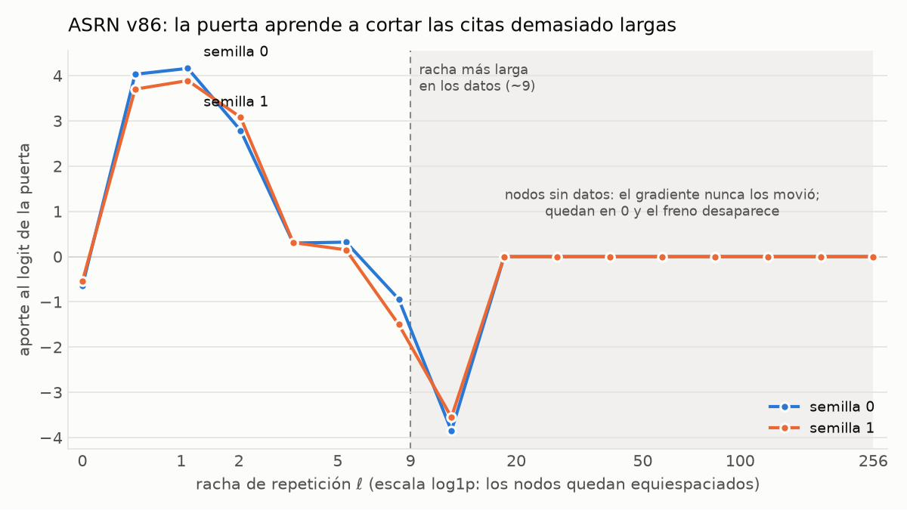

# ASRN 1.0 (v89): tiempo propio, intensidad de Hawkes y respuesta no monótona para una recurrencia dispersa de memoria O(N)

*Registro técnico. Código: `asrn_v89.py`; pruebas: `pruebas/test_asrn_v89.py` (62); verificación en GPU:
`pruebas/verificar_gpu_v89.py` y el cuaderno `benchmarks/pruebas_gpu_a100.ipynb`; velocidad:
`history/experiments/medir_velocidad_v89.py` y [RENDIMIENTO.md](RENDIMIENTO.md); experimento:
experimento_cita_v87.py (eliminado en 1.0); resultados en GPU: [`history/results/`](../results/README.md). Necesita PyTorch
2.9 o más nuevo y NumPy.*

*Qué cambió en octubre de 2026 (sección 12): una capa ASRN cada dos bloques (`largo_cada=2`) es la forma por omisión,
porque aprende igual y entrena 13–18% más rápido; se compara con Mamba-2 y RWKV-7; las opciones que no ganaron
(`partir_valores`, convolución por canal, capa densa con puerta) se quitaron del código, y hay un kit para entrenar un
modelo de 100 millones con FineWeb. Las cuentas de la capa no cambian.*

*Qué cambió en v89 y por qué: cualquier persona puede pedir el tamaño de modelo que quiera
(`ConfigASRN.para_parametros('50m', V=...)` o `--parametros 50m`) en vez de elegir de una lista; la lista de tallas
queda solo como ejemplos, sin referencias a hardware específico (sección 7.7). Las cuentas del modelo no cambian.*

*Qué cambió en v88 y por qué: v88 es la primera versión "1.0" del código. No cambia ninguna cuenta del modelo (los
archivos de v87 cargan y dan los mismos números, comprobado); agrega lo necesario para instanciar ASRN de ~3 mil a ~27
mil millones de parámetros desde una sola configuración y para entrenarlo repartido entre varias GPUs (sección 7). Las
secciones 1 a 6 son las de v87 sin cambios.*

*Estados: **confirmado** = medido con pruebas automáticas; **sin probar** = el código existe pero nadie lo ha corrido en
esa condición.*

## Resumen

ASRN (Adaptive Sparse Recurrence Network) es una capa de copia para modelos de lenguaje: con tablas de hash aprendidas
encuentra apariciones anteriores del contexto actual y copia lo que vino después, con costo proporcional al largo. La
versión v85 tenía tres problemas: (1) gastaba 55·d floats por pieza y por capa en activaciones para la vuelta, casi la
mitad por copias evitables; (2) su puerta de copia veía señales saturadas (¿este grupo de 1 a 4 piezas ya salió?), de
modo que una cita de 5 piezas y una de 50 eran el mismo estado; y (3) al escribir necesitaba una heurística fija
(`escala_vistos=0.5`) para no citar de más. v86 reescribe el flujo de tensores (**−44% de memoria guardada**, misma
matemática), agrega un reloj de tiempo propio dependiente de los datos con un núcleo continuo `α·e^(−βn)`, una
intensidad de Hawkes por n-grama y una racha de repetición, todo calculado con un escaneo asociativo paralelo de trabajo
O(N), y una respuesta no monótona de la puerta a la racha. Todo lo nuevo arranca neutro: con los pesos de v85, v86
calcula lo mismo. En un experimento sintético con citas de largo acotado, la puerta aprende sola un "acantilado" que
corta las citas en el largo máximo de los datos, de forma casi idéntica en dos semillas, y con el muestreo por defecto
la racha máxima escrita baja de 63 a 12 piezas sin ninguna perilla al escribir.

## 1. Arquitectura matemática

### 1.1 La capa de v85 (lo que se conserva)

Para cada una de T = 8 tablas, un hash aprendido (14 bits de signo de una proyección φ) asigna un casillero a cada
posición. Las posiciones se ordenan por casillero (estable: dentro de un casillero, por posición) y cada pregunta t mira
a sus C = 32 compañeros de casillero más recientes, con la puntuación

```
s_τ(t, s) = ⟨φ_t, φ_s⟩ / √(T·n_bits) + ⟨q_t, k_s⟩ / √c + w_suf[ℓ(t, s)]
```

(confirmación con el estado normalizado y un peso por el largo ℓ ≤ 4 del sufijo exacto común). El valor copiado desde
s es la pieza s+1. Las salidas de las tablas se promedian y entran al estado por una puerta:

```
h' = h + σ(g·h + g_conf·[señales de confianza] + Σ_n w_n·vistos_n(t)) · O·salida
```

### 1.2 Tiempo propio y núcleo continuo

Desde el estado normalizado ĥ (el mismo que usa la confirmación) cada capa calcula dos escalares por pieza:

```
β_t = softplus(w_β·ĥ_t + b_β) ≥ 0        B_t = Σ_{u≤t} β_u          (reloj de tiempo propio)
α_s = 2σ(w_α·ĥ_s) ∈ (0, 2)                                           (cuán memorable es la aparición s)
K_κ(t, s) = α_s · exp(−κ (B_t − B_s))
```

K es el núcleo `W(n) = α e^(−βn)` con n medido en tiempo propio: una reparametrización del tiempo que depende del texto
y que comparten todos los casilleros. Se usa de dos formas:

- **Normalizado (dónde copiar).** Cada tabla suma `log α_s − (γ_τ / C)(B_t − B_s)` a la puntuación: una escala temporal
  por tabla. Se arma como la diferencia de dos vectores que se difunden (llave − pregunta), así que no se guarda ningún
  tensor C×2C, y la forma relativa mantiene estacionaria la señal de confianza `mejor` de la puerta.
- **Sin normalizar (si copiar).** Es la intensidad de Hawkes de la sección 3.

### 1.3 Escaneo asociativo

Los mapas afines x ↦ a·x + b forman un monoide bajo composición, `(a₁, b₁) ∘ (a₂, b₂) = (a₁a₂, a₂b₁ + b₂)`, así que la
recurrencia lineal `S_i = a_i S_{i−1} + b_i` es un prefijo en ese monoide. `escaneo()` lo calcula en forma par-impar
recursiva: combina pares vecinos (N/2 elementos), resuelve los impares recursivamente y obtiene cada par con un paso
desde el impar anterior. El trabajo es N + N/2 + … = O(N), la profundidad O(log N), y autograd guarda unos 20 bytes por
elemento, constante en N (una versión Hillis–Steele guardaría O(N log N)). Con a ∈ [0, 1] solo hay productos en [0, 1]
y sumas, sin divisiones: es estable en fp32 y bf16. Un a_i = 0 reinicia la recurrencia, así que muchos segmentos
independientes se escanean en una sola pasada.

Vista desde grafos: cada tabla y cada orden de n-grama parten las posiciones en clases, y dentro de cada clase las
apariciones forman una cadena temporal. La memoria de ASRN es un bosque de cadenas y el escaneo hace paso de mensajes
exacto sobre todas a la vez; es la "recurrencia dispersa" del nombre.

### 1.4 Neutralidad

`w_α`, γ, los pesos de Hawkes y la respuesta a la racha arrancan en cero, y ninguno consume el generador aleatorio al
construirse. Con eso, v86 calcula **la misma función que v85** (verificado en ida, vuelta y escritura), la misma semilla
da el mismo arranque, y `cargar()` acepta archivos de v83/v84/v85, a los que solo les faltan los parámetros nuevos.

## 2. Optimización de memoria O(N)

Medimos los bytes que autograd guarda para la vuelta en una capa (d = 256, CPU) y rastreamos qué nodo del grafo
retiene cada tensor. En v85 casi la mitad venía de tres copias evitables:

| Componente (floats por pieza, en unidades de d) | v85 | v86 | Cambio |
|---|---|---|---|
| Valores ordenados, bloque anterior + actual | 16.0 | ≈ 8.3 | Las llaves del bloque anterior son una vista solapada (`unfold`) de una sola copia ordenada, en lugar de `torch.cat` |
| Salida ordenada retenida al desordenar | 8.0 | 0 | `scatter` en lugar de `gather`: su vuelta solo necesita índices, no la salida |
| Firmas φ (pregunta, llave, llave transpuesta) | 10.5 | ≈ 3.6 | Una sola copia: pregunta y llave son vistas de ella |
| Reloj, Hawkes, racha | – | ≈ 0.3 | Escalares por pieza; la respuesta a la racha guarda nodo y fracción (6 floats), no la base de funciones |
| **Total medido** | **55.3** | **30.9** | **−44%** |

Otros dos detalles: las posiciones de relleno solo existen en el espacio ordenado (no se rellena E), y la máscara de
ventana es una constante C×2C en lugar de tensores de posiciones. Lo guardado por pieza es constante en el largo, así que
la memoria es O(N); el tiempo es O(N log N) por los ordenamientos, como en v85. La intensidad de Hawkes reutiliza los
ordenamientos que ya calculaba `vistos`. En CPU, la ida y vuelta a L = 2048 bajó de 768 a 463 ms.

## 3. Proceso de Hawkes con respuesta no monótona

### 3.1 El problema: aliasing de estado

Con teacher forcing la puerta aprende P(copiar | señales). Si las señales fueran un estadístico suficiente del estado
de la cita en curso, el lazo cerrado (escribir muestreando) reproduciría la ley de largos de cita de los datos, porque
usaría las mismas condicionales. Las señales de v85 saturan: `vistos ∈ {0, 1}⁴` y el sufijo llega hasta 4 piezas, así
que una cita de 5 piezas y una de 50 son el mismo estado. La puerta aplica una tasa de continuación promedio y la ley de
largos se vuelve geométrica, con más cola que en un texto donde las citas terminan. `escala_vistos = 0.5` era una
reducción fija de la ganancia de ese lazo.

### 3.2 Hawkes y racha

```
λ_n(t) = Σ_{s<t, mismo grupo de n piezas} α_s e^(−κ_n (B_t − B_s))     intensidad de Hawkes, n = 1..4
ℓ_t    = r_t (e^(−κ_r β_t) ℓ_{t−1} + 1),   r_t = vistos_4(t)             racha de repetición
logit_puerta += Σ_n u_n log1p(λ_n(t)) + f_racha(ℓ_t)
```

λ_n se calcula con un escaneo segmentado sobre el orden por clave que `vistos` ya tenía: en ese orden la aparición
anterior está justo antes, y `S_i = a_i (S_{i−1} + α_{i−1})`, con `a_i = e^(−κ (B_i − B_{i−1}))` si sigue la misma
clave y 0 si no. Su soporte, `1[λ_n > 0]`, es exactamente el `vistos` de v85. ℓ es un escaneo sobre el texto; al
escribir es un estado de un número por capa. Las tasas κ_n arrancan en un espectro geométrico 1/(C·4ⁿ⁻¹): los grupos
cortos olvidan rápido y los largos, que son raros, recuerdan más.

### 3.3 La respuesta no monótona

La primera versión usaba `u_r · log1p(ℓ)`. Es monótona, así que la puerta no puede expresar "seguir copiando hasta el
largo normal de una cita y entonces parar", y en el experimento no frenó las citas largas (aprendió u_r = +0.28). La
versión final usa una interpolación lineal por tramos

```
x = log1p(ℓ) / Δ,  Δ = log1p(256) / 15,  i = ⌊x⌋
f_racha(ℓ) = u_i + (x − i) · (u_{i+1} − u_i)          (constante pasado el último nodo)
```

con 16 valores aprendidos u_0..u_15 que arrancan en cero. Equivale a una base de funciones sombrero, pero la vuelta solo
guarda el índice y la fracción de cada pieza: 24 bytes, frente a 64 de la base completa.

## 4. Resultados del experimento sintético

**Montaje.** El texto son piezas al azar, imposibles de predecir, con citas de vez en cuando: un trozo anterior de largo
uniforme entre 6 y 12. Así, en el texto real ninguna racha de grupos de 4 piezas ya vistos pasa de ~9. Se entrenan v85 y
v86 (d = 64, 2 capas, L = 256, 3000 pasos) con las semillas 0 y 1. Cada modelo escribe 128 piezas a partir de 128 piezas
de inicio de 64 textos de validación, y se compara con la continuación real. "> 9" es el porcentaje de rachas imposibles
en los datos.

**La puerta aprende un acantilado** (figura 1). Las dos semillas aprenden casi la misma curva: empuja a copiar al
empezar una cita (+4 en ℓ ≈ 0.5–1) y se cierra con fuerza pasado el largo máximo de los datos (−3.9 y −3.6 en ℓ ≈ 12).



*Figura 1. Aporte de la racha al logit de la puerta, semillas 0 y 1 (v87: 6000 pasos, datos frescos, curva por incrementos).
En gris, v86 (valores por nodo, 3000 pasos): los nodos de ℓ ≥ 18 nunca vieron datos y volvían a 0 (sección 6.1).*

**Efecto al escribir**, con memoria de lo ajeno activada (valor por defecto) y las rachas de las dos semillas juntas:

| | T=1: citado | racha media | máx | > 9 | T=0.8, top_k=40: citado | racha media | máx | > 9 |
|---|---|---|---|---|---|---|---|---|
| texto real | 15.6% | 5.6 | 10 | 0.9% | 15.6% | 5.6 | 10 | 0.9% |
| v85, `escala_vistos=1.0` | 6.4% | 5.1 | 19 | 9.7% | 19.2% | 11.1 | 63 | 46.5% |
| v85, `escala_vistos=0.5` | 1.3% | 5.2 | 26 | 4.9% | 4.1% | 12.8 | 51 | 55.8% |
| **v86** | 7.1% | 5.0 | **12** | **4.7%** | **14.4%** | **7.1** | **12** | **13.2%** |

Sin memoria de lo ajeno, a T=0.8: v85 cita 25.0% con 46.7% de rachas > 9; v86 cita 18.0% con 17.2%, pero tiene un caso
que se queda copiándose a sí mismo (racha de 85 piezas). La pérdida de validación es igual: 3.8875 / 3.8879 (v85) frente
a 3.8951 / 3.8856 (v86).

**Lectura.** Con el muestreo por defecto, v86 se acerca al texto real tanto en cuánto cita como en lo largo de las citas,
sin perillas al escribir. La heurística de v85 solo bajaba cuánto se cita, no lo largo de las citas.

## 5. Conclusiones y limitaciones

1. **Memoria.** Un flujo de tensores sin copias (vistas solapadas, reordenamientos cuya vuelta solo guarda índices)
   reduce un 44% la memoria guardada de la capa con la misma matemática. Es la ganancia más segura de esta versión.
2. **Mecanismo.** Hacer observable el estado de la cita (Hawkes y racha) y darle a la puerta una respuesta no monótona
   basta para que el freno salga del entrenamiento: la puerta aprende el acantilado sin que se lo pidamos.
3. **Neutralidad.** Todo lo nuevo arranca en cero, así que los modelos de v85 cargan y dan los mismos números, y se
   pueden afinar.

## 6. v87: cierre de las limitaciones de v86

**6.1 Extrapolación del freno.** Con valores por nodo, los nodos de ℓ ≥ 18 nunca recibían gradiente y quedaban en 0:
el freno desaparecía justo donde más hacía falta (un bucle de 85 piezas sin memoria de lo ajeno). Ahora la curva se
aprende por incrementos, `u_i = Σ_{j≤i} d_j`. Un nodo sin datos tiene `∂L/∂d_i = 0`, su incremento queda en 0 y hereda
el valor del último nodo con datos: extrapolación plana, la hipótesis de menor información, que los datos sobrescriben
donde existan rachas así (en texto real puede haber citas largas legítimas, por eso no se impone monotonía). La
conversión desde archivos con `u_racha` es exacta. Resultado: la curva queda en −8.3 / −9.0 hasta ℓ = 256 (figura 1) y
la racha máxima escrita es 10–11 en todas las condiciones.

**6.2 Temperatura que conserva la cita.** Sea C_t el conjunto de piezas que cierran un grupo de 4 ya visto. El muestreo
reparte q (tras temperatura y recortes) como `q'_w = q_w · p(C)/q(C)` en C y `q_w · (1−p(C))/(1−q(C))` fuera, con p el
modelo a T=1. Así la tasa de continuación de una cita (la ley de largos que la puerta aprendió) no depende de T; la
temperatura solo afina la elección dentro de cada parte. A T=0.8: rachas > 9 de 3.5–6.0% a 0.5–1.0% (real 0.9%).
Limitación: no cubre el arranque de las citas, así que a T<1 se cita más seguido (20.5–23.4% contra 15.6%).

**6.3 Copia a T=1.** Con teacher forcing, la puerta ya estaba saturada (0.985) con sufijos de 4 y aun así la
probabilidad de seguir era 0.92 contra 0.976 del texto real: el límite no era la puerta. Quitar el decaimiento de pesos
no cambió nada; usar datos frescos en lugar de ~30 pasadas por 400k piezas, sí (validación 3.89 → 3.71, calibración
0.96–0.97). Con 6000 pasos, a T=1 sin memoria de lo ajeno v87 cita 11.5% (real 15.6%; con memoria de lo ajeno el
techo es 11.1% y cita 9.6%). Lo que falta es calibrar el arranque (ℓ = 0, sufijo de 1–2 piezas).

**6.4 torch.compile.** Un solo grafo (antes 6: el `bincount` de la vuelta de `w_sufijo` tiene forma dependiente de los
datos; ahora `index_add_`). Inductor en CPU generaba C++ inválido al mezclar la comparación en 64 bits de las claves con
un relleno booleano; el relleno se hace en enteros. Compilado = sin compilar en logits (6e-7), gradientes (8e-5) y en
la curva de entrenamiento. La prueba `test_torch_compile_un_solo_grafo_y_mismas_cuentas` lo comprueba; en GPU no se ha validado.

Sigue abierto: GPU (el script está listo), el arranque de las citas a T<1, y el efecto en texto real.

## 7. v88 / ASRN 1.0: un solo código de 3 mil a 27 mil millones de parámetros

**7.1 Configuración única.** `ConfigASRN` reúne todo lo que define al modelo (vocabulario, ancho d, capas, ventana local,
y las opciones de la capa ASRN). `validar()` explica en español qué está mal; `contar_parametros()` arma el modelo en el
dispositivo `meta` (solo formas, sin memoria), así que cuenta exacto incluso 27 mil millones. `TALLAS` trae
configuraciones de ejemplo (con V = 32 768 salvo las chicas; desde v89 cualquier tamaño se pide con
`para_parametros`, sección 7.7). Desde octubre de 2026 tienen una capa ASRN cada dos bloques (`largo_cada=2`, sección
12) y más capas para quedar del mismo tamaño:

| Talla | Parámetros | d | Capas | Estado |
|---|---|---|---|---|
| nano-3k | 2 948 | 10 | 2 (capa ASRN reducida: 2 tablas de 6 bits) | sin entrenar |
| 12m | 12 047 120 | 256 | 16 (V = 8000) | sin entrenar con esta receta |
| 30m | 30 300 876 | 384 | 13 | sin entrenar con esta receta |
| 125m | 122 479 410 | 768 | 18 | sin entrenar con esta receta |
| 350m | 328 943 870 | 1024 | 31 | sin entrenar con esta receta (versiones anteriores entrenaron uno de ~300M con otra forma) |
| 1b | 1 088 770 746 | 2048 | 27 | sin entrenar |
| 7b | 6 800 244 972 | 4096 | 44 | sin entrenar |
| 27b | 26 887 880 940 | 8192 | 44 | sin entrenar |

Los bloques locales (convolución 4d² + capa densa 4d² por capa) son la mayor parte y crecen con el tamaño: 69% en
125m (con 21% de vocabulario y 10% de capas ASRN), 83% en 1b y ~87% en 7b y 27b, donde las capas ASRN son ~11% y el
vocabulario 1–2%. (Con una capa ASRN por bloque, la forma de antes, las capas ASRN eran ~17–20%.) Que el código *cree y reparta* una talla no dice nada de cómo *aprende*: eso solo lo dirán las
curvas de escalado.

**7.2 Checkpointing por niveles.** `checkpoint='asrn'` (el de v87) recalcula en la vuelta solo las capas ASRN; `'todo'`
también los bloques locales. Memoria guardada para la vuelta (d = 256, 8 capas, V = 8000, L = 1024, lote 1, CPU,
medida con ganchos de autograd): **631 MB → 175 MB → 94 MB** (−72% y −85%), con la misma pérdida y los mismos
gradientes (confirmado, tolerancia 1e-6). Con `'todo'` lo que queda es sobre todo la salida sobre el vocabulario.
Memoria pico en GPU: sin probar (`verificar_gpu_v89.py`, prueba 2).

**7.3 Arranque sin el modelo entero.** `materializar(modelo, dispositivo, semilla)` llena un modelo creado en `meta`
(ya repartido o no) pieza por pieza en CPU, consumiendo el azar en el mismo orden que el constructor: el resultado es
**bit a bit igual** a `crear_modelo(semilla=...)` (confirmado en 3 configuraciones × 2 semillas, pesos y salida), sin
tocar el azar global. Así un modelo gigante nunca existe completo en una sola máquina; el pico de memoria es la pieza
más grande (en 27b, el vocabulario: 32 768 × 8192 floats ≈ 1 GB).

**7.4 FSDP.** `repartir_fsdp()` usa FSDP2 (`fully_shard`): cada bloque local y cada capa ASRN es una unidad; el
vocabulario y la salida (la misma matriz) quedan en la raíz. Por defecto los pesos se juntan en 32 bits y las cuentas
van en bf16 por autocast, igual que sin repartir, para que el reloj, Hawkes y las firmas sigan en 32 bits donde la capa
lo pide; juntar en bf16 (`precision_pesos=torch.bfloat16`) todavía no funciona (la capa necesita pesos de 32 bits) y
se rechaza con un mensaje claro. `entrenar()` detecta el
reparto: cada proceso toma lotes distintos, la pérdida y la decisión de saltar un paso con NaN se promedian entre
procesos (todos saltan o ninguno), solo el proceso 0 escribe. Los archivos guardan el estado de AdamW por nombre de
parámetro cuando hay reparto, y se convierten en ambos sentidos: un entrenamiento puede seguir de 1 GPU a varias y al
revés.

Confirmado con 2 procesos en CPU (gloo): ida igual a sin repartir; la norma del gradiente y el paso de AdamW con
recorte iguales a un solo proceso con el lote completo (tolerancia 2e-5); `entrenar()` repartido aprende, guarda,
`cargar()` lo abre en un proceso con la misma salida, y reanuda desde archivos repartidos y de un proceso; la línea de
comandos con `torchrun` entrena y reanuda. Sin probar: NCCL en GPU (prueba 3 de `verificar_gpu_v89.py`, 1 GPU), y
varias GPUs de verdad. fp16 repartido se rechaza a propósito (el escalado de gradientes por proceso
podría desincronizarlos): con FSDP se usa bf16.

**7.5 Complejidad, dicho con precisión.** La memoria guardada para la vuelta es O(N) en el largo; el **tiempo es
O(N log N)** por los ordenamientos de casilleros (sección 2), no O(N). Sigue siendo muy inferior al O(N²) de la
atención completa, pero en una publicación debe escribirse así.

**7.6 Lo que v88 no resuelve.** Long Range Arena, la comparación de velocidad y memoria contra Transformer con esta
versión y las curvas de escalado son las siguientes fases; ninguna está hecha.

## 8. v89: el tamaño que cada quien quiera

`ConfigASRN.para_parametros(objetivo, V, **fijos)` recibe el número de parámetros deseado (`50e6` o textos como `'3k'`,
`'50m'`, `'1.5b'`) y el vocabulario del tokenizador, y devuelve la configuración con la receta final más cercana. Lo
que el usuario fije (`d`, `n_capas`, `largo_cada`, `dropout`, opciones de la capa) se respeta; la búsqueda mueve solo lo
demás. En la línea de comandos: `--parametros 50m --V 32000`.

**Cómo busca.** Una fórmula cerrada da el número exacto de parámetros de cualquier configuración sin armar el modelo
(confirmado igual al conteo real en 200 configuraciones al azar en las pruebas, y en 300 al desarrollarla), así que se
pueden revisar miles de formas al instante: anchos d de 2 en 2 hasta 64, de 8 en 8 hasta 2048 y de 64 en 64 después, y
de 2 a 512 capas. Entre las formas a menos de 3% del objetivo elige la de proporción d / capas más cercana a 64; si
ninguna llega, la más cercana. Si la capa ASRN normal no cabe (objetivos de pocos miles), usa la capa reducida (2 tablas
de 6 bits). Tarda de 0 a 4 segundos.

| Pedido | V | d | Capas | Parámetros | Diferencia |
|---|---|---|---|---|---|
| 3k | 48 | 10 | 2 (capa reducida) | 2 980 | −0.7% |
| 12m | 8000 | 384 | 6 | 12 120 618 | +1.0% |
| 50m | 32 768 | 576 | 9 | 49 228 176 | −1.5% |
| 125m | 32 768 | 848 | 13 | 122 342 264 | −2.1% |
| 1.5b | 32 768 | 2048 | 33 | 1 458 631 744 | −2.8% |
| 27b | 32 768 | 5568 | 87 | 27 206 913 900 | +0.8% |
| 70b | 128 000 | 7616 | 119 | 70 096 898 988 | +0.1% |

**Lo que esto no dice.** La proporción d / capas ≈ 64 es una regla de forma razonable, no una forma óptima medida para
ASRN; cuál forma aprende mejor a un tamaño dado solo lo dirán las curvas de escalado.

## 9. Revisión antes de publicar

Una revisión de todo el código antes de publicarlo. Las cuentas del modelo no cambian: las pruebas de igualdad con v85
y v87 (ida, vuelta, escritura y carga de archivos) siguen pasando sin tocarlas. Se encontró y corrigió:

- **Dependencias.** Guardar con el modelo repartido usa `all_gather_object` de PyTorch, que necesita NumPy:
  `requirements.txt` ahora lo pide (sin NumPy, el entrenamiento repartido se caía al primer guardado). La versión
  mínima de PyTorch sube de 2.6 a 2.9, comprobado versión por versión en CPU: con 2.6 FSDP falla
  (`distribute_tensor(src_data_rank=...)` todavía no existe); con 2.7 y 2.8 la norma del gradiente repartido (gloo)
  sale el doble que en un solo proceso; desde 2.9, FSDP coincide. `torch.compile` en CPU solo funciona desde 2.14: de
  2.6 a 2.13 Inductor genera C++ inválido o Python se cae (corrupción de memoria o segmentation fault) al compilar
  este modelo. Es opcional; con esas versiones `entrenar(compilar=True)` avisa y su prueba se salta.
- **Fallos.** Reanudar en fp16 un entrenamiento hecho en bf16 o fp32 (por ejemplo, de una A100 a una T4) fallaba al
  cargar el escalador de gradientes. `escribir()` fallaba con `top_p=0`, con `no_repetir_ngramas` cuando prohíbe todas
  las piezas (con vocabularios chicos) y, con un error poco claro, con piezas fuera del vocabulario.
- **Silencios.** `torchrun` sin `--fsdp` hacía que cada proceso entrenara su propia copia y todos escribieran el mismo
  archivo; reanudar con `pasos` ya alcanzado no hacía nada sin decirlo; reanudar con otros `pasos`, `lr` o `lote` cambiaba
  la curva de la tasa de aprendizaje sin aviso; `--V`, `--capas`, etc. se ignoraban al reanudar; una validación demasiado
  corta se descartaba sin aviso; `para_parametros` devolvía, sin avisar, un modelo hasta 40 veces más grande o cientos de
  veces más chico que lo pedido cuando el objetivo era imposible (vocabulario grande, o `d` y `n_capas` fijos). Ahora
  todos avisan, y los imposibles dan un error que explica por qué.
- **Mensajes claros** en lugar de errores confusos: `--fsdp` sin `torchrun`, `--guardar_cada 0` (y otros ceros),
  formatos de datos desconocidos, archivos que no existen (antes: "no se pudo leer en modo seguro"), reanudar desde el
  `.mejor.pt` (solo trae pesos), nombres de campo mal escritos en `para_parametros`.
- **Precisión.** Los pesos deben estar en 32 bits; bf16 y fp16 se usan con autocast. Convertir el modelo con
  `.to(torch.bfloat16)` o `.half()`, o pedir `precision_pesos=torch.bfloat16` a `repartir_fsdp`, fallaba con un error de
  tipos (y las claves de `vistos` se redondeaban: falsos positivos en ~0.01% de las posiciones); ahora se rechaza
  explicando qué hacer.
- **Guardado y memoria.** El archivo se baja al disco (`fsync`) antes de renombrarlo y el temporal se borra si algo
  falla. Al reanudar repartido, los procesos de una máquina leen el archivo con `mmap` y comparten una sola copia en
  memoria, en vez de cargarlo entero cada uno.
- **Pruebas nuevas (10).** Causalidad (cambiar las piezas futuras no cambia ninguna salida anterior), casos límite
  (largo 1, lote 1, vocabulario 2, `chunk` 1, `largo_cada` mayor que `n_capas`) y una por cada arreglo de arriba. Se quitó
  la prueba que necesitaba `asrn_v86.py` (no está en el repositorio: contaba como "ok" sin probar nada); la
  conversión de los archivos de v86 sigue probada por `test_migrar_racha_de_archivos_viejos_es_exacta`.

**Sigue abierto** (no se cambió porque cambiaría los números del modelo o necesita GPU): con autocast, la proyección
del reloj (β, α) se calcula en 16 bits antes de pasar a 32 (error relativo de β de hasta ~3%; calcularla en 32 bits
cambiaría los resultados en bf16); guardar repartido junta pesos y AdamW completos en la memoria del proceso 0 (~12
bytes por parámetro), y para modelos de miles de millones convendrá guardar por pedazos con
`torch.distributed.checkpoint`; `evaluar()` repartido hace la misma cuenta en todos los procesos en vez de repartir las
ventanas.

## 10. Primera corrida en GPU

El cuaderno `pruebas_gpu_a100.ipynb` corrió completo en una A100 de 40 GB (PyTorch 2.11, bf16). Todos los números,
gráficas y el cuaderno ejecutado están en `history/results/corrida_1/` (resumen de todas las corridas en
`history/results/README.md`). En corto:

- **Correctitud.** GPU = CPU (diferencia máxima 6·10⁻⁷ en 32 bits, también en los gradientes), causalidad y escritura
  paso a paso iguales al texto entero; FSDP con NCCL da lo mismo repartido. Dos problemas encontrados y corregidos:
  `torch.compile` falla con PyTorch 2.11 en GPU (error interno de Triton; la comprobación ahora se salta antes de 2.14),
  y las pruebas de FSDP con gloo fallaban en una máquina con GPU porque `fully_shard` armaba la malla en la GPU
  (`repartir_fsdp` ahora la arma en la CPU cuando el grupo usa gloo).
- **Copia a larga distancia** (~2.5 M de parámetros, entrenado con L = 1 024, 3 semillas): ASRN 99.9% con L = 1 024,
  99.8% con 4 096 y 83% ± 26 con 16 384; el Transformer 68% ± 44 con 1 024 y nivel de azar (0.2%) con textos más
  largos; sin la capa ASRN, nivel de azar.
- **WikiText-103** (~44 M de parámetros, 30 M de piezas, L = 1 024, 3 semillas): perplejidad 56.75 ± 0.61 (ASRN)
  contra 63.76 ± 0.48 (Transformer); con L = 4 096, 52.76 contra 128.17. A igual cantidad de datos, no de cómputo: ASRN
  tardó 4 veces más (12.7 contra 3.1 minutos).
- **Costo.** Una capa ASRN escala de forma lineal en tiempo (pendiente 0.88 contra 1.88 de FlashAttention) y supera a
  FlashAttention desde ~131 mil piezas (2.6 veces más rápida con 262 mil), pero usa unas 4 veces más memoria. Un
  modelo entero de 50 M entrena de 2 a 6 veces más lento que el Transformer entre 1 024 y 32 768 piezas.

Falta: comparar a igual cómputo, contra arquitecturas lineales (Mamba, RWKV), con más tasas de aprendizaje y a mayor
escala.

## 11. Velocidad: primer paso

La capa ASRN está limitada por la memoria, no por las cuentas: en la forma del modelo de 50 M (d = 576, 32 768 piezas
por paso) una ida y vuelta mueve ~852 KB por pieza y hace ~7 MFLOP por pieza, unas 8 operaciones por byte (una A100
necesita ~150 para que el límite sean las cuentas). El 73% de esos bytes está en la atención por casilleros
(`_acumular`), y el 53% de las ~930 operaciones que lanza una capa son del escaneo (`escaneo`), que con textos cortos
domina el tiempo fijo de ~20 ms por capa medido en la A100.

Cuatro cambios con las mismas cuentas (la ida da el mismo resultado bit a bit; en la vuelta solo cambia el redondeo
del escaneo, ≤ 3·10⁻⁷ relativo):

- **Volver al orden del texto por filas.** La salida de las ventanas vuelve al orden del texto con un índice por fila
  (`index_select`) en vez de un `scatter` con un índice de 64 bits por número, y la suma de las tablas tiene su
  propia vuelta (`_DesordenarSumar`): cada fila recibe el gradiente de su posición, sin sumas atómicas.
- **Largo del sufijo en 1 byte** (`_largo_seguido`) en vez de 8: el tensor tiene el tamaño de los puntajes.
- **Casilleros en 32 bits** (`_ids`): ordenar claves de 32 bits necesita la mitad de pasadas que de 64.
- **Vuelta propia del escaneo** (`_Escaneo`): la vuelta de S_i = a_i S_{i−1} + b_i es el mismo escaneo de derecha a
  izquierda, l_i = g_i + a_{i+1} l_{i+1}, con dL/db = l y dL/da_i = l_i S_{i−1}. Guarda 2 números por elemento (antes
  ~5) y lanza ~150 operaciones en la vuelta en lugar de ~350.

Contado operación por operación (d = 576, lote 32 × 1 024): de 852 a 619 KB por pieza (−27%) y de 927 a 731
operaciones (−21%). La velocidad en GPU se mide con `medir_velocidad_v89.py` (antes y ahora en la misma sesión). Lo
que queda, y el diseño del primer kernel propio (Triton) para la atención por casilleros, está en
`RENDIMIENTO.md`.

Medido en una A100 (PyTorch 2.11): la salida es igual bit a bit y la capa va de 1.05 a 1.21 veces más rápido. El
perfil mostró que la mitad del tiempo de GPU de la capa (18.4 de 36.6 ms con 16 384 piezas) era la vuelta de
`w_sufijo[largo]`: un `index_add_` atómico de millones de números sobre 5 direcciones, que la GPU serializa; la
vuelta de `u_racha[i]` (16 direcciones) sumaba otros 2.9 ms. `_Tomar` hace esa vuelta con una reducción por
entrada, sin atómicas y siempre con el mismo resultado.

Con `_Tomar`, la capa va de 1.20 (1 024 piezas) a 2.80 veces (262 144) más rápido en la A100 y el modelo de 50 M de
1.61 a 2.01 veces (89 402 piezas/s con 16 384 × 2, frente a 128 774 del Transformer). La GPU queda ociosa la mitad
del tiempo esperando lanzamientos; el escaneo pasa entonces a un kernel Triton (`_escaneo_kernel`, ida y vuelta, con
`tl.associative_scan` por bloques y acarreo), que se usa en GPU y deja el de PyTorch como respaldo. Detalle en
`RENDIMIENTO.md`.

Corrida completa del cuaderno con todo esto (A100 de 80 GB, `history/results/corrida_2/`): el modelo de 50 M entrena
de 1.8 a 2.3 veces más rápido que en la primera corrida, y con 32 768 piezas por texto iguala al Transformer
(100 658 contra 96 542 piezas/s). WikiText-103 repite la perplejidad (57.19 ± 0.13 contra 63.41 ± 0.78 del
Transformer), ahora en 7.4 minutos por corrida en vez de 12.7.

La atención por casilleros pasa también a Triton (`_casilleros_ida` y `_casilleros_vuelta`): un programa por fila y
bloque lee sus 32 preguntas y 64 llaves directamente del orden del texto, arma los puntajes en la SRAM y escribe cada
salida en su posición. La vuelta recalcula los puntajes, como FlashAttention, y no guarda nada de la ida. En fp32 da lo
mismo que `_acumular` salvo el redondeo; la velocidad en GPU está por medir. Detalle en `RENDIMIENTO.md`
(sección 5c).

Medido en la A100 de 40 GB: el modelo de 50 M entrena a ~106 mil piezas por segundo con cualquier largo (3 veces más
que al principio, 1.14 veces más que el Transformer con 32 768 piezas) y la memoria de la capa baja a la mitad. El
perfil mostró que la vuelta (6.4 ms contra 0.33 ms de la ida, con 16 384 piezas) sumaba con atómicas; ahora cada
contribución se escribe en su propio lugar (cada llave aparece en dos ventanas de su tabla) y se suma después, sin
atómicas y siempre con el mismo resultado.

Sin atómicas, la vuelta del kernel pasó de 6.4 a 0.99 ms y el modelo de 50 M entrena a ~146 mil piezas por segundo con
cualquier largo: de 3.3 a 4.2 veces más que al principio, más rápido que el Transformer desde 16 384 piezas (1.58 veces
con 32 768) y 1.4 veces más lento con 1 024. En bf16, antes y ahora quedan igual de cerca de la cuenta en 32 bits
(1.15·10⁻³). Con textos cortos, el límite ahora es lanzar ~400 kernels desde Python.

Tercera corrida completa del cuaderno, con todos los kernels (A100 de 80 GB, `history/results/corrida_3/`): ASRN aprende
igual (WikiText-103: 56.97 ± 0.18 contra 63.44 ± 0.32 del Transformer; copia con 4 veces el largo: 99.9% ± 0.2), entrena
el modelo de 50 M a ~162 mil piezas por segundo (4.6 veces la primera corrida; 1.18 y 1.68 veces más rápido que el
Transformer con 16 384 y 32 768 piezas) y cada corrida de WikiText tarda 4.0 minutos en vez de 12.7.

Con textos cortos la GPU espera a Python (1.6 ms de trabajo en 10.6 ms por capa con 1 024 piezas). `PasoGrafado` graba
el paso de entrenamiento entero (ida, vuelta, recorte, AdamW fusionado con `capturable=True` y la tasa en la GPU) como
CUDA Graph; los pasos con pérdida o norma no finitas no cambian nada (`found_inf` de AdamW fusionado). Se mide contra el
Transformer también grabado; si no alcanza, el siguiente paso es que cada tabla copie solo su parte del vector. En el
camino se corrigió `_respuesta_racha`: un NaN ya no se convierte en un índice fuera de rango.

Medido: con CUDA Graph una capa sola con 1 024 piezas baja de 11.4 a 1.6 ms (FlashAttention 1.5 ms), pero al entrenar
con 32 768 piezas por paso la GPU ya está ocupada el 95–98% del tiempo con ASRN (99.6% con el Transformer): el límite
en entrenamiento es el trabajo de la GPU, no Python. El siguiente paso es el cambio de diseño.

El paso entero por partes (A100, PyTorch 2.14, 1 024 × 32): vocabulario y pérdida 24%, bloques locales 31%, capas ASRN
61% (medidas solas), y las conversiones de tipo son el 21% del trabajo de la GPU. `torch.compile` en las partes chicas
de las capas (sin tocar los kernels Triton) bajó el paso de 224 a 191 ms. `compilar_partes` agrega los bloques locales
y es una opción de `entrenar()` (`compilar='partes'`, `--compilar`).

Con todo compilado (`compilar_partes`, PyTorch 2.14), ASRN entrena a ~183 mil piezas por segundo (+26%), pero el
Transformer compilado también gana (+31%): ASRN queda 1.20 y 1.76 veces más rápido con 16 384 y 32 768 piezas, y 1.26 y
1.45 veces más lento con 4 096 y 1 024. Con textos cortos la diferencia es de trabajo por pieza (un bloque local y una
capa ASRN por nivel, contra un bloque del Transformer), no de programación: lo que queda son decisiones de diseño.

Cuarta corrida completa (A100 de 40 GB, `history/results/corrida_4/`): con una capa ASRN cada dos bloques
(`largo_cada=2`, los mismos parámetros repartidos en más bloques locales y la mitad de capas ASRN) el modelo aprende
igual (WikiText-103: 57.06 ± 0.47 contra 56.97 ± 0.18; copia con 4 y 16 veces el largo: 99.3% y 89.6% contra 99.9% y
90.9%) y entrena 16–18% más rápido (~171 mil piezas por segundo sin compilar, contra ~146 mil). Con 1 024 piezas queda
1.20 veces más lento que el Transformer (antes 1.40) y con 16 384 y 32 768, 1.32 y 1.83 veces más rápido. Es la forma
recomendada, y desde octubre de 2026 la de por omisión (sección 12).

## 12. Contra Mamba-2 y RWKV-7, y la receta de octubre de 2026

Quinta corrida completa del cuaderno (A100 de 80 GB, PyTorch 2.11, bf16, `history/results/corrida_5/`), ahora también contra
**Mamba-2** y **RWKV-7**, las otras capas de costo lineal (reimplementadas en `benchmarks/rivales_lineales.py` con los
kernels Triton de flash-linear-attention). Mismos datos y tamaño, la mejor de dos tasas y 3 semillas por modelo:

| | ASRN (cada 2) | ASRN (cada 1) | Transformer | Mamba-2 | RWKV-7 |
|---|---|---|---|---|---|
| WikiText-103, perplejidad con 1 024 | 57.02 ± 0.32 | 56.48 ± 0.86 | 64.26 ± 1.23 | 59.46 ± 0.50 | **47.87 ± 0.15** |
| WikiText-103, perplejidad con 4 096 | 53.06 ± 0.36 | 52.46 ± 0.91 | 122.6 ± 2.5 | 58.34 ± 0.60 | **45.83 ± 0.11** |
| Copia con 1 024 | 99.97% | 99.98% | 70.8% ± 47 | 0.2% | 2.4% |
| Copia con 4 096 | **99.3%** ± 0.8 | **99.6%** ± 0.8 | 0.2% | 0.2% | 0.2% |
| Copia con 16 384 | **76.9%** ± 23 | **79.9%** ± 33 | 0.2% | 0.2% | 0.2% |
| Modelo de 50 M, piezas/s con 1 024 | 200 258 | 176 423 | 231 545 | 94 806 | 53 048 |
| Modelo de 50 M, piezas/s con 32 768 | 199 930 | 174 740 | 96 204 | 90 771 | 49 762 |

Una capa sola con 262 144 piezas tarda 60 ms (ASRN), 216 (Mamba-2), 547 (RWKV-7) y 1 485 (FlashAttention).

- **RWKV-7 predice mejor el texto** (16% menos perplejidad). ASRN gana a Mamba-2 y al Transformer.
- **Solo ASRN copia desde lejos**, y lo sigue haciendo con textos 4 veces más largos que los de entrenamiento.
- **Una capa ASRN cada dos bloques** queda dentro de la variación entre semillas en todo y entrena 13% más rápido en
  esta GPU (16–18% en la cuarta corrida). Por eso es la forma por omisión (`largo_cada=2`); las tallas de ejemplo se
  ajustaron para quedar del mismo tamaño (por ejemplo, la de 125 M pasó a 18 capas).

**Bloques locales** (`history/results/bloques_1/`, una semilla): cambiar la convolución densa de 4 piezas por una memoria
con olvido por canal (`mezcla='memoria'`, mismo escaneo que la capa ASRN, mismos parámetros) baja la perplejidad 5.7%
(56.2 → 53.1) pero rompe la copia con textos más largos (35% con 4 096, 3% con 16 384). La convolución sigue por
omisión; la siguiente prueba es la memoria con escalas más cortas (`memoria_max` 128 y 32), detalle en
[RENDIMIENTO.md](RENDIMIENTO.md), sección 5i.

**Limpieza.** Se quitaron del código las opciones que no ganaron: `partir_valores` (+2% de velocidad), la convolución
por canal sin memoria (igual que la receta) y la capa densa con puerta (peor). Las conversiones de tipo de la capa
bajaron 43% (contado en CPU) con las mismas cuentas. Las 62 pruebas pasan.

**Siguiente escala.** `examples/train_100m/` entrena un ASRN de 103.5 millones de parámetros (12 capas de ancho 768, una
capa ASRN cada dos bloques, vocabulario de GPT-2) con ~2 mil millones de piezas de FineWeb en Google Colab. Sin correr
todavía.
