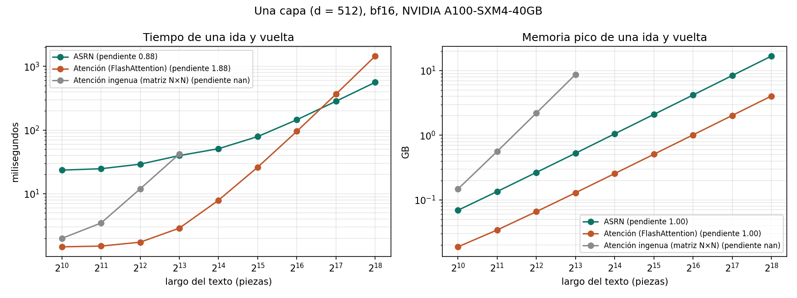
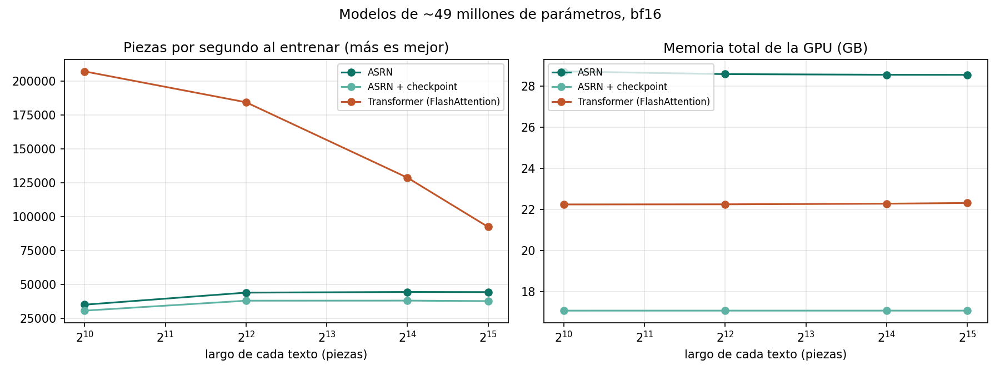
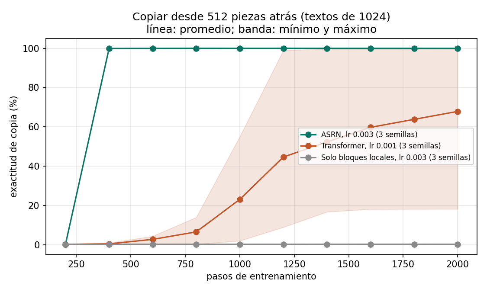
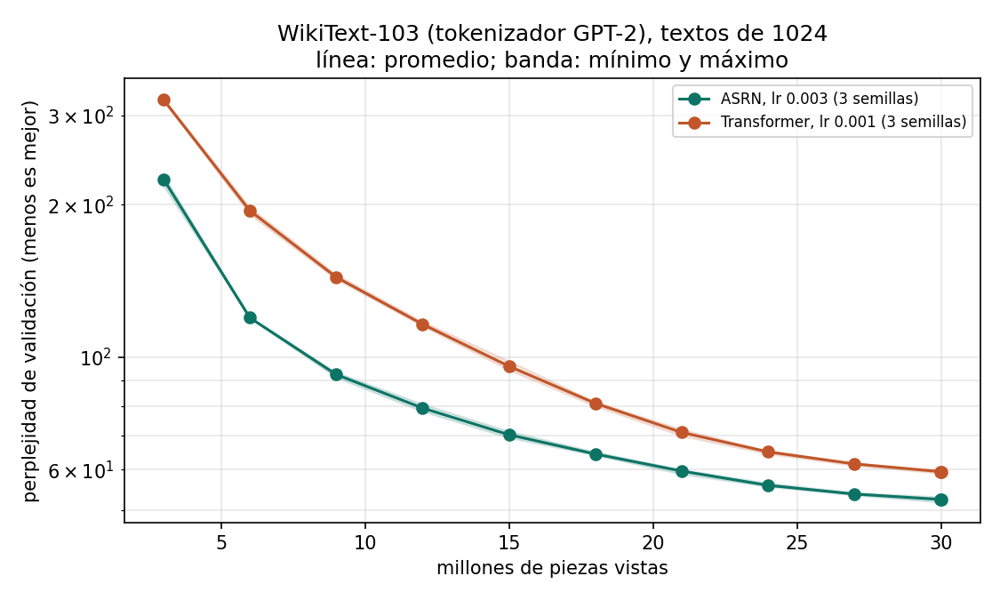

# ASRN 1.0 en GPU: resultados

2026-10-04 01:36 UTC · NVIDIA A100-SXM4-40GB (42.4 GB) · PyTorch 2.11.0+cu130 · CUDA 13.0 · Python 3.13.15 · código: asrn_v89.py sha256 ea454e19df24 · cuentas en bf16

## Estado de cada sección

| Sección | Resultado | Detalle |
|---|---|---|
| 2. Pruebas automáticas | FALLA | AssertionError: 2 pruebas fallaron |
| 3. Verificación en GPU | FALLA | AssertionError: fallaron: 4. torch.compile en GPU: mismas cuentas |
| 4. Una capa: memoria y tiempo según el largo | LISTA | 23 mediciones |
| 5. Modelo de 50 millones: velocidad y memoria | LISTA | 12 mediciones |
| 6. Copiar desde lejos | LISTA | 12 corridas |
| 7. Texto real | LISTA | WikiText-103 (tokenizador GPT-2) |

## Verificación en GPU

| Prueba | Resultado | Detalle |
|---|---|---|
| 1. bf16 en GPU, talla 30m | PASA | 31,069,686 parametros / perdida 9.706 -> 0.201 / 14,795 piezas/s |
| 2. checkpoint por niveles: misma perdida, menos memoria | PASA | no: 3,390 MB / asrn: 1,756 MB / todo: 1,147 MB (largo 2048, lote 4, bf16) |
| 3. FSDP con NCCL en 1 proceso | PASA | repartido = sin repartir (dif 0.0e+00); entrena, guarda y carga (dif 0.0e+00) |
| 4. torch.compile en GPU: mismas cuentas | FALLA | InductorError: SubprocException: An exception occurred in a subprocess:  Name=triton_per_fused__to_copy__unsafe_view_add_addmm_clamp_div_floor_index_log1p_mul_native_layer_norm_native_layer_norm_backward_select_sigmoid_slice_stack_sub_sum_transpose_unsqueeze_view_75 Traceback (most recent call last):   File "/usr/local/lib/python3.13/dist-packages/torch/_inductor/compile_worker/subproc_pool.py", line 457, in do_job     result = job()   File "/usr/local/lib/python3.13/dist-packages/torch/_inductor/runtime/compile_tasks.py", line 68, in _worker_compile_triton     kernel.precompile(warm_cache_only=True)     ~~~~~~~~~~~~~~~~~^^^^^^^^^^^^^^^^^^^^^^   File "/usr/local/lib/python3.13/dist-packages/torch/_inductor/runtime/triton_heuristics.py", line 491, in precompile     self._precompile_worker()     ~~~~~~~~~~~~~~~~~~~~~~~^^   File "/usr/local/lib/python3.13/dist-packages/torch/_inductor/runtime/triton_heuristics.py", line 522, in _precompile_worker     compile_results.append(self._precompile_config(c))                            ~~~~~~~~~~~~~~~~~~~~~~~^^^   File "/usr/local/lib/python3.13/dist-packages/torch/_inductor/runtime/triton_heuristics.py", line 872, in _precompile_config     binary = triton.compile(*compile_args, **compile_kwargs)   File "/usr/local/lib/python3.13/dist-packages/triton/compiler/compiler.py", line 324, in compile     next_module = compile_ir(module, metadata)   File "/usr/local/lib/python3.13/dist-packages/triton/backends/nvidia/compiler.py", line 541, in <lambda>     stages["ttgir"] = lambda src, metadata: self.make_ttgir(src, metadata, options, capability)                                             ~~~~~~~~~~~~~~~^^^^^^^^^^^^^^^^^^^^^^^^^^^^^^^^^^^^   File "/usr/local/lib/python3.13/dist-packages/triton/backends/nvidia/compiler.py", line 316, in make_ttgir     pm.run(mod, 'make_ttgir')     ~~~~~~^^^^^^^^^^^^^^^^^^^ RuntimeError: PassManager::run failed   Set TORCHDYNAMO_VERBOSE=1 for the internal stack trace (please do this especially if you're reporting a bug to PyTorch). For even more developer context, set TORCH_LOGS="+dynamo"  |
| 5. GPU = CPU: misma salida y mismo gradiente (32 bits) | PASA | 100.0% de las posiciones iguales (dif max 6.0e-07); gradiente: dif relativa 4.5e-07 |
| 6. Causalidad en GPU: el futuro no cambia el pasado | PASA | dif max en el pasado 1.8e-07 (5 cortes, largo 513) |
| 7. Escribir paso a paso = texto entero en GPU | PASA | 100.0% de los 80 pasos iguales (dif max 2.4e-07) |

## Una capa (d = 512): tiempo y memoria de una ida y vuelta

| Largo | ASRN | Atención (FlashAttention) | Atención ingenua (matriz N×N) |
|---|---|---|---|
| 1 024 | 23.5 ms · 0.07 GB | 1.5 ms · 0.02 GB | 2.0 ms · 0.15 GB |
| 2 048 | 24.7 ms · 0.13 GB | 1.5 ms · 0.03 GB | 3.5 ms · 0.56 GB |
| 4 096 | 29.2 ms · 0.27 GB | 1.7 ms · 0.07 GB | 11.9 ms · 2.20 GB |
| 8 192 | 39.8 ms · 0.53 GB | 2.9 ms · 0.13 GB | 42.1 ms · 8.74 GB |
| 16 384 | 51.0 ms · 1.05 GB | 7.9 ms · 0.26 GB | sin memoria |
| 32 768 | 79.1 ms · 2.10 GB | 26.1 ms · 0.51 GB | — |
| 65 536 | 145.2 ms · 4.20 GB | 95.6 ms · 1.01 GB | — |
| 131 072 | 283.7 ms · 8.39 GB | 367.4 ms · 2.03 GB | — |
| 262 144 | 561.9 ms · 16.78 GB | 1448.7 ms · 4.05 GB | — |

Pendientes (1 = lineal, 2 = cuadrática), con los textos más largos:

| Contendiente | Tiempo | Memoria |
|---|---|---|
| ASRN | 0.88 | 1.00 |
| Atención (FlashAttention) | 1.88 | 1.00 |
| Atención ingenua (matriz N×N) | nan | nan |

## Entrenar un modelo de ~50 millones de parámetros

Parámetros: ASRN: 49 228 176, ASRN + checkpoint: 49 228 176, Transformer (FlashAttention): 50 767 488

| Modelo | Largo × lote | Piezas por segundo | Memoria total |
|---|---|---|---|
| ASRN | 1 024 × 32 | 35 136 | 28.7 GB |
| ASRN | 4 096 × 8 | 44 033 | 28.6 GB |
| ASRN | 16 384 × 2 | 44 503 | 28.5 GB |
| ASRN | 32 768 × 1 | 44 410 | 28.5 GB |
| ASRN + checkpoint | 1 024 × 32 | 30 746 | 17.1 GB |
| ASRN + checkpoint | 4 096 × 8 | 38 074 | 17.1 GB |
| ASRN + checkpoint | 16 384 × 2 | 38 132 | 17.1 GB |
| ASRN + checkpoint | 32 768 × 1 | 37 778 | 17.1 GB |
| Transformer (FlashAttention) | 1 024 × 32 | 207 118 | 22.2 GB |
| Transformer (FlashAttention) | 4 096 × 8 | 184 380 | 22.2 GB |
| Transformer (FlashAttention) | 16 384 × 2 | 128 774 | 22.3 GB |
| Transformer (FlashAttention) | 32 768 × 1 | 92 469 | 22.3 GB |

## Copiar desde lejos (entrenado con textos de 1024, 2000 pasos)

Mejor tasa de cada modelo, promedio ± desviación en 3 semillas:

| Modelo | Tasa | Exactitud con 1 024 | Exactitud con 4 096 | Exactitud con 16 384 |
|---|---|---|---|---|
| ASRN | 0.003 | 99.9% ± 0.0 | 99.8% ± 0.3 | 83.4% ± 25.9 |
| Transformer | 0.001 | 67.7% ± 43.6 | 0.2% ± 0.0 | 0.2% ± 0.0 |
| Solo bloques locales | 0.003 | 0.2% ± 0.1 | 0.2% ± 0.0 | 0.2% ± 0.0 |

Todas las corridas:

| Modelo | Tasa | Semilla | Parámetros | Exactitud con 1 024 | Exactitud con 4 096 | Exactitud con 16 384 | Tiempo |
|---|---|---|---|---|---|---|---|
| ASRN | 0.001 | 0 | 2 828 390 | 0.3% | 0.2% | 0.2% | 565 s |
| ASRN | 0.003 | 0 | 2 828 390 | 99.9% | 100.0% | 96.9% | 567 s |
| Transformer | 0.001 | 0 | 2 497 792 | 85.4% | 0.1% | 0.2% | 36 s |
| Transformer | 0.003 | 0 | 2 497 792 | 0.3% | 0.2% | 0.2% | 36 s |
| Solo bloques locales | 0.001 | 0 | 2 236 928 | 0.1% | 0.2% | 0.2% | 28 s |
| Solo bloques locales | 0.003 | 0 | 2 236 928 | 0.3% | 0.2% | 0.2% | 28 s |
| ASRN | 0.003 | 1 | 2 828 390 | 100.0% | 100.0% | 99.8% | 567 s |
| ASRN | 0.003 | 2 | 2 828 390 | 99.9% | 99.5% | 53.6% | 573 s |
| Transformer | 0.001 | 1 | 2 497 792 | 18.1% | 0.2% | 0.2% | 36 s |
| Transformer | 0.001 | 2 | 2 497 792 | 99.7% | 0.2% | 0.2% | 36 s |
| Solo bloques locales | 0.003 | 1 | 2 236 928 | 0.2% | 0.2% | 0.2% | 28 s |
| Solo bloques locales | 0.003 | 2 | 2 236 928 | 0.2% | 0.2% | 0.2% | 28 s |

Al azar sería 0.2%. La tasa de cada modelo se eligió con la semilla 0.

## Texto real: WikiText-103 (tokenizador GPT-2)

Mejor tasa de cada modelo, perplejidad promedio ± desviación en 3 semillas (menos es mejor):

| Modelo | Tasa | Perplejidad con 1 024 | Perplejidad con 4 096 |
|---|---|---|---|
| ASRN | 0.003 | 56.75 ± 0.61 | 52.76 ± 0.72 |
| Transformer | 0.001 | 63.76 ± 0.48 | 128.17 ± 2.77 |

Todas las corridas:

| Modelo | Tasa | Semilla | Parámetros | Piezas vistas | Perplejidad con 1 024 | Perplejidad con 4 096 | Piezas por segundo | Tiempo |
|---|---|---|---|---|---|---|---|---|
| ASRN | 0.001 | 0 | 44 335 308 | 29 999 104 | 70.81 | 68.44 | 39 693 | 12.6 min |
| Transformer | 0.001 | 0 | 44 634 624 | 29 999 104 | 63.24 | 124.97 | 163 346 | 3.1 min |
| ASRN | 0.003 | 0 | 44 335 308 | 29 999 104 | 56.20 | 52.10 | 39 400 | 12.7 min |
| Transformer | 0.003 | 0 | 44 634 624 | 29 999 104 | 100.21 | 117.31 | 163 322 | 3.1 min |
| ASRN | 0.003 | 1 | 44 335 308 | 29 999 104 | 57.41 | 53.54 | 39 469 | 12.7 min |
| ASRN | 0.003 | 2 | 44 335 308 | 29 999 104 | 56.63 | 52.65 | 39 432 | 12.7 min |
| Transformer | 0.001 | 1 | 44 634 624 | 29 999 104 | 64.16 | 129.74 | 163 348 | 3.1 min |
| Transformer | 0.001 | 2 | 44 634 624 | 29 999 104 | 63.89 | 129.80 | 163 374 | 3.1 min |

La tasa de cada modelo se eligió con la semilla 0.

